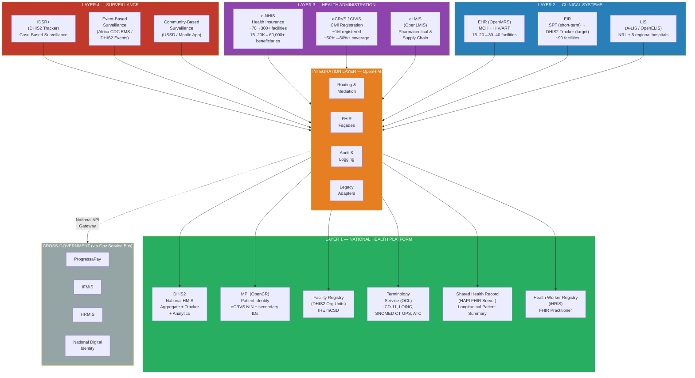
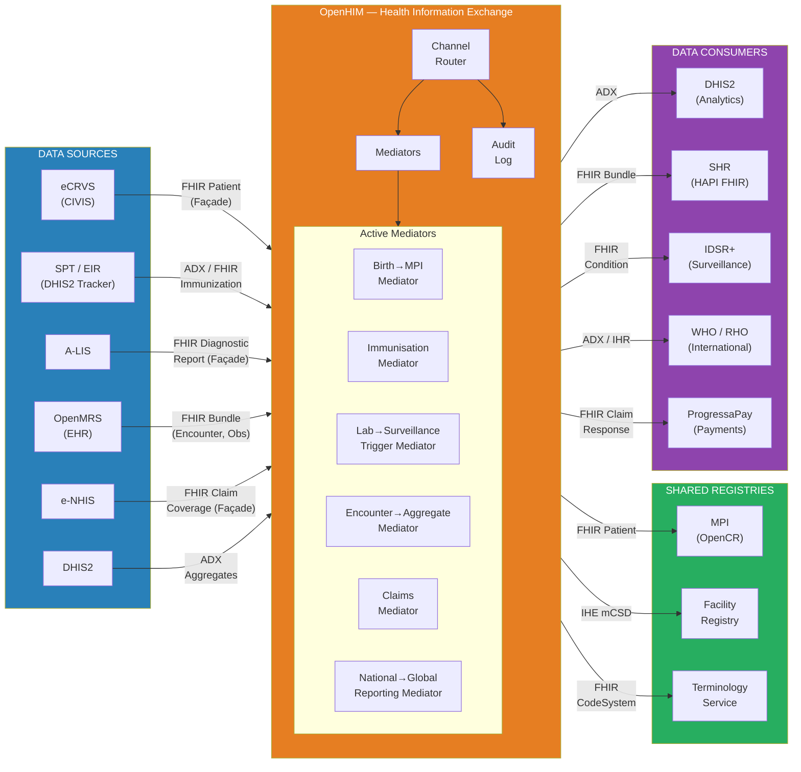
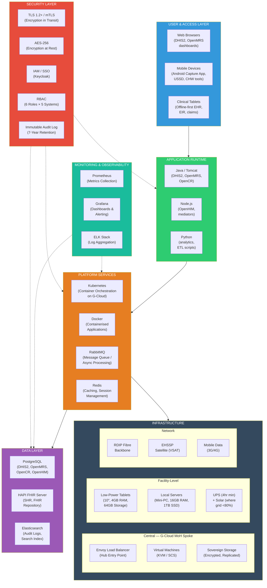

# 8. Enterprise Architecture Core Diagrams

This section provides architectural diagrams that visually synthesise the target architecture defined across Sections 2–7. Each diagram is presented in Mermaid or ASCII notation for rendering in documentation tools, with accompanying narrative that explains the architectural intent.

---

## 8.1 MoH Target Architecture Overview Diagram

The overview diagram presents the complete MoH target architecture as a single-page layered view, from strategic governance at the top through business, data, application, integration, and technology layers at the base. This diagram serves as the primary orientation reference for stakeholders reviewing the architecture.

```mermaid
graph TB
    subgraph GOV["GOVERNANCE & STRATEGY"]
        NDHSC["National Digital Health<br/>Steering Committee (NDHSC)"]
        DHDD["Digital Health & Data<br/>Directorate (DHDD)"]
        TWG1["TWG: Architecture<br/>& Interoperability"]
        TWG2["TWG: Data Standards<br/>& Governance"]
        TWG3["TWG: Implementation<br/>& Capacity"]
        NDHSC --> DHDD
        DHDD --> TWG1
        DHDD --> TWG2
        DHDD --> TWG3
    end

    subgraph BIZ["BUSINESS ARCHITECTURE"]
        BC1["Health Policy<br/>& Planning"]
        BC2["Health Service<br/>Delivery Oversight"]
        BC3["Public Health<br/>Programme Mgmt"]
        BC4["Health Financing<br/>& Insurance"]
        BC5["Health Information<br/>Mgmt"]
    end

    subgraph DATA["DATA ARCHITECTURE"]
        DG["Data Governance<br/>(Ownership, Stewardship,<br/>Quality Framework)"]
        MR["Master Registries<br/>(MPI, Facility, HW,<br/>Terminology)"]
        DW["Analytics &<br/>Data Warehouse"]
        DP["Data Protection<br/>(Classification,<br/>Consent, Audit)"]
    end

    subgraph APP["APPLICATION ARCHITECTURE"]
        direction LR
        subgraph L4["Layer 4: Surveillance"]
            IDSR["IDSR+<br/>(DHIS2 Tracker)"]
            EBS["Event-Based<br/>Surveillance"]
            CBS["Community-Based<br/>Surveillance"]
        end
        subgraph L3["Layer 3: Health Administration"]
            ENHIS["e-NHIS<br/>(Insurance)"]
            ECRVS["eCRVS/CIVIS<br/>(Civil Reg.)"]
            ELMIS["eLMIS<br/>(Supply Chain)"]
        end
        subgraph L2["Layer 2: Clinical Systems"]
            EHR["EHR<br/>(OpenMRS)"]
            EIR["EIR<br/>(DHIS2 Tracker<br/>/ SPT)"]
            LIS["LIS<br/>(A-LIS /<br/>OpenELIS)"]
        end
        subgraph L1["Layer 1: National Health Platform"]
            DHIS2["DHIS2<br/>(HMIS + Tracker<br/>+ Analytics)"]
            MPI["MPI<br/>(OpenCR)"]
            FR["Facility<br/>Registry"]
            TS["Terminology<br/>Service (OCL)"]
            SHR["Shared Health<br/>Record (HAPI FHIR)"]
        end
    end

    subgraph INT["INTEGRATION ARCHITECTURE"]
        OHIM["OpenHIM — Health Information Exchange"]
        FHIR["FHIR R4 APIs"]
        ADX["ADX Aggregate<br/>Exchange"]
        FAC["FHIR Façade<br/>Adapters"]
        API["API Management<br/>& Governance"]
        OHIM --- FHIR
        OHIM --- ADX
        OHIM --- FAC
        OHIM --- API
    end

    subgraph TECH["TECHNOLOGY ARCHITECTURE"]
        GC["G-Cloud Sovereign<br/>Hosting (MoH Spoke)"]
        NET["Network<br/>(3-Tier:<br/>DC↔DC, DC↔Facility,<br/>Last-Mile)"]
        SEC["Security<br/>(TLS/mTLS, RBAC,<br/>Audit, CSIRT)"]
        FAC2["Facility Hosting<br/>(Offline-First<br/>Tablets & Servers)"]
        DR["Disaster Recovery<br/>(3 Scenarios,<br/>RTO/RPO Targets)"]
    end

    subgraph EXT["EXTERNAL / CROSS-SECTORAL"]
        RDIP["RDIP Infra<br/>(DC, Broadband,<br/>2nd Cable)"]
        GSB["Government<br/>Service Bus"]
        PROPAY["ProgressaPay"]
        IFMIS["IFMIS"]
        NID["National Digital<br/>Identity Platform"]
    end

    GOV --> BIZ
    BIZ --> DATA
    DATA --> APP
    APP --> INT
    INT --> TECH
    TECH -.-> EXT

    style GOV fill:#1a5276,color:#fff
    style BIZ fill:#1f618d,color:#fff
    style DATA fill:#2874a6,color:#fff
    style APP fill:#2e86c1,color:#fff
    style INT fill:#3498db,color:#fff
    style TECH fill:#5dade2,color:#fff
    style EXT fill:#aed6f1,color:#1a5276
```

**Reading the diagram.** The architecture is layered from top to bottom. Governance and strategy at the top provide direction to business capabilities, which in turn define data requirements. The application layer implements business capabilities using systems organised into four functional layers (platform, clinical, administration, surveillance). The integration layer (OpenHIM) mediates all data exchange between applications using FHIR R4, ADX, and FHIR Façade patterns. The technology layer provides hosting, networking, security, and disaster recovery. External and cross-sectoral dependencies (RDIP infrastructure, Government Service Bus, ProgressaPay, IFMIS, National Digital Identity) are shown at the base, connected by dotted lines to indicate dependencies that are outside MoH's direct control.

---

## 8.2 Application Landscape Diagram

The application landscape diagram shows all target health information systems organised by their functional layer, with integration relationships indicated. All inter-system data flows pass through the OpenHIM integration layer — no direct point-to-point connections exist in the target state.

**Key architectural principle.** Every arrow in this diagram passes through the OpenHIM integration layer. This is the "mediated integration" principle established in Design Decision DD-01: no application communicates directly with another application. OpenHIM enforces security policies, transforms data formats (FHIR ↔ ADX ↔ legacy APIs), logs all transactions for audit, and routes requests to the appropriate destination. This eliminates the spaghetti of point-to-point integrations and enables independent evolution of individual applications without breaking the ecosystem.

---

## 8.3 Integration Flow Diagram

The integration flow diagram shows the hub-and-spoke pattern with OpenHIM at the centre, illustrating the six priority integration flows defined in Section 6.2 and the key data exchange standards used for each.

**Six priority integration flows:**

| Flow | Source → Destination | Standard | Phase |
|------|---------------------|----------|-------|
| 1. Birth Registration → MPI → NHIS Enrollment | eCRVS → OpenHIM → OpenCR → e-NHIS | FHIR Patient, RelatedPerson | Phase 1 |
| 2. Immunisation Recording → Aggregate Reporting | SPT/EIR → OpenHIM → DHIS2 + SHR | FHIR Immunization, ADX | Phase 1–2 |
| 3. Laboratory Result → Surveillance Notification | A-LIS → OpenHIM → IDSR+ | FHIR DiagnosticReport, Condition | Phase 2 |
| 4. Clinical Encounter → Aggregate Reporting | OpenMRS → OpenHIM → SHR → DHIS2 | FHIR Bundle (Encounter, Obs) | Phase 2 |
| 5. Insurance Eligibility & Claims | e-NHIS ↔ OpenHIM ↔ EHR ↔ ProgressaPay | FHIR Claim, Coverage, ClaimResponse | Phase 2 |
| 6. National → Global Reporting | DHIS2 → OpenHIM → WHO/RHO/PBoS | ADX, IHR formats | Phase 1–2 |

---

## 8.4 Technology Stack Diagram

The technology stack diagram shows the infrastructure layers from physical facilities at the base through virtualisation, platform services, application runtime, and security at each level.

**Technology stack summary.** The stack is built on an open-source-preferred foundation: PostgreSQL for relational data, Tomcat/Node.js for application runtime, Docker/Kubernetes for containerised deployment, RabbitMQ for message queuing, Prometheus/Grafana for monitoring, and Keycloak for identity and access management. All components run on Ubuntu LTS. The target hosting environment is the G-Cloud sovereign cloud (MoH isolated spoke), with facility-level devices operating offline-first with local storage and background synchronisation. Security is layered: TLS 1.2+/mTLS for transit encryption, AES-256 for data at rest, RBAC across all systems, and immutable audit logging with seven-year retention.

---

# 9. Architecture Decision Records

This section compiles all major design decisions documented across Sections 2–7 into a comprehensive Architecture Decision Record (ADR) table. Each decision is assigned a unique identifier, traced to its originating section, and documented with the options considered, the decision made, the rationale, and the architectural implications.

Architecture Decision Records serve three purposes: they provide an audit trail for why specific choices were made, they enable future architects to understand the reasoning behind the current design without requiring access to the original decision-makers, and they establish a baseline against which proposed changes can be evaluated.

## 9.1 ADR Summary Table

| ADR ID | Decision Area | Section Ref | Options Considered | Decision Made | Rationale | Implications |
|--------|--------------|-------------|-------------------|---------------|-----------|-------------|
| ADR-01 | Health Information Exchange Platform | 2.4 (DD-01) | (a) OpenHIM, (b) Custom middleware, (c) Wait for RDIP Gov Service Bus only | OpenHIM as MoH HIE interoperability layer, designed to connect to national service bus when available | Most widely deployed open-source health interoperability layer in Africa (Tanzania, Rwanda, South Africa). Purpose-built for health data mediation with native FHIR support. Custom middleware exceeds MoH development capacity. Waiting for RDIP defers health integration 2–3 years. | OpenHIM must be deployed as Phase 1 foundational infrastructure. All inter-system communication routes through OpenHIM. Mediator development capacity required in DHDD. |
| ADR-02 | Master Patient Index Strategy | 2.4 (DD-02) | (a) Build new MPI from scratch, (b) Use eCRVS NIN as sole identifier, (c) OpenCR-based MPI federating multiple identifiers around eCRVS NIN | OpenCR-based MPI using eCRVS NIN as foundational identifier, accepting Immigration NIN, facility MRNs, and e-NHIS IDs as secondary identifiers | eCRVS already registered about 1 million people (~50% coverage). OpenCR provides probabilistic and deterministic matching to reconcile fragmented identities. Builds on existing eCRVS investment while accommodating reality of multiple identifier schemes. | MPI deployment is Phase 1 priority alongside HIE. All patient-facing systems must perform MPI lookup. NIN synchronisation with Immigration remains a national-level dependency. |
| ADR-03 | Electronic Health Record Platform | 2.4 (DD-03) | (a) OpenMRS, (b) Bahmni (OpenMRS + OpenELIS + Odoo), (c) GNU Health, (d) Commercial EHR | OpenMRS as core EHR, with Bahmni for hospitals requiring integrated lab and admin functions | Most widely deployed open-source EHR in African public health (Kenya, Uganda, Rwanda, Malawi, Mozambique, Zambia). Proven FHIR module, offline-capable. Bahmni adds lab (OpenELIS) and admin (Odoo). GNU Health has less African evidence. Commercial EHR introduces vendor lock-in. | OpenMRS deployment at 15–20 facilities in Phase 1 (MCH + HIV/ART). Bahmni evaluated for regional hospitals. Requires local implementation partner and FHIR configuration. |
| ADR-04 | EHR Deployment Scope | 2.4 (DD-04) | (a) All ~90 facilities, (b) Vertical-first at 30–40, (c) Pilot at 15–20 high-volume facilities | Vertical-first pilot: MCH + HIV/ART at 15–20 high-volume facilities, expanding to 30–40 in Phase 2 | Evidence from Kenya and Nigeria: vertical-first achieves higher adoption. MoH has ~90% HW readiness but zero EHR experience. Focused training, troubleshooting, and evidence before scaling. | Facility selection criteria: reliable power, connectivity, >50 daily encounters, motivated staff. Success criteria must be met before Phase 2 expansion. |
| ADR-05 | Electronic Immunisation Registry Transition | 2.4 (DD-05) | (a) Replace SPT immediately, (b) Maintain SPT indefinitely, (c) Phased transition SPT → DHIS2 Tracker EIR | Phased transition from SPT to DHIS2 Tracker EIR over 3–5 years | SPT operational at all ~90 facilities with >99% accuracy and 350,000–400,000 children. Immediate replacement risks data quality collapse. DHIS2 Tracker validated in Rwanda (national), Maldives (96% newborn registration in year one). Transition only after Tracker matches SPT performance. | SPT maintained short-term. DHIS2 Tracker EIR piloted at 10–15 facilities with adequate infrastructure. Coexistence period with clear handover criteria. |
| ADR-06 | Disease Surveillance Platform | 2.4 (DD-06) | (a) Standalone electronic surveillance, (b) DHIS2 Tracker for case-based IDSR, (c) Paper IDSR with incremental digitisation | DHIS2 Tracker for case-based IDSR+ surveillance, retaining DHIS2 aggregate for routine indicator-based surveillance | Leverages existing DHIS2 infrastructure. Validated in Tanzania, Rwanda, Ethiopia. Avoids separate platform needing distinct hosting, training, maintenance. WHO VPD surveillance package available. | IDSR paper replaced by electronic case notification starting with 7 priority diseases. Parallel paper IDSR maintained at non-pilot facilities during transition. |
| ADR-07 | Health Insurance Scaling Strategy | 2.4 (DD-07) | (a) Replace e-NHIS, (b) Enhance e-NHIS with mobile enrollment + offline claims + eCRVS integration, (c) Defer until EHR provides clinical claims data | Enhance and scale existing e-NHIS with mobile enrollment (USSD + app), offline claims (Ghana CLAIM-it pattern), eCRVS-NIN integration | e-NHIS operational with >95% satisfaction, ~90% quality scores. Primary barriers are enrollment reach and offline capability, not platform limitations. Ghana CLAIM-it validates offline model. Rwanda's Mutuelle shows community mobile enrollment works. | eCRVS-NHIS integration is Phase 1 priority. Mobile enrollment channels (USSD, app) target ~80% mobile ownership. Offline CLAIM-it module deployed at rural facilities. |
| ADR-08 | Laboratory Information System Strategy | 2.4 (DD-08) | (a) Replace A-LIS with OpenELIS, (b) Strengthen and scale A-LIS, (c) Integrate lab workflows into EHR | Strengthen and scale A-LIS with DHIS2 integration, LOINC coding, FHIR DiagnosticReport interfaces; evaluate OpenELIS as Bahmni component for hospitals | A-LIS at early adoption — replacement discards initial investment. Two integration pathways: A-LIS→DHIS2 (aggregate) and A-LIS→HIE (patient-level via FHIR). LOINC mapping for ~200 priority tests. OpenELIS for Bahmni hospitals. | Deploy at NRL + 5 regional hospitals first. LOINC mapping requires health informatician capacity. Lab→IDSR trigger integration is high-priority for surveillance. |
| ADR-09 | eLMIS Platform | 2.4 (DD-09) | (a) OpenLMIS, (b) DHIS2 Logistics module, (c) Maintain SMS for Health | OpenLMIS as primary eLMIS, integrated with DHIS2 for consumption reporting and HIE for supply chain visibility, replacing SMS for Health | SMS for Health provides only basic stock-level SMS. OpenLMIS purpose-built for pharma supply chains in LMICs (Tanzania, Malawi, Mozambique), already piloted at ~50 facilities under EHSSP/Global Fund. DHIS2 Logistics module lacks dedicated supply chain features. | SMS for Health retired when eLMIS covers equivalent facilities. OpenLMIS→DHIS2 integration for stock-out dashboards. Global Fund co-financing for development. |
| ADR-10 | Health Data Standards Strategy | 2.4 (DD-10) | (a) Minimal (ICD-11 only), (b) Comprehensive all-at-once, (c) Phased: ICD-11 → LOINC → SNOMED CT GPS → ATC | Phased standards adoption: ICD-11 first (mandatory WHO), LOINC for lab coding, SNOMED CT GPS for EHR, ATC for eLMIS — sequentially as systems reach readiness | Simultaneous adoption overwhelms MoH's zero health informatics capacity. ICD-11 non-negotiable for WHO/RHO reporting. SNOMED CT GPS (free ~7,500 concepts) sufficient for initial EHR without full licence. Tanzania/Ethiopia validate phased approach. | ICD-11 and LOINC in Phase 1. SNOMED CT GPS with EHR deployment. ATC with eLMIS deployment. OCL terminology service required as shared infrastructure. |
| ADR-11 | Infrastructure Hosting Model | 2.4 (DD-11) | (a) Public cloud immediately, (b) Maintain fragmented hosting, (c) Sovereign cloud for identifiable data + hybrid for de-identified analytics | Sovereign cloud (G-Cloud) for identifiable health data, hybrid for de-identified analytics, operating via interim ProgTel hosting until RDIP delivery (~2027) | Health data among most sensitive; no data protection law — sovereign hosting as compensating control. G-Cloud target 2027. All systems containerised from outset for non-disruptive migration. | Dual-mode architecture: interim (ProgTel) and target (G-Cloud). Containerised deployments mandatory. 60-day parallel-run for each migration. |
| ADR-12 | Integration Standard | 2.4 (DD-12) | (a) Custom point-to-point APIs, (b) FHIR R4 universally, (c) FHIR R4 for patient-level + ADX for aggregate + FHIR Façade for legacy | FHIR R4 for patient-level exchange, ADX for DHIS2 aggregate flows, FHIR Façade adapters for legacy systems (eCRVS, e-NHIS, A-LIS) | Mandating FHIR universally impractical — most existing systems lack FHIR support. Three-tier approach: FHIR R4 for new/patient-level, ADX for DHIS2 aggregate (purpose-built, natively supported), FHIR Façade for legacy. Validated in Tanzania and South Africa OpenHIM deployments. | All new systems must expose FHIR R4 APIs. FHIR Façade development for 5 legacy systems. ADX maintained for aggregate DHIS2 flows. OpenHIM mediators handle all transformation. |
| ADR-13 | Digital Health Governance Model | 3.1.1 | (a) Ad-hoc coordination, (b) Ministry-level steering committee, (c) National-level inter-ministerial body | NDHSC (14 members, chaired by PS MoH) with DHDD as operational unit and 3 Technical Working Groups | Tanzania, Rwanda, Kenya governance models demonstrate effectiveness of Ministry-led digital health coordination. PDGA alignment ensures national EA framework compliance. Ministerial Order establishment avoids legislative delays. | NDHSC operational by mid-2026. DHDD requires 12–15 national staff + 7 regional, phased 2026–2028. Investment decisions >$50K require NDHSC approval. |
| ADR-14 | Data Governance Framework | 4.1 | (a) No formal governance, (b) MoH-internal data governance policy, (c) Wait for national data protection legislation | MoH-internal Health Data Protection Policy (8 core principles) as interim framework, designed to be subsumed into national legislation | No data protection law exists; CRVS Bill pending. Sovereign hosting alone is insufficient — operational data governance (classification, access controls, consent, audit) required immediately. Aligned with REC framework. | 11 data domains with designated owners. Data stewardship at 3 levels. 5-dimension quality framework. 4-tier data classification (Public, Internal, Confidential, Restricted). |
| ADR-15 | Master Patient Index Implementation | 4.2 | (a) Single identifier (eCRVS NIN only), (b) Identifier federation with trust hierarchy, (c) National identity platform dependency | OpenCR with 6 identifier types in trust hierarchy: eCRVS NIN (rank 1) → Immigration NIN (rank 2) → e-NHIS ID → Facility MRN → EIR ID → Temporary | eCRVS at ~50% means ~50% of population lacks NIN. Must handle patients without NIN through probabilistic matching. Trust hierarchy ensures best available identifier used. 3-phase deployment 2026–2030. | Phase 1: eCRVS + e-NHIS linkage. Phase 2: EHR + EIR linkage. Phase 3: Full federation with national identity platform. <5% unresolved duplicate target. |
| ADR-16 | FHIR Canonical Data Model | 4.3 | (a) Minimal resource profiles, (b) Comprehensive FHIR profiles for all domains, (c) Priority 14 resource profiles covering core use cases | 14 priority FHIR R4 resource profiles: Patient, Encounter, Observation, Condition, Immunization, DiagnosticReport, MedicationRequest, Claim, Coverage, Location, Organization, Practitioner, Bundle, Provenance | 14 resources cover all 6 priority integration flows. Comprehensive profiling exceeds current capacity. Each profile has specific MoH extensions (NIN slice on Patient.identifier, facility type on Location). | Profiles maintained by Architecture & Interoperability TWG. New systems must conform. Profiles versioned with 6-month deprecation policy. |
| ADR-17 | Offline-First Architecture Pattern | 7.2.3 | (a) Online-first with offline fallback, (b) Offline-first as foundational design requirement, (c) Separate online and offline system versions | Offline-first as foundational design requirement for all facility-level systems | ~60% electricity access, single submarine cable, variable satellite. Online-first fails at point of care. Offline-first means local storage, full clinical workflow without connectivity, background sync on reconnection. | All EHR, EIR, claims, and LIS instances must have local data. Conflict resolution protocols mandatory. Device specs include UPS (4hr) and solar. |
| ADR-18 | Security Architecture Pattern | 7.4 | (a) Perimeter security only, (b) Layered security with encryption + RBAC + audit + incident response, (c) Zero-trust architecture | Layered security: TLS 1.2+/mTLS for transit, AES-256 for rest, RBAC framework (6 roles × 5 systems), immutable audit logging (7-year retention), 3-tier incident response aligned with National Cybersecurity Policy | Zero-trust exceeds current maturity and capacity. Layered approach addresses realistic threats while building toward stronger security posture. 7-year audit retention aligns with health record retention requirements. | Annual penetration testing required. Patching SLAs: critical ≤72hr, high ≤7 days. CSIRT team within DHDD. Vulnerability management programme. |
| ADR-19 | Service-Oriented Architecture Approach | 7.6 | (a) Full microservices, (b) Monoliths stay monolithic + OpenHIM as service bus, (c) Hybrid with selective decomposition | Pragmatic SOA: monoliths stay monolithic, OpenHIM as service bus, containerisation for central services only, lightweight service discovery | Full microservices dramatically increases operational complexity beyond MoH capacity. Existing systems (DHIS2, OpenMRS) are mature monoliths; decomposing them adds risk without proportional benefit. OpenHIM already provides service mediation. | No system re-architecture required. Containerisation for central deployment only. API catalogue in OpenAPI 3.0. DNS-based service discovery (no Consul/Istio). |
| ADR-20 | Network Connectivity Strategy | 7.2.2 | (a) Terrestrial broadband only, (b) 3-tier architecture (DC↔DC, DC↔facility, last-mile), (c) Mobile-only | 3-tier network: fibre backbone for central, RDIP broadband + EHSSP satellite for facilities, mobile data for community/last-mile | Each tier serves different latency, bandwidth, and reliability requirements. Satellite provides interim bridge. Mobile (~80% ownership) enables community tools. Progressive enhancement as RDIP broadband reaches facilities. | Bandwidth planning for 7 applications. Facility tiering based on connectivity (Tier 1: broadband, Tier 2: RDIP pending, Tier 3: satellite/mobile). |
| ADR-21 | Disaster Recovery Strategy | 7.3 | (a) No DR (accept risk), (b) Single backup site, (c) 3 scenarios with differentiated RTO/RPO | 3 DR scenarios: Facility failure (RTO 4hr / RPO 24hr), Central system failure (RTO 8hr / RPO 1hr), National infrastructure failure (RTO 48hr / RPO 24hr) | Differentiated scenarios reflect different risk profiles and recovery capabilities. Facility recovery fastest (offline-first means local data preserved). Central recovery via containerised redeployment. National catastrophe triggers offline-only mode. | Automated daily backups for all central systems. Weekly backup verification. DR testing annually. Offline-first design is inherently the DR strategy for facilities. |

---

# Appendices

## Appendix A: Mapping to GEATDM PDU Reference Architecture

This appendix maps the capabilities defined in the GEATDM PDU Reference Architecture (PDU-RA-Complete-v1.0) to the MoH target architecture, showing how generic cross-government capabilities are instantiated in the health sector context.

| PDU RA Capability | PDU RA Description | MoH Target Implementation | System(s) | Status |
|---|---|---|---|---|
| Policy Development and Management | Create, review, and manage sector policies | Health policy repository, evidence dashboards from DHIS2 analytics for policy development | Government DMS + DHIS2 analytics | Phase 2 (2027–2029) |
| Legislative and Regulatory Management | Track legislation, regulations, compliance | Health legislation tracking, regulatory standards dissemination | Government DMS | Phase 2 (2028–2030) |
| Strategic Planning | Develop and monitor strategic plans | National Health Sector Strategic Plan monitoring via cross-system analytics dashboards | DHIS2 enhanced analytics + HIE data | Phase 2 (2028–2030) |
| Stakeholder Communication | Manage relationships with external stakeholders | Donor coordination portal, standardised partner reporting from DHIS2 metrics | Lightweight project tool + DHIS2 | Phase 2 (2027–2029) |
| Performance Monitoring | Track organisational and programme performance | Real-time health performance dashboards from multiple systems via HIE | DHIS2 + HIE cross-system dashboards | Phase 1–2 (2027–2030) |
| Financial Management | Budget execution, expenditure tracking, reporting | IFMIS integration for health budget monitoring; e-NHIS claims financial reporting | IFMIS (via Gov Service Bus) + e-NHIS | Phase 1 (IFMIS existing) |
| Human Resource Management | Workforce management, payroll, deployment | Health worker registry (iHRIS) integrated with HRMIS for deployment, credentials, training records | iHRIS + HRMIS (via Gov Service Bus) | Phase 2 |
| Procurement Management | Goods and services procurement processes | Health commodity procurement tracking, integrated with eLMIS for supply chain | eLMIS + Government e-Procurement | Phase 2–3 |
| Document and Records Management | Create, store, retrieve, archive documents | Health policy documents, clinical guidelines, SOPs, training materials | Government DMS | Phase 2 |
| Internal Communications and Collaboration | Staff communication, coordination tools | DHDD-led coordination; existing email and messaging platforms | Government collaboration tools | Ongoing |
| Reporting to Central Government | Statutory and operational reporting to MoF, Cabinet | Automated health indicator reporting from DHIS2 to PBoS; IFMIS reporting | DHIS2 + IFMIS | Phase 1 (ongoing) |

**Assessment.** MoH's target architecture implements all 11 PDU RA capabilities. The primary gap is that Tier 1 capabilities (policy, legislative, document management) remain at lower maturity because the national government DMS and collaboration platforms are not yet deployed. MoH's strongest Tier 1 capability is Performance Monitoring, driven by DHIS2's established role as the national health data platform.

---

## Appendix B: Mapping to eHealth Reference Architecture Layers

This appendix maps the eHealth Reference Architecture's five-layer model to the MoH target implementation, showing how each layer is realised through specific platforms, standards, and governance mechanisms.

| eHealth RA Layer | Description | MoH Target Implementation | Key Platforms | Key Standards |
|---|---|---|---|---|
| **Layer 1: Foundation** | Core infrastructure: hosting, connectivity, identity, security | G-Cloud sovereign hosting (MoH spoke), 3-tier network, Keycloak IAM, layered security (TLS/mTLS, AES-256, RBAC) | G-Cloud (Kubernetes), ProgTel interim, EHSSP satellite, Envoy load balancer | TLS 1.2+, AES-256, OAuth 2.0, SMART on FHIR |
| **Layer 2: Health Data** | Data governance, master data, registries, terminology, analytics | Data governance framework (11 domains, 3-level stewardship), MPI, facility registry, health worker registry, terminology service, data warehouse | OpenCR (MPI), DHIS2 Org Units (facilities), iHRIS (HW), OCL (terminology), DHIS2 analytics | FHIR R4 Patient, IHE PIXm/PDQm, IHE mCSD, ICD-11, LOINC, SNOMED CT GPS, ATC |
| **Layer 3: Health Information Exchange** | Integration platform, API management, mediation, audit | OpenHIM as HIE core with mediation, routing, audit logging; API management with lifecycle governance; FHIR Façade for legacy systems | OpenHIM, FHIR Façade mediators, API catalogue (OpenAPI 3.0), RabbitMQ (async) | FHIR R4, ADX, IHE profiles, REST, OAuth 2.0, mTLS |
| **Layer 4: Health Applications** | Clinical, administrative, surveillance, and programme applications | 4-layer application portfolio: National Platform (DHIS2, MPI, SHR), Clinical (EHR, EIR, LIS), Administration (e-NHIS, eCRVS, eLMIS), Surveillance (IDSR+, EBS, CBS) | DHIS2, OpenMRS, A-LIS/OpenELIS, e-NHIS, eCRVS/CIVIS, OpenLMIS, DHIS2 Tracker | FHIR R4 resource profiles, offline-first design, open-source preference |
| **Layer 5: Presentation and Access** | User interfaces, dashboards, mobile access, reporting | DHIS2 dashboards and scorecards (web), DHIS2 Android Capture App (mobile), OpenMRS clinical interface (web + offline), USSD channels for insurance and CHW tools, automated international reporting | DHIS2 web/Android, OpenMRS UI, USSD gateway, ADX export mediator | Responsive web, Android offline-first, USSD, ADX for WHO/RHO/PBoS |

**Assessment.** The MoH target architecture fully addresses all five eHealth RA layers. The most mature layer is Layer 4 (Health Applications), building on existing DHIS2 and eCRVS investments. The most critical gap is Layer 3 (Health Information Exchange), which does not exist in the current state and represents the foundational investment for the target architecture.

---

## Appendix C: System-by-System Modernisation Decision Table

This appendix expands the application modernisation strategy from Section 5.6, providing a comprehensive view of every system's disposition, timeline, dependencies, risks, and success criteria.

| System | Current State Summary | Disposition | Target State | Timeline | Key Dependencies | Primary Risk | Success Criteria |
|---|---|---|---|---|---|---|---|
| **DHIS2 (Aggregate)** | Operational since 2010; all ~90 facilities; ~70–80% completeness | RETAIN + INVEST | ≥95% completeness/timeliness; WHO packages; GIS; enhanced analytics | Ongoing strengthening Phase 1–3 | DHDD staffing; HISP regional node support | Loss of key DHIS2 specialists | ≥95% completeness by 2028; cross-system dashboards operational |
| **DHIS2 Tracker (EIR)** | COVID-19 vaccine tracking only | NEW (pilot → scale) | National EIR per WHO DAK; progressive SPT replacement | Phase 1 pilot (2026–2027), Phase 2 expand | MPI linkage; facility connectivity; SPT data migration | Tracker performance at scale; health worker adoption | ≥95% data completeness at pilot sites; match SPT accuracy before SPT retirement |
| **DHIS2 Tracker (IDSR+)** | Not deployed; ~90% paper IDSR | NEW (replace paper IDSR) | Electronic case-based surveillance for 7→all notifiable diseases | Phase 1 pilot (2026–2027), Phase 2 national | Facility connectivity; IDSR focal person training | Resistance to workflow change; connectivity gaps | Case notification <24hr from detection; auto-generated weekly aggregate matches manual |
| **DHIS2 Tracker (RMNCH)** | Not deployed | NEW | ANC, delivery, PNC, child growth tracking | Phase 2 (2028–2029) | EHR co-deployment; MPI linkage | Complexity of RMNCH workflows in Tracker | Continuity of care across ANC visits demonstrable |
| **HIE (OpenHIM)** | Does not exist | NEW (foundational) | Integration backbone for all health data exchange | Phase 1 (2026–2027) | G-Cloud/interim hosting; integration developer in DHDD | Mediator development capacity; vendor cooperation for Façades | ≥3 integration flows operational within 18 months |
| **MPI (OpenCR)** | Does not exist | NEW (foundational) | Unified patient identity; identifier federation | Phase 1 (2026–2027) | eCRVS data feed; NIN availability | eCRVS NIN coverage (currently ~50%); duplicate resolution | <5% unresolved duplicates; all new births linked within 48hr |
| **EHR (OpenMRS)** | Does not exist; ~90% paper registers | NEW (pilot → scale) | MCH + HIV/ART at 15–20 facilities → 30–40 | Phase 1 (2027–2028), Phase 2 (2029–2030) | Facility infrastructure; power; connectivity; training capacity | Health worker adoption; offline sync reliability; support capacity | >80% clinical encounters digitised at pilot sites within 12 months |
| **SPT (Vaxa)** | Operational; all ~90 facilities; >99% accuracy; 350,000–400,000 children | RETAIN → MIGRATE | Maintained until DHIS2 Tracker EIR proven equivalent | Maintain Phase 1–2; retire Phase 3 (2030+) | DHIS2 Tracker EIR readiness; health worker retraining | Premature retirement before Tracker ready; data migration loss | SPT decommissioned only when Tracker achieves ≥99% accuracy at equivalent facilities |
| **e-NHIS** | Operational; about 70 facilities; 15,000–20,000 beneficiaries; >95% satisfaction | RETAIN + INVEST | 60,000+ beneficiaries; mobile enrollment; offline claims; FHIR claims | Phase 1 (integration), Phase 2 (scaling) | eCRVS integration; MPI; ProgressaPay; offline CLAIM-it development | Enrollment scaling in rural areas; claims backlog during offline transition | ≥60,000 beneficiaries by 2028; eCRVS-linked enrollment operational |
| **eCRVS / CIVIS** | Operational, launched recently; ~1M registered; ~50% coverage | RETAIN + INVEST (integration focus) | 80%+ coverage; 3 HIE flows (MPI, e-NHIS, EIR) | Phase 1 (integration) | eCRVS vendor cooperation; FHIR Façade development | Vendor API availability; NIN format changes; integration delays | Birth→MPI→e-NHIS flow operational within Phase 1; >80% birth registration |
| **A-LIS** | Early pilot; limited adoption | INVEST | NRL + 5 regional hospitals; LOINC; DHIS2/IDSR/EHR integration | Phase 1 (core labs), Phase 2 (integration) | Laboratory directorate buy-in; LOINC mapping capacity | Low adoption persistence; competing manual workflows | ≥80% test results coded LOINC at NRL; lab→IDSR trigger operational |
| **eLMIS (OpenLMIS)** | SMS for Health (limited); ~50 facility pilot | REPLACE SMS for Health | Full facility coverage; stock, consumption, reorder | Phase 2 (2028–2029) | EHSSP/Global Fund funding; facility connectivity | Supply chain process change resistance; training burden | SMS for Health retired; stock-out dashboard in DHIS2 from eLMIS data |
| **Facility Registry** | DHIS2 Org Units (partial) | INVEST | Canonical registry via IHE mCSD FHIR interface | Phase 1 | DHIS2 metadata cleanup; GIS data completion | Incomplete facility metadata | All ~90+ facilities with complete metadata and GIS coordinates |
| **Terminology Service (OCL)** | Does not exist | NEW | ICD-11, LOINC, SNOMED CT GPS, ATC | Phase 1 (ICD-11, LOINC) → Phase 2 (expanded) | Health informatician capacity; OCL deployment | Terminology mapping quality; maintenance capacity | ICD-11 and LOINC available via OCL API within Phase 1 |
| **SHR (HAPI FHIR)** | Does not exist | NEW | Longitudinal patient summary from all clinical sources | Phase 2 (initial) → Phase 3 | EHR and EIR producing FHIR data; MPI linkage | Data volume management; query performance | Patient summary retrievable across EHR + EIR encounters |
| **NMRI EMRS** | Operational since 2015; NMRI facilities | RETAIN | No change; autonomous research operation | No change | None (NMRI-managed) | None significant | Optional HIE integration if NMRI initiates |
| **SMS for Health** | Operational since 2010; 50 clinics + stores | RETIRE | Functions absorbed by eLMIS | Phase 2 (when eLMIS covers equivalent facilities) | eLMIS readiness at equivalent coverage | Gap period between SMS for Health retirement and eLMIS operational | No gap in stock visibility during transition |
| **EBS** | Does not exist | NEW | Signal detection from media, community, facilities | Phase 2 (2027–2029) | Core IDSR+ Tracker operational | Trained surveillance officers; signal noise ratio | Verified events escalated into IDSR+ within 24hr |
| **CBS (Community)** | Informal verbal only | NEW | USSD/smartphone CHW reporting linked to IDSR+ | Phase 3 (2029–2033) | IDSR+ and EBS operational; CHW training | CHW digital literacy; mobile coverage in remote areas | CHW signals verified and linked to case investigation |

---

## Appendix D: Standards and Specifications Reference List

This appendix compiles all standards, specifications, profiles, and frameworks referenced in this architecture document.

### D.1 Health Data Exchange Standards

| Standard | Full Name | Version | Use in MoH Architecture | Section Reference |
|---|---|---|---|---|
| HL7 FHIR | Fast Healthcare Interoperability Resources | R4 (v4.0.1) | Target integration standard for patient-level data exchange through HIE | 2.4 (DD-12), 6.3 |
| ADX | Aggregate Data Exchange | 1.0 | DHIS2 aggregate data flows between facilities and national, and national-to-international | 2.4 (DD-12), 6.3 |
| IHE PIXm | Patient Identifier Cross-referencing for Mobile | IHE ITI-83, ITI-84 | MPI patient identity cross-referencing via OpenCR | 4.2, 6.3 |
| IHE PDQm | Patient Demographics Query for Mobile | IHE ITI-78 | Patient demographic lookup via MPI | 4.2, 6.3 |
| IHE mCSD | Mobile Care Services Discovery | IHE ITI-90, ITI-91 | Facility registry FHIR interface (DHIS2 Org Units) | 4.2, 6.3 |
| IHE XDS / MHD | Cross-Enterprise Document Sharing / Mobile access to Health Documents | IHE ITI | Future: document sharing for clinical summaries via SHR | 6.3 (Phase 3) |
| SMART on FHIR | Substitutable Medical Applications, Reusable Technologies | v2.0 | OAuth 2.0 scopes for FHIR API authorisation | 6.4 |

### D.2 Clinical and Health Data Classifications

| Standard | Full Name | Version / Edition | Use in MoH Architecture | Section Reference |
|---|---|---|---|---|
| ICD-11 | International Classification of Diseases | 11th Revision (2022) | Mandatory morbidity and mortality classification for WHO/RHO reporting; facility-level diagnosis coding | 2.4 (DD-10), 4.3 |
| LOINC | Logical Observation Identifiers Names and Codes | Current (updated biannually) | Laboratory test coding for ~200 priority tests; standardised observation naming | 2.4 (DD-10), 4.3, 5.3.3 |
| SNOMED CT GPS | Systematized Nomenclature of Medicine — Clinical Terms, Global Patient Set | GPS Release (~7,500 concepts) | Clinical terminology in EHR; free subset for LMICs | 2.4 (DD-10), 4.3 |
| ATC | Anatomical Therapeutic Chemical Classification | WHO Collaborating Centre | Pharmaceutical classification in eLMIS | 2.4 (DD-10), 4.3, 5.4.3 |
| ICD-10-PCS | International Classification of Diseases, Procedure Coding System | 10th Revision | Future: procedure coding for claims (e-NHIS) | 5.4.1 |

### D.3 Architecture Frameworks and Methodologies

| Framework | Full Name | Use in MoH Architecture | Section Reference |
|---|---|---|---|
| TOGAF | The Open Group Architecture Framework | v9.2 | Base methodology adapted by GEATDM; ADM phases inform ADAPT phase | 1.4 |
| GEATDM | Generic EA Target Architecture Development Method | v1.0 | National EA methodology; ADAPT phase used for D6 development | 1.4, 1.5 |
| PAERA | Public Administration Ecosystem Reference Architecture | v1.0 | Organisational classification (PDU/RA/SDA); PDU Reference Architecture as Tier 1 base | 1.5, App. A |
| GovStack | GovStack Building Blocks | Current | Modular reusable technology components; informed integration patterns | 1.4 |
| OpenHIE | Open Health Information Exchange | v3.0 | Reference architecture for health interoperability; framework for HIE design | 2.4 (DD-01), 6.1 |
| WHO Digital Health | WHO Digital Health Architecture Guidelines | Current | Informed eHealth Reference Architecture layers | 1.5, App. B |

### D.4 FHIR Resource Profiles (MoH Target)

| FHIR Resource | Profile Name (Proposed) | Use Case | Source/Consuming Systems |
|---|---|---|---|
| Patient | PG-MoH-Patient | Unified patient identity with NIN slice on identifier | OpenCR (MPI) → all systems |
| Encounter | PG-MoH-Encounter | Clinical encounters at EHR facilities | OpenMRS → SHR → DHIS2 |
| Observation | PG-MoH-Observation | Vital signs, clinical measurements, lab observations | OpenMRS, A-LIS → SHR, DHIS2 |
| Condition | PG-MoH-Condition | Diagnoses (ICD-11 coded) | OpenMRS → SHR, IDSR+ |
| Immunization | PG-MoH-Immunization | Vaccine administration records | DHIS2 Tracker EIR → SHR, DHIS2 aggregate |
| DiagnosticReport | PG-MoH-DiagnosticReport | Laboratory results (LOINC coded) | A-LIS → EHR, IDSR+, SHR |
| MedicationRequest | PG-MoH-MedicationRequest | Prescriptions (ATC coded) | OpenMRS → eLMIS, e-NHIS |
| Claim | PG-MoH-Claim | Insurance claims | e-NHIS ↔ EHR ↔ ProgressaPay |
| Coverage | PG-MoH-Coverage | Insurance enrollment / eligibility | e-NHIS → EHR |
| Location | PG-MoH-Location | Facility information with GIS | DHIS2 Org Units → all systems |
| Organization | PG-MoH-Organization | Organisational entities | DHIS2 → all systems |
| Practitioner | PG-MoH-Practitioner | Health worker identity and credentials | iHRIS → EHR, HIE |
| Bundle | (standard) | Transaction bundles for multi-resource exchange | All integration flows |
| Provenance | (standard) | Data lineage and audit trail | All integration flows |

### D.5 Security and Infrastructure Standards

| Standard | Use in MoH Architecture | Section Reference |
|---|---|---|
| TLS 1.2+ | Minimum transport encryption for all inter-system communication | 7.4 |
| mTLS (Mutual TLS) | Service-to-service authentication within HIE | 6.4, 7.4 |
| AES-256 | Encryption at rest for all health databases | 7.4 |
| OAuth 2.0 | API authorisation framework | 6.4 |
| OpenAPI 3.0 | API specification and documentation format for API catalogue | 6.4, 7.6 |
| Kubernetes | Container orchestration for G-Cloud deployment | 7.1.2 |
| Docker | Application containerisation | 7.1.5, 7.5 |
| Ubuntu LTS | Target server operating system | 7.5 |
| PostgreSQL | Primary relational database | 7.5 |

---

## Appendix E: Glossary

This glossary defines all acronyms and technical terms used in this document.

| Term | Definition |
|---|---|
| A-LIS | Africa Laboratory Information System — a laboratory information system deployed at early pilot stage in Progressa for specimen tracking, result recording, and laboratory quality assurance |
| Submarine Cable | Progressa's sole submarine cable for international internet connectivity, currently at mid-life |
| ADM | Architecture Development Method — the iterative process defined by TOGAF for developing and managing enterprise architectures |
| ADAPT Phase | The GEATDM phase equivalent to TOGAF ADM Phases B–D, taking a reference architecture as starting point and tailoring it to a specific organisation |
| ADR | Architecture Decision Record — a structured document capturing the context, options, decision, and consequences of an architectural choice |
| ADX | Aggregate Data Exchange — a standard for exchanging aggregate health data, natively supported by DHIS2 for routine health reporting |
| AES-256 | Advanced Encryption Standard with 256-bit key — industry-standard symmetric encryption algorithm used for data at rest |
| API | Application Programming Interface — a set of protocols and tools for building software interactions between systems |
| ART | Antiretroviral Therapy — treatment for HIV infection using a combination of medications |
| ATC | Anatomical Therapeutic Chemical Classification System — WHO standard for classifying pharmaceutical substances |
| BDAT+I | Business, Data, Application, Technology + Integration — the five architecture domains used in GEATDM |
| CBS | Community-Based Surveillance — detection and reporting of health threats by community health workers using mobile tools |
| CHW | Community Health Worker — a lay health worker providing basic health services at community level |
| CLAIM-it | Claims-processing Interface Technology — Ghana's offline-capable insurance claims system, used as a reference model for e-NHIS offline claims |
| COFOG | Classification of the Functions of Government — UN standard classification of government expenditure by function |
| CRVS | Civil Registration and Vital Statistics — the system for recording vital events (births, deaths, marriages) |
| CSIRT | Computer Security Incident Response Team — a team responsible for responding to cybersecurity incidents |
| DfTA | Digital Transformation for Africa — the World Bank programme under which RDIP is funded |
| DHDD | Digital Health and Data Directorate — the proposed MoH organisational unit for managing all digital health systems |
| DHIS2 | District Health Information Software, Version 2 — an open-source health management information system platform used globally; Progressa's national HMIS since 2010 |
| DMP | National digital master plan (ten-year) — Progressa's national digital transformation strategy |
| DNS | Domain Name System — the internet's system for translating domain names to IP addresses |
| Docker | A platform for developing, shipping, and running applications in containers |
| DR | Disaster Recovery — strategies and procedures for recovering IT systems and data after a disruption |
| EA | Enterprise Architecture — a discipline for managing and aligning an organisation's IT assets with its business strategy |
| EBS | Event-Based Surveillance — detection of health threats from non-routine sources (media, rumours, informal reports) |
| eCRVS | Electronic Civil Registration and Vital Statistics — Progressa's digital birth and death registration system based on the CIVIS platform |
| REC | Regional Economic Community — regional economic union of member states |
| EHR | Electronic Health Record — a longitudinal digital record of a patient's health information from multiple clinical encounters |
| EIR | Electronic Immunisation Registry — a digital system for tracking individual immunisation records |
| eLMIS | Electronic Logistics Management Information System — a digital system for managing health commodity supply chains |
| EMR | Electronic Medical Record — a digital version of a patient's chart at a single facility (narrower than EHR) |
| e-NHIS | Electronic National Health Insurance System — Progressa's digital health insurance platform |
| Envoy | A high-performance edge/middle/service proxy used as the G-Cloud hub load balancer |
| EPI | Expanded Programme on Immunisation — the national immunisation programme |
| FHIR | Fast Healthcare Interoperability Resources — HL7's standard for exchanging healthcare information electronically |
| FHIR Façade | A middleware adapter that exposes FHIR-compliant endpoints while translating to a legacy system's native data format |
| G-Cloud | Government Cloud — Progressa's planned sovereign cloud platform under RDIP, using a hub-and-spoke architecture |
| ProgressaPay | The Government of Progressa's central payment gateway managed by the Accountant General's Department |
| GAVI | The Vaccine Alliance — a global partnership funding immunisation programmes in low-income countries |
| PBoS | Progressa Bureau of Statistics — the national statistical office |
| GEATDM | Generic EA Target Architecture Development Method — the national EA methodology established under D2 |
| EHSSP | Essential Health Services Strengthening Project — World Bank IDA-funded project (about USD 100–150 million) supporting health sector strengthening |
| PDGA | Progressa Digital Government Authority — the national ICT regulatory and governance authority |
| GIS | Geographic Information System — technology for analysing and visualising spatial data |
| GNU Health | An open-source health and hospital information system |
| Golden Record | The MPI's authoritative, deduplicated record for a single patient, linking all known identifiers |
| GovStack | An international initiative providing reusable, interoperable digital building blocks for government services |
| HAPI FHIR | An open-source FHIR server implementation in Java, used for the Shared Health Record |
| CIVIS | The eCRVS platform vendor/product name used in Progressa |
| HIE | Health Information Exchange — the infrastructure and governance for sharing health information between systems |
| HISP regional node | Health Information Systems Programme for the region — a regional DHIS2 support network |
| HL7 | Health Level Seven International — the global authority on health information interoperability standards |
| HMIS | Health Management Information System — the system for collecting, processing, and reporting health data |
| HP-01 to HP-10 | Health Architecture Principles — the ten governing principles for MoH architecture design decisions |
| HRMIS | Human Resource Management Information System — government-wide human resource management platform |
| ICD-11 | International Classification of Diseases, 11th Revision — WHO standard for coding diseases and health conditions |
| IDSR | Integrated Disease Surveillance and Response — the WHO/AFRO framework for disease surveillance in Africa |
| IDSR+ | The enhanced electronic case-based version of IDSR implemented through DHIS2 Tracker in this architecture |
| IFMIS | Integrated Financial Management Information System — the government-wide financial management platform |
| IHE | Integrating the Healthcare Enterprise — an initiative improving health information sharing through controlled standards adoption |
| IHR | International Health Regulations — WHO binding instrument for preventing international disease spread |
| iHRIS | Integrated Human Resource Information System — an open-source health workforce information platform |
| ITU | International Telecommunication Union — the United Nations specialised agency for ICT |
| Keycloak | An open-source identity and access management solution for modern applications |
| Kubernetes | An open-source container orchestration platform for automating deployment and scaling of containerised applications |
| LOINC | Logical Observation Identifiers Names and Codes — international standard for laboratory and clinical observations |
| LIS | Laboratory Information System — a system for managing laboratory operations and test results |
| LTS | Long-Term Support — a software release designation indicating extended maintenance and security updates |
| mCSD | Mobile Care Services Discovery — IHE profile for querying health facility and organisation directories |
| MCH | Maternal and Child Health — health services focused on mothers and children |
| MoDE | Ministry of Digital Economy — Progressa's ministry responsible for ICT policy |
| MoF | Ministry of Finance — Progressa's finance ministry |
| MoH | Ministry of Health — Progressa's health ministry |
| MPI | Master Patient Index — a centralised system for maintaining a unified patient identity across multiple health systems |
| NMRI | National Medical Research Institute — a research institution operating clinical facilities in Progressa |
| MRN | Medical Record Number — a facility-level patient identifier |
| mTLS | Mutual Transport Layer Security — TLS with bidirectional certificate authentication between client and server |
| NDHSC | National Digital Health Steering Committee — the proposed apex governance body for digital health in Progressa |
| NHIA | National Health Insurance Authority — the semi-autonomous agency managing Progressa's health insurance scheme |
| NIN | National Identification Number — the unique identifier assigned through eCRVS or Immigration |
| NRL | National Reference Laboratory — Progressa's primary reference laboratory |
| OCL | Open Concept Lab — an open-source platform for managing health terminology services |
| OpenCR | Open Client Registry — an open-source MPI platform for patient identity management |
| OpenELIS | Open Enterprise Laboratory Information System — an open-source laboratory information system |
| OpenHIE | Open Health Information Exchange — an international community and reference framework for health interoperability in LMICs |
| OpenHIM | Open Health Information Mediator — an open-source health interoperability middleware platform |
| OpenLMIS | Open Logistics Management Information System — an open-source supply chain management platform for health commodities |
| OpenMRS | Open Medical Record System — an open-source electronic health record platform widely deployed in Africa |
| PAERA | Public Administration Ecosystem Reference Architecture — a framework for classifying government entities and their reference architectures |
| PDU | Policy Development Unit — a PAERA classification for government entities focused on policy development |
| PIXm | Patient Identifier Cross-referencing for Mobile — IHE profile for patient identity cross-referencing |
| PDQm | Patient Demographics Query for Mobile — IHE profile for patient demographic searches |
| PostgreSQL | An open-source relational database management system |
| Prometheus | An open-source systems monitoring and alerting toolkit |
| RA | Regulatory Agency — a PAERA classification for government entities focused on regulation |
| RBAC | Role-Based Access Control — a method of regulating access based on user roles |
| REST | Representational State Transfer — an architectural style for web services using standard HTTP methods |
| RMNCH | Reproductive, Maternal, Newborn, and Child Health — an integrated health service delivery framework |
| RPO | Recovery Point Objective — the maximum acceptable data loss measured in time |
| RTO | Recovery Time Objective — the maximum acceptable downtime for a system |
| SCS | Sovereign Cloud Stack — an open-source cloud infrastructure standard aligned with G-Cloud |
| SDA | Service Delivery Authority — a PAERA classification for government entities focused on service delivery |
| SHR | Shared Health Record — a longitudinal patient health summary aggregated from multiple clinical sources |
| SLA | Service Level Agreement — a commitment between a service provider and consumer specifying performance expectations |
| SMART on FHIR | Substitutable Medical Applications, Reusable Technologies on FHIR — a standard for authorising clinical application access to FHIR APIs |
| SMS | Short Message Service — text messaging service on mobile networks |
| SNOMED CT | Systematized Nomenclature of Medicine — Clinical Terms — a comprehensive clinical terminology standard |
| SNOMED CT GPS | SNOMED CT Global Patient Set — a free subset (~7,500 concepts) for use in LMICs |
| SOA | Service-Oriented Architecture — an architectural style where services are provided through a communication protocol |
| SPT | Scanned paper tracking — immunisation tracking system developed by the Vaxa Foundation using paper forms scanned into digital records |
| TLS | Transport Layer Security — a cryptographic protocol for securing network communications |
| TOGAF | The Open Group Architecture Framework — a globally recognised framework for enterprise architecture |
| TWG | Technical Working Group — a thematic expert group supporting the NDHSC |
| UHC | Universal Health Coverage — the goal that all people receive quality health services without financial hardship |
| UPS | Uninterruptible Power Supply — a device providing emergency power during outages |
| USSD | Unstructured Supplementary Service Data — a communication protocol for mobile phones enabling interactive services without internet |
| VSAT | Very Small Aperture Terminal — a satellite communication system for data transmission |
| RHO | Regional Health Organisation — the REC health agency responsible for regional health coordination |
| RDIP | Regional Digital Integration Project — a World Bank-funded regional programme of about USD 300 million for digital infrastructure |
| Civitas Group | The vendor/hosting provider for the eCRVS/CIVIS platform |
| WHO | World Health Organisation — the United Nations specialised agency for international public health |
| WHO CCS | WHO Country Cooperation Strategy — a medium-term strategic framework for WHO's work with a member state |
| WHO DAK | WHO Digital Adaptation Kit — standardised digital health content packages for specific health domains |

---

*This section completes the architectural documentation. Section 9 (Consolidation and Review) will merge all sections into a single document for stakeholder validation.*
