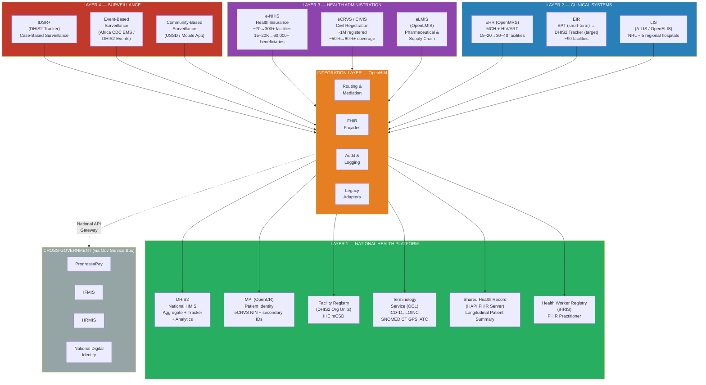
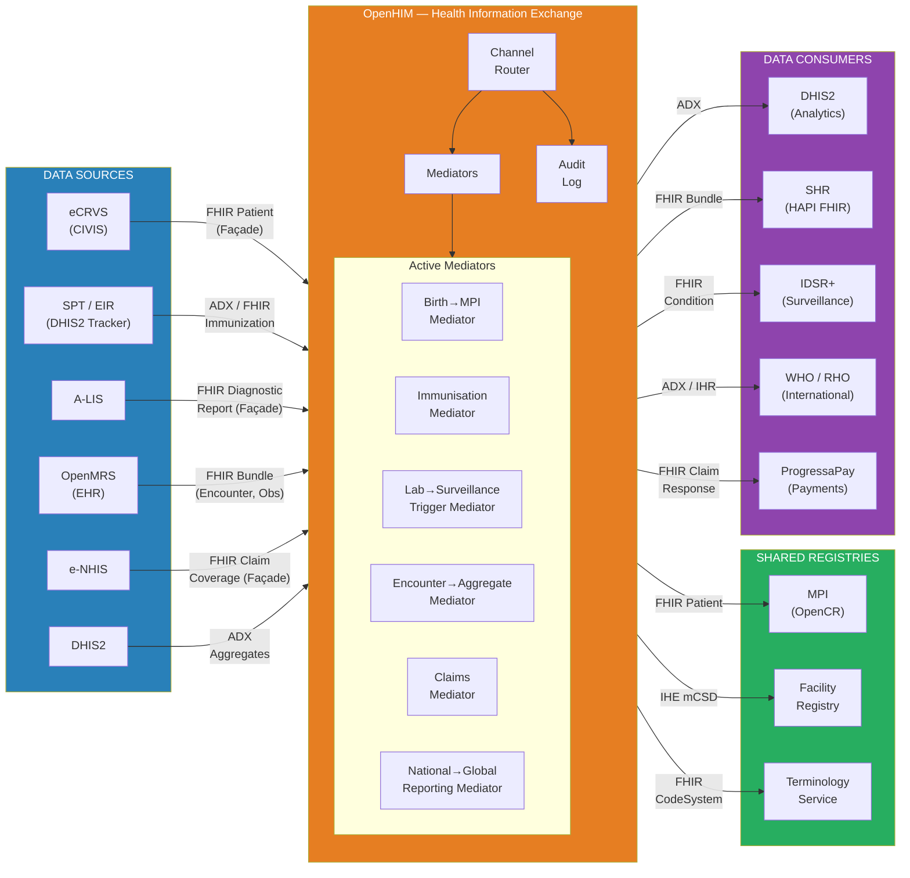
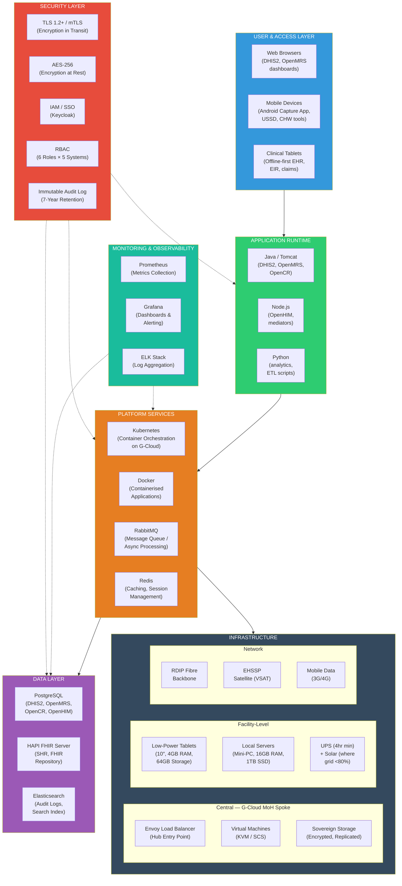

# D6 — Future State "To-Be" Architecture: Ministry of Health, Progressa

## Front Matter

---

### Document Control

| Field | Detail |
|-------|--------|
| **Document Title** | Future State "To-Be" Architecture — Ministry of Health |
| **Deliverable Reference** | D6 (Contract [contract reference]) |
| **Version** | 1.0 — Draft |
| **Date** | February 2026 |
| **Status** | Draft for Stakeholder Review |
| **Prepared For** | Ministry of Digital Economy (MoDE) / PDGA, Progressa |
| **Prepared By** | ITU Lead Architect, Enterprise Architecture Initiative |
| **Contract** | Agreement for Delivery of Outputs — Development of Progressa Enterprise Architecture |
| **Project** | Digital Transformation for Africa / Regional Digital Integration Project (DfTA/RDIP) |
| **Loan/Credit/Grant No.** | [reference] |
| **Financing Agreement Closing Date** | 31/12/2028 |

**Version History**

| Version | Date | Author | Changes |
|---------|------|--------|---------|
| 0.1 | Feb 2026 | ITU EA Team | Initial draft — Sections 1–9 + Appendices |
| 1.0 | Feb 2026 | ITU EA Team | Complete draft for stakeholder validation |

**Document Approval**

| Role | Name | Date | Signature |
|------|------|------|-----------|
| ITU Lead Architect | | | |
| PDGA Director General | | | |
| MoH Permanent Secretary | | | |
| RDIP Project Coordinator | | | |

---

### Executive Summary

This document presents the Future State "To-Be" Enterprise Architecture for the Ministry of Health (MoH) of Progressa, developed as Deliverable D6 under the ITU-PDGA Enterprise Architecture Initiative (Contract [contract reference]). It defines the target digital health architecture for the period 2025–2033, aligned with Progressa's national digital master plan (ten-year) and the national health sector strategic plan.

**Current State Challenge.** Progressa's health sector operates with a fragmented digital landscape. Across ~90 health facilities serving approximately 2–3 million people, at least eight distinct digital health systems function largely as silos: DHIS2 (national HMIS since 2010), eCRVS/CIVIS (about 1 million registrations, ~50% population coverage), e-NHIS (15,000–20,000 beneficiaries against a 60,000 target), scanned paper tracking for immunisation (350,000–400,000 children registered with over 99% data accuracy), A-LIS (early-stage laboratory system), IDSR surveillance (~90% paper-based), the NMRI clinical EMR, and SMS for Health for drug supply tracking. These systems lack a unifying integration layer, a shared patient identifier, or a common data governance framework. The sole operational automated integration flow within MoH is SPT-to-DHIS2 for immunisation data.

**Target State Vision.** By 2033, the Ministry of Health will operate an integrated, interoperable health information ecosystem built on the OpenHIE architecture. A Health Information Exchange (HIE) mediated by OpenHIM will connect all major health systems through standardised FHIR-based interfaces. A Master Patient Index anchored in the eCRVS National Identification Number will provide a unified patient identity across the health sector. Electronic health records based on OpenMRS will serve 30–40 priority facilities, beginning with maternal health and HIV/ART services. Disease surveillance will transition from ~90% paper-based to electronic case-based reporting through DHIS2 Tracker. Health insurance will expand from 15,000–20,000 to at least 60,000 beneficiaries through mobile enrollment and offline claims processing. All systems will follow an offline-first design principle, reflecting the realities of ~60% national electricity access and dependence on a single submarine cable for international connectivity.

**Key Architectural Decisions.** This architecture makes twelve major design decisions, each grounded in evidence from comparable African implementations and calibrated to Progressa's resource constraints. These include the adoption of OpenHIE as the interoperability framework, DHIS2 as the strengthened national health data platform, OpenMRS as the preferred EHR platform, eCRVS NIN as the foundational patient identifier, sovereign cloud hosting for identifiable health data via RDIP's planned G-Cloud infrastructure, FHIR R4 as the target integration standard with FHIR Façade wrappers for existing systems, and a phased transition from SPT to DHIS2 Tracker for the Electronic Immunisation Registry. Every decision reflects a deliberate preference for building on what already works rather than replacing functional systems, for open-source solutions over proprietary alternatives, and for conservative phasing that respects the Ministry's limited ICT staffing and absorption capacity.

**Strategic Alignment.** The architecture draws its mandate from five converging strategic frameworks: the national digital master plan (ten-year), the RDIP/DTFA programme (USD 50 million for digital infrastructure including broadband, cloud, and digital identity), the Essential Health Services Strengthening Project (EHSSP, about USD 100–150 million with significant digital health components), the WHO country cooperation strategy (which designates digital health as a strategic priority), and the national health sector strategic plan. Together, these frameworks create an unprecedented window of aligned funding and political commitment for digital health transformation.

**Dependencies and Realism.** This architecture is designed to function in two modes: a full target state that leverages RDIP's planned national data centre, broadband backbone, and digital identity platform; and an interim architecture that operates with existing infrastructure while RDIP components are delivered between 2024 and 2028. The document identifies specific constraints — ~60% electricity access, a single submarine cable halfway through its operational lifespan, severe ICT staffing shortages, the absence of a data protection law, and near-total donor dependence for digital health funding — and designs around each rather than assuming they will be resolved. Implementation timelines reflect these realities: 18–24 months for a minimal HIE with two to three integration flows, 2–3 years for an EHR pilot at 15–20 facilities, and 5–7 years for meaningful national coverage.

This deliverable is structured across five architecture domains — Business, Data, Application, Integration, and Technology — following the GEATDM ADAPT phase methodology. It is intended to be read alongside D5 (Current "As-Is" Architecture), which provides the baseline, and will be followed by D7 (EA Roadmap), which translates the gap between current and target states into a phased implementation plan.

---

### Abbreviations

| Abbreviation | Full Form |
|-------------|-----------|
| ADM | Architecture Development Method (TOGAF) |
| ADX | Aggregate Data Exchange |
| A-LIS | Africa Laboratory Information System |
| API | Application Programming Interface |
| ARM | Architectural Reference Model |
| ART | Antiretroviral Therapy |
| ATC | Anatomical Therapeutic Chemical Classification |
| BDAT | Business, Data, Application, Technology |
| BDAT+I | Business, Data, Application, Technology + Integration |
| CHW | Community Health Worker |
| COFOG | Classification of the Functions of Government |
| CRVS | Civil Registration and Vital Statistics |
| DfTA | Digital Transformation for Africa |
| DHIS2 | District Health Information Software, Version 2 |
| DMP | National digital master plan (ten-year) |
| EA | Enterprise Architecture |
| eCRVS | Electronic Civil Registration and Vital Statistics |
| EHR | Electronic Health Record |
| EHSSP | Essential Health Services Strengthening Project |
| EIR | Electronic Immunisation Registry |
| eLMIS | Electronic Logistics Management Information System |
| EMR | Electronic Medical Record |
| e-NHIS | Electronic National Health Insurance System |
| EPI | Expanded Programme on Immunisation |
| FHIR | Fast Healthcare Interoperability Resources |
| GEATDM | Generic EA Target Architecture Development Method |
| HIE | Health Information Exchange |
| HL7 | Health Level Seven International |
| HMIS | Health Management Information System |
| HRMIS | Human Resource Management Information System |
| ICD-11 | International Classification of Diseases, 11th Revision |
| IDSR | Integrated Disease Surveillance and Response |
| IFMIS | Integrated Financial Management Information System |
| IHE | Integrating the Healthcare Enterprise |
| IHR | International Health Regulations |
| ITU | International Telecommunication Union |
| LIS | Laboratory Information System |
| LOINC | Logical Observation Identifiers Names and Codes |
| MCH | Maternal and Child Health |
| MoDE | Ministry of Digital Economy |
| MoF | Ministry of Finance |
| MoH | Ministry of Health |
| MPI | Master Patient Index |
| NDHSC | National Digital Health Steering Committee |
| NHIA | National Health Insurance Authority |
| NIN | National Identification Number |
| NMRI | National Medical Research Institute |
| OpenCR | Open Client Registry |
| OpenHIE | Open Health Information Exchange |
| OpenHIM | Open Health Information Mediator |
| OpenMRS | Open Medical Record System |
| PAERA | Public Administration Ecosystem Reference Architecture |
| PDGA | Progressa Digital Government Authority |
| PDU | Policy Development Unit |
| RDIP | Regional Digital Integration Project |
| RHO | Regional Health Organisation |
| RMNCH | Reproductive, Maternal, Newborn, and Child Health |
| SHR | Shared Health Record |
| SNOMED CT | Systematized Nomenclature of Medicine — Clinical Terms |
| SPT | Scanned paper tracking (Vaxa Foundation) |
| TOGAF | The Open Group Architecture Framework |
| UHC | Universal Health Coverage |
| USSD | Unstructured Supplementary Service Data |
| WHO | World Health Organisation |
| WHO CCS | WHO Country Cooperation Strategy |

---

## 1. Introduction

### 1.1 Purpose and Scope

This document defines the target enterprise architecture for the Ministry of Health of Progressa, covering the period 2025 through 2033. It is Deliverable D6 under the Agreement for Delivery of Outputs between the Government of Progressa and the International Telecommunication Union (Contract Reference [contract reference]), funded through the World Bank's Digital Transformation for Africa / Regional Digital Integration Project (Loan/Credit/Grant No. [reference]).

The purpose of D6 is to articulate a coherent, evidence-based vision of what the Ministry of Health's digital systems, data flows, integration patterns, and technology infrastructure should look like by 2033. It addresses the full span of health information systems — from facility-level clinical tools to national reporting platforms — and specifies the architectural patterns, standards, platforms, and governance structures required to move from the current fragmented state to an integrated health information ecosystem.

The scope encompasses five architecture domains as defined in the Generic EA Target Architecture Development Method (GEATDM): Business Architecture (governance, capabilities, processes), Data Architecture (data governance, master data, analytics, privacy), Application Architecture (system portfolio, modernisation decisions, platform strategies), Integration Architecture (interoperability patterns, standards, priority data flows), and Technology Architecture (infrastructure, hosting, connectivity, security). Each domain addresses both the generic cross-sectoral components applicable to all government ministries and the sector-specific extensions unique to MoH's role as the steward of Progressa's health information ecosystem.

The primary audience for this document includes MoH leadership and technical staff responsible for health information systems, MoDE and PDGA as the national EA governance authority, development partners (World Bank, WHO, GAVI, Global Fund) who fund and support digital health initiatives, and implementing partners and vendors who will execute specific components of the architecture. Secondary audiences include the RDIP project coordination unit, MoF for alignment with financial management systems, and regional bodies (REC, RHO) for cross-border health data exchange considerations.

### 1.2 Relationship to Other Deliverables

This document exists within a suite of interdependent deliverables produced under the same contract. Understanding these relationships is essential for contextualising the architectural decisions made herein.

**D2 — National EA Framework** establishes the overarching governance structure, architecture principles, metamodel, and methodology that apply across all government ministries. The principles defined in D2 — including API-first design, cloud-first deployment, standards-based technology, and whole-of-government integration — serve as binding constraints on this sector-specific architecture. Section 2.2 of this document adapts those principles for the health sector context.

**D5 — Current "As-Is" Architecture** provides the comprehensive baseline from which this target architecture departs. Every system referenced in D6, every gap identified, and every modernisation decision made is grounded in the findings documented in D5. The gap between D5 and D6 constitutes the transformation scope that D7 must address. D5 established that MoH's digital health maturity stands at Level 1 (Initial/Ad-hoc) on the integration maturity scale, with ~90% of facilities using paper-based clinical registers, no integration layer, no shared patient identifier, and all major systems operating as independent silos.

**D7 — EA Roadmap** will translate the gap between D5 (current state) and D6 (target state) into a phased, costed, and sequenced implementation plan. D7 depends directly on D6 for its gap analysis, prioritisation framework, and dependency mapping. Architectural decisions in D6 are made with implementation sequencing in mind, but the detailed phasing, cost estimation, and resource planning belong to D7.

**D10 — Integration Strategy** (at the national level) defines the government-wide interoperability platform, API gateway standards, and cross-ministry integration patterns. The health-sector integration architecture in this document (Section 6) is designed to operate through the national integration platform when it becomes available, while functioning independently through an MoH-managed HIE in the interim period.

**D11 — Cloud Strategy** specifies the sovereign cloud architecture (hub-and-spoke model), the national data centre requirements, and the data classification framework. MoH's technology architecture (Section 7) positions health systems as an isolated spoke within the national cloud, with sovereign hosting for all identifiable health data and hybrid cloud options for de-identified analytics.

The D4 (Architectural Reference Model) provides the GEATDM reference architectures — including the PDU Reference Architecture and eHealth Reference Architecture — that serve as the starting point for MoH's target architecture. This document tailors those reference models to Progressa's specific context.

### 1.3 Architecture Validity Period

This architecture covers the period from 2025 to 2033, an eight-year validity window aligned with Progressa's national digital master plan (ten-year). The selection of this timeframe reflects three considerations.

First, health system transformation at the scale envisioned — establishing an HIE, deploying EHRs, transitioning surveillance to electronic case-based reporting, and scaling health insurance from ~30% to full target enrolment — requires sustained investment over multiple funding cycles. The RDIP programme runs through 2028, and its infrastructure outputs (broadband, data centre, cloud platform) will not be fully operational until 2027 at the earliest. Designing an architecture with a shorter validity period would be premature given these dependencies.

Second, the 2033 endpoint aligns with the horizon for realistic health sector digitisation targets. The current service digitisation rate is far below the master plan's target, which cannot credibly be reached in fewer than eight years given the foundational infrastructure gaps, capacity constraints, and the sequential nature of digital health transformation (infrastructure must precede platforms, platforms must precede data exchange, and data exchange must precede analytics).

Third, an eight-year architecture requires a formal review cycle to remain relevant. This architecture mandates a comprehensive review every two to three years, with the following schedule:

- **2027 Review** (Year 2): Assess RDIP infrastructure availability, adjust interim-to-target transition timelines, evaluate initial HIE and MPI deployments, and confirm EHR pilot facility selections.
- **2029 Review** (Year 4–5): Full mid-term evaluation coinciding with anticipated G-Cloud operational maturity. Reassess technology choices, update standards alignment (FHIR version, ICD revisions), and evaluate scaling decisions for EHR and insurance.
- **2031 Review** (Year 6–7): Pre-final evaluation to assess progress toward 2033 targets, identify emerging technologies or standards requiring architecture adaptation, and prepare the next-generation architecture vision for the post-2033 period.

Between scheduled reviews, the Architecture and Interoperability Technical Working Group (proposed in Section 3) has authority to approve minor amendments — such as adding a new system to the approved portfolio or updating an integration specification — without triggering a full architecture revision.

### 1.4 Methodology

This target architecture was developed using the GEATDM ADAPT phase, which is the Progressa-tailored equivalent of TOGAF ADM Phases B through D (Business Architecture, Information Systems Architecture, and Technology Architecture). The ADAPT phase takes a reference architecture as its starting point and systematically tailors it to the specific organisation through a structured process of capability mapping, gap identification, and design decision-making.

The GEATDM methodology was established under D2 (National EA Framework) as an adaptation of TOGAF 9.2 for Progressa's government context. It incorporates elements from the Public Administration Ecosystem Reference Architecture (PAERA), which provides the organisational classification scheme (PDU, RA, SDA), and from the GovStack Building Blocks approach, which provides modular, reusable technology components. The key adaptation for Progressa's context includes simplified governance procedures appropriate for small teams (3–5 ICT staff per ministry), template-driven processes to reduce the need for specialised EA expertise, and phased maturity progression that starts from the current Level 2.19 rather than assuming a mature EA practice.

For this deliverable, the ADAPT phase was executed in four steps:

**Step 1 — Reference Architecture Selection.** MoH was classified as a Policy Development Unit (PDU) with significant sector-specific service delivery oversight under the PAERA taxonomy (see Section 1.5). This classification determined the base reference architecture: the GEATDM PDU Reference Architecture (PDU-RA-Complete-v1.0), extended with the eHealth Reference Architecture developed for this engagement. The PDU RA provides the generic capabilities (document management, financial management, HR, collaboration) while the eHealth RA provides the sector-specific layers (clinical services, public health, health information exchange, health data governance).

**Step 2 — Capability Mapping and Gap Analysis.** Using GEATDM Toolkit instruments TK-14 (Capability Adaptation Worksheet) and TK-15 (Application Mapping Worksheet), each capability in the reference architecture was mapped against MoH's current state as documented in D5. This mapping identified capabilities that are already addressed by existing systems (DHIS2 for aggregate reporting, eCRVS for birth registration, SPT for immunisation tracking), capabilities that exist in rudimentary form (A-LIS for laboratory, IDSR for surveillance), and capabilities that are entirely absent (HIE, MPI, EHR, terminology services, health data governance).

**Step 3 — Design Decision-Making.** For each capability gap, the architecture team evaluated technology options against a decision framework that weighted evidence from comparable African implementations, open-source availability and community support, alignment with national and international standards (WHO, HL7, IHE), offline capability in low-resource settings, total cost of ownership including maintenance and human capacity requirements, and integration feasibility with existing MoH systems. The resulting decisions are documented in the Architecture Decision Records (Section 9) and summarised in Section 2.4.

**Step 4 — Architecture Specification.** The selected platforms, patterns, and standards were specified across all five BDAT+I domains, producing the architecture documented in Sections 3 through 7. Each domain specification follows a consistent structure: current state summary, target state description, key design decisions with rationale, and dependencies on other domains.

The tailoring approach applied throughout this process is guided by the GEATDM Tailoring Decision Log (TK-13), which documents where and why the reference architecture was adapted. Major tailoring decisions include extending the PDU RA with an entire health information exchange layer not present in the base model, adding offline-first as a mandatory architectural quality attribute (reflecting infrastructure realities), and constraining the technology stack to open-source solutions given budget limitations and the need to avoid vendor lock-in in a market with limited local vendor presence.

### 1.5 MoH Classification and Reference Architecture Selection

Under the PAERA organisational taxonomy adopted by the GEATDM, government entities are classified into three types based on their primary function: Policy Development Units (PDUs), Regulatory Agencies (RAs), and Service Delivery Authorities (SDAs). This classification determines which reference architecture serves as the starting point for the entity's target architecture.

The Ministry of Health is classified as a **PDU with significant sector-specific service delivery oversight**. This classification reflects MoH's dual role. In its primary capacity, MoH functions as a PDU: it develops health policy, maintains health sector legislation, coordinates with development partners, oversees health financing, and manages the national health information system. These functions correspond directly to the PAERA PDU business model — policy development, stakeholder communication, strategic planning, and sector coordination.

However, MoH's responsibilities extend substantially beyond the standard PDU model. Unlike a pure policy ministry, MoH has direct operational oversight of ~90 health facilities (public, private, and not-for-profit), manages national public health programmes (immunisation through EPI/SPT, disease surveillance through IDSR, health insurance through NHIA), operates national health information systems (DHIS2, eCRVS, e-NHIS), and coordinates the health supply chain. These functions introduce service delivery characteristics that are absent from the base PDU reference architecture.

The architectural approach therefore uses a **two-tier model**:

**Tier 1 — Generic PDU Core** draws directly from the GEATDM PDU Reference Architecture (PDU-RA-Complete-v1.0). This tier covers capabilities that MoH shares with every ministry: document and records management, internal communications and collaboration, financial management (via IFMIS integration), human resource management (via HRMIS), procurement management, performance monitoring and reporting, and policy repository management. The application portfolio for these capabilities follows the standard PDU RA specification.

**Tier 2 — Health Sector Extensions** draws from the eHealth Reference Architecture (e-health-ref-arch-ch1-7) developed specifically for this engagement, informed by the WHO digital health architecture guidelines, the OpenHIE framework, and evidence from comparable African country implementations. This tier adds the capabilities unique to health sector management: health information systems management (DHIS2/HMIS), disease surveillance and outbreak response (IDSR), immunisation programme management (SPT/EIR), health insurance administration (e-NHIS/NHIA), laboratory services coordination (A-LIS), health facility oversight, civil registration for health events (eCRVS — births and deaths), health supply chain management (eLMIS), and the foundational health information exchange layer that connects these vertical systems.

This two-tier approach ensures that MoH benefits from the standardisation and reuse embedded in the national reference architecture (shared infrastructure, common building blocks, consistent governance) while accommodating the sector-specific requirements that make health architectures fundamentally different from those of a finance ministry or a regulatory agency.

---

## 2. Architecture Vision

### 2.1 Strategic Context and Drivers

The target architecture for MoH's digital health ecosystem is shaped by the convergence of five strategic frameworks, each contributing specific mandates, funding streams, and implementation expectations. This convergence creates an unprecedented — and time-limited — opportunity for coordinated digital health transformation.

**National digital master plan (ten-year)** establishes the national vision of a leading digital society and innovation hub, operationalised through ten strategic pillars that include digital health systems as a designated pillar. The Master Plan sets an overarching digitisation target for government services, which for MoH translates into the progressive digitisation of clinical workflows, public health programme management, health insurance operations, and health data reporting. The Master Plan also drives the cross-sectoral infrastructure on which the health architecture depends: national broadband, digital identity, the government interoperability platform, and the sovereign cloud.

**The national health sector strategic plan** (and its anticipated successor) defines the sectoral priorities: universal health coverage, strengthened primary health care, improved health information for decision-making, and health systems resilience. The NHSSP specifically calls for the strengthening of the Health Management Information System, the scale-up of the National Health Insurance Scheme, and the improvement of disease surveillance — all of which are addressed as core components of this architecture.

**The Essential Health Services Strengthening Project (EHSSP)**, funded at about USD 100–150 million through World Bank IDA, is the primary funding vehicle for health sector digital transformation. EHSSP supports NHIS digitalisation, DHIS2 interoperability improvements, eCRVS scale-up, satellite connectivity for health facilities (operational), eLMIS deployment, and health workforce capacity building. While EHSSP's original closing date was August 2025, Additional Financing 3 (AF3) extends resource availability. The architecture is designed to leverage EHSSP investments as foundational components rather than treating them as independent project outputs.

**The RDIP/DTFA Programme** (USD 50 million for Progressa within a regional programme of about USD 300 million) provides the national digital infrastructure on which the health architecture ultimately depends. RDIP's four components — connectivity infrastructure (broadband expansion, second submarine cable at about USD 30 million), digital market development, online services and e-government platforms, and institutional strengthening — deliver the data centre, cloud platform (G-Cloud, target 2027), broadband backbone, digital identity platform, and government service bus that this architecture assumes will exist at the national level by 2027–2028.

**The WHO country cooperation strategy** designates digital health as a strategic priority, calling for the establishment of a comprehensive national e-health programme, scale-up of electronic medical records beyond pilot facilities, deployment of an electronic logistics management information system, and technology deployment to health facilities. This provides international technical endorsement and potential WHO technical assistance for the architecture's key components.

Collectively, these frameworks create a funding envelope exceeding USD 200 million (across EHSSP, RDIP, and partner contributions) with direct relevance to digital health, within a five-year active implementation window. The architecture is designed to maximise the alignment of these investments and to ensure that project-funded components become sustainable parts of a coherent national health information ecosystem rather than isolated, time-limited interventions.

### 2.2 Architecture Principles

The following architecture principles govern all design decisions in this document. They are derived from the national EA principles established in D2 (National EA Framework), adapted for the health sector context and supplemented with health-specific principles where the national set is insufficient.

| # | Principle | Statement | Rationale | Implications |
|---|-----------|-----------|-----------|--------------|
| HP-01 | Build on What Works | Existing operational systems (DHIS2, eCRVS, e-NHIS, SPT) shall be strengthened and integrated rather than replaced, unless a system is fundamentally incompatible with the target architecture. | MoH has invested significant resources in these systems, users are trained, and data continuity is critical. Replacement introduces risk, cost, and disruption that a resource-constrained environment cannot absorb. | Modernisation decisions favour "Retain + Invest" over "Replace." New capabilities are added through integration (FHIR Façade) rather than system replacement. SPT's transition to DHIS2 EIR is phased over years, not imposed overnight. |
| HP-02 | Interoperability by Design | All health information systems shall be capable of exchanging data through the national Health Information Exchange using standardised interfaces. | The current siloed state — where DHIS2, eCRVS, e-NHIS, A-LIS, and SPT cannot share data — is the single greatest barrier to effective health information management. | All new systems must expose FHIR R4 APIs. Existing systems must be wrapped with FHIR Façade adapters. The HIE (OpenHIM) is a foundational investment, not an optional enhancement. |
| HP-03 | Offline-First | All facility-level systems shall be designed to function without continuous internet connectivity, synchronising data when connectivity is available. | With ~60% national electricity access, a single submarine cable subject to frequent disruptions, and poor rural internet coverage, any system that requires continuous connectivity will fail at the point of care. | EHR, EIR, and claims systems must have local data storage and offline transaction capability. Synchronisation protocols must handle conflict resolution. Device selection must include UPS and solar power provisions. |
| HP-04 | Sovereign Health Data | All identifiable health data shall be hosted on nationally controlled infrastructure, with de-identified data eligible for hybrid cloud hosting. | Health data is among the most sensitive categories of personal information. The absence of a national data protection law makes sovereign hosting a compensating control until legal protections are enacted. | EHR, MPI, eCRVS, and e-NHIS data must reside on the G-Cloud sovereign infrastructure (or interim national hosting). Analytics on de-identified data may use public cloud. |
| HP-05 | Open Standards and Open Source | The architecture shall prefer open standards (HL7 FHIR, ICD-11, LOINC) and open-source platforms (DHIS2, OpenMRS, OpenHIM, OpenCR) over proprietary alternatives. | Budget constraints, the absence of a robust local vendor market, and the need to avoid long-term vendor lock-in make open solutions the only sustainable path. Global digital health commons (OpenHIE ecosystem, HISP network) provide community support that compensates for limited local capacity. | Procurement processes must evaluate open-source options first. Proprietary systems may be used only where no viable open-source alternative exists, and then must expose open APIs. |
| HP-06 | Patient-Centred Identity | A unified patient identity, anchored in the eCRVS National Identification Number, shall be the foundation for cross-system data integration. | Without a shared patient identifier, it is impossible to link a child's immunisation record (SPT) to their birth registration (eCRVS) to their insurance enrolment (e-NHIS) to their clinical encounters (EHR). The current state — multiple disconnected identifiers with no reconciliation — undermines care coordination and programme efficiency. | The Master Patient Index (MPI) must be established as a priority. All systems must be capable of accepting and returning the NIN. Identity reconciliation between eCRVS NIN and Immigration NIN must be addressed at the national level. |
| HP-07 | Conservative Phasing | Implementation shall proceed in small, validated steps rather than large-scale simultaneous deployments, with each phase delivering measurable value before the next begins. | MoH has limited ICT staff, limited absorption capacity, and a history of donor-funded systems that achieve pilot success but fail to scale. A conservative approach reduces risk, builds institutional confidence, and allows course correction. | EHR deployment starts at 15–20 facilities before expanding. HIE begins with 2–3 integration flows before adding more. Each phase has explicit success criteria that must be met before proceeding. |
| HP-08 | National Platform Integration | MoH systems shall be designed to integrate with national cross-sectoral platforms (digital identity, interoperability platform, cloud infrastructure, payment systems) as these become available, while operating independently in the interim. | RDIP will deliver shared platforms that MoH should leverage rather than duplicate. However, RDIP timelines are uncertain, and MoH cannot defer critical health system improvements indefinitely. | The architecture specifies both a target state (using RDIP platforms) and an interim state (using MoH-managed alternatives). Transition paths from interim to target are defined for each dependency. |
| HP-09 | Evidence-Based Design | Architectural and technology choices shall be supported by evidence from comparable implementations in African health systems. | Progressa is a small, low-income country with limited ICT capacity. Untested or novel approaches carry unacceptable risk. Choices validated in similar contexts (Tanzania, Kenya, Rwanda, Ghana, Maldives) offer both reduced risk and access to implementation knowledge. | Each major platform selection cites country evidence. The EHR strategy draws on Kenya and Uganda OpenMRS deployments. The insurance scaling approach draws on Ghana's CLAIM-it pattern. The EIR transition references Rwanda and Maldives DHIS2 Tracker deployments. |
| HP-10 | Sustainability Planning | Every architectural component shall have an identified sustainability pathway covering operational funding, human capacity, and institutional ownership beyond project-funded implementation periods. | Progressa's digital health landscape is characterised by donor-funded projects that end, leaving systems without operational budgets or skilled maintainers. The architecture must break this pattern. | Each system in the target portfolio must have a designated owner, an operational budget estimate, and a staffing model. The architecture recommends allocation of 3–5% of the health budget for digital health operations, aligned with international benchmarks. |

### 2.3 Target State Vision Statement

By 2033, the Ministry of Health of Progressa will operate a unified, digitally-enabled health information ecosystem that supports every stage of the patient journey — from birth registration through immunisation, clinical care, disease surveillance, and health insurance — through interconnected, standards-based digital systems. At the heart of this ecosystem, a Health Information Exchange will mediate the flow of data between clinical, administrative, and public health systems using internationally recognised standards. Every resident who interacts with the health system will have a single, verifiable identity linked across all health programmes, eliminating the fragmentation that currently prevents coordinated care. Health workers at the point of care will access and contribute to longitudinal patient records, replacing the paper registers that today dominate ~90% of facilities.

This transformation will be built on a foundation of pragmatism and respect for the realities of Progressa's operating environment. Systems will work offline first and synchronise when connectivity allows, because a health worker in a rural facility with intermittent power and no internet needs tools that enhance rather than obstruct their work. The architecture will strengthen DHIS2, eCRVS, e-NHIS, and SPT — systems that Progressa has already invested in and that health workers already know — rather than replacing them with unfamiliar alternatives. New capabilities, particularly the EHR and the HIE, will be introduced incrementally, starting where the evidence base is strongest and the impact most visible: maternal health clinics and HIV treatment centres in high-volume facilities.

The health information ecosystem will serve not only clinical care but also the strategic management of the health sector itself. Decision-makers at every level — from facility managers to the Permanent Secretary — will have timely, reliable data to guide resource allocation, monitor programme performance, track disease outbreaks, and assess progress toward universal health coverage. The National Health Insurance Scheme will reach its enrollment targets through mobile-first enrollment and offline claims processing, making health financing more equitable and more efficient. And when Progressa reports to the WHO, RHO, and the global health community, the data will flow automatically from the point of care through the national platform to regional and international systems, eliminating the manual aggregation and transcription that currently introduce delays and errors.

### 2.4 Key Design Decisions and Rationale

The following table summarises the twelve major design decisions that shape this architecture. Each decision was evaluated against the architecture principles (Section 2.2), the strategic context (Section 2.1), and evidence from comparable implementations. Detailed Architecture Decision Records are provided in Section 9.

| ID | Decision Area | Options Considered | Decision | Rationale |
|----|--------------|-------------------|----------|-----------|
| DD-01 | Health Information Exchange Platform | (a) OpenHIM (OpenHIE ecosystem), (b) Custom-built middleware, (c) Wait for RDIP Government Service Bus only | **OpenHIM as the MoH HIE interoperability layer**, designed to connect to the national RDIP service bus when available | OpenHIM is the most widely deployed open-source health interoperability layer in Africa (Tanzania, Rwanda, South Africa). It is purpose-built for health data mediation, supports FHIR natively, and aligns with the OpenHIE architecture adopted by WHO as a reference framework. Custom middleware would require development capacity MoH does not have. Waiting for RDIP alone defers critical health integration by 2–3 years. |
| DD-02 | Master Patient Index Strategy | (a) Build new MPI from scratch, (b) Use eCRVS NIN as the sole identifier, (c) OpenCR-based MPI federating multiple identifiers around eCRVS NIN | **OpenCR-based MPI using eCRVS NIN as the foundational identifier**, accepting Immigration NIN, facility MRNs, and e-NHIS IDs as secondary identifiers | eCRVS has already registered about 1 million people (~50% coverage) with a National Identification Number. This is the largest digital identity dataset in the health sector. However, eCRVS NIN and Immigration NIN are not synchronised, and many existing patients have only facility-level identifiers. OpenCR provides probabilistic and deterministic matching to reconcile these identities. This approach builds on the eCRVS investment while accommodating the reality of multiple, fragmented identifier schemes. |
| DD-03 | Electronic Health Record Platform | (a) OpenMRS, (b) Bahmni (OpenMRS + OpenELIS + Odoo), (c) GNU Health, (d) Commercial EHR | **OpenMRS as the core EHR platform**, with Bahmni considered for hospitals requiring integrated lab and administrative functions | OpenMRS is the most widely deployed open-source EHR in African public health systems (Kenya, Uganda, Rwanda, Malawi, Mozambique, Zambia). It has a proven FHIR module, offline-capable deployments, and an active community of implementers. The Bahmni distribution adds integrated laboratory (OpenELIS) and administration (Odoo) for larger hospitals. GNU Health has less African deployment evidence. Commercial EHRs introduce vendor lock-in and recurring licensing costs incompatible with MoH's budget. |
| DD-04 | EHR Deployment Scope | (a) All ~90 facilities simultaneously, (b) Vertical-first at 30–40 facilities, (c) Pilot at 15–20 high-volume facilities | **Vertical-first pilot: maternal health + HIV/ART at 15–20 high-volume facilities**, expanding to 30–40 facilities in Phase 2 | Evidence from Kenya and Nigeria demonstrates that vertical-first EHR deployment (starting with specific programmes in selected facilities) achieves higher adoption rates than broad rollout. MoH has ~90% healthcare professional readiness (2022 survey) but zero EHR experience. Starting with 15–20 facilities allows focused training, troubleshooting, and evidence generation before scaling. Maternal health and HIV/ART are chosen because they have the strongest clinical workflows, donor funding alignment, and data requirements. |
| DD-05 | Electronic Immunisation Registry | (a) Replace SPT with DHIS2 Tracker EIR immediately, (b) Maintain SPT indefinitely, (c) Phased transition: maintain SPT → pilot DHIS2 Tracker EIR → progressive replacement | **Phased transition from SPT to DHIS2 Tracker EIR** over 3–5 years | SPT currently covers all ~90 facilities with 350,000–400,000 children registered and over 99% data accuracy. It is operationally proven and health workers are trained. DHIS2 Tracker has been validated as a full Electronic Immunisation Registry in Rwanda (national scale since 2019), the Maldives (96% newborn registration within one year of deployment in 2022), and Lao PDR. However, immediate replacement of SPT would disrupt a system that currently achieves 100,000–150,000 fully vaccinated children and 200,000–250,000 SMS follow-ups — outcomes that must not regress during transition. The phased approach maintains SPT as the primary system in the short term while piloting DHIS2 Tracker EIR in 10–15 facilities where infrastructure (reliable power, connectivity, and trained staff) permits. Progressive facility-by-facility replacement begins only after the DHIS2 EIR pilot demonstrates equivalent data completeness (≥95%) and timeliness. This approach aligns with GAVI's support for EPI data system strengthening and avoids the pattern observed in other countries where premature replacement of a functioning system led to temporary data quality collapse. |
| DD-06 | Disease Surveillance Platform | (a) Build a standalone electronic surveillance system outside DHIS2, (b) Extend DHIS2 Tracker with case-based IDSR modules, (c) Maintain the current paper-based IDSR workflow with incremental digitisation of weekly aggregate reporting only | **Extend DHIS2 Tracker for case-based IDSR surveillance**, transitioning from ~90% paper-based to electronic case notification while retaining DHIS2 aggregate reporting for routine indicator-based surveillance | Progressa's IDSR system currently achieves 90% of facilities with standard case definitions and ~90% with trained focal persons, but ~90% of clinical registers remain paper-based, which introduces transcription errors and delays outbreak detection. DHIS2 Tracker has been successfully deployed for case-based surveillance in Tanzania (national HIM integration with real-time disease notification), Rwanda (case-based VPD surveillance linked to the EPI Tracker), and Ethiopia (case-based reporting integrated into the national HMIS). Using DHIS2 Tracker leverages MoH's existing DHIS2 infrastructure, avoids introducing a separate surveillance platform that would require distinct hosting, training, and maintenance, and aligns with WHO's recommended approach for electronic IDSR implementation. The WHO Vaccine-Preventable Disease (VPD) surveillance package for DHIS2 is available as a starting configuration. Implementation should begin with the seven priority notifiable conditions and expand to full IDSR coverage as facility-level connectivity improves. |
| DD-07 | Health Insurance Scaling Strategy | (a) Replace e-NHIS with a new commercial insurance platform, (b) Enhance the existing e-NHIS with mobile enrollment, offline claims processing, and eCRVS integration, (c) Defer insurance digitisation until EHR rollout provides clinical data for claims adjudication | **Enhance and scale the existing e-NHIS platform** with mobile enrollment, offline claims processing (following the Ghana CLAIM-it pattern), and eCRVS-NIN integration for beneficiary identity verification | The e-NHIS has enrolled 15,000–20,000 beneficiaries against a target of 60,000 (~30% achievement), but it has demonstrated operational viability: >95% beneficiary satisfaction, ~90% quality of care scores, and successful expansion from about a dozen to about 70 contracted facilities since the pilot at the national MCH Hospital. The primary barriers to scale are not platform limitations but enrollment reach (urban-centric access), lack of offline claims capability for rural facilities, and absence of integration with eCRVS for identity verification. Ghana's CLAIM-it system demonstrated that offline claims processing with rule enforcement can function in low-connectivity environments, enabling claims submission from facilities without internet access. Rwanda's Mutuelle de Santé achieved near-universal coverage through community-based mobile enrollment — a model directly applicable to Progressa's ~80% mobile phone ownership. Replacing e-NHIS would sacrifice the institutional knowledge, user training, and operational data accumulated since launch. The architecture instead targets eCRVS-NHIS integration (already planned for August 2025) as the foundation for verified enrollment, with mobile-first enrollment channels and offline claims modules added incrementally under EHSSP funding. |
| DD-08 | Laboratory Information System | (a) Replace A-LIS with OpenELIS or another open-source LIS, (b) Strengthen and scale A-LIS with DHIS2 and HIE integration, LOINC adoption, and expanded facility coverage, (c) Integrate laboratory workflows into the EHR (OpenMRS) rather than maintaining a separate LIS | **Strengthen and scale A-LIS** with standardised DHIS2 integration, LOINC coding for priority test panels, and FHIR DiagnosticReport interfaces to the HIE, while evaluating OpenELIS as a Bahmni component for hospital laboratory workflows | A-LIS was introduced with guidelines published in January 2023 but remains at early-stage adoption, limited to pilot facilities. Immediate replacement would discard the initial investment and training while the laboratory services directorate is still building basic digital capacity. The architecture prioritises two integration pathways: A-LIS to DHIS2 for aggregate laboratory indicators (building on the existing but limited data flow), and A-LIS to the HIE via FHIR DiagnosticReport resources for patient-level results. LOINC adoption for the 50–80 most common laboratory tests (as recommended by the laboratory services policy) enables standardised test coding across facilities. For hospitals where the Bahmni distribution of OpenMRS is deployed, OpenELIS provides an integrated laboratory module that shares the clinical context, reducing duplicate data entry. Tanzania's national HIM demonstrates successful LIS-to-HMIS integration through standardised interfaces, while Kenya's experience shows that LOINC mapping for a core test panel (rather than the full LOINC dictionary) is the pragmatic starting point for resource-constrained settings. |
| DD-09 | Health Supply Chain (eLMIS) | (a) Implement OpenLMIS as a standalone logistics management system, (b) Deploy the DHIS2 Logistics / Supply Chain module as an extension of the existing DHIS2 platform, (c) Maintain and enhance the existing SMS for Health system | **Implement OpenLMIS as the primary eLMIS platform**, integrated with DHIS2 for consumption data reporting and with the HIE for supply chain visibility, replacing SMS for Health as the drug supply tracking mechanism | SMS for Health has been operational since 2010 across 50 clinics, 6 regional medical stores, and 5 hospitals, but it provides only basic stock-level notifications via SMS without the forecasting, order management, or distribution tracking required for effective supply chain management. OpenLMIS is already in pilot deployment at approximately 50 facilities under EHSSP and Global Fund co-financing, with the Global Fund specifically funding software development. OpenLMIS is purpose-built for pharmaceutical supply chains in low-resource settings, deployed across multiple African countries (Tanzania, Malawi, Mozambique, Zambia), and provides offline-capable tablet interfaces for facility-level stock management. The DHIS2 Logistics module, while simpler, lacks the dedicated supply chain features (lot tracking, expiry management, automated resupply calculations) needed for effective drug and vaccine management. The architecture specifies OpenLMIS-to-DHIS2 integration for consumption reporting (enabling correlation of service delivery data with supply availability) and OpenLMIS-to-HIE integration for cross-system supply visibility. The eLMIS deployment leverages the existing EHSSP satellite connectivity at health facilities. |
| DD-10 | Health Data Standards | (a) Adopt a minimal standards set (ICD-11 only for WHO reporting), (b) Adopt a comprehensive standards portfolio (ICD-11, LOINC, SNOMED CT full edition, ATC, IHE profiles) from the outset, (c) Phased standards adoption: ICD-11 and LOINC first, then SNOMED CT subset and ATC as systems mature | **Phased standards adoption**: ICD-11 for morbidity and mortality classification (mandatory for WHO/RHO reporting), LOINC for laboratory test coding (priority panel of 50–80 tests), SNOMED CT (Global Patient Set subset) for clinical terminology in the EHR, and ATC for pharmaceutical classification in the eLMIS — introduced sequentially as each system reaches operational readiness | A comprehensive terminology and classification strategy is essential for interoperability, but adopting all standards simultaneously would overwhelm MoH's limited health informatics capacity (currently zero dedicated health informaticians). ICD-11, as the WHO mandatory classification, is the non-negotiable starting point — it is already partially used in DHIS2 aggregate reporting and must be systematically applied to facility-level morbidity reporting. LOINC is prioritised second because laboratory data standardisation directly supports both clinical care (EHR lab results) and surveillance (case confirmation). The SNOMED CT Global Patient Set — a free, curated subset of approximately 7,500 concepts designed for low-resource settings — provides sufficient clinical terminology for the initial EHR deployment without requiring a full SNOMED CT licence or the mapping effort of the complete terminology. ATC classification aligns with the eLMIS deployment timeline. Tanzania's HIM and Ethiopia's HIE both demonstrate that phased terminology adoption, starting with ICD and LOINC before adding SNOMED CT, produces better data quality outcomes than attempting simultaneous adoption across all coding systems. |
| DD-11 | Infrastructure Hosting Model | (a) Host all health systems on public cloud immediately, (b) Maintain current fragmented hosting (mixed cloud, on-premises, vendor-hosted) indefinitely, (c) Sovereign cloud (G-Cloud) for identifiable health data with hybrid cloud for de-identified analytics, operating in interim mode until RDIP infrastructure is delivered | **Sovereign cloud hosting via G-Cloud for all identifiable health data** (EHR, MPI, eCRVS, e-NHIS, DHIS2 patient-level data), with public cloud permitted for de-identified analytics, development/staging, and training environments — **operating through interim national hosting** (existing ProgTel/e-Government data centre) until the RDIP Tier 4 data centre and G-Cloud platform reach operational readiness (target 2027) | Health data is among the most sensitive categories of personal information, and Progressa currently lacks a comprehensive data protection law (the CRVS Bill is pending enactment). Sovereign hosting serves as a compensating control, ensuring that identifiable patient records, insurance data, and civil registration data remain under national jurisdiction regardless of the legal framework's maturity. The RDIP programme has allocated funding for a Tier 4 national data centre and the G-Cloud sovereign cloud platform (hub-and-spoke architecture), but these are not expected to be fully operational before 2027. The architecture therefore specifies two operating modes: an interim mode using existing ProgTel/e-Government infrastructure with enhanced security controls, and a target mode leveraging the G-Cloud isolated spoke model where each MoH system (DHIS2, eCRVS, e-NHIS, OpenMRS, OpenHIM, OpenCR) runs in its own isolated Kubernetes-based environment. The hub-and-spoke model — with a central hardened load balancer cluster (Envoy-based) providing a single controlled public entry point and isolated per-capability spokes — aligns with the national cloud strategy's principles of sovereignty first, isolation by design, and infrastructure-as-code operations. De-identified data for analytics and research may use public cloud to leverage cost-effective compute resources without exposing patient identity. |
| DD-12 | Integration Standard | (a) Custom point-to-point APIs between each system pair, (b) HL7 FHIR R4 as the universal integration standard for all health data exchange, (c) FHIR R4 as the target standard for new integrations and patient-level data, ADX for DHIS2 aggregate data flows, and FHIR Façade adapters for legacy systems that cannot natively support FHIR | **FHIR R4 as the target integration standard** for patient-level data exchange through the HIE, **ADX (Aggregate Data Exchange)** for DHIS2 aggregate reporting flows, and the **FHIR Façade pattern** for wrapping existing systems (eCRVS, e-NHIS, A-LIS) with FHIR-compliant interfaces without requiring their internal replacement | Mandating FHIR R4 universally would be technically correct in principle but impractical given that most existing MoH systems (eCRVS/CIVIS, e-NHIS, A-LIS) were not built with FHIR support and cannot be re-engineered in the short term. The three-tier approach addresses this reality. For new systems and patient-level exchange (EHR ↔ HIE, MPI queries, laboratory results, immunisation records), FHIR R4 is the mandatory standard, using the priority resource profiles: Patient, Encounter, Observation, Immunization, DiagnosticReport, Claim, and Coverage. For DHIS2 aggregate data — which represents the bulk of routine health information flows — ADX is the purpose-built standard already supported natively by DHIS2, providing efficient aggregate data exchange without the overhead of mapping aggregate indicators to individual FHIR resources. For legacy systems, the FHIR Façade pattern (a middleware adapter that exposes FHIR endpoints while translating to the system's native data formats) allows eCRVS, e-NHIS, and A-LIS to participate in the HIE without internal modifications. This pattern is validated by Tanzania's Health Information Mediator and South Africa's OpenHIM deployments, where legacy system wrappers enabled incremental interoperability without the cost and risk of system replacement. OpenHIM natively supports mediator development for FHIR Façade adapters, making this the most practical integration architecture for MoH's current system landscape. |

### 2.5 Constraints and Assumptions

The target architecture described in this document is designed within a clearly defined set of constraints — factors that bound what is achievable and that shape every design decision from platform selection to implementation sequencing. Recognising these constraints explicitly is not an expression of pessimism but an act of architectural discipline: an architecture that ignores the operating environment it must function within is an architecture that will fail in deployment. The constraints identified below are drawn from the current state assessment (D5), validated through stakeholder engagement, and cross-referenced against available programme documentation.

The constraints are organised into six categories, followed by the assumptions on which the architecture depends. The summary table below provides a quick reference before the narrative discussion.

| Category | Key Constraint | Architectural Implication |
|----------|---------------|---------------------------|
| Infrastructure | ~60% national electricity access; single submarine cable at mid-life | Offline-first design mandatory; UPS/solar provisioning at all EHR facilities; data synchronisation protocols required |
| Infrastructure | Limited rural broadband; RDIP expansion timeline uncertain | Satellite connectivity (EHSSP) as interim bridge; progressive rollout tied to connectivity availability |
| Human Capacity | Limited MoH ICT staff; no dedicated health informatics capacity | Conservative phasing; maximum 1–2 new system deployments per year; training absorption ceiling |
| Financial | Near-total donor dependence for digital health; no dedicated budget line | Sustainability planning embedded in every component; open-source preference; operational cost modelling required |
| Legal/Regulatory | No data protection law; no eHealth legislation; CRVS Bill pending | Sovereign hosting as compensating control; ministerial-level data governance as interim framework |
| Timeline | RDIP G-Cloud target 2027; EHSSP closing date; key investments needed 2025–2028 | Dual-mode architecture (interim + target); phased dependency management |

#### Infrastructure Constraints

Progressa's digital infrastructure presents the most significant constraints on health system architecture. These are not temporary conditions but structural features of the operating environment that will persist for much of the architecture's validity period.

**Electricity access.** The national electricity access rate stands at ~60%, with reliability significantly lower in rural areas where many health facilities operate. This single statistic shapes the entire architecture more than any other factor. Facility-level systems — EHR, EIR, offline claims processing — must function during power outages that may last hours or days. The architectural response is threefold: all facility-level systems must implement offline-first design with local data storage; every facility selected for EHR deployment must have a functioning UPS (minimum four hours) and, where grid reliability is below 80%, solar power provisioning; and data synchronisation protocols must handle extended offline periods with robust conflict resolution. The EU/European Investment Bank has announced plans for renewable energy at all public health facilities, but the timeline and coverage remain unconfirmed.

**International connectivity.** Progressa depends on a single regional fibre-optic submarine cable, which is halfway through its technical lifespan with approximately four years of legal lifespan remaining. The cable has a documented history of frequent damages and disruptions. A terrestrial backup through a neighbouring country exists but offers limited bandwidth. The World Bank has allocated about USD 30 million for a second submarine cable under RDIP, but deployment is not yet complete. Until redundancy is established, any architecture that assumes continuous, high-bandwidth international connectivity is unreliable. Cloud services hosted outside Progressa, real-time synchronisation with international platforms, and large-scale data transfers are all subject to interruption. The sovereign hosting decision (DD-11) and the offline-first principle (HP-03) are direct responses to this vulnerability.

**Rural broadband and internet coverage.** Internet penetration stands at approximately 60% of the population, with mobile internet at ~70% and fixed broadband at only ~40,000 subscribers nationally. Coverage is heavily concentrated in the capital region. Rural health facilities — where a substantial portion of primary health care is delivered — have limited or no internet connectivity. RDIP's broadband expansion component will progressively address this, but the rollout timeline across all seven administrative regions is uncertain. In the interim, the EHSSP project has deployed satellite connectivity at selected health facilities, and mobile data networks (with ~80% mobile phone ownership and about 4 million cellular connections) provide a partial alternative. The architecture prioritises facility selection for EHR deployment based on verified connectivity status, and designs all facility-level workflows to function with intermittent connectivity rather than depending on always-on broadband.

**Satellite connectivity.** EHSSP has funded satellite connectivity at selected health facilities, providing an interim bridge for locations without terrestrial broadband. While this is a significant enabler, satellite connectivity carries inherent limitations: higher latency (500–600ms round-trip typical for geostationary systems), bandwidth constraints compared to fibre, weather sensitivity, and per-megabyte costs that make large data transfers expensive. The architecture uses satellite connectivity for critical synchronisation flows (EHR data sync, surveillance case notifications, claims submission) while keeping bulk data operations (software updates, analytics data transfers) for scheduled off-peak windows or for periods when terrestrial connectivity is available.

#### Human Capacity Constraints

Human capacity is the constraint most likely to determine the pace of implementation, regardless of funding or infrastructure availability.

**MoH ICT staffing.** The Ministry of Health operates its entire digital health ecosystem with a severely constrained ICT workforce. Digital health units are fragmented across separate teams managing DHIS2, eCRVS, e-NHIS, A-LIS, and SPT, with limited coordination between them. There is no dedicated health informatics unit, no enterprise architect, and no integration specialist within MoH. The Directorate of Planning and Information holds custody of DHIS2 operations, but this represents data management rather than systems architecture or integration capability. The current staffing model relies heavily on project-funded technical assistance — WHO advisors, GAVI consultants, Vaxa Foundation support for SPT — which creates capability that disappears when project funding ends.

**DHIS2 expertise concentration.** Advanced DHIS2 skills — configuration, metadata management, indicator design, Tracker programme setup, API development — are concentrated in a small number of individuals. While ~90% of facilities have IDSR-trained focal persons and basic DHIS2 data entry is widely understood, the system administration and development capacity that would be needed to configure DHIS2 Tracker for case-based surveillance, build FHIR interfaces, or manage metadata governance rests with very few staff. Loss of any one of these individuals would create an immediate operational risk.

**No health informatics capacity.** Progressa currently has zero dedicated health informaticians within MoH — professionals trained at the intersection of health science, information science, and computer science. This gap means that the Ministry lacks the internal capacity to evaluate health information standards (FHIR, ICD-11, LOINC, SNOMED CT), design clinical workflows for electronic systems, manage terminology services, or lead interoperability initiatives without external technical assistance. Building this capacity is a multi-year endeavour that requires university-level training programmes, professional development pathways, and competitive remuneration to retain trained staff.

**Training absorption capacity.** Even with unlimited funding, MoH cannot deploy multiple new systems simultaneously. Each new system — whether EHR, eLMIS, DHIS2 Tracker for surveillance, or offline claims processing — requires training of health workers who are already managing heavy clinical workloads. The 2022 survey showing ~90% healthcare professional readiness for digital tools is encouraging, but readiness and capacity are different things. The architecture enforces a strict principle of sequential deployment: no more than one major new system introduction per facility per year, with a minimum stabilisation period of six months before the next system is introduced.

#### Financial Constraints

Progressa's digital health investment landscape is characterised by substantial but time-bound external funding with minimal domestic resource mobilisation for digital health.

**Donor dependence.** Virtually all digital health investment in Progressa is externally funded. EHSSP (mostly IDA, within a total of about USD 100–150 million), RDIP (USD 50 million Progressa allocation), Global Fund, GAVI, WHO, and bilateral partners provide the capital and technical resources for system development, infrastructure deployment, and capacity building. MoH's recurrent budget does not include a dedicated line for digital health operations, maintenance, or staff. This creates a fundamental sustainability risk: systems built with project funding require operational budgets that the government has not yet committed to provide.

**Time-bound funding windows.** The active investment window for digital health is concentrated between 2024 and 2028, corresponding to the RDIP programme period and the extended EHSSP timeline. EHSSP's original closing date was August 2025, with Additional Financing 3 (AF3) extending resource availability. After these programmes close, the funding for system maintenance, hardware replacement, hosting costs, training refresher courses, and technical support must come from domestic sources or successor programmes that are not yet confirmed. The architecture must ensure that every component deployed during the active funding period has a credible sustainability pathway.

**Sustainability gap.** International benchmarks suggest that digital health operations require approximately 3–5% of the health budget for sustained effectiveness. Progressa does not currently allocate a percentage of the health budget to digital health. The gap between project-funded implementation and sustained operations is the single greatest risk to the long-term viability of this architecture. The sustainability planning principle (HP-10) and the requirement for operational cost modelling in D7 are direct responses to this risk.

#### Legal and Regulatory Constraints

**Data protection.** Progressa currently has no comprehensive data protection law in force. The CRVS Bill is pending enactment and would provide a legal basis for civil registration data governance, but broader data protection legislation covering health data, consent frameworks, and cross-border data transfers does not exist. The Cyber Security Bill is also in formulation. This legal vacuum creates uncertainty around the permissibility of health data sharing between systems, the requirements for patient consent, the liability framework for data breaches, and the conditions under which health data may be used for research or analytics. The sovereign hosting decision (DD-11) serves as a compensating control — by keeping all identifiable health data on nationally controlled infrastructure, the architecture mitigates the risk of data leaving the jurisdiction in the absence of legal protections.

**No eHealth legislation.** There is no dedicated eHealth or digital health legislation in Progressa. This means there is no legal framework governing the validity of electronic health records (whether a digital clinical record carries the same legal weight as a paper record), the standards for health data exchange, the obligations of health data custodians, or the governance of health information systems. The national health sector policy and the HMIS policy provide policy direction, but policy is not legislation. This constrains the architecture's ability to mandate data sharing between systems — each integration must be established through institutional agreements rather than legal obligations.

**Health data sharing policies.** No formal health data sharing agreements exist between MoH directorates, between MoH and NHIA, or between MoH and other government ministries (MoF for health financing data, PDGA for infrastructure services). The eCRVS-NHIS integration planned for August 2025 will require such an agreement but, at the time of writing, no formal data sharing protocol has been established. The architecture proposes a MoH-internal data governance framework (Section 4) as an interim measure, but cross-ministerial data sharing will ultimately require either legislation or formal inter-ministerial memoranda of understanding.

**Regional and international obligations.** Progressa is a member of REC and participates in RHO (Regional Health Organisation) health data reporting. International Health Regulations (IHR) require timely disease notification. These obligations create requirements for cross-border health data exchange that are not yet formally addressed in national law or policy. The architecture accommodates these requirements through FHIR-based exchange interfaces and ICD-11/IDSR standards alignment, but the legal basis for routine cross-border health data sharing remains undefined.

#### Timeline Constraints

**RDIP infrastructure delivery.** The architecture's target state assumes the availability of RDIP-delivered infrastructure: G-Cloud sovereign cloud (target 2027), national broadband backbone (progressive rollout 2026–2028), Government Service Bus (target 2027–2028), and digital identity platform (target 2026–2027). These timelines are projections based on current programme schedules, but large-scale infrastructure projects in Progressa's context are subject to procurement delays, construction challenges, and institutional readiness requirements. Delays in any RDIP component directly impact MoH's ability to transition from interim to target hosting, connectivity, and integration arrangements.

**EHSSP closing and AF3 timeline.** EHSSP's original closing date was August 2025. Additional Financing 3 extends the resource envelope, but the precise terms, scope, and timeline of AF3-funded digital health activities are subject to World Bank approval processes. Several key digital health investments — eCRVS-NHIS integration, eLMIS scale-up, satellite connectivity expansion — depend on EHSSP funding availability beyond the original closing date.

**Critical investment window.** The architecture has an eight-year validity period (2025–2033), but the first three years (2025–2028) are critical. This is the period when foundational components — the HIE, the MPI, the EHR pilot, eCRVS-NHIS integration, DHIS2 Tracker configuration — must be established. These components depend on the active investment period of both RDIP and EHSSP. If foundational investments are delayed beyond 2028, the 2033 targets become unachievable regardless of subsequent funding.

#### Assumptions

The following assumptions underpin the target architecture. Each assumption is testable and should be reviewed at the scheduled architecture review points (2027, 2029, 2031). If any assumption proves invalid, the affected architectural components must be re-evaluated.

**Infrastructure Assumptions:**

1. **RDIP delivers G-Cloud by 2027.** The RDIP Tier 4 national data centre and G-Cloud sovereign cloud platform will reach operational readiness sufficient to host MoH health information systems by the end of 2027, enabling transition from interim hosting arrangements.

2. **Broadband expansion reaches regional health centres by 2028.** RDIP-funded broadband infrastructure will provide reliable connectivity to regional health centres and district hospitals in at least five of seven administrative regions by 2028, enabling progressive expansion of online-capable health system deployments.

3. **Second submarine cable operational by 2027.** The World Bank-funded second submarine cable (about USD 30 million) will be deployed and operational by 2027, providing international connectivity redundancy that reduces the risk of prolonged internet outages.

4. **Satellite connectivity maintained at EHSSP-equipped facilities.** The satellite connectivity installed at health facilities under EHSSP will remain operational and funded through the architecture validity period, providing a connectivity bridge for facilities not yet reached by terrestrial broadband.

**Funding Assumptions:**

5. **EHSSP AF3 extends digital health funding.** Additional Financing 3 for the Essential Health Services Strengthening Project will extend funding availability for digital health components (eCRVS scale-up, NHIS digitalisation, eLMIS deployment, health workforce digital capacity building) beyond the original August 2025 closing date.

6. **WHO and GAVI continue technical assistance.** WHO country cooperation strategy funding and GAVI support for immunisation data systems will continue through their current programme cycles, providing technical assistance and co-financing for HIE development, DHIS2 Tracker configuration, and EIR transition.

7. **Government commits digital health operational budget by 2028.** The Government of Progressa, through MoF and MoH, will establish a recurrent budget allocation for digital health operations (targeting 3–5% of the health budget) before the primary donor funding windows close, ensuring sustainability of systems deployed during the active investment period.

**Policy and Legal Assumptions:**

8. **Data protection legislation enacted by 2027.** Comprehensive data protection legislation — building on the pending CRVS Bill and the Cyber Security Bill under formulation — will be enacted and an enforcement framework established by 2027, providing the legal basis for health data governance, patient consent, and cross-border data exchange.

9. **Digital health governance structure established by 2026.** A National Digital Health Steering Committee (or equivalent governance body), endorsed by MoH leadership and including MoDE/PDGA, development partners, and clinical stakeholders, will be operational by 2026 to provide strategic oversight, standards approval, and investment coordination for digital health.

10. **eHealth strategy developed and adopted.** A comprehensive national eHealth or digital health strategy, aligned with this architecture and the National Health Sector Strategic Plan, will be developed and formally adopted by the Government by 2027.

**Capacity Assumptions:**

11. **MoH recruits and retains 3–5 additional ICT staff.** The Ministry of Health will recruit, train, and retain a minimum of three to five additional ICT professionals (systems administrator, health informatician, integration specialist, data analyst, help desk/support) within the Directorate of Planning and Information or a reconstituted digital health unit by 2027.

12. **Training programmes sustained beyond project funding.** Digital health training programmes for health workers (DHIS2, EHR, eLMIS, offline claims processing) will be institutionalised within MoH's continuing professional development framework rather than relying exclusively on project-funded training events.

**Technology Assumptions:**

13. **Core platforms continue active development.** The open-source platforms selected for this architecture — DHIS2, OpenMRS, OpenHIM, OpenCR, OpenLMIS — will continue to receive active development, security patches, and community support throughout the architecture validity period (2025–2033).

14. **FHIR R4 remains the prevailing health interoperability standard.** HL7 FHIR R4 will remain the dominant health data exchange standard through the architecture validity period, with backward compatibility maintained in any future FHIR releases.

15. **eCRVS NIN achieves 80%+ population coverage by 2028.** The eCRVS system, currently at ~50% population coverage, will expand to at least 80% coverage by 2028 through continued registration activities, making the NIN a viable foundational identifier for the Master Patient Index.

### 2.6 Dependencies on National and Cross-Sectoral Infrastructure

The MoH target architecture does not exist in isolation. It depends on national infrastructure, shared platforms, and cross-sectoral services that are being developed under RDIP and other government programmes. These dependencies are among the most significant risk factors for the architecture: if a national platform is delayed, the MoH architecture must function without it. This section identifies each dependency, assesses its expected timeline and impact, and specifies the interim strategy that MoH will follow until the national capability is available.

The dependency table below provides a consolidated view, followed by narrative discussion of each dependency.

| # | Dependency | Provider | Expected Timeline | Impact if Delayed | MoH Interim Strategy |
|---|-----------|----------|-------------------|-------------------|---------------------|
| 1 | RDIP Sovereign Cloud (G-Cloud) | MoDE / PDGA / RDIP | 2027 | MoH cannot migrate to sovereign infrastructure; identifiable health data remains on interim hosting with elevated security risk | MoH-managed hosting at existing ProgTel/e-Government data centre with enhanced access controls, encryption, and backup procedures |
| 2 | National Digital Identity Platform | MoDE / Immigration / PDGA | 2026–2027 | Patient identity verification relies solely on eCRVS NIN; no cross-government identity federation | eCRVS NIN as primary health identifier via OpenCR MPI; facility-level MRNs as fallback; probabilistic matching for patients without NIN |
| 3 | National Broadband Backbone | MoDE / ProgTel / RDIP | 2026–2028 (progressive) | EHR and online system deployment limited to facilities with existing connectivity; rural facilities remain offline-dependent | Offline-first system design; EHSSP satellite connectivity at priority facilities; mobile data connectivity for critical transactions; facility prioritisation based on verified connectivity |
| 4 | Government Service Bus / Interoperability Platform | MoDE / PDGA / RDIP | 2027–2028 | MoH cannot route cross-ministry data flows through a national integration layer; each integration requires bilateral arrangement | MoH-managed OpenHIM as the health sector HIE; point-to-point integrations with IFMIS and HRMIS; designed to register as a domain on the national service bus when available |
| 5 | ProgressaPay / National Payment Platform | MoF / AGD / CBP | Operational (limited adoption) | Health insurance premium collection and provider payments lack a standardised government payment channel | e-NHIS direct banking integration for claims settlement; mobile money partnerships (leveraging ~80% mobile phone ownership) for premium collection; ProgressaPay integration when health sector onboarding is facilitated |
| 6 | National Data Protection Framework | Attorney General / MoDE | 2027 (uncertain) | No legal basis for health data sharing, patient consent framework, or cross-border data exchange; limits MoH's ability to mandate system integration | Ministerial data sharing protocols between MoH directorates; MoH-internal data governance framework with classification, access controls, and audit logging; data protection by design in all new systems |

#### Dependency 1: RDIP Sovereign Cloud (G-Cloud)

The RDIP programme includes the establishment of a Tier 3/4 national data centre and a Government Cloud (G-Cloud) platform, designed as a hub-and-spoke architecture with a central hardened load balancer cluster and isolated per-capability spokes. MoH is positioned as an isolated spoke within this architecture, hosting its major health information systems (DHIS2, eCRVS health data, e-NHIS, OpenMRS, OpenHIM, OpenCR) in dedicated Kubernetes-based environments.

The G-Cloud is targeted for operational readiness by 2027. If delivered on schedule, it provides MoH with enterprise-grade hosting including redundant power, physical security, network isolation, automated backup, and infrastructure-as-code operations — capabilities that far exceed what is available through current hosting arrangements. The sovereignty guarantee ensures that all identifiable health data remains under national jurisdiction, which is particularly important given the absence of a data protection law.

If G-Cloud delivery is delayed, MoH will continue operating on interim hosting at the existing ProgTel Private Cloud Data Centre and the Government e-Government Mini Data Centre. The interim hosting strategy includes enhanced security controls (encryption at rest and in transit, multi-factor authentication for administrative access, regular security audits), a defined backup and disaster recovery procedure, and contractual hosting agreements with ProgTel that specify data residency and access conditions. The interim arrangement is adequate for the initial deployment phase (HIE pilot, MPI establishment, early EHR deployment) but is not suitable for the full target state, which requires the reliability, scalability, and isolation guarantees of the G-Cloud spoke model.

The transition from interim to G-Cloud hosting is designed as a non-disruptive migration. Systems will be containerised from the outset (Docker/Kubernetes), enabling migration from interim infrastructure to G-Cloud through container orchestration rather than system reinstallation. The architecture specifies that no system may be deployed in a hosting configuration that cannot be migrated to the G-Cloud spoke model without redesign.

#### Dependency 2: National Digital Identity Platform

A unified national digital identity platform — potentially based on the National Identification System unification infrastructure referenced in the RDIP technology roadmap — would provide a single, authoritative source of identity for all government interactions, including health services. This would resolve the current fragmentation between the eCRVS National Identification Number and the Immigration Department's NIN, which are not synchronised.

MoH needs reliable patient identity verification for multiple purposes: linking a child's birth record (eCRVS) to their immunisation record (SPT/EIR) to their clinical encounters (EHR) to their insurance enrollment (e-NHIS). Without a unified national identity, MoH must operate its own identity reconciliation mechanism.

The interim strategy is the OpenCR-based Master Patient Index (DD-02), which uses the eCRVS NIN as the foundational identifier while accepting and reconciling secondary identifiers (Immigration NIN, facility medical record numbers, e-NHIS beneficiary IDs). OpenCR provides both deterministic matching (exact NIN match) and probabilistic matching (demographic matching for patients who present without a NIN) to create a unified patient identity within the health sector even in the absence of a national identity platform. When the national platform becomes available, the MPI will federate with it, using the national identity as the authoritative root and retiring the health-sector-specific reconciliation logic.

#### Dependency 3: National Broadband Backbone

RDIP's connectivity component includes broadband infrastructure expansion across Progressa's regions. For MoH, broadband connectivity at health facilities is the gating factor for online system deployment — facilities without reliable internet cannot operate an EHR in online mode, cannot submit real-time surveillance notifications, and cannot process insurance claims electronically.

The progressive rollout expected between 2026 and 2028 means that connectivity will arrive at different facilities at different times. The architecture accommodates this through a facility tiering approach: Tier 1 facilities (regional hospitals and high-volume urban health centres with existing broadband) receive EHR and online systems first; Tier 2 facilities (district hospitals and health centres expected to receive RDIP broadband by 2027) are scheduled for the second deployment wave; Tier 3 facilities (rural health posts and minor health centres dependent on satellite or mobile connectivity) operate with offline-first tools and batch synchronisation.

If broadband expansion is delayed, the architecture does not stall. The offline-first design principle (HP-03) ensures that every facility-level system functions without internet connectivity. Satellite connectivity from EHSSP and mobile data networks provide minimum viable connectivity for critical synchronisation flows. The deployment schedule adjusts — more facilities remain in Tier 2 or Tier 3 longer — but the architectural components themselves do not require modification.

#### Dependency 4: Government Service Bus / Interoperability Platform

The RDIP programme envisions a national Government Service Bus and interoperability platform that would serve as the central integration layer for all government-to-government data exchange. This platform would provide API gateway services, message routing, protocol mediation, and security enforcement for cross-ministry interactions — for example, MoH requesting budget execution data from IFMIS, or MoF receiving health expenditure reports from MoH.

The national interoperability platform is expected to reach operational status in 2027–2028. Until then, MoH cannot rely on a shared government integration layer for cross-ministry data flows.

The interim strategy positions OpenHIM as the health sector's interoperability layer. OpenHIM manages all intra-MoH data exchange (between DHIS2, eCRVS, e-NHIS, OpenMRS, A-LIS, and OpenLMIS) and mediates the limited cross-ministry integrations required in the near term (IFMIS health budget reporting, HRMIS health workforce data). OpenHIM is designed to function as a domain-level mediator that can register with the national Government Service Bus when it becomes available — effectively becoming the health sector's gateway to the national integration platform. This design avoids two failure modes: building a health-specific integration layer that duplicates and conflicts with the national platform, and deferring all integration until the national platform is ready.

#### Dependency 5: ProgressaPay / National Payment Platform

ProgressaPay is the Government of Progressa's central payment gateway, managed by the Accountant General's Department under MoF. It is fully operational for the IFMIS-to-banking chain and rated at API Maturity Level 4 (the highest in government). However, MoH has not yet onboarded to ProgressaPay for health-specific payment flows.

MoH needs digital payment capabilities for two primary use cases: health insurance premium collection from beneficiaries (particularly mobile and community-based enrollment) and provider payment processing for claims settlement under the NHIS. The e-NHIS currently processes claims through direct banking arrangements with contracted facilities.

The interim strategy proceeds on two tracks. For claims settlement, the existing e-NHIS banking integration continues to operate, with a planned transition to ProgressaPay-mediated provider payments when the NHIA onboards to the platform (this requires ProgressaPay API adaptation for health insurance claim workflows, which is a joint NHIA-AGD initiative). For premium collection — particularly for the mobile-first enrollment strategy targeting the ~80% mobile phone ownership rate — mobile money partnerships provide the immediate channel, with ProgressaPay integration as the medium-term objective. The architecture specifies FHIR-based Claim and Coverage resources within the HIE, which can route to either direct banking channels or ProgressaPay depending on the integration status at the time of deployment.

#### Dependency 6: National Data Protection Framework

A national data protection framework — comprising legislation, an enforcement authority, and operational regulations — provides the legal foundation for health data sharing, patient consent management, and cross-border data exchange. Without it, every health data integration operates in a legal grey area.

MoH needs this framework to mandate data sharing between its own directorates and agencies (NHIA is semi-autonomous), to establish patient consent protocols for the EHR and the MPI, to define the conditions under which de-identified health data may be shared for research or analytics, and to comply with regional obligations (REC data protection harmonisation, RHO health data reporting requirements).

The interim strategy creates an MoH-internal data governance framework that operates within the Ministry's existing legal authority. This framework includes a health data classification scheme (public, internal, confidential, restricted), role-based access controls for all health information systems, audit logging for data access and sharing, data sharing agreements between MoH directorates and with NHIA, and data protection by design requirements for all new system deployments. The framework is designed to be subsumed into the national data protection regime when legislation is enacted, not to create a parallel or conflicting governance structure.

#### The Dual-Mode Architecture Concept

The dependency analysis reveals a consistent pattern: the target architecture depends on national platforms that are planned but not yet delivered, while the health sector has urgent needs that cannot wait for those platforms to arrive. The architectural response to this pattern is a deliberate dual-mode design.

The **target mode** is the architecture's intended steady state. It leverages the full suite of RDIP-delivered national infrastructure: G-Cloud sovereign hosting, national broadband connectivity, Government Service Bus for cross-ministry integration, a unified national digital identity, ProgressaPay for health payment flows, and a comprehensive data protection framework. In target mode, MoH systems operate as a federated domain within the national digital architecture, sharing platforms and services with all government ministries while maintaining health-sector-specific capabilities.

The **interim mode** is the architecture's operating state during the transition period while national infrastructure is being delivered (approximately 2025–2028). In interim mode, MoH operates its health information ecosystem using: interim hosting on existing ProgTel and e-Government infrastructure, offline-first designs with satellite and mobile connectivity, OpenHIM as a self-contained health sector HIE, the OpenCR-based MPI with eCRVS NIN as the primary identifier, direct bilateral integrations for the limited cross-ministry data flows required, and a ministerial data governance framework operating within MoH's existing administrative authority.

The critical design requirement is that the transition from interim to target mode is non-disruptive. Systems deployed in interim mode must migrate to target mode without re-implementation. This is achieved through three mechanisms: containerised deployments that migrate between hosting environments, standards-based integration interfaces (FHIR, ADX) that work identically through OpenHIM or through the national Government Service Bus, and a modular architecture where each component (HIE, MPI, EHR, EIR) can transition independently rather than requiring a simultaneous "big bang" migration.

The dual-mode approach ensures that MoH can begin realising the benefits of digital health integration — starting with the HIE pilot, the MPI, eCRVS-NHIS integration, and the EHR at priority facilities — without waiting for the full national infrastructure to materialise. It also protects against the risk that RDIP timelines slip: if the G-Cloud is delayed by a year, MoH continues operating in interim mode with no loss of functionality, only a deferral of the performance and security improvements that the target infrastructure provides.

## 3. Business Architecture (To-Be)

### 3.1 Future Health Service Delivery Model

#### 3.1.1 Digital Health Governance Structure

The most critical organisational gap identified in the current state assessment is the absence of a unified digital health governance structure. MoH operates at least eight distinct digital health systems — DHIS2, eCRVS, e-NHIS, SPT, A-LIS, IDSR, NMRI EMRS, and SMS for Health — each managed by separate teams within different directorates, with no overarching coordination mechanism, no shared standards, and no common investment oversight. This fragmentation is the root cause of the siloed system landscape described in D5.

The target governance structure establishes three tiers: a strategic steering body (the National Digital Health Steering Committee), an operational coordination unit (the Digital Health and Data Directorate), and thematic technical working groups. This structure is modelled on the governance frameworks that have proven effective in Tanzania (Digital Health Steering Committee and Secretariat under MoH), Rwanda (MoH-led digital health programme through Rwanda Biomedical Centre), and Kenya (national eHealth governance under the Health Act), adapted to Progressa's small-government context where lean structures are essential.

##### National Digital Health Steering Committee (NDHSC)

The NDHSC is the apex governance body for all digital health strategy, investment, and standards decisions. It provides strategic oversight, resolves cross-directorate and cross-ministerial issues, and ensures that digital health investments align with the National Digital Master Plan, the Health Sector Strategic Plan, and the Enterprise Architecture framework established in D2.

**Composition.** The NDHSC is chaired by the Permanent Secretary of the Ministry of Health, reflecting the principle that health sector digital transformation is a health leadership responsibility, not a technology-driven exercise. Membership includes:

| Role | Representative | Rationale |
|------|---------------|-----------|
| Chair | MoH Permanent Secretary | Strategic authority over health sector; accountable for health outcomes |
| Vice-Chair | Director of Planning and Information, MoH | Custodian of HMIS and health information systems; operational leadership |
| Member | Director of Health Services, MoH | Represents clinical service delivery needs across ~90 facilities |
| Member | Director of Public Health, MoH | Oversees disease surveillance (IDSR), immunisation (EPI), and health promotion |
| Member | Executive Director, NHIA | Semi-autonomous agency managing e-NHIS; requires coordination with MoH systems |
| Member | Director, Directorate of Laboratories | Represents laboratory systems (A-LIS) and laboratory network |
| Member | Director General, PDGA | National ICT authority; EA governance lead; RDIP coordination |
| Member | Representative, MoDE | National digital economy strategy alignment; broadband and infrastructure policy |
| Member | Representative, MoF | Health budget and IFMIS integration; financial sustainability oversight |
| Member | Chief Statistician, PBoS | National statistical coordination; alignment with NSS requirements |
| Member | WHO Country Representative (or delegate) | Technical advisory; CCS strategic-priority alignment |
| Member | RDIP Project Coordinator | Infrastructure delivery coordination; investment sequencing |
| Member | Civil Society Representative | Patient rights and community health perspective |
| Observer | Development Partners (rotating) | GAVI, Global Fund, UNICEF, and other active health development partners |

**Mandate.** The NDHSC has authority to:

1. Approve the national digital health strategy, investment roadmap, and annual work plan.
2. Approve all digital health standards (data, interoperability, security) recommended by the Technical Working Groups.
3. Review and endorse all new digital health investments exceeding a defined threshold (proposed: USD 50,000) regardless of funding source — ensuring that donor-funded projects align with the national architecture and use approved standards.
4. Resolve disputes between MoH directorates and between MoH and external stakeholders regarding digital health system scope, data sharing, and integration priorities.
5. Monitor implementation progress against the EA roadmap (D7) and commission reviews or corrective actions.
6. Champion digital health at the Cabinet level and with development partners to secure sustained political commitment and funding.

**Operating rhythm.** The NDHSC meets quarterly, with extraordinary sessions convened by the Chair for urgent matters. A standing agenda includes: implementation progress review (against D7 milestones), new investment review (any projects proposed since the last meeting), standards and policy approvals (recommendations from TWGs), and risk and dependency tracking (particularly RDIP infrastructure delivery status).

**Establishment mechanism.** The NDHSC is established by Ministerial Order of the Minister of Health, with Terms of Reference endorsed by the PDGA Board to ensure alignment with the national EA governance framework. This mechanism avoids the delays of legislative establishment while providing sufficient institutional authority. The NDHSC should be operational by mid-2026 (Assumption 9, Section 2.5).

##### Digital Health and Data Directorate (DHDD)

The current HMIS team within the Directorate of Planning and Information manages DHIS2 operations and health data reporting. This team has delivered consistent service for over a decade, but its mandate, staffing, and organisational positioning are insufficient for the integrated digital health ecosystem envisioned in this architecture.

The target architecture proposes upgrading and expanding this function into a **Digital Health and Data Directorate** — a dedicated organisational unit within MoH with a mandate that covers all digital health systems, not just HMIS. This is not a proposal to create an entirely new directorate from scratch; rather, it elevates and expands the existing HMIS team's mandate, adds the staff positions required for HIE management, integration, and data governance, and provides the organisational authority to coordinate across all MoH directorates that operate digital health systems.

**Functions of the DHDD:**

1. **Digital Health Strategy and Architecture.** Maintain the MoH digital health strategy and enterprise architecture (this document and its successors). Serve as the MoH focal point for the national EA initiative under PDGA. Prepare investment proposals and business cases for NDHSC review.

2. **Health Information Systems Management.** Operate and maintain the national HMIS (DHIS2), including metadata governance, indicator management, data quality assurance, and user support. Provide system administration for MoH-managed platforms (DHIS2, OpenHIM, OpenCR, and progressively other nationally hosted systems).

3. **Interoperability and Integration.** Manage the Health Information Exchange (OpenHIM), including mediator development, FHIR Façade maintenance, API management, and integration testing. Coordinate integration with national platforms (RDIP Government Service Bus, G-Cloud, digital identity) as they become available.

4. **Data Governance and Standards.** Maintain the health data dictionary, national terminology services (ICD-11, LOINC mappings), master data registries (facility registry, health worker registry), and data quality frameworks. Serve as the secretariat for the Data Standards and Governance TWG.

5. **Digital Health Project Coordination.** Track all active digital health projects across MoH (including donor-funded initiatives), ensure alignment with the national architecture, and report to the NDHSC on portfolio status.

6. **Capacity Building.** Coordinate training programmes for health workers on digital health systems, manage relationships with HISP regional node and other technical partners, and maintain a health informatics professional development pathway.

**Proposed staffing model.** The DHDD requires a phased staffing build-up aligned with system deployment timelines and funding availability:

| Position | Number | Phase | Priority | Funding Source |
|----------|--------|-------|----------|---------------|
| Director, Digital Health and Data | 1 | Phase 1 (2026) | Critical | Government + WHO TA |
| DHIS2/HMIS Specialists | 2–3 | Existing + 1 new | Critical | Government (existing) + EHSSP |
| Health Information Exchange Manager | 1 | Phase 1 (2026–2027) | High | RDIP / WHO |
| Integration Developer | 1 | Phase 2 (2027–2028) | High | RDIP / GAVI |
| Data Governance Officer | 1 | Phase 1 (2026–2027) | High | EHSSP / Government |
| Health Informatician | 1–2 | Phase 2 (2027–2028) | Medium | Government + scholarship |
| EHR Support Specialist | 1 | Phase 2 (2028) | Medium | EHSSP |
| Help Desk / User Support | 1–2 | Phase 1 (2026) | High | Government |
| Regional HIS Focal Persons | 7 | Phase 1–2 (2026–2028) | High | Government + EHSSP |

This staffing model brings the core national team to approximately 12–15 positions, with 7 additional regional focal persons. This is within the range recommended by WHO and comparable country experience for a small country managing a multi-system health information ecosystem (Section 3.3 of the external research synthesis). The phasing reflects the reality that MoH cannot recruit and absorb all positions simultaneously and that some positions (particularly the HIE Manager and Integration Developer) are only needed once the corresponding systems are deployed.

**Organisational positioning.** The DHDD reports to the Director of Planning and Information (who in turn reports to the Permanent Secretary), maintaining continuity with the current reporting line for HMIS. However, the DHDD Director has a dotted-line reporting relationship to the NDHSC for strategic matters, ensuring that digital health coordination is not filtered through a single directorate's priorities. The DHDD Director attends all NDHSC meetings as the technical secretariat and is responsible for preparing the NDHSC agenda, briefing materials, and progress reports.

##### Technical Working Groups

Three standing Technical Working Groups support the NDHSC by providing expert-level analysis, recommendations, and standards development. TWGs meet monthly and report to the NDHSC quarterly.

**Architecture and Interoperability TWG.** This group is responsible for the technical direction of the health information exchange, integration architecture, and application portfolio. Its mandate includes reviewing and recommending integration specifications (FHIR resource profiles, API designs, mediator configurations), evaluating new system proposals for architecture compliance, managing the integration testing and certification process for systems connecting to the HIE, and advising on technology platform decisions. Composition: DHDD Integration Developer (chair), DHIS2 specialists, system vendor representatives (eCRVS/CIVIS, e-NHIS, SPT/Vaxa, A-LIS), PDGA interoperability team, and invited technical experts from WHO and development partners.

**Data Standards and Governance TWG.** This group owns the health data standards landscape, including the national health data dictionary, terminology mappings (ICD-11, LOINC, SNOMED CT GPS), master data management policies, and data quality frameworks. Its mandate includes maintaining the DHIS2 metadata governance process (indicator definitions, data element standards, category combinations), reviewing and approving data sharing agreements between MoH directorates and with external partners, developing the health data classification scheme and consent management protocols, and advising on data protection policy ahead of and aligned with national legislation. Composition: DHDD Data Governance Officer (chair), DHIS2/HMIS specialists, epidemiologists from the Directorate of Public Health, NHIA data manager, PBoS representative, and invited WHO technical advisors.

**Implementation and Capacity TWG.** This group coordinates the practical aspects of system deployment, training, change management, and user support. Its mandate includes developing training curricula and materials for digital health systems, coordinating the facility readiness assessment process (infrastructure, staffing, connectivity) before system deployment, managing the relationship with HISP regional node and other capacity building partners, and tracking user adoption metrics and recommending interventions where adoption is lagging. Composition: DHDD Capacity Building coordinator (chair), regional HIS focal persons, health facility representatives, training institution partners (University of Progressa School of Medicine and Allied Health Sciences), HISP regional node representative, and implementing partner training leads.

#### 3.1.2 Target Operating Model for MoH Digital Health

The target operating model describes how MoH operates differently in a digitally enabled environment compared to the current largely paper-based and siloed state.

**From fragmented system teams to integrated digital health management.** In the current state, each digital health system is managed by a separate team with its own reporting line, vendor relationship, and operating procedures. The DHIS2 team, the eCRVS team, the e-NHIS team, and the SPT support team operate largely independently. In the target state, these teams retain their programme-specific expertise but operate under the coordinating umbrella of the DHDD. System-specific operations (DHIS2 metadata management, eCRVS registration workflows, e-NHIS claims processing) remain with programme teams, but cross-cutting functions (integration management, data governance, infrastructure operations, security) are consolidated in the DHDD. This model preserves domain expertise while eliminating the coordination gaps that currently prevent systems from sharing data.

**From manual aggregation to automated data flows.** In the current state, health data moves from facilities to the national level primarily through manual processes: paper registers are transcribed into DHIS2, surveillance reports are compiled from paper forms, and aggregate indicators are calculated manually or semi-manually. In the target state, data flows are progressively automated through the HIE. Clinical encounters recorded in the EHR generate individual-level data that is automatically aggregated for DHIS2 reporting. Immunisation events recorded in the EIR flow to DHIS2 without manual intervention. Disease notifications trigger automatic case-based surveillance records. Insurance claims originate from clinical encounters rather than separate paper-based claims forms. This shift does not happen overnight — the phased implementation timeline (Section 2.4, DD-04 and DD-07) means that automated flows expand incrementally as systems are deployed and integrated.

**From reactive to proactive health information use.** In the current state, health information is primarily used for retrospective reporting — monthly HMIS reports, quarterly data verification, annual health statistics. In the target state, digital systems enable real-time or near-real-time information use: automated surveillance alerts trigger outbreak investigation within hours rather than days; NHIS claims data enables real-time monitoring of service utilisation and expenditure; facility-level dashboards show current stock levels, patient flow, and service coverage. The DHIS2 analytics platform, enhanced with cross-system data from the HIE, supports both routine monitoring and ad-hoc analysis for decision-making at every level from facility to national.

**From donor-driven system selection to architecture-governed investment.** In the current state, digital health investments are largely determined by donor project design — each project brings its own system, its own data model, and its own support structure. In the target state, the NDHSC and the DHDD serve as gatekeepers for all digital health investments. New systems must demonstrate compliance with the national architecture (FHIR interfaces, offline capability, open standards), alignment with the approved application portfolio, and a credible sustainability pathway. Donor proposals are reviewed against these criteria before approval, preventing the accumulation of new silos.

#### 3.1.3 Proposed Organisational Changes

The organisational changes proposed in this architecture are designed to be achievable within MoH's existing administrative structure, requiring ministerial-level decisions rather than legislative reform.

**Change 1: Elevate the HMIS team to the Digital Health and Data Directorate.** The current HMIS team within the Directorate of Planning and Information is re-designated as the Digital Health and Data Directorate, with an expanded mandate covering all digital health systems, integration, data governance, and capacity building. The existing DHIS2 specialists transfer directly into the new directorate, preserving institutional knowledge. New positions are added as described in Section 3.1.1. This change requires a Ministerial Order redefining the organisational structure of the Directorate of Planning and Information.

**Change 2: Establish the NDHSC by Ministerial Order.** The National Digital Health Steering Committee is established with the composition and mandate described in Section 3.1.1. This requires drafting Terms of Reference, securing endorsement from the PDGA Board for EA alignment, and issuing a Ministerial Order. The NDHSC replaces any ad-hoc coordination meetings currently convened for digital health matters.

**Change 3: Designate regional HIS focal persons.** Each of the seven Regional Health Directorates designates (or recruits) a Health Information Systems focal person responsible for DHIS2 support, data quality monitoring, EHR user support (as systems are deployed), and first-line troubleshooting. These positions may be existing data officers with expanded terms of reference or new positions funded through EHSSP and progressively absorbed into the government payroll. Regional HIS focal persons report administratively to the Regional Health Director and technically to the DHDD.

**Change 4: Formalise the NHIA–MoH digital coordination mechanism.** NHIA operates with a degree of semi-autonomy within MoH. The e-NHIS system is managed by NHIA with its own ICT support. The target operating model requires that e-NHIS integrates with the HIE (for eCRVS-based identity verification, claims data exchange with the EHR, and aggregate reporting to DHIS2). A formal coordination protocol between NHIA and the DHDD, endorsed by both the MoH Permanent Secretary and the NHIA Executive Director, defines roles, data sharing agreements, integration responsibilities, and escalation procedures.

**Change 5: Establish system-level data stewardship roles.** Each major digital health system is assigned a designated Data Steward — a named individual responsible for data quality, metadata management, and data sharing decisions for that system. Data Stewards are drawn from the existing programme teams: the DHIS2 Data Steward from the HMIS team, the eCRVS Data Steward from the Civil Registration unit, the e-NHIS Data Steward from NHIA, the surveillance Data Steward from the Directorate of Public Health, and the immunisation Data Steward from the EPI programme. Data Stewards participate in the Data Standards and Governance TWG and are accountable to both their programme director and the DHDD for data quality outcomes.

---

### 3.2 Target Business Capability Map

#### 3.2.1 Capability Map Structure

The MoH target business capability map follows the two-tier model established in Section 1.5: Tier 1 covers core PDU capabilities that MoH shares with every government ministry, drawn from the GEATDM PDU Reference Architecture; Tier 2 covers health-sector-specific capabilities that reflect MoH's extended role in health service oversight, public health programme management, and national health information systems. Each capability is assessed for current maturity, target maturity, the type of digital support required (new system, enhancement of existing, or integration improvement), and the expected timeline for reaching the target state.

Maturity levels used in this assessment:

| Level | Label | Description |
|-------|-------|-------------|
| 0 | Non-existent | Capability not performed or entirely manual without systematic process |
| 1 | Initial | Ad-hoc, person-dependent, paper-based or basic spreadsheet |
| 2 | Developing | Some digital support, partially standardised processes, limited coverage |
| 3 | Defined | Standardised processes with systematic digital support, reasonable coverage |
| 4 | Managed | Comprehensive digital support, measured performance, data-driven decisions |
| 5 | Optimised | Continuous improvement, fully integrated, analytics-driven, cross-system data use |

#### 3.2.2 Tier 1: Core PDU Capabilities

These capabilities apply to MoH's functions as a policy development and sector coordination ministry.

| Capability | Current Maturity | Target Maturity (2033) | Digital Support Required | Timeline |
|-----------|-----------------|----------------------|------------------------|----------|
| **Health Policy Development and Management** | 1 — Policies developed through manual processes; no digital policy repository; limited evidence-based policy analysis | 3 — Policy repository with version control; evidence dashboards from DHIS2 analytics informing policy decisions; digital stakeholder consultation | Government DMS integration; DHIS2 enhanced analytics for policy evidence | 2027–2029 |
| **Legislative and Regulatory Management** | 1 — Paper-based legislative tracking; no digital regulatory management | 2 — Basic digital tracking of health legislation, regulations, and compliance; digital dissemination of standards | Part of government-wide DMS; regulatory tracking module | 2028–2030 |
| **Strategic Planning** | 2 — Health Sector Strategic Plan exists; DHIS2 provides some monitoring data; limited integrated planning tools | 3 — Digital strategic planning supported by cross-system analytics; integrated monitoring dashboard linking health outcomes to resource inputs | Enhanced DHIS2 dashboards + cross-system analytics (post-HIE) | 2028–2030 |
| **Stakeholder and Donor Coordination** | 1 — Coordination through meetings and email; no shared project tracking; fragmented donor reporting | 3 — Digital project portfolio tracking; standardised donor reporting from DHIS2 and system metrics; shared coordination platform | Lightweight project portfolio tool; automated donor reporting from DHIS2 | 2027–2029 |
| **Performance Monitoring and Evaluation** | 2 — DHIS2 provides aggregate indicators; quarterly data verification; limited real-time monitoring; about half of data sources adequate | 4 — Real-time performance dashboards drawing from multiple systems via HIE; automated indicator calculation; data quality index tracked continuously | DHIS2 strengthening + HIE-enabled cross-system dashboards | 2027–2030 |
| **Health Financing Oversight** | 1 — Limited visibility into health expenditure; no digital health financing analytics; IFMIS integration minimal | 3 — Digital health expenditure tracking linked to IFMIS; e-NHIS financial dashboards; budget execution monitoring | IFMIS integration; e-NHIS financial analytics module | 2028–2030 |
| **Document and Records Management** | 1 — Paper-based records; no formal records management system; ad-hoc filing | 2 — Basic electronic document management for core administrative records; digital archiving policy | Government DMS deployment (RDIP-aligned) | 2028–2029 |
| **Internal Communications and Collaboration** | 1 — Email and in-person meetings only; no digital collaboration platform | 2 — Basic digital collaboration (email, shared documents, calendar) aligned with government-wide platform | Government collaboration platform (Microsoft 365 or equivalent via RDIP) | 2027–2028 |
| **Human Resource Management** | 1 — Paper-based HR records; HRMIS planned but not deployed for MoH-specific functions | 2 — HRMIS integration for health workforce data; digital staff registry linked to Health Worker Registry | HRMIS integration; Health Worker Registry (HWR) | 2028–2030 |
| **Financial Management** | 2 — IFMIS operational for government-wide budgeting and expenditure; MoH uses IFMIS for budget execution | 3 — Full IFMIS integration with MoH programme budgeting; automated financial reporting; health-specific expenditure classification | IFMIS enhancement; health budget analytics | 2027–2029 |
| **Procurement Management** | 1 — Manual procurement processes; compliance with government procurement rules but no digital procurement platform | 2 — Government e-procurement platform for health sector procurement; digital contract management | Government e-procurement system (RDIP-aligned) | 2029–2031 |

#### 3.2.3 Tier 2: Health-Sector-Specific Capabilities

These capabilities reflect MoH's unique responsibilities in health service oversight, public health programmes, and health information management.

| Capability | Current Maturity | Target Maturity (2033) | Digital Support Required | Timeline |
|-----------|-----------------|----------------------|------------------------|----------|
| **Health Information Management (HMIS/DHIS2)** | 3 — DHIS2 operational since 2010 at all facilities; aggregate reporting functional but with timeliness and completeness gaps; limited Tracker use | 4 — DHIS2 as integrated national health data platform; Tracker programmes for case-based surveillance and EIR; automated data flows from EHR and other systems via HIE; advanced analytics | DHIS2 strengthening (Tracker, analytics); HIE integration for automated data flows | 2026–2029 |
| **Disease Surveillance (IDSR)** | 2 — IDSR operational with 90% facilities having standard case definitions; ~90% paper-based clinical registers; weekly aggregate reporting via DHIS2; no electronic case-based notification; no event-based surveillance | 4 — Electronic case-based surveillance via DHIS2 Tracker for priority conditions; automated case notification triggered from EHR clinical encounters; event-based surveillance pilot; community-based surveillance via mobile tools | DHIS2 Tracker (IDSR case-based); EHR-to-DHIS2 automated notifications via HIE; mobile CBS tools | 2027–2030 |
| **Immunisation Programme Management (EPI)** | 3 — SPT operational at all ~90 facilities with 350,000–400,000 children registered, >99% accuracy, 60% admin time reduction; hybrid paper-digital with scanning delay; SPT→DHIS2 integration operational | 4 — Full electronic immunisation registry (DHIS2 Tracker EIR) at facilities with adequate infrastructure; SPT maintained at remaining facilities; real-time vaccination coverage tracking; automated defaulter identification and SMS follow-up; cold chain monitoring integration | DHIS2 Tracker EIR (phased from SPT); enhanced SMS follow-up; cold chain sensors; eLMIS vaccine supply integration | 2027–2031 |
| **Health Insurance Administration (NHIS)** | 2 — e-NHIS operational with 15,000–20,000 of 60,000 target beneficiaries; about 70 contracted facilities; >95% satisfaction; fee-for-service model with 19 essential interventions; limited digital claims; urban-centric | 4 — e-NHIS scaled to 60,000+ beneficiaries; mobile-first enrollment (USSD and mobile app); offline claims processing at all contracted facilities; eCRVS-NIN integration for identity verification; FHIR-based claims exchange with EHR via HIE; provider payment analytics | e-NHIS enhancement (mobile enrollment, offline claims, CLAIM-it pattern); eCRVS-NHIS integration; FHIR claims interface via HIE | 2026–2029 |
| **Laboratory Services Coordination** | 1 — A-LIS guidelines published January 2023; limited pilot deployment; weak DHIS2 integration; no standardised test coding | 3 — A-LIS operational at reference and regional laboratories; LOINC coding for 50–80 priority tests; automated lab results reporting to DHIS2 and surveillance via HIE; OpenELIS at Bahmni hospital sites | A-LIS scale-up; LOINC mapping; FHIR DiagnosticReport interface; OpenELIS at hospitals | 2028–2031 |
| **Civil Registration for Health Events (eCRVS)** | 3 — eCRVS/CIVIS operational with about 1 million registered (~50% coverage); NIN and QR code; simultaneous NHIS card issuance planned; NIN not synchronised with Immigration | 4 — eCRVS coverage above 80%; integrated with MPI for health identity verification; automated birth notification to e-NHIS for insurance enrollment; death registration linked to mortality surveillance; NIN reconciliation with national digital ID platform | eCRVS-MPI integration via HIE; eCRVS-NHIS integration; mortality-surveillance data flow; national ID reconciliation | 2026–2028 |
| **Drug Supply Chain Management** | 2 — SMS for Health operational at 50 clinics, 6 stores, 5 hospitals for stock tracking; eLMIS in pilot (~50 facilities); Global Fund co-financing eLMIS software | 4 — OpenLMIS operational at all health facilities; automated resupply calculations; consumption data integrated with DHIS2; vaccine supply chain linked to EIR; drug dispensing data available for pharmacovigilance | OpenLMIS full rollout; DHIS2 consumption integration; EIR-supply chain linkage; eLMIS-to-HIE integration | 2027–2030 |
| **Health Facility Management** | 1 — No formal facility registry; facility data maintained informally in DHIS2 organisation units; no systematic infrastructure or equipment tracking | 3 — National Health Facility Registry (master facility list) as authoritative source linked to DHIS2, EHR, e-NHIS; facility infrastructure and equipment inventory; facility readiness monitoring dashboard | Health Facility Registry (OpenHIE component); facility infrastructure module | 2027–2029 |
| **Vital Registration and Statistics** | 2 — eCRVS covers births at ~50%; death registration less mature; limited cause-of-death coding; no systematic link to health outcome monitoring | 3 — eCRVS integrated with mortality surveillance; ICD-11 cause-of-death coding for deaths occurring in health facilities; vital statistics automated reporting to PBoS | eCRVS enhancement (death registration); ICD-11 coding integration; PBoS data flow | 2028–2031 |
| **Community Health Services** | 1 — Community health workers operate with paper-based tools; limited mobile health (mHealth) support; no digital reporting from community level | 2 — Mobile tools for CHWs covering referral, data collection, and supply reporting; CHW activity data integrated with DHIS2; community-based surveillance inputs | CHW mobile application; DHIS2 community module | 2029–2032 |
| **Health Workforce Management** | 1 — No comprehensive health worker registry; limited digital tracking of workforce distribution, qualifications, and training | 3 — Health Worker Registry integrated with HRMIS and DHIS2; workforce distribution analytics supporting deployment decisions; digital training record management | Health Worker Registry (OpenHIE component); HRMIS integration | 2028–2030 |
| **Clinical Care (EHR)** | 0 — ~90% paper-based clinical registers; no national EHR standard; 60% EHR unavailability in public facilities; NMRI EMRS at NMRI facilities only (isolated) | 3 — OpenMRS deployed at 30–40 priority facilities (maternal health, HIV/ART, outpatient); offline-first with local data storage; FHIR-based data exchange with HIE; longitudinal patient record for enrolled facilities | OpenMRS deployment (phased, vertical-first); facility infrastructure provisioning; clinical workflow redesign and training | 2028–2032 |

#### 3.2.4 Capability Development Priorities

The capability maturity targets reveal a clear sequencing logic. Foundational capabilities must be addressed first to enable downstream improvements:

**Foundation layer (2026–2027):** Health information management (DHIS2 strengthening), digital health governance (NDHSC and DHDD establishment), civil registration integration (eCRVS-MPI-NHIS), and health facility registry. These capabilities provide the governance structure, the identity foundation, and the data platform on which all other capabilities depend.

**Integration layer (2027–2029):** Disease surveillance modernisation, health insurance scaling, immunisation registry transition, and drug supply chain management. These capabilities require the HIE to be operational with initial integration flows, and they benefit from the MPI and facility registry established in the foundation layer.

**Clinical layer (2028–2032):** Clinical care (EHR deployment), laboratory services, community health services, and health workforce management. These capabilities represent the deepest transformation — moving from paper-based to digital clinical workflows — and require the most infrastructure, training, and change management investment.

---

### 3.3 Future Business Process Architecture

#### 3.3.1 Process Prioritisation Framework

The selection of priority processes for digitisation is governed by four criteria: impact on health outcomes (processes where digitisation directly improves care quality, timeliness, or coverage); volume and frequency (high-volume processes yield the greatest efficiency gains from digitisation); existing system readiness (processes where digital systems already exist or are partially deployed are prioritised over those requiring entirely new systems); and integration value (processes that generate or consume data needed by other systems, where digitisation enables cross-system data flows through the HIE).

The eight priority processes described below represent the core health service delivery and public health management workflows that will be progressively digitised over the 2025–2033 architecture period.

#### 3.3.2 Priority Process Descriptions

##### Process 1: Patient Registration and Identification

**Description.** Every interaction between a patient and the health system begins with identification. In the target state, patient registration establishes or verifies the patient's identity in the Master Patient Index, links the encounter to the patient's longitudinal record, and ensures that the patient's NIN (from eCRVS) is associated with all subsequent clinical, insurance, and programme data.

| Aspect | Current State | Target State |
|--------|--------------|--------------|
| **State** | Paper-based registration at most facilities; each facility maintains its own patient register with facility-specific medical record numbers; no cross-facility patient identification; eCRVS NIN exists for ~50% of the population but is not routinely used in clinical settings | Digital registration through MPI lookup; patient identified by NIN (primary) or demographic search (secondary); encounter linked to longitudinal record across all facilities; insurance eligibility verified automatically |
| **Key changes** | Shift from facility-specific paper registers to MPI-based digital identification; NIN becomes the universal health identifier; facilities equipped with NIN verification capability (QR code scanning or manual entry) | |
| **System support** | OpenCR (MPI) for identity resolution; eCRVS for NIN verification; OpenMRS (EHR) for registration at EHR-enabled facilities; DHIS2 for aggregate facility visit data; e-NHIS for insurance eligibility check via HIE | |
| **Integration flows** | Patient NIN → MPI query → Patient record retrieved/created → EHR encounter initiated → e-NHIS eligibility checked → Encounter context established for all downstream processes | |

##### Process 2: Clinical Encounter Documentation

**Description.** The clinical encounter — the interaction between a health worker and a patient for the purpose of assessment, diagnosis, treatment, or follow-up — is the fundamental unit of health care delivery. In the target state, clinical encounters at EHR-enabled facilities are recorded digitally, generating structured data that feeds surveillance, insurance claims, aggregate reporting, and the patient's longitudinal record.

| Aspect | Current State | Target State |
|--------|--------------|--------------|
| **State** | ~90% paper-based clinical registers; patient history reconstructed from memory or fragmented paper records; no standardised clinical documentation; diagnoses rarely coded; medication records incomplete | Digital clinical documentation in OpenMRS at priority facilities; structured encounter data (chief complaint, diagnosis [ICD-11], medications [ATC], procedures, observations); paper-based at non-EHR facilities with progressive expansion |
| **Key changes** | At EHR facilities: shift from paper registers to structured digital encounter forms; ICD-11 coding for all diagnoses; clinical decision support for priority protocols (RMNCH, HIV/ART); at non-EHR facilities: improved paper register design with standardised data elements for future digitisation | |
| **System support** | OpenMRS (EHR) for digital encounter documentation; DHIS2 for aggregate reporting of encounter data; terminology services (ICD-11, LOINC) for standardised coding | |
| **Integration flows** | Clinical encounter in OpenMRS → FHIR Encounter/Observation resources → HIE (OpenHIM) → DHIS2 aggregate (auto-calculated); Diagnosis data → IDSR (if notifiable condition detected); Medication data → eLMIS (consumption reporting); Insurance encounter → e-NHIS (claims) | |

##### Process 3: Immunisation Service Delivery and Recording

**Description.** Immunisation is one of Progressa's strongest digital health success stories, with SPT achieving >99% data accuracy across all ~90 facilities. The target state preserves this achievement while progressively transitioning to a fully electronic immunisation registry.

| Aspect | Current State | Target State |
|--------|--------------|--------------|
| **State** | SPT (scanned paper tracking) at all ~90 facilities; 350,000–400,000 children registered; 100,000–150,000 fully vaccinated; 200,000–250,000 SMS follow-ups; hybrid paper-digital workflow with scanning delay limiting real-time data; SPT→DHIS2 integration operational | DHIS2 Tracker EIR at facilities with adequate infrastructure (target: 40–50 facilities by 2031); SPT maintained at remaining facilities during transition; real-time vaccination recording; automated defaulter identification; SMS/USSD follow-up for caregivers; vaccine stock linked to eLMIS; cold chain temperature monitoring |
| **Key changes** | Phased transition from SPT to DHIS2 Tracker EIR (DD-05); no disruption to current >99% data accuracy; EIR facilities record vaccinations in real-time (no scanning delay); child identity linked to eCRVS NIN via MPI; vaccine supply chain visibility through eLMIS integration | |
| **System support** | DHIS2 Tracker (EIR programme); SPT (maintained during transition); MPI (child identity); eLMIS (vaccine stock); SMS gateway (defaulter follow-up) | |
| **Integration flows** | Birth registered in eCRVS → MPI creates child record → EIR enrols child → vaccination recorded → DHIS2 aggregate EPI indicators updated; vaccine administered → eLMIS stock decremented; defaulter identified → SMS to caregiver | |

##### Process 4: Disease Notification and Outbreak Response

**Description.** The Integrated Disease Surveillance and Response (IDSR) system is the backbone of public health emergency preparedness. The target state transforms surveillance from ~90% paper-based to electronic case-based reporting for priority conditions, with automated notification and faster outbreak detection.

| Aspect | Current State | Target State |
|--------|--------------|--------------|
| **State** | IDSR long established (third edition adapted recently); 90% of facilities have standard case definitions; ~90% have IDSR-trained focal persons; ~90% paper-based clinical registers; weekly aggregate reporting to DHIS2; 100% disease detection within 7 days; no electronic case-based notification; no event-based surveillance | Electronic case-based surveillance via DHIS2 Tracker for 7 priority conditions (measles, AFP/polio, cholera, meningitis, yellow fever, neonatal tetanus, COVID-19); automated case notification triggered from EHR diagnosis entry at connected facilities; event-based surveillance pilot using community reports and media monitoring; weekly aggregate IDSR maintained in parallel |
| **Key changes** | Case-based notification for priority conditions replaces aggregate-only reporting; EHR-connected facilities auto-generate case notifications when a notifiable diagnosis is coded; DHIS2 Tracker captures individual case details (demographics, symptoms, lab confirmation, outcome); alert thresholds trigger automated notifications to regional and national epidemiologists; community-based surveillance adds signals from CHWs via mobile tools | |
| **System support** | DHIS2 Tracker (IDSR case-based module, using WHO VPD surveillance package); OpenMRS (EHR, generating diagnosis triggers); SMS/USSD (CHW community-based reporting); A-LIS/OpenELIS (laboratory confirmation data) | |
| **Integration flows** | Notifiable diagnosis in EHR → FHIR Condition resource → HIE → DHIS2 Tracker case notification; Lab confirmation → A-LIS → HIE → DHIS2 Tracker case update; Alert threshold breached → SMS/email to regional epidemiologist and DPH; Aggregate IDSR → DHIS2 → WHO/RHO reporting (IHR compliance) | |

##### Process 5: Health Insurance Enrolment and Claims

**Description.** The National Health Insurance Scheme is a critical instrument for achieving universal health coverage. The target state scales enrolment from 15,000–20,000 to 60,000+ beneficiaries through mobile-first enrolment and improves claims efficiency through offline processing and eCRVS-based identity verification.

| Aspect | Current State | Target State |
|--------|--------------|--------------|
| **State** | e-NHIS operational nationally after a pilot; 15,000–20,000 beneficiaries (~30% of 60,000 target); about 70 contracted facilities; fee-for-service model with 19 essential interventions (maternal/newborn focus); >95% beneficiary satisfaction; limited digital claims processing; urban-centric enrolment; no eCRVS integration | Mobile-first enrolment via USSD and mobile app (leveraging ~80% mobile phone ownership); eCRVS NIN as beneficiary identifier (verified via MPI); offline claims processing at all contracted facilities (CLAIM-it pattern); claims data exchangeable with EHR via FHIR Claim/Coverage resources; provider payment analytics; progressive expansion of benefit package |
| **Key changes** | Enrolment channels expanded from in-person to mobile (USSD for feature phones, app for smartphones); identity verification automated through eCRVS-MPI linkage; claims processing enabled at rural facilities through offline-first design; claims generated from EHR encounters where available, reducing double data entry; beneficiary coverage tracking linked to DHIS2 population denominators | |
| **System support** | e-NHIS (enhanced platform); MPI/OpenCR (beneficiary identity); eCRVS (NIN verification); OpenMRS (encounter-based claims at EHR facilities); mobile/USSD gateway (enrolment); ProgressaPay (provider payments, when onboarded) | |
| **Integration flows** | Birth registered in eCRVS → MPI → e-NHIS auto-enrolment notification (for eligible populations); beneficiary presents at facility → NIN checked against MPI → e-NHIS eligibility confirmed → clinical encounter in EHR → FHIR Claim generated → e-NHIS processes claim → provider payment | |

##### Process 6: Laboratory Ordering and Results Reporting

**Description.** Laboratory services are essential for clinical care, disease surveillance, and programme monitoring. The target state connects the laboratory workflow to the broader health information ecosystem through standardised test ordering, coded results, and automated reporting.

| Aspect | Current State | Target State |
|--------|--------------|--------------|
| **State** | A-LIS guidelines published January 2023; limited pilot deployment; most lab ordering is paper-based (paper request forms); results communicated verbally or on paper; weak DHIS2 integration; no standardised test coding; NMRI EMRS has comprehensive lab integration but is isolated | A-LIS operational at reference and regional laboratories (6–8 sites); LOINC coding for 50–80 priority tests; electronic lab ordering from EHR (OpenMRS) at connected facilities; results returned electronically to EHR and patient record; automated reporting of key indicators to DHIS2 and surveillance; OpenELIS integrated with Bahmni at hospital sites |
| **Key changes** | Lab orders generated from EHR encounter forms; test results coded in LOINC and stored as FHIR DiagnosticReport resources; positive results for notifiable conditions automatically trigger surveillance case notification; aggregate lab indicators (test volumes, positivity rates) automatically reported to DHIS2; hospital laboratories use OpenELIS integrated with Bahmni EHR | |
| **System support** | A-LIS (reference/regional labs); OpenELIS (hospital labs within Bahmni); OpenMRS (EHR, generating lab orders and receiving results); DHIS2 (aggregate lab indicators); DHIS2 Tracker (surveillance case confirmation); OpenHIM (mediating lab data flows) | |
| **Integration flows** | Clinician orders test in EHR → FHIR ServiceRequest → HIE → LIS; Lab performs test → FHIR DiagnosticReport (LOINC-coded) → HIE → EHR (patient record); if notifiable → HIE → DHIS2 Tracker (case confirmation); aggregate indicators → HIE → DHIS2 | |

##### Process 7: Drug Supply Chain Management

**Description.** Reliable drug supply is fundamental to health service delivery. The target state replaces the SMS-based stock tracking system with a comprehensive logistics management platform that connects drug supply to clinical consumption.

| Aspect | Current State | Target State |
|--------|--------------|--------------|
| **State** | SMS for Health operational since 2010 at 50 clinics, 6 regional medical stores, 5 hospitals; basic stock level notifications via SMS; eLMIS in pilot at ~50 facilities; no automated resupply; no consumption-to-dispensing linkage; stock-outs detected late | OpenLMIS operational at all health facilities; automated resupply calculations based on consumption data; stock levels visible in real-time at regional and national level; vaccine supply chain linked to EIR; drug dispensing data from EHR (where deployed) feeds consumption analytics; expiry management and lot tracking |
| **Key changes** | Transition from SMS-based stock tracking to comprehensive eLMIS (OpenLMIS); facility staff record receipts, dispensing, and stock counts on tablets (offline-capable); automated resupply thresholds trigger reorder recommendations; vaccine supply chain integrated with EIR for stock-to-utilisation analysis; consumption data flows to DHIS2 for health system analytics | |
| **System support** | OpenLMIS (primary supply chain platform); DHIS2 (consumption reporting and analytics); EHR/OpenMRS (dispensing data at EHR facilities); EIR/DHIS2 Tracker (vaccine stock-utilisation linkage); OpenHIM (mediating data flows) | |
| **Integration flows** | Drug dispensed at EHR facility → OpenMRS → HIE → OpenLMIS stock decremented; stock level below threshold → OpenLMIS → resupply recommendation → regional medical store; consumption data → OpenLMIS → HIE → DHIS2 (aggregate supply chain indicators); vaccine administered (EIR) → vaccine stock decremented (OpenLMIS) | |

##### Process 8: Aggregate Health Data Reporting (Facility → District → National → WHO)

**Description.** The aggregate health data reporting chain is the backbone of health sector monitoring and accountability. The target state progressively automates this chain, reducing manual data entry and transcription errors while maintaining the accountability and verification mechanisms that ensure data quality.

| Aspect | Current State | Target State |
|--------|--------------|--------------|
| **State** | Facility staff compile monthly reports from paper registers; data entered into DHIS2 at facility or district level; quarterly data verification visits; data flows: facility → district → regional → national → WHO/RHO; about half of data sources adequate; untimely and incomplete reporting | At EHR-connected facilities: aggregate indicators auto-calculated from individual encounter data (no manual compilation); at non-EHR facilities: improved DHIS2 data entry with validation rules; automated data quality checks with immediate feedback; real-time dashboards at all levels; automated ADX-based reporting to WHO/RHO; quarterly data verification retained as quality assurance mechanism |
| **Key changes** | Progressive elimination of manual aggregation at EHR facilities — individual records aggregated automatically by DHIS2 analytics engine based on HIE data flows; enhanced validation rules in DHIS2 prevent common data entry errors at non-EHR facilities; automated data quality index scores visible to facility, district, regional, and national managers; ADX export to WHO/RHO replaces manual compilation of international reports; data use culture strengthened through dashboards and quarterly review meetings | |
| **System support** | DHIS2 (national aggregate platform and analytics engine); OpenHIM (HIE for automated individual-to-aggregate data flows); OpenMRS (EHR, generating individual encounter data); DHIS2 dashboards (all levels); ADX export module (international reporting) | |
| **Integration flows** | EHR encounter → HIE → DHIS2 (individual-to-aggregate); EIR vaccination → DHIS2 EPI indicators; e-NHIS claims → DHIS2 insurance coverage indicators; eLMIS consumption → DHIS2 supply chain indicators; DHIS2 aggregate → ADX → WHO/RHO; DHIS2 → PDGA national EA repository (health sector KPIs) | |

#### 3.3.3 Process Digitisation Summary

| # | Process | Current State | Target State | Key System(s) | Integration Complexity |
|---|---------|--------------|--------------|---------------|----------------------|
| 1 | Patient Registration and Identification | Manual, paper, facility-specific | Digital, MPI-based, NIN-linked | MPI/OpenCR, eCRVS, EHR | Medium — requires MPI + eCRVS integration |
| 2 | Clinical Encounter Documentation | ~90% paper-based | Digital at 30–40 priority facilities | OpenMRS (EHR) | High — requires EHR deployment + HIE |
| 3 | Immunisation Service Delivery | SPT (hybrid, >99% accuracy) | DHIS2 Tracker EIR (phased from SPT) | DHIS2 Tracker, MPI, eLMIS | Medium — phased transition |
| 4 | Disease Notification and Outbreak Response | ~90% paper, weekly aggregate | Electronic case-based, automated alerts | DHIS2 Tracker, EHR, A-LIS | High — requires EHR + LIS + HIE |
| 5 | Insurance Enrolment and Claims | e-NHIS (~30% of target), urban-centric | Mobile enrolment, offline claims, 60,000+ | e-NHIS, MPI, eCRVS, EHR | Medium — requires eCRVS-NHIS + mobile |
| 6 | Laboratory Ordering and Results | Paper-based, A-LIS early stage | Electronic ordering/results, LOINC coded | A-LIS, OpenELIS, EHR, DHIS2 | High — requires LIS scale-up + HIE |
| 7 | Drug Supply Chain | SMS for Health + eLMIS pilot | OpenLMIS at all facilities, automated resupply | OpenLMIS, EHR, EIR, DHIS2 | Medium — requires eLMIS rollout + HIE |
| 8 | Aggregate Health Data Reporting | Manual compilation, DHIS2 entry | Auto-aggregation from individual systems | DHIS2, HIE, all clinical systems | High — requires HIE + multiple system integrations |

---

### 3.4 Stakeholder Ecosystem and Governance

#### 3.4.1 NDHSC Terms of Reference

The National Digital Health Steering Committee's composition and strategic role are described in Section 3.1.1. This section provides the formal Terms of Reference suitable for inclusion in the Ministerial Order establishing the Committee.

**Name.** National Digital Health Steering Committee (NDHSC).

**Establishment.** Established by Order of the Minister of Health, with endorsement from the PDGA Board for alignment with the National Enterprise Architecture governance framework.

**Purpose.** To provide strategic governance, investment oversight, and standards authority for all digital health initiatives in Progressa, ensuring alignment with the National Health Sector Strategic Plan, the national digital master plan (ten-year), and the national Enterprise Architecture framework.

**Authority.** The NDHSC has decision-making authority over:

1. Approval of the national digital health strategy and its periodic revisions.
2. Approval of the annual digital health investment plan, including review and endorsement of all digital health projects exceeding USD 50,000 regardless of funding source.
3. Adoption of health data standards (data dictionaries, interoperability specifications, coding systems) recommended by the Data Standards and Governance TWG.
4. Adoption of integration standards and specifications recommended by the Architecture and Interoperability TWG.
5. Resolution of cross-directorate and cross-agency disputes relating to digital health systems, data sharing, and integration priorities.
6. Commissioning of architecture reviews (per the 2027, 2029, and 2031 review schedule defined in Section 1.3) and approval of architecture amendments.

**Composition.** As specified in Section 3.1.1 (14 members plus observers).

**Chair.** MoH Permanent Secretary. In the absence of the PS, the Director of Planning and Information serves as Acting Chair.

**Secretariat.** The Digital Health and Data Directorate provides secretariat support, including agenda preparation, meeting documentation, progress reports, and follow-up on decisions.

**Meeting frequency.** Quarterly (4 meetings per year), with extraordinary sessions convened by the Chair as required.

**Quorum.** A minimum of 8 of the 14 members must be present, including either the Chair or Vice-Chair.

**Reporting.** The NDHSC reports to the Minister of Health on digital health strategy implementation. It provides an annual report to the PDGA Board on health sector EA compliance and progress. It furnishes progress updates to the RDIP Project Steering Committee as requested.

**Review.** The NDHSC's Terms of Reference are reviewed every two years, coinciding with the scheduled architecture review cycles.

#### 3.4.2 Architecture and Interoperability TWG

**Mandate.** To develop, maintain, and enforce the technical architecture and interoperability standards for Progressa's health information exchange and digital health ecosystem.

**Specific responsibilities:**

1. Develop and maintain FHIR resource profiles (Patient, Encounter, Observation, Immunization, DiagnosticReport, Claim, Coverage, and others as needed) adapted to Progressa's health data requirements.
2. Define API specifications and mediator configurations for the OpenHIM-based HIE.
3. Review and evaluate new digital health systems proposed for connection to the HIE, assessing architecture compliance, interoperability readiness, and security posture.
4. Manage the integration testing and certification process — no system connects to the production HIE without TWG certification.
5. Advise the NDHSC on technology platform decisions, including EHR, LIS, and eLMIS platform evaluations.
6. Maintain the integration catalogue (documentation of all active integration flows, API endpoints, mediator configurations) and the integration sandbox for developer testing.
7. Monitor international standards evolution (HL7 FHIR releases, IHE profile updates, WHO digital health guidelines) and recommend adoption timelines.

**Composition.** DHDD HIE Manager (Chair); DHIS2 system administrator; integration developer (DHDD); eCRVS/CIVIS technical lead; e-NHIS technical lead; SPT/Vaxa technical liaison; PDGA interoperability team representative; WHO digital health advisor (invited); implementing partner technical leads (as relevant).

**Meeting frequency.** Monthly, with ad-hoc working sessions as needed for specific integration specification development.

#### 3.4.3 Data Standards and Governance TWG

**Mandate.** To develop and maintain health data standards, data governance policies, and data quality frameworks for Progressa's health information ecosystem.

**Specific responsibilities:**

1. Maintain the national health data dictionary, including data element definitions, coding standards, and permissible values.
2. Govern DHIS2 metadata: approve new data elements, indicators, category combinations, and organisation unit changes through a formal change management process.
3. Manage the adoption and localisation of international classification systems: ICD-11 (diagnosis and mortality coding), LOINC (laboratory test coding), SNOMED CT Global Patient Set (clinical terminology), and ATC (pharmaceutical classification).
4. Develop and maintain data sharing agreements — templates and specific agreements for data exchange between MoH directorates, between MoH and NHIA, and with external partners.
5. Develop and maintain the health data classification scheme (public, internal, confidential, restricted) and associated handling procedures.
6. Define consent management policies for the EHR, MPI, and HIE, appropriate to the Progressa context (considering low-literacy populations and the absence of data protection legislation).
7. Monitor data quality indicators across all health information systems and recommend corrective actions.
8. Advise on data protection policy alignment with the REC regional framework on personal data protection and any emerging national legislation.

**Composition.** DHDD Data Governance Officer (Chair); DHIS2/HMIS specialists; epidemiologist (Directorate of Public Health); NHIA data manager; PBoS representative; Civil Registration data officer; WHO health information advisor (invited); academic partner representative (University of Progressa).

**Meeting frequency.** Monthly, with quarterly data quality review sessions involving regional HIS focal persons.

#### 3.4.4 Implementation and Capacity TWG

**Mandate.** To coordinate the practical deployment, training, change management, and user support activities required for digital health system implementation across Progressa's health facilities.

**Specific responsibilities:**

1. Develop and maintain facility readiness assessment criteria — a standardised checklist covering infrastructure (electricity, connectivity, physical space, devices), staffing (trained users, data focal persons), and organisational readiness (management buy-in, workflow redesign completion) that must be satisfied before a facility receives a new digital health system.
2. Coordinate training curricula development and delivery for all digital health systems, ensuring consistent quality across training events and alignment with adult learning principles.
3. Manage the relationship with HISP regional node (for DHIS2 training and mentorship), Vaxa Foundation (for SPT/EIR transition training), and other technical training partners.
4. Operate the train-the-trainer programme: identify and develop national and regional master trainers who can sustain training capacity beyond project-funded training events.
5. Track user adoption metrics (system login frequency, data entry completeness, feature utilisation) and recommend targeted interventions where adoption is below expected levels.
6. Coordinate change management activities — stakeholder communication, workflow redesign workshops, clinical champion identification — for each major system deployment.
7. Manage the help desk and user support escalation pathway from facility level (first-line: regional HIS focal person) to national level (DHDD system specialists) to vendor/partner support (third-line).

**Composition.** DHDD Capacity Building coordinator (Chair); regional HIS focal persons (7); health facility representatives (rotating); University of Progressa School of Medicine and Allied Health Sciences representative; HISP regional node representative; implementing partner training leads; WHO training advisor (invited).

**Meeting frequency.** Monthly, with quarterly regional coordination meetings.

#### 3.4.5 Decision-Making Flow for Digital Health Investments

All digital health investments — whether government-funded, donor-funded, or partner-implemented — follow a standardised decision flow to ensure architecture alignment and prevent the accumulation of new system silos.

**Step 1: Proposal submission.** Any entity (MoH directorate, NHIA, development partner, or donor) proposing a new digital health system, a significant enhancement to an existing system, or a new integration flow submits a structured proposal to the DHDD. The proposal must describe the business need, the proposed technology approach, the estimated cost (including three-year operational costs), and the integration requirements.

**Step 2: Architecture compliance review.** The DHDD assesses the proposal against the target architecture documented in D6. The Architecture and Interoperability TWG reviews the technical specification. The review evaluates: Does the system use approved standards (FHIR, open-source preferred)? Does it integrate through the HIE or have a credible integration plan? Does it support offline-first operation where required? Is it consistent with the approved application portfolio? Does it have a sustainability pathway beyond project funding?

**Step 3: Data governance review.** The Data Standards and Governance TWG reviews data aspects: Does the proposal use approved data elements and coding systems? Does it respect the data classification scheme? Are data sharing agreements in place? Is the consent model appropriate?

**Step 4: NDHSC decision.** For investments exceeding USD 50,000 or involving a new system not in the approved portfolio, the DHDD presents the proposal to the NDHSC with TWG recommendations. The NDHSC approves, approves with conditions, defers pending further analysis, or rejects. For smaller investments within the approved portfolio, the DHDD Director may approve directly and report to the NDHSC at the next quarterly meeting.

**Step 5: Implementation coordination.** Approved projects are registered in the digital health project portfolio and assigned to the Implementation and Capacity TWG for deployment coordination. The DHDD monitors implementation against the approved specification and reports progress to the NDHSC.

This governance flow is intentionally lightweight — suitable for a small government context where elaborate approval processes would become bottlenecks — but sufficiently structured to prevent the pattern of uncoordinated donor-funded system proliferation that characterised the current fragmented landscape.

---


## 4. Data Architecture (To-Be)

The data architecture defines how health data will be governed, organised, integrated, and protected across the Ministry of Health's digital health ecosystem. It translates the principles established in Section 2 — particularly HP-02 (Interoperability by Design), HP-04 (Sovereign Health Data), HP-05 (Open Standards and Open Source), and HP-06 (Patient-Centred Identity) — into specific data governance structures, master data management strategies, integration standards, and privacy frameworks.

The current state, documented in D5, reveals a data landscape characterised by fragmentation: at least eight distinct health information systems maintain separate data stores with no shared patient identifier, no national health data dictionary, no master data registries, and no data governance framework. A recent health information system assessment found only about half of data sources adequate and limited data use resources. DHIS2 serves as the national aggregate data platform, but its role as a decision-support tool is constrained by incomplete and untimely facility reporting, limited analytical capacity at sub-national levels, and the absence of individual-level clinical data from the ~90% of facilities that rely on paper-based clinical registers.

This section specifies the target data architecture across five domains: data governance (Section 4.1), master data management (Section 4.2), data integration architecture (Section 4.3), analytics and business intelligence (Section 4.4), and data classification and privacy (Section 4.5). Together, these domains create the information foundation on which the application architecture (Section 5), integration architecture (Section 6), and technology architecture (Section 7) are built.

---

### 4.1 Data Governance Framework

#### 4.1.1 Data Ownership Model

Effective data governance begins with unambiguous ownership. Each health information system and its associated data assets must have a designated data owner — an accountable individual at directorate level or equivalent who has authority over data definitions, quality standards, access policies, and sharing decisions for their domain.

The following table establishes the data ownership model for the target architecture. Data owners are responsible not only for the quality and integrity of the data within their systems but also for authorising data flows to and from other systems through the HIE. This ownership model is enforced through the National Digital Health Steering Committee (Section 3.1.1) and operationalised through the Digital Health and Data Directorate (Section 3.1.1).

| Data Domain | System(s) | Data Owner | Directorate / Agency | Responsibilities |
|-------------|-----------|------------|---------------------|------------------|
| Aggregate health statistics | DHIS2 | Director of Planning and Information | Directorate of Planning and Information | HMIS indicator definitions, reporting templates, data quality assurance, facility reporting compliance |
| Civil registration and vital statistics | eCRVS / CIVIS | Director of Health Services (Civil Registration) | Civil Registration Unit, MoH | Birth/death registration standards, NIN assignment policy, data sharing authorisation with NHIA and MPI |
| Health insurance enrollment and claims | e-NHIS | Executive Director, NHIA | National Health Insurance Authority | Beneficiary data standards, claims data quality, enrollment verification rules, provider credentialing data |
| Immunisation records | SPT / DHIS2 Tracker EIR | Director of Public Health (EPI Manager) | Expanded Programme on Immunisation | Individual immunisation records, defaulter tracking, coverage calculation methodology, cold chain data |
| Disease surveillance | IDSR / DHIS2 Tracker | Director of Public Health | Directorate of Public Health | Case definitions, notification thresholds, outbreak data, IDSR reporting standards, IHR compliance |
| Laboratory data | A-LIS | Director of Laboratory Services | Directorate of Laboratories | Test result coding (LOINC), quality assurance, reference ranges, laboratory network data |
| Patient clinical records | OpenMRS (EHR) | Director of Health Services | Directorate of Health Services | Clinical data standards, EHR content requirements, clinical terminology governance, care protocol data |
| Patient identity | OpenCR (MPI) | Director of Planning and Information | Digital Health and Data Directorate | Identity matching rules, identifier lifecycle management, cross-system identity resolution policies |
| Pharmaceutical supply chain | OpenLMIS | Director of Pharmaceutical Services | National Drug Service | Stock data standards, consumption reporting, distribution tracking, expiry management |
| Health workforce | iHRIS / HRMIS | Director of Human Resources | Directorate of Human Resources | Health worker credentials, deployment data, professional licensing, training records |
| Facility registry | DHIS2 Organisation Units | Director of Planning and Information | Digital Health and Data Directorate | Facility master list, facility coding, GIS coordinates, service availability classification |

Data owners are accountable to the NDHSC and exercise their authority within the data governance policies approved by the Data Standards and Governance Technical Working Group (TWG-DSG, established in Section 3.1.1). No data owner may unilaterally change data definitions, identifier formats, or sharing policies that affect other systems in the health information ecosystem — such changes require TWG-DSG review and NDHSC approval.

#### 4.1.2 Data Stewardship Roles

While data owners set policy, data stewards execute it. The stewardship model operates at three levels, reflecting the health system's administrative structure.

**National Level — Digital Health and Data Directorate (DHDD).** The DHDD (proposed in Section 3.1.1) serves as the custodian of data governance operations across MoH. Within the DHDD, the following stewardship roles are essential:

- **Chief Data Steward** (1 position): Coordinates data governance across all health information systems; maintains the national health data dictionary; manages data sharing agreements between MoH directorates and with external agencies; reports to TWG-DSG; chairs monthly data governance operational meetings.
- **DHIS2 Data Manager** (1 position, existing): Manages HMIS metadata, indicator definitions, data validation rules, and aggregate reporting; ensures consistency between DHIS2 metadata and the national health data dictionary.
- **Integration Data Steward** (1 position): Manages master data registries (MPI, facility registry, terminology services) within the HIE; monitors data quality across integration flows; maintains FHIR resource profiles and mapping documentation.
- **Health Information Security Officer** (1 position): Manages data classification enforcement, access control policies, audit log review, and incident response for health data breaches; coordinates with the planned NCSC on health-sector-specific security.

**Regional Level — Regional Health Data Officers.** Each of Progressa's seven administrative regions requires a Regional Health Data Officer (7 positions total, phased 2026–2028 per the DHDD staffing plan in Section 3.1.1). Regional data officers are responsible for:

- Supervising facility-level data quality for DHIS2 reporting in their region.
- Conducting quarterly data verification visits to facilities (currently ad hoc).
- Providing first-line support for digital health systems at facility level.
- Escalating data quality issues that require metadata changes to the national DHIS2 Data Manager.
- Monitoring eCRVS registration completeness and timeliness within their region.

**Facility Level — Facility Data Focal Points.** Every health facility using digital health systems (currently all ~90 for DHIS2/SPT; progressively more as EHR and eLMIS are deployed) designates a data focal point — typically a senior nurse, records officer, or health information assistant. Facility data focal points are responsible for:

- Ensuring timely and complete monthly DHIS2 reporting.
- Maintaining data quality at the point of entry (validation, completeness checks).
- Acting as the primary contact for data-related queries from regional and national levels.
- Supporting EHR and other system operations at their facility.

The current situation — where ~90% of facilities have IDSR-trained focal persons and basic DHIS2 data entry is widely practiced — provides a foundation on which this stewardship model can be built. The primary gap is formalising the role, providing structured training on data quality management (beyond data entry), and linking facility focal points into the regional and national stewardship chain.

#### 4.1.3 Data Quality Management Framework

Data quality is not an abstract concern in Progressa's health sector — it directly affects resource allocation, disease outbreak detection, immunisation coverage calculations, and insurance claims accuracy. A recent HIS assessment found only about half of data sources adequate, indicating significant room for improvement.

The target data quality management framework defines five dimensions, each with measurable targets and accountable stewards.

| Dimension | Definition | Current Baseline | Target (2028) | Target (2033) | Measurement Method |
|-----------|-----------|-----------------|---------------|---------------|-------------------|
| **Completeness** | Percentage of expected data elements reported | Varies; DHIS2 monthly reporting rate ~70–80% nationally | ≥90% for DHIS2 monthly reports; ≥85% for eCRVS birth registration | ≥95% for all routine health data; ≥90% for real-time case-based surveillance | DHIS2 completeness dashboard; eCRVS registration rate; EHR record completeness audit |
| **Timeliness** | Percentage of data submitted within the designated reporting period | DHIS2: variable, many facilities report late | ≥85% of facilities report within 15 days of month-end | ≥95% within reporting deadline; surveillance case notification within 24 hours | DHIS2 timeliness indicator; IDSR notification timestamp analysis |
| **Accuracy** | Agreement between recorded values and verified values | SPT: >99% data accuracy; DHIS2: not systematically verified | Discrepancy rate <5% for key indicators at quarterly data verification | Discrepancy rate <3%; automated validation catches >80% of entry errors | Quarterly data verification visits (regional officers); automated DHIS2 validation rules |
| **Consistency** | Agreement between the same data reported through different systems or levels | Significant inconsistencies between facility registers and DHIS2 entries (paper-to-digital transcription) | Cross-system consistency checks operational for MPI-linked records; DHIS2 validation rules enforced | Automated cross-system reconciliation for all HIE-connected systems | MPI duplicate detection rate; DHIS2 inter-period consistency checks; HIE transaction audit logs |
| **Uniqueness** | Absence of duplicate records within and across systems | No MPI; duplicate patient records likely across eCRVS, e-NHIS, and facility registers | MPI operational with <5% unresolved duplicate rate | MPI duplicate rate <2%; all systems cross-reference MPI for patient identification | OpenCR matching statistics; e-NHIS enrollment deduplication rate |

**Operational mechanisms for data quality improvement:**

*Automated validation rules.* DHIS2 supports configurable validation rules that flag impossible or implausible values during data entry (e.g., facility reporting more vaccinations than live births, negative stock values, age-sex mismatches). The current rule set is limited. The target architecture expands the validation rule library to cover all priority indicators, with rules enforced at entry time (blocking submission of invalid data) rather than applied retrospectively. For EHR data, OpenMRS validation rules enforce mandatory fields for priority clinical forms (antenatal visit, HIV encounter, immunisation record).

*Quarterly data verification.* Regional Health Data Officers conduct structured data verification visits to a sample of facilities each quarter, comparing paper registers with digital entries to identify systematic errors, training gaps, and data entry shortcuts. This practice exists in limited form under the current HMIS programme but is not standardised or consistently funded. The target architecture makes quarterly verification a formal responsibility of regional data officers, with a standardised verification tool and results reported to TWG-DSG.

*Data quality scorecards.* DHIS2 dashboards are configured to display facility-level and regional-level scorecards showing completeness, timeliness, and selected accuracy indicators in a traffic-light format. These scorecards are reviewed at monthly regional health management meetings and quarterly NDHSC sessions, creating accountability at every level of the health system.

*Feedback loops.* When data quality issues are identified — whether through automated validation, verification visits, or scorecard reviews — the data governance framework requires a documented corrective action. This may include targeted retraining for facility staff, metadata corrections by the national DHIS2 Data Manager, system configuration changes (additional validation rules, clearer form instructions), or escalation to the data owner for policy-level decisions.

#### 4.1.4 Health Data Protection Policy

Progressa currently lacks a comprehensive data protection law. The CRVS Bill is pending enactment, the Cyber Security Bill is under formulation, and the REC regional framework on personal data protection provides a regional framework but has limited enforcement mechanisms. This legal vacuum creates uncertainty around health data sharing, patient consent, and cross-border data exchange.

The target architecture addresses this through an interim MoH Health Data Protection Policy — an administrative instrument issued under the Permanent Secretary's authority — that establishes operational data protection practices while the national legal framework matures. This policy is designed to be subsumed into the national data protection regime when legislation is enacted, not to create a parallel governance structure.

**Core principles of the MoH Health Data Protection Policy:**

1. **Lawful purpose.** Health data shall be collected, used, and shared only for purposes directly related to healthcare delivery, public health management, health research (with appropriate ethics approval), and statutory health reporting obligations. Processing of health data for purposes unrelated to health (e.g., commercial marketing, political profiling) is prohibited.

2. **Data minimisation.** Health information systems shall collect only the data elements necessary for their designated function. Collection of additional data fields "for future use" without a defined and approved purpose is prohibited.

3. **Consent management.** Where data are collected directly from individuals (e.g., eCRVS registration, e-NHIS enrollment, EHR clinical encounters), informed consent for the specific data use is required. Consent must be recorded in the system and must specify the scope of data sharing authorised. For public health surveillance under IDSR, statutory reporting obligations provide the legal basis for data collection without individual consent, but the data may only be used for surveillance and outbreak response purposes.

4. **Data sharing agreements.** Any data flow between MoH directorates, between MoH and NHIA, or between MoH and external agencies (PBoS, RHO, WHO) requires a formal data sharing agreement approved by the relevant data owners and endorsed by the NDHSC. Data sharing agreements specify the data elements shared, the purpose, the retention period, the security controls, and the responsibilities of each party.

5. **Individual rights.** Individuals have the right to access their own health records, to request correction of inaccurate data, and to receive information about how their health data are used. These rights are operationalised progressively as digital systems mature — the EHR provides patient access capability that paper registers do not.

6. **Breach notification.** Any unauthorised access, disclosure, or loss of health data must be reported to the Health Information Security Officer within 24 hours, investigated, and affected individuals notified within 72 hours of confirmation. Breach reports are submitted to the NDHSC quarterly.

7. **Alignment with REC framework.** The policy aligns with the REC regional framework on personal data protection, specifically the principles of legitimacy, purpose limitation, proportionality, accuracy, transparency, confidentiality, and security. This positions MoH to comply with any national data protection law that implements the REC framework.

8. **Cross-border data exchange.** Identifiable health data may be shared across borders only for international health reporting obligations (WHO IHR, RHO, REC), approved health research collaborations with ethics approval and data sharing agreements, and emergency public health response (outbreak investigation, contact tracing). All cross-border data sharing must be authorised by the data owner and the NDHSC.

---

### 4.2 Master Data Management Strategy

Master data — the core reference data entities that multiple systems need to share and agree on — is the foundation of interoperability. Without consistent, authoritative master data, integration efforts produce unreliable results: a patient registered in eCRVS cannot be linked to their immunisation record in SPT or their insurance enrollment in e-NHIS; a health facility in DHIS2 may carry a different code or name than the same facility in the e-NHIS provider directory; and laboratory tests reported from A-LIS cannot be matched to clinical orders in the EHR.

The target master data management strategy addresses four primary master data domains: patient identity (the Master Patient Index), facility identity (the Facility Registry), health workforce identity (the Health Worker Registry), and clinical terminology (Terminology Services).

#### 4.2.1 Master Patient Index (MPI)

The absence of a unified patient identifier across Progressa's health systems is the single most consequential data gap identified in the current state assessment. A child born and registered in eCRVS receives a National Identification Number, but that NIN is not used by SPT (which tracks the same child's immunisations), by e-NHIS (which may cover the child under the mother's insurance enrollment), or by any health facility's clinical records (where the child is identified by a facility-specific medical record number, or often by name and date of birth alone). This fragmentation prevents longitudinal care coordination, makes insurance verification difficult, and undermines the accuracy of aggregate statistics where deduplication is needed.

**Platform selection: OpenCR (Open Client Registry).** The target architecture deploys OpenCR as the Master Patient Index platform, aligned with the OpenHIE client registry component and design decision DD-02 (Section 2.4). OpenCR is an open-source, standards-based client registry deployed in Botswana, Haiti, and Uganda. It supports both deterministic and probabilistic matching algorithms, exposes FHIR-compatible APIs, and is designed to operate within an OpenHIE architecture alongside OpenHIM (the HIE interoperability layer).

**Identifier strategy.** The MPI accepts and reconciles multiple identifiers, organised in a hierarchy of trust:

| Identifier Type | Source | Coverage | Trust Level | MPI Role |
|----------------|--------|----------|-------------|----------|
| eCRVS NIN (10-digit) | eCRVS / CIVIS platform | about 1 million people (~50% population) | **Primary / foundational** | Root identifier; highest confidence for identity resolution |
| Immigration NIN | Progressa Immigration Department | Unknown coverage | **Secondary** | Accepted as alternate identity; linked to eCRVS NIN when both exist for same person |
| e-NHIS Beneficiary ID | e-NHIS platform | 15,000–20,000 beneficiaries | **Secondary** | Cross-referenced against MPI record; not a stand-alone identifier |
| Facility Medical Record Number (MRN) | Individual health facilities | Facility-specific; no standardisation | **Tertiary** | Facility-level identifier stored in MPI as a local alias; used for matching when no NIN available |
| SPT Child ID | SPT / Vaxa platform | 350,000–400,000 children | **Secondary** | Linked to MPI record; supports immunisation record linkage |
| EHR Patient ID | OpenMRS | New (as deployed) | **Secondary** | Generated during EHR enrollment; cross-referenced with MPI from creation |

**Matching approach.** OpenCR employs a combined matching strategy:

*Deterministic matching* is applied when a patient presents with a verified eCRVS NIN. The NIN is used as the primary lookup key against the MPI, producing a confirmed match when the NIN matches exactly. Deterministic matching also applies when two identifiers from different systems (e.g., eCRVS NIN and e-NHIS beneficiary ID) are both present in the MPI record.

*Probabilistic matching* is applied when a patient presents without a NIN — a situation that will remain common given that eCRVS covers only ~50% of the population and many existing health system users were not captured in the eCRVS mass registration. Probabilistic matching uses a weighted algorithm across multiple demographic fields:

| Field | Weight (indicative) | Notes |
|-------|---------------------|-------|
| Full name (phonetic) | High | Soundex or Double Metaphone for name variants; Progressa has naming patterns that require attention to patronymic variations |
| Date of birth | High | Exact match or ±1 day (to accommodate registration recording differences) |
| Sex | Medium | Binary field; contributes to match confidence |
| Mother's name | Medium | Particularly useful for paediatric matching (infants without own NIN) |
| Phone number | Medium | ~80% mobile phone ownership; useful discriminator but numbers change |
| Village/locality | Low-Medium | Useful as a discriminator but subject to variation in spelling and administrative boundary changes |
| Facility of first contact | Low | Stored in MPI; useful for manual review of uncertain matches |

The matching configuration targets a sensitivity of ≥95% (minimising false negatives — patients who are actually the same person but are not matched) and a specificity of ≥98% (minimising false positives — patients who are incorrectly identified as the same person). Matches above a configurable confidence threshold (e.g., ≥0.85 on a 0–1 scale) are auto-linked. Matches in a "grey zone" (e.g., 0.60–0.84) are queued for manual review by the Integration Data Steward. Matches below 0.60 result in a new MPI record.

**MPI-to-HIE integration.** The MPI operates as a core service within the HIE (OpenHIM). All systems that submit or query patient data through the HIE must first resolve patient identity against the MPI. The standard workflow is:

1. A clinical system (e.g., OpenMRS at a facility) submits a patient lookup request to OpenHIM, including available identifiers and demographics.
2. OpenHIM routes the request to OpenCR.
3. OpenCR performs deterministic and/or probabilistic matching and returns the canonical patient identifier (MPI ID) along with linked identifiers from other systems.
4. The clinical system uses the MPI ID for all subsequent transactions through the HIE.
5. If no match is found, OpenCR creates a new MPI record and returns the newly assigned MPI ID.

This workflow is implemented using the IHE PIXm (Patient Identifier Cross-referencing for Mobile) and PDQm (Patient Demographics Query for Mobile) FHIR-based profiles, which are purpose-built for patient identity resolution in health information exchanges.

**Phased deployment.** MPI deployment proceeds in three phases:

- **Phase 1 (2026–2027)**: Load eCRVS registration data as the seed population. Establish MPI-to-eCRVS integration. Begin linking e-NHIS beneficiary records to MPI entries (supports the eCRVS-NHIS integration planned for August 2025). Deploy OpenCR within the OpenHIM infrastructure.
- **Phase 2 (2027–2028)**: Integrate SPT child records with MPI. Begin linking EHR patient records (as OpenMRS is deployed at pilot facilities). Integrate laboratory system patient identifiers.
- **Phase 3 (2028–2030)**: Federate with the national digital identity platform when RDIP delivers it. Progressively reduce reliance on probabilistic matching as eCRVS NIN coverage expands toward the 80% target (Assumption 15, Section 2.5). Extend MPI to community health worker records and outreach programme beneficiary tracking.

#### 4.2.2 Facility Registry

An authoritative, standardised master facility list is essential for consistent health reporting, service delivery mapping, resource allocation, and system interoperability. Currently, DHIS2 maintains the de facto facility registry as its organisation unit hierarchy (covering all ~90 public, private, and not-for-profit health facilities), but this registry is not systematically synchronised with facility identifiers in eCRVS (which uses facility names for place-of-birth coding), e-NHIS (which has its own provider directory of about 70 contracted facilities), or A-LIS.

**Target facility registry specifications:**

- **Canonical source**: DHIS2 organisation unit hierarchy serves as the master facility list, maintained by the DHIS2 Data Manager within the DHDD. This avoids duplicating the existing registry while ensuring it meets the requirements of all connected systems.
- **Facility coding standard**: Each facility receives a unique, persistent facility code that is used consistently across all health information systems. The coding scheme aligns with the WHO Master Facility List guidelines and the IHE mCSD (Mobile Care Services Discovery) profile for facility discovery services.
- **Data elements**: Facility name (official), facility code, facility type (hospital, health centre, health post, community health post, private clinic, NGO facility), administrative region, district, GIS coordinates (latitude/longitude), ownership (government, private, NGO/faith-based), service availability (inpatient, outpatient, maternity, laboratory, pharmacy), operational status (active, temporarily closed, decommissioned), contact details.
- **GIS integration**: All facility records include verified geographic coordinates, enabling GIS-based analytics within DHIS2 (catchment area mapping, service coverage analysis, distance-to-facility calculations).
- **Synchronisation**: The facility registry is exposed through the HIE (OpenHIM) as a FHIR Location resource endpoint. All connected systems (eCRVS, e-NHIS, A-LIS, OpenMRS, OpenLMIS) query the facility registry for facility identification rather than maintaining independent facility lists. Changes to the master facility list are propagated to connected systems through the HIE.
- **IHE mCSD compliance**: The facility registry implements the IHE mCSD profile, enabling standardised facility lookup by name, code, type, location, or service availability. This supports use cases such as e-NHIS verifying whether a facility is contracted, eCRVS identifying the facility where a birth occurred, and the EHR identifying referral destinations.

#### 4.2.3 Health Worker Registry

A national health worker registry provides an authoritative source of identity and credentials for health professionals across the system. Currently, health workforce data is fragmented between MoH human resource records, professional licensing bodies (Nurses and Midwives Council, Medical and Dental Council), DHIS2 user accounts, and individual facility staffing records.

**Target health worker registry specifications:**

- **Platform**: iHRIS (Integrated Human Resource Information System) is the recommended platform, an open-source health workforce information system developed by IntraHealth International and deployed in over 30 countries. Where iHRIS is not deployed, the health worker registry function is served through the existing HRMIS with enhanced data elements and HIE integration.
- **Data elements**: Health worker unique identifier (linked to MPI where applicable), name, professional cadre, licensing status, licensing body, licence number, licence validity period, deploying facility (linked to facility registry), qualifications, specialisations, date of deployment, and employment status.
- **Integration with professional licensing**: The registry reflects the licensing status maintained by professional regulatory bodies. Changes in licensing status (suspension, renewal, revocation) are reflected in the registry and can be used for access control in clinical systems (e.g., a suspended clinician's EHR prescribing privileges are automatically revoked).
- **IHE mCSD compliance**: The health worker registry is exposed through the HIE as a FHIR Practitioner and PractitionerRole resource endpoint, enabling clinical systems to verify practitioner identity and credentials during care delivery and supporting workforce analytics (distribution by region, cadre gaps, training needs).
- **Phasing**: The health worker registry is a medium-term priority (2028–2029), deployed after the MPI and facility registry are operational. In the interim, DHIS2 user accounts and HRMIS records serve as the primary health worker data sources.

#### 4.2.4 Terminology Services

Terminology services provide the standardised clinical vocabularies and classifications that enable meaningful data exchange between systems. Without consistent coding, a laboratory test result reported from A-LIS cannot be matched to a clinical order in the EHR, a diagnosis entered in DHIS2 cannot be aggregated with the same diagnosis from the insurance claims in e-NHIS, and international reporting to WHO and RHO requires manual code translation.

The target architecture adopts a phased terminology strategy (design decision DD-10, Section 2.4), introducing classification and coding systems sequentially as each consuming system reaches operational readiness.

**Phase 1 — ICD-11 (2026–2027):**

ICD-11 (International Classification of Diseases, 11th Revision) is the WHO mandatory classification for mortality and morbidity reporting. It replaces ICD-10 and is the non-negotiable starting point for Progressa's terminology strategy because it is required for statutory reporting to WHO and RHO, it is partially used in DHIS2 aggregate morbidity reporting already, and it provides the diagnostic coding foundation for both disease surveillance (IDSR case classification) and insurance claims (e-NHIS diagnosis-based processing).

Implementation approach: configure ICD-11 coding within DHIS2 for facility-level morbidity reporting; train facility data focal points on ICD-11 code selection for the most common conditions (a priority subset of approximately 200–300 codes covering the conditions responsible for 80% of outpatient visits and inpatient admissions); embed ICD-11 in the EHR encounter form as the diagnostic coding standard; and use ICD-11 codes in e-NHIS claims to enable diagnosis-based claims analysis.

**Phase 2 — LOINC (2027–2028):**

LOINC (Logical Observation Identifiers Names and Codes) provides standardised coding for laboratory tests and clinical observations. It is prioritised second because laboratory data standardisation directly supports both clinical care (EHR lab results interpretation) and surveillance (case confirmation requires specific test results).

Implementation approach: map the 50–80 most commonly performed laboratory tests in Progressa's health facility and reference laboratories to LOINC codes. This priority panel covers the tests used in routine diagnostics (complete blood count, malaria rapid diagnostic test, HIV rapid test, blood glucose, urinalysis, liver function, renal function), disease surveillance confirmation (culture and sensitivity for priority pathogens), and maternal health screening (haemoglobin, blood group, RPR/VDRL, urinalysis). The mapping is maintained by the Integration Data Steward and published as part of the national health data dictionary. A-LIS and OpenELIS (where deployed as part of Bahmni) use LOINC codes for test identification; laboratory results sent to the HIE as FHIR DiagnosticReport resources include LOINC-coded test identifiers.

Tanzania's experience demonstrates that mapping a core test panel (rather than the full LOINC dictionary of over 98,000 codes) is the pragmatic starting point for resource-constrained settings.

**Phase 3 — SNOMED CT Global Patient Set (2028–2030):**

SNOMED CT provides comprehensive clinical terminology for encoding clinical findings, procedures, anatomical sites, and other clinical concepts. The full SNOMED CT edition comprises over 350,000 concepts and requires significant informatics capacity to implement and maintain.

The target architecture adopts the SNOMED CT Global Patient Set (GPS) — a free, curated subset of approximately 7,500 concepts specifically designed for use in low- and middle-income country settings where the full SNOMED CT licence and implementation effort are not feasible in the short term. The GPS covers the clinical terms most commonly needed in primary care, maternal and child health, HIV/TB management, and basic inpatient care.

Implementation approach: integrate SNOMED CT GPS into the OpenMRS EHR as the clinical terminology for problem lists, clinical findings, and procedure documentation. Mapping between SNOMED CT GPS and ICD-11 (for diagnostic coding) and LOINC (for observations) enables automated translation between clinical documentation and reporting/billing terminologies. The EHR's terminology service provides clinicians with searchable, hierarchical access to SNOMED CT GPS concepts during clinical documentation.

**Phase 4 — ATC Classification (2029–2030):**

The Anatomical Therapeutic Chemical (ATC) classification system, maintained by the WHO Collaborating Centre for Drug Statistics Methodology, provides standardised coding for pharmaceutical products. ATC is deployed in alignment with the eLMIS (OpenLMIS) rollout, enabling standardised drug identification across supply chain management, prescribing (in the EHR), and insurance claims (in e-NHIS).

Implementation approach: map Progressa's Essential Medicines List to ATC codes. OpenLMIS uses ATC-coded product identifiers for stock management, consumption reporting, and distribution tracking. The EHR uses ATC codes in the prescribing module, linking prescriptions to the eLMIS inventory. e-NHIS uses ATC codes for pharmaceutical claims validation.

**Terminology service infrastructure.** The terminology services described above require a technical platform to store, manage, and serve coded content to consuming systems. The target architecture deploys a terminology service within the HIE infrastructure (hosted alongside OpenHIM and OpenCR) that provides:

- Centralised storage of ICD-11, LOINC, SNOMED CT GPS, ATC, and local code sets.
- FHIR ValueSet and CodeSystem resources for standards-based terminology access.
- Code lookup APIs for consuming systems (EHR, LIS, DHIS2, e-NHIS).
- Cross-mapping tables between coding systems (e.g., SNOMED CT GPS to ICD-11 for diagnostic coding; LOINC to local laboratory test names).
- Version management to ensure all systems use the same edition of each classification.

The OCL (Open Concept Lab) platform, developed as an OpenHIE-aligned terminology management tool, is evaluated as the terminology service platform. OCL provides dictionary management, version control, and FHIR-compatible API access for health terminology services.

---

### 4.3 Data Integration Architecture

#### 4.3.1 Unified Data Model Approach

The target architecture does not impose a single, monolithic data model across all health information systems. Each system — DHIS2, eCRVS, e-NHIS, OpenMRS, A-LIS, OpenLMIS — retains its internal data model, which is optimised for its specific function. Instead, the architecture defines a canonical data model at the integration layer (the HIE) using HL7 FHIR R4 resources as the common language for data exchange between systems.

This approach — sometimes called a "canonical messaging model" — means that each system translates its internal data into FHIR resources when sending data to the HIE and translates incoming FHIR resources into its internal format when receiving data. OpenHIM mediators handle the transformation for systems that cannot natively produce FHIR, implementing the FHIR Façade pattern (DD-12, Section 2.4).

**Priority FHIR R4 resource profiles for the Progressa MoH HIE:**

| FHIR Resource | Use Case | Source Systems | Consuming Systems |
|---------------|----------|---------------|-------------------|
| **Patient** | Patient demographics and identifiers; canonical representation of the MPI record | OpenCR (MPI), eCRVS, e-NHIS, OpenMRS | All systems via HIE |
| **Encounter** | Clinical visit records; documents a patient-provider interaction at a facility | OpenMRS (EHR) | DHIS2 (aggregation), e-NHIS (claims support) |
| **Observation** | Clinical measurements, vital signs, and diagnostic findings | OpenMRS, A-LIS, SPT | DHIS2 (indicator aggregation), HIE (shared health record) |
| **Immunization** | Individual immunisation event records | SPT / DHIS2 Tracker EIR | OpenMRS (patient record), DHIS2 (coverage aggregation) |
| **DiagnosticReport** | Laboratory test results (bundled with Observation resources for individual results) | A-LIS, OpenELIS | OpenMRS (clinical decision support), DHIS2 (surveillance) |
| **Condition** | Active diagnoses and health problems on a patient's record | OpenMRS | e-NHIS (claims adjudication), DHIS2 (morbidity reporting) |
| **Claim** | Health insurance claims submitted by facilities | e-NHIS | NHIA claims processing |
| **Coverage** | Insurance enrollment status of a patient | e-NHIS | OpenMRS (insurance verification at point of care) |
| **Location** | Facility identity and attributes; canonical representation of the facility registry | DHIS2 (organisation units) | All systems via HIE |
| **Practitioner / PractitionerRole** | Health worker identity, credentials, and role assignments | iHRIS / HRMIS | OpenMRS (provider authentication), DHIS2 (workforce reporting) |
| **MedicationRequest** | Prescription records from the EHR | OpenMRS | OpenLMIS (demand signal), e-NHIS (pharmaceutical claims) |
| **SupplyDelivery / SupplyRequest** | Pharmaceutical supply chain transactions | OpenLMIS | DHIS2 (stock reporting), OpenMRS (formulary availability) |

Each FHIR resource profile is tailored to Progressa's context. For example, the Patient resource profile includes extensions for eCRVS NIN, Immigration NIN, and e-NHIS beneficiary ID as identifier types; the Location resource profile includes extensions for facility ownership type and DHIS2 organisation unit identifier; and the Immunization resource profile accommodates the SPT scanning workflow metadata.

#### 4.3.2 Data Exchange Standards

The target architecture employs three complementary data exchange standards, reflecting the different maturity levels and capabilities of MoH's systems (DD-12, Section 2.4):

**HL7 FHIR R4 — Target standard for patient-level data exchange.** All new integrations involving individual patient data (EHR ↔ HIE, MPI queries, laboratory results, immunisation records, insurance verification) use FHIR R4 as the mandatory standard. FHIR's RESTful API design, JSON-based payloads, and resource-oriented architecture are well-suited to the lightweight integration patterns appropriate for Progressa's environment. The specific FHIR profiles for each integration flow are defined in the Integration Architecture (Section 6).

**ADX (Aggregate Data Exchange) — Standard for DHIS2 aggregate data flows.** ADX is the IHE-profiled standard for exchanging aggregate health data, natively supported by DHIS2. It provides an efficient, structured format for the bulk of routine health information flows — monthly facility reports, quarterly disease summaries, annual health statistics — without the overhead of mapping aggregate indicators to individual FHIR resources. ADX is used for all aggregate data flows between DHIS2 and external consumers (WHO, RHO, PBoS, MoF health budget reporting).

**REST/JSON and CSV — Transitional formats for legacy integration.** For systems that cannot support FHIR or ADX natively in the short term (particularly eCRVS/CIVIS and e-NHIS), REST/JSON APIs and CSV batch transfers serve as transitional formats. OpenHIM mediators translate these formats to and from FHIR, ensuring that the HIE operates on a consistent canonical model even when source systems use simpler formats. As systems are upgraded or replaced over the architecture validity period, the expectation is that native FHIR support progressively replaces transitional formats.

#### 4.3.3 National Health Data Dictionary

A national health data dictionary is the authoritative catalogue of all data elements collected, stored, and exchanged across MoH's health information ecosystem. It defines the name, definition, data type, coding standard, source system, and allowable values for every data element, ensuring that all systems use consistent definitions.

**Structure and maintenance:**

- The data dictionary is organised by domain: patient demographics, clinical encounter, laboratory, immunisation, disease surveillance, insurance, supply chain, health workforce, and facility.
- Each data element entry includes: element name, definition, data type (text, numeric, date, coded), coding system (ICD-11, LOINC, SNOMED CT GPS, ATC, or local code), allowable values or value set reference, mandatory/optional classification, source system(s), and FHIR resource mapping.
- The data dictionary is maintained by the Chief Data Steward within the DHDD and governed by TWG-DSG. Changes to data element definitions require TWG-DSG approval.
- The data dictionary is published as a machine-readable artefact (FHIR StructureDefinition and ValueSet resources) accessible through the terminology service, enabling automated validation of data against the dictionary.

**Alignment with international standards.** The data dictionary aligns with the WHO 100 Core Health Indicators, the WHO-recommended minimum dataset for health facility reporting, and the REC/RHO health data reporting requirements. This ensures that Progressa's health data can be mapped to international reporting frameworks without manual translation.

#### 4.3.4 Data Lineage and Provenance

As data flows between systems through the HIE, maintaining a clear record of where data originated, how it was transformed, and who accessed it is essential for data quality management, audit compliance, and troubleshooting.

**Provenance tracking.** Every data transaction through the HIE is logged by OpenHIM with: timestamp, source system, target system, FHIR resource type, patient MPI identifier (where applicable), transaction outcome (success, failure, partial), and any data transformations applied by mediators.

**FHIR Provenance resource.** For critical data elements — particularly patient identity operations (MPI matches, merges, and splits), clinical data sharing (EHR records accessed by other systems), and insurance transactions (claims submitted and adjudicated) — the HIE generates FHIR Provenance resources that record the complete chain of custody for the data. These provenance records are stored alongside the data in the shared health record component of the HIE and are accessible to authorised data stewards and auditors.

**Data lineage documentation.** Each integration flow documented in Section 6 includes a data lineage specification that traces data from its point of origin (e.g., a health worker entering a clinical observation at a facility) through transformation (e.g., FHIR Façade translation), mediation (OpenHIM routing), and destination (e.g., aggregation in DHIS2 or storage in the shared health record). This documentation is maintained as part of the national health data dictionary and updated whenever integration flows are modified.

---

### 4.4 Analytics and Business Intelligence

#### 4.4.1 DHIS2 as the National Health Analytics Platform

DHIS2 has served as Progressa's national health management information system since 2010, providing the primary platform for aggregate health data collection, storage, analysis, and dissemination. The target architecture strengthens and extends DHIS2's analytics capabilities rather than introducing a separate analytics platform, consistent with principle HP-01 (Build on What Works).

**Current analytics capabilities and gaps:**

| Capability | Current State | Target State |
|-----------|--------------|-------------|
| Aggregate data collection | Operational; monthly facility reporting, weekly IDSR | Strengthened: improved completeness (≥90% → ≥95%), timeliness, and validation |
| Dashboard visualisation | Basic dashboards exist; limited use at sub-national levels | Enhanced: standardised national, regional, and facility dashboards with role-based access; GIS integration |
| Data quality analytics | Limited automated validation rules | Comprehensive: expanded validation rule library, data quality scorecards, automated outlier detection |
| Indicator calculation | Core HMIS indicators configured | Extended: full indicator set aligned with NHSSP, SDG health targets, and UHC monitoring framework |
| GIS-based analytics | DHIS2 supports GIS but limited use | Operational: facility-level mapping, catchment area analysis, service coverage overlays, outbreak mapping |
| Cross-programme analytics | Minimal; each programme uses separate DHIS2 dashboards | Integrated: cross-programme dashboards (e.g., immunisation coverage vs. NHIS enrollment vs. facility capacity) |
| Data use at sub-national levels | Limited; data primarily flows upward for national reporting | Strengthened: regional and district-level analytics training; routine data review meetings using DHIS2 dashboards |

**Enhanced analytics capabilities (2026–2028):**

*WHO Health Data Toolkit packages.* DHIS2 supports standardised WHO metadata packages for specific health programmes. The target architecture deploys the following DHIS2 packages:

- **Immunisation (EPI) package**: Aligns with WHO/GAVI reporting requirements; supports both aggregate (from SPT) and individual-level (from DHIS2 Tracker EIR) immunisation data.
- **IDSR surveillance package**: WHO Vaccine-Preventable Disease (VPD) surveillance metadata; supports case-based surveillance through DHIS2 Tracker.
- **HIV/ART package**: Programme-level aggregate indicators; supports patient-level tracking through DHIS2 Tracker (building on existing COVID-19 vaccination Tracker experience).
- **RMNCH scorecard package**: Reproductive, maternal, newborn, and child health indicators with traffic-light scorecard visualisation.
- **Data quality package**: Automated data quality checks, consistency analysis, and outlier detection.

*Bottleneck analysis.* DHIS2's bottleneck analysis tool identifies constraints in health service delivery cascades — for example, the dropout rate between first antenatal visit and facility-based delivery, or between first vaccination dose and complete immunisation series. This analysis capability, currently underutilised, is configured for priority health programmes and presented at quarterly regional health management meetings.

*GIS integration.* DHIS2's built-in GIS capabilities are activated with verified facility coordinates (from the facility registry) and administrative boundary shapefiles. GIS-based analytics support catchment area analysis (identifying underserved populations), disease outbreak mapping (spatial clustering of surveillance cases), service accessibility mapping (distance-to-facility calculations), and resource allocation modelling (correlating service demand with facility capacity and staffing).

#### 4.4.2 Future Health Data Warehouse

As the HIE matures and multiple systems begin exchanging patient-level data, the demand for cross-system analytics will exceed what DHIS2's aggregate-focused architecture can efficiently support. Cross-system questions — such as correlating insurance claims data with clinical outcomes, or linking immunisation coverage with birth registration completeness — require a data warehouse that integrates data from multiple source systems into a unified analytical model.

The target architecture takes a conservative, phased approach to health data warehousing:

**Phase 1 (2026–2028): DHIS2 as the primary analytical engine.** DHIS2 continues to serve as the national health analytics platform. Cross-system data is accessible through DHIS2 where integration flows bring aggregate data from other systems into DHIS2 (e.g., aggregate immunisation data from SPT/EIR, aggregate claims data from e-NHIS). Advanced analytics use DHIS2's data visualiser, pivot tables, and GIS tools. This phase does not require a separate data warehouse.

**Phase 2 (2028–2030): DHIS2 Data Warehouse capabilities.** DHIS2 versions 2.38 and later include enhanced data warehouse features (data store, continuous analytics, improved SQL-based analytics). These capabilities are leveraged to create cross-programme analytical views that integrate data from DHIS2's aggregate and Tracker programmes. Where DHIS2's built-in warehouse capabilities are insufficient for specific analytical use cases (e.g., longitudinal patient journey analysis across EHR and insurance data), data extracts are provided to a lightweight analytical environment (e.g., PostgreSQL analytical database with Apache Superset for visualisation) operating on de-identified data in a separate environment.

**Phase 3 (2030–2033): Dedicated health data warehouse (if justified).** A dedicated health data warehouse is considered only if the volume and complexity of cross-system analytics exceeds DHIS2's capabilities and the lightweight Phase 2 analytical environment. This decision is made at the 2029 architecture review (Section 1.3). If deployed, the data warehouse operates on de-identified data extracted from the HIE, hosted on the G-Cloud sovereign infrastructure (for data that can be re-identified) or on public cloud (for fully de-identified analytical datasets).

#### 4.4.3 Reporting Pipeline

The reporting pipeline defines how health data flows from the point of collection through successive levels of aggregation and analysis to national and international consumers.

**Facility level.** Health workers record clinical encounters (paper registers or EHR where deployed), programme data (SPT scanning, IDSR case notification, e-NHIS claims), and supply chain data (OpenLMIS stock management). Data enters DHIS2 through monthly aggregate reporting (manual entry from registers), real-time Tracker entry (where DHIS2 Tracker is deployed for surveillance or immunisation), and automated integration flows (SPT → DHIS2, OpenLMIS → DHIS2 for stock-out indicators).

**District / regional level.** Regional Health Data Officers review facility data for completeness and quality using DHIS2 dashboards and scorecards. Quarterly data verification visits sample facility registers against DHIS2 entries. Regional health management teams use DHIS2 analytics for programme monitoring and resource allocation within their region.

**National level.** The DHDD and data owners use DHIS2 for national health statistics compilation, programme performance monitoring, epidemiological analysis, and policy-relevant analytics. The NDHSC reviews quarterly performance dashboards. PBoS receives aggregate health statistics for national statistical reporting.

**International level.** WHO receives statutory health reports aligned with the 100 Core Health Indicators framework, IHR notifications for priority diseases, and programme-specific data (EPI, HIV, TB, malaria). RHO receives regional health statistics through established reporting channels. REC receives health data relevant to regional health security and disease surveillance coordination. All international reporting is generated from DHIS2 using standardised indicator definitions and ADX-formatted data exports where applicable.

---

### 4.5 Data Classification and Privacy

#### 4.5.1 Health Data Classification Framework

The target architecture establishes a four-tier health data classification framework that determines the security controls, access restrictions, hosting requirements, and sharing rules for each category of health data. This classification aligns with the national data classification framework proposed in D2 (National EA Framework) and with the REC data protection principles.

| Classification Tier | Description | Examples | Access Control | Hosting Requirement | Sharing Rules |
|--------------------|-------------|----------|---------------|--------------------|--------------:|
| **Tier 1: Public** | Aggregate, non-identifiable health statistics intended for public consumption | DHIS2 national and regional health indicators; WHO/RHO health reports; published health system performance data | Open access; published on MoH website and DHIS2 public portals | Any hosting (sovereign, public cloud, CDN) | Freely shareable; proper attribution required |
| **Tier 2: Internal** | Operational health data used for internal MoH management; not individually identifiable but potentially sensitive in aggregate | Facility-level performance data (before publication); internal programme monitoring data; health workforce deployment details; procurement data | MoH staff with role-based access; development partner staff with data sharing agreements | Sovereign cloud or MoH-managed infrastructure | Shared within MoH and with authorised development partners under data sharing agreements |
| **Tier 3: Confidential** | Personally identifiable information (PII) without clinical content; demographic and administrative data that can identify individuals | eCRVS registration records; e-NHIS beneficiary enrollment data; patient demographic data in the MPI; health worker personal records | Named-user access with authentication; role-based access control; audit logging | Sovereign cloud (G-Cloud) or approved national hosting only; encrypted at rest and in transit | Shared only under formal data sharing agreements with specified purpose, retention period, and security controls |
| **Tier 4: Restricted** | Clinical health records containing sensitive health information that could cause significant harm if disclosed | EHR clinical encounter records; HIV status; mental health records; diagnostic results; prescribed medications; insurance claims with clinical detail | Named-user access with strong authentication (MFA where supported); minimum-necessary access principle; comprehensive audit logging; break-the-glass protocols for emergency access | Sovereign cloud (G-Cloud) only; encrypted at rest and in transit; backup encryption; no replication to non-sovereign infrastructure | Clinical data shared only for direct patient care (through HIE with consent), statutory public health reporting (anonymised or pseudonymised), or approved health research (de-identified, with ethics approval and data sharing agreement) |

#### 4.5.2 Consent Management

Consent management in Progressa's health context must balance the individual's right to control their health data with the public health imperatives of a low-income country where disease surveillance, immunisation programmes, and insurance coverage expansion are critical to population health.

**Consent model: Opt-in for data sharing beyond the treatment purpose.**

The target architecture adopts the following consent framework:

- **Implied consent for treatment.** When a patient presents at a health facility for care, the act of seeking treatment implies consent for the health worker to access and record clinical data necessary for the patient's care within that facility. This is the standard clinical consent model worldwide and requires no additional digital consent mechanism.

- **Opt-in consent for cross-system data sharing through the HIE.** When a patient's data is shared between systems through the HIE — for example, sharing an EHR encounter record with e-NHIS for claims processing, or linking a child's birth record (eCRVS) with their immunisation record (SPT/EIR) through the MPI — the patient (or guardian) must provide consent. Consent is recorded in the MPI as a consent directive associated with the patient's MPI record, specifying which data categories may be shared and with which systems.

- **Statutory exception for public health surveillance.** IDSR case notification, disease outbreak investigation, and IHR-mandated reporting are statutory public health functions. Individual consent is not required for these activities, but the data collected under this authority may only be used for surveillance and outbreak response purposes. De-identification is applied before any secondary use (research, programme evaluation).

- **Opt-in consent for research use.** Use of identifiable or potentially re-identifiable health data for research requires individual consent (unless a research ethics committee grants a waiver based on minimal risk, impracticability of consent, and public benefit). De-identification is required for research datasets wherever feasible.

**Practical considerations for low-literacy contexts.** Given that Progressa includes populations with limited literacy, consent cannot rely solely on written forms. The consent management approach accommodates verbal consent (witnessed and recorded by the health worker in the system), pictographic consent aids (visual explanations of data sharing scope), and tiered consent (simple yes/no for basic data sharing, with the option for more granular consent where patients wish to exercise greater control). The consent recording mechanism in the MPI stores the consent status, the date, the method (written, verbal-witnessed), and the scope.

#### 4.5.3 De-identification Requirements

De-identification is required whenever health data is used for purposes beyond direct patient care: analytics, research, programme evaluation, capacity building, and public reporting. The target architecture specifies two levels of de-identification:

**Pseudonymisation.** Patient identifiers (name, NIN, MRN, address, phone number) are replaced with pseudonyms (non-reversible tokens or hashed identifiers). The mapping table that links pseudonyms to real identifiers is held separately under restricted access. Pseudonymised data allows longitudinal analysis (tracking the same pseudonymised patient across multiple encounters) while preventing identification by analysts. Pseudonymised data is classified as Tier 3 (Confidential) because re-identification is technically possible if the mapping table is compromised.

**Full anonymisation.** All identifying information is removed, and statistical disclosure control techniques (suppression of small cells, generalisation of age/location) are applied to prevent re-identification even through combination with other data sources. Fully anonymised data is classified as Tier 1 (Public) or Tier 2 (Internal) depending on the aggregation level and intended audience.

De-identification is performed at the point of data extraction from operational systems — not within the operational systems themselves. The DHDD maintains a de-identification service (either embedded in the DHIS2 analytics pipeline or as a standalone data processing component) that applies the appropriate de-identification level based on the data use purpose and the data classification of the output.

#### 4.5.4 Data Residency

The data residency policy, driven by design decision DD-11 (Section 2.4) and architecture principle HP-04 (Sovereign Health Data), establishes clear rules for where health data may be physically stored and processed:

- **Tier 3 and Tier 4 data** (Confidential and Restricted): must reside exclusively on sovereign infrastructure — the G-Cloud when operational, or the interim national hosting arrangement at ProgTel/e-Government data centre. This data may not be replicated to, backed up to, or processed on infrastructure outside Progressa's jurisdiction without NDHSC approval and a data sharing agreement that guarantees equivalent protection.

- **Tier 2 data** (Internal): should reside on sovereign infrastructure where available. Public cloud hosting is permitted for Tier 2 data when sovereign infrastructure lacks the required capability (e.g., advanced analytics processing), subject to encryption in transit and at rest and a hosting agreement that specifies data residency within the REC region at minimum.

- **Tier 1 data** (Public): may reside on any hosting infrastructure, including public cloud and content delivery networks, as it is aggregate, non-identifiable, and intended for public consumption.

- **Development, testing, and training environments** may use public cloud hosting but must use synthetic or fully anonymised data. Production health data — even de-identified production data — may not be used in cloud-hosted development environments without de-identification verification by the DHDD.

The transition from the current fragmented hosting arrangement (where eCRVS hosting location is unspecified, e-NHIS likely uses an external cloud provider, and SPT is cloud-hosted by Vaxa) to the sovereign hosting target requires systematic migration planning as part of the D7 roadmap. During the interim period, each system's current hosting arrangement is assessed against the data classification of the data it holds, and compensating controls (encryption, access controls, contractual data residency guarantees) are applied where sovereign hosting is not yet available.

---

*This section will be read alongside Section 5 (Application Architecture), which specifies the target application portfolio, and Section 6 (Integration Architecture), which defines the specific data flows between systems. The data governance, master data, and standards frameworks defined here serve as the foundational layer that makes application integration meaningful and trustworthy.*


## 5. Application Architecture (To-Be)

The application architecture defines the target application portfolio for the Ministry of Health's digital health ecosystem — the specific systems, platforms, and tools that will deliver the business capabilities described in Section 3, manage the data governed by Section 4, and operate through the integration flows specified in Section 6 and the technology infrastructure detailed in Section 7. It translates strategic intent into a concrete, actionable landscape of health information systems.

The current state, documented in D5, reveals an application landscape of at least eight distinct systems operating largely in isolation. DHIS2 (operational since 2010) serves as the national HMIS but is used almost exclusively for aggregate facility reporting, with limited exploitation of its Tracker capabilities for individual-level data. eCRVS/CIVIS (about 1 million registrations, ~50% population coverage) and e-NHIS (15,000–20,000 beneficiaries against a 60,000 target) function as standalone applications with no automated data exchange between them — the planned eCRVS-to-e-NHIS integration targeted for August 2025 remains undelivered. SPT provides immunisation tracking across all ~90 facilities with over 99% data accuracy, but its hybrid paper-scan workflow introduces digitisation delays that prevent real-time decision support. A-LIS exists at early pilot stage with limited adoption. IDSR surveillance remains ~90% paper-based. The NMRI clinical EMR operates autonomously within a research context. The sole operational automated integration flow within MoH is SPT-to-DHIS2 for aggregate immunisation data.

This section specifies the target application portfolio across four functional layers — national health platform (Section 5.2), clinical systems (Section 5.3), health administration (Section 5.4), and surveillance (Section 5.5) — followed by a comprehensive application modernisation strategy (Section 5.6) that maps every current system to a specific disposition decision, and a portfolio summary table (Section 5.7) that consolidates the complete target landscape. Every application decision in this section is governed by the twelve design decisions established in Section 2 and grounded in the architecture principles HP-01 through HP-10.

---

### 5.1 Target Application Portfolio Overview

#### 5.1.1 Application Landscape Organisation

The target application portfolio is organised into four functional layers, each aligned with a distinct set of business capabilities from the capability map defined in Section 3. This layered organisation reflects the eHealth Reference Architecture's five-layer model (Foundation, Data, Integration, Service, User Interface) adapted to Progressa's health sector context and maturity level. The layers are:

**Layer 1 — National Health Platform.** The foundational data and interoperability infrastructure on which all other health applications depend. This layer comprises DHIS2 (strengthened as national HMIS and program management platform), the Health Information Exchange (HIE) based on OpenHIE architecture, and the Master Patient Index (MPI). These are shared national assets, not owned by any single program or directorate, governed through the NDHSC and operated by the Digital Health and Data Directorate (DHDD).

**Layer 2 — Clinical Systems.** Patient-facing applications that capture individual-level clinical data at the point of care. This layer includes the Electronic Health Record (EHR) based on OpenMRS, the Electronic Immunisation Registry (EIR) transitioning from SPT to DHIS2 Tracker, and the Laboratory Information System (A-LIS/OpenELIS). These systems serve health workers directly and generate the clinical data that flows upward through the HIE to aggregate reporting, surveillance, and analytics.

**Layer 3 — Health Administration.** Systems that support the administrative functions underpinning health service delivery — health insurance (e-NHIS), civil registration (eCRVS), and pharmaceutical supply chain (eLMIS). These systems are critical integration partners rather than clinical tools; they exchange data with clinical systems through the HIE to enable automated processes such as insurance verification at the point of care, birth-triggered immunisation scheduling, and stock-informed prescribing.

**Layer 4 — Surveillance.** Applications dedicated to public health surveillance and outbreak detection. This layer includes the modernised IDSR (transitioning from paper to DHIS2 Tracker-based electronic case reporting), event-based surveillance for signal detection, and community-based surveillance through mobile tools for Community Health Workers (CHWs). Surveillance applications consume data from clinical systems and feed into DHIS2 analytics and international reporting obligations (IHR).

#### 5.1.2 Target Application Landscape Diagram

The following text-based diagram illustrates the target application landscape and its primary data flows. All inter-application communication passes through the HIE (OpenHIM) integration layer, eliminating point-to-point integrations. Systems above the integration layer produce and consume health data; the integration layer mediates, routes, and transforms that data; the national platform layer provides shared registries and the aggregate data platform.

```
┌─────────────────────────────────────────────────────────────────────────────┐
│                        LAYER 4: SURVEILLANCE                                │
│  ┌──────────────┐  ┌─────────────────────┐  ┌──────────────────────────┐   │
│  │ IDSR (DHIS2  │  │ Event-Based         │  │ Community-Based          │   │
│  │ Tracker)     │  │ Surveillance (EBS)  │  │ Surveillance (CBS/CHW)   │   │
│  └──────┬───────┘  └──────────┬──────────┘  └────────────┬─────────────┘   │
└─────────┼──────────────────────┼──────────────────────────┼─────────────────┘
          │                      │                          │
┌─────────┼──────────────────────┼──────────────────────────┼─────────────────┐
│         │          LAYER 3: HEALTH ADMINISTRATION         │                 │
│  ┌──────┴───────┐  ┌──────────┴──────────┐  ┌────────────┴─────────────┐   │
│  │ e-NHIS       │  │ eCRVS / CIVIS       │  │ eLMIS                    │   │
│  │ (Insurance)  │  │ (Civil Registration)│  │ (Supply Chain)           │   │
│  └──────┬───────┘  └──────────┬──────────┘  └────────────┬─────────────┘   │
└─────────┼──────────────────────┼──────────────────────────┼─────────────────┘
          │                      │                          │
┌─────────┼──────────────────────┼──────────────────────────┼─────────────────┐
│         │            LAYER 2: CLINICAL SYSTEMS            │                 │
│  ┌──────┴───────┐  ┌──────────┴──────────┐  ┌────────────┴─────────────┐   │
│  │ EHR          │  │ EIR                 │  │ LIS                      │   │
│  │ (OpenMRS)    │  │ (DHIS2 Tracker /    │  │ (A-LIS / OpenELIS)      │   │
│  │              │  │  SPT coexistence)   │  │                          │   │
│  └──────┬───────┘  └──────────┬──────────┘  └────────────┬─────────────┘   │
└─────────┼──────────────────────┼──────────────────────────┼─────────────────┘
          │                      │                          │
          ▼                      ▼                          ▼
┌─────────────────────────────────────────────────────────────────────────────┐
│                    INTEGRATION LAYER (OpenHIM)                               │
│  ┌───────────┐  ┌──────────┐  ┌────────────┐  ┌───────────────────────┐    │
│  │ Routing &  │  │ FHIR     │  │ Audit &    │  │ Legacy Adapters       │    │
│  │ Mediation  │  │ Façades  │  │ Logging    │  │ (ADX, custom API)     │    │
│  └───────────┘  └──────────┘  └────────────┘  └───────────────────────┘    │
└────────────────────────────────────┬────────────────────────────────────────┘
                                     │
┌────────────────────────────────────┼────────────────────────────────────────┐
│                   LAYER 1: NATIONAL HEALTH PLATFORM                         │
│  ┌──────────────┐  ┌──────────────┴──────────────┐  ┌──────────────────┐   │
│  │ DHIS2        │  │ Master Registries            │  │ Terminology      │   │
│  │ (National    │  │ ┌─────────┐ ┌────────────┐  │  │ Service (OCL)    │   │
│  │  HMIS +      │  │ │ MPI     │ │ Facility   │  │  │                  │   │
│  │  Tracker)    │  │ │(OpenCR) │ │ Registry   │  │  │                  │   │
│  │              │  │ └─────────┘ └────────────┘  │  │                  │   │
│  └──────────────┘  └─────────────────────────────┘  └──────────────────┘   │
└─────────────────────────────────────────────────────────────────────────────┘
```

The key architectural principle governing this diagram is **mediated integration** (Design Decision DD-01): no application communicates directly with another application. All data exchange passes through the OpenHIM integration layer, which enforces security policies, transforms data between formats (FHIR, ADX, legacy APIs), logs all transactions for audit, and routes requests to the appropriate destination system. This principle eliminates the spaghetti of point-to-point integrations that characterise the current landscape and enables independent evolution of individual applications without breaking the broader ecosystem.

---

### 5.2 National Health Platform Layer

The national health platform layer provides the shared data infrastructure and interoperability services on which all other health applications depend. This layer is not a clinical system — health workers do not interact with it directly. It operates as the backbone that connects clinical, administrative, and surveillance applications into a coherent ecosystem.

#### 5.2.1 DHIS2 — National Health Management Information System

**Current State.** DHIS2 has been operational since 2010 and serves as Progressa's national HMIS platform. All ~90 health facilities report monthly aggregate data through DHIS2. The platform also receives aggregate immunisation data from SPT and weekly IDSR surveillance reports. However, DHIS2 is used predominantly for aggregate reporting and basic indicator dashboards. Its Tracker module — capable of individual-level longitudinal data capture — has been deployed for COVID-19 vaccination tracking but is not systematically used for routine health programs.

**Target State.** DHIS2 will be retained and significantly strengthened as the national health data platform, serving three distinct but integrated functions:

*Aggregate HMIS (continuing role).* Monthly facility reporting remains the backbone of national health statistics. The target is to increase reporting completeness from approximately 70–80% to 95% or above by 2033, with timeliness (reporting within 15 days of month-end) reaching 95%. This requires expanding the validation rule library (currently limited) to cover all priority indicators, enforcing rules at data entry time to block submission of invalid data, and deploying the full WHO Health Data Toolkit packages for standardised dashboards, scorecards, and bottleneck analysis.

*Tracker Programs (expanded role).* DHIS2 Tracker will be deployed for three priority individual-level programs:

- **Electronic Immunisation Registry (EIR):** A DHIS2 Tracker-based EIR programme aligned with the WHO Digital Adaptation Kit for immunisation, providing real-time individual child records, automated defaulter tracking, and decision support at the point of care. This programme will progressively replace SPT's aggregate reporting function (see Section 5.3.2 for the detailed coexistence and transition strategy).
- **Case-Based Disease Surveillance (IDSR+):** Individual case notification and follow-up for notifiable diseases, replacing the current ~90% paper-based IDSR workflow. Each suspected case generates a tracked entity instance with event-based follow-up (investigation, laboratory confirmation, outcome, contact tracing). This enables real-time outbreak detection rather than weekly aggregate reporting (see Section 5.5.1).
- **RMNCH Tracking:** Reproductive, maternal, newborn, and child health tracking for antenatal care, delivery, postnatal care, and child growth monitoring. This aligns with the e-NHIS maternal health focus (the 19 essential interventions currently covered are predominantly maternal and newborn) and creates the individual-level clinical data needed for continuity of care.

*Analytics Platform (strengthened role).* DHIS2's analytics capabilities will be systematically expanded through WHO standard packages (Health Data Toolkit), GIS-based coverage mapping leveraging eCRVS geo-coded facility data, equity analysis dashboards disaggregating coverage by region and facility type, and integration with the national health data warehouse (Section 4.4) for advanced cross-system analytics.

**Version Upgrade Path.** The current DHIS2 instance should be upgraded to the latest stable Long-Term Support (LTS) release to gain improved Tracker performance, enhanced FHIR support, and better offline capabilities for the Android Capture App. Upgrades should follow the DHIS2 recommended upgrade path (one major version at a time), with each upgrade validated in a staging environment before production deployment. The DHDD DHIS2 Data Manager (Section 4.1.2) is accountable for managing the upgrade lifecycle.

**Integration Interfaces.** DHIS2 participates in the HIE through several interface types: its native REST API for aggregate data operations (indicator queries, data value sets, organisation unit management); ADX (Aggregate Data Exchange) profile for standardised aggregate data interchange with other systems via OpenHIM; a FHIR Façade adapter exposing Tracker data (individual immunisation records, case-based surveillance events) as FHIR resources (Immunization, Condition, Encounter) for consumption by other HIE-connected systems; and inbound data feeds from eLMIS (stock data mapped to DHIS2 data elements for stock-out indicators), LIS (aggregate laboratory statistics), and facility-level clinical systems.

#### 5.2.2 Health Information Exchange (HIE)

**Design Decision Reference.** DD-01 (OpenHIE as the interoperability framework) and DD-06 (FHIR R4 as target integration standard, with FHIR Façade wrappers for existing systems).

The Health Information Exchange is the integration backbone that connects all health applications into a coherent ecosystem. It is based on the OpenHIE architecture — an internationally recognised, standards-based reference architecture implemented in varying degrees of maturity in Tanzania, Ethiopia, Rwanda, Uganda, Malawi, and Kenya. Progressa's HIE implementation follows the OpenHIE logical architecture while adapting to the country's scale (~2–3 million population, ~90 health facilities) and resource constraints.

**Core HIE Components.**

*OpenHIM — Interoperability Layer.* OpenHIM (Open Health Information Mediator) serves as the central mediator through which all inter-system data exchange flows. It performs five critical functions:

- **Routing:** Directs incoming requests from source systems to the appropriate destination system or registry based on message type, content, and routing rules.
- **Orchestration:** Coordinates multi-step workflows that involve multiple systems. For example, a birth registration event from eCRVS triggers a sequence: create identity in MPI → create enrollment record in e-NHIS → generate immunisation schedule in EIR. OpenHIM orchestrates this sequence, handling success, partial failure, and retry logic.
- **Transformation:** Converts data between formats and standards. Legacy systems that expose custom APIs or ADX are transformed to FHIR for downstream consumers, and vice versa. This includes DHIS2 ADX-to-FHIR conversion, e-NHIS proprietary format-to-FHIR Claims mapping, and SPT data-to-FHIR Immunization resource mapping during the coexistence period.
- **Security Enforcement:** Authenticates and authorises all system-to-system requests. Each connected application has a registered identity, certificate, and permission set defining which HIE services it may access. All requests are validated before routing.
- **Audit Logging:** Every transaction processed by OpenHIM is logged with timestamp, source, destination, payload hash, response code, and processing time. These logs provide the transaction audit trail required for data governance compliance (Section 4.1) and are essential for debugging integration issues.

OpenHIM is lightweight by design and suitable for Progressa's scale. A single OpenHIM instance hosted on the G-Cloud infrastructure (or on interim PDGA data centre resources before G-Cloud is available) can handle the anticipated transaction volume — estimated at fewer than 50,000 transactions per day in the target state, based on facility visit volumes, surveillance notifications, and insurance claims.

*Client Registry / Master Patient Index (MPI).* See Section 5.2.3 for detailed specification.

*Facility Registry.* The DHIS2 organisation unit hierarchy serves as the canonical facility registry, as established in Section 4.2.2. The HIE exposes facility data through an IHE mCSD-compliant FHIR interface (Location and Organization resources), allowing any connected application to discover and validate facility identifiers, names, coordinates, service types, and administrative hierarchy. This eliminates the current problem of inconsistent facility identification across systems — each system currently maintains its own facility list with different codes and naming conventions.

*Terminology Service.* The Open Concept Lab (OCL) platform provides managed health terminology services for the HIE, as specified in Section 4.2.3. It manages ICD-11 (diagnosis coding, priority Phase 1), LOINC (laboratory test coding, priority Phase 1), SNOMED CT GPS (clinical terminology, Phase 2), and ATC (pharmaceutical classification, Phase 2). The terminology service exposes FHIR CodeSystem and ValueSet resources, enabling connected applications to validate codes, look up display terms, and map between code systems.

*Shared Health Record (SHR).* A lightweight longitudinal patient record repository that stores FHIR documents (Bundle resources) contributed by connected clinical systems. The SHR does not replace source system databases — it aggregates summary clinical information (encounter summaries, immunisation records, laboratory results, diagnosis lists) into a patient-centred longitudinal view accessible through the MPI identifier. This enables continuity of care when a patient moves between facilities or programs. The SHR is implemented as a FHIR server (such as HAPI FHIR) fronted by OpenHIM for access control. Its initial scope is limited to immunisation history, maternal health encounter summaries, and HIV/ART status (matching the EHR Phase 1 scope).

**HIE Implementation Phasing.**

- **Phase 1 (2026–2027, 18–24 months):** Minimal viable HIE — OpenHIM deployment, MPI with eCRVS NIN federation, facility registry (DHIS2 org units exposed via mCSD), and 2–3 priority integration flows: eCRVS→MPI→e-NHIS (birth triggers insurance enrollment), SPT/EIR→DHIS2 (immunisation data), IDSR Tracker→DHIS2 (case-based surveillance to aggregate dashboard).
- **Phase 2 (2027–2029):** Extended HIE — terminology service deployment, SHR initialisation, EHR (OpenMRS) integration with MPI and SHR, LIS→DHIS2 and LIS→IDSR flows, eLMIS→DHIS2 stock data, e-NHIS claims integration with EHR.
- **Phase 3 (2029–2033):** Mature HIE — full SHR with cross-program patient summaries, advanced orchestration workflows, cross-border data exchange capabilities (REC health data portability), and FHIR-native interfaces for all connected systems (retiring legacy adapters).

#### 5.2.3 Master Patient Index (MPI)

**Design Decision Reference.** DD-05 (eCRVS NIN as foundational patient identifier) and DD-06 (FHIR R4 as target integration standard).

The absence of a unified patient identifier is the single most critical data architecture gap in Progressa's current health information landscape. Patients exist in eCRVS (with a NIN), in e-NHIS (with an NHIS ID), in SPT (with a child ID), in facility registers (with medical record numbers — MRNs — that are facility-specific), and potentially in future EHR systems — with no mechanism to link these identities. This prevents continuity of care across facilities, accurate insurance verification, complete immunisation histories, and reliable epidemiological analysis.

**Platform Selection: OpenCR.** The MPI will be built on OpenCR (Open Client Registry), an open-source client registry developed by IntraHealth International and aligned with the OpenHIE architecture. OpenCR is designed specifically for low- and middle-income country health systems and provides:

- A FHIR-native data model (Patient resources with multiple identifiers).
- Configurable matching algorithms supporting both deterministic and probabilistic matching.
- An identifier federation model that links multiple identifiers to a single golden record.
- Integration with OpenHIM for mediated access.
- Support for bulk data loading (initial population from eCRVS and e-NHIS records) and real-time matching (new registrations and encounter-time lookups).

**Identifier Federation Model.** The MPI federates six identifier types, arranged in a trust hierarchy reflecting data quality and verification rigour:

| Rank | Identifier | Source System | Trust Level | Assignment Trigger |
|------|-----------|---------------|-------------|-------------------|
| 1 | eCRVS NIN (Birth Registration) | eCRVS / CIVIS | Highest | Birth registration with biometric capture |
| 2 | National ID (Immigration NIN) | National ID System | High | Immigration identity verification (adult) |
| 3 | e-NHIS Member ID | e-NHIS | Medium-High | Insurance enrollment (verified against eCRVS where available) |
| 4 | Facility MRN | Facility registers / EHR | Medium | Patient registration at health facility |
| 5 | DHIS2 Tracker Entity ID | DHIS2 Tracker programs | Medium | Enrollment in Tracker program (EIR, IDSR, RMNCH) |
| 6 | SPT Child ID | SPT / Vaxa | Medium | Immunisation registration (during coexistence period) |

The eCRVS NIN is the anchor identifier. Where a patient has a NIN, all other identifiers are linked to it in the MPI golden record. Where a patient lacks a NIN (the ~50% of the population not yet registered in eCRVS), the MPI creates a provisional golden record using the best available identifier(s) and probabilistic matching on demographic attributes (name, date of birth, sex, mother's name, facility of birth/registration). When such patients subsequently register in eCRVS and receive a NIN, the MPI links the NIN to the existing provisional record.

**Matching Algorithm Configuration.** OpenCR supports configurable matching rules. For Progressa's context, the matching configuration uses a two-pass approach:

*Deterministic pass (first).* Exact match on any shared identifier — if a patient presents a NIN that matches an existing MPI record, the match is confirmed immediately with no ambiguity. This handles the majority of lookups once eCRVS coverage increases.

*Probabilistic pass (fallback).* When no identifier match is found, OpenCR applies a weighted probabilistic algorithm on demographic attributes: full name (accounting for variant spellings and naming conventions in the national languages), date of birth (exact match or ±3 days for neonates where birth dates may be approximate), sex, mother's name (critical for paediatric matching), and facility of birth or registration. Matches above a configurable threshold (e.g., 85% probability) are auto-linked; matches in the uncertain range (70–85%) are flagged for manual review by the DHDD Integration Data Steward; matches below 70% are treated as new patients.

**Data Quality Requirements.** The MPI is only as good as the data fed into it. Section 4.1.3 establishes data quality targets for completeness, accuracy, and uniqueness. For the MPI specifically:

- **Duplicate rate target:** Less than 5% unresolved duplicates by 2028; less than 2% by 2033.
- **Coverage target:** All patients presenting at EHR-enabled facilities are registered in the MPI by 2029; all eCRVS-registered individuals are loaded into the MPI by 2027.
- **Data quality enforcement:** New patient registrations from any connected system must include a minimum demographic data set (name, date of birth, sex, and at least one identifier) to be accepted by the MPI. Registrations missing mandatory fields are rejected with an error code directing the source system to collect the missing data.

**MPI Deployment Phasing.**

- **Phase 1 (2026–2027):** Deploy OpenCR, bulk-load eCRVS records (about 1 million registered identities), establish eCRVS→MPI real-time feed for new birth registrations, bulk-load e-NHIS beneficiary records (15,000–20,000), configure matching algorithms, and establish the eCRVS NIN→e-NHIS ID linkage as the first production use case.
- **Phase 2 (2027–2029):** Integrate MPI with EHR (OpenMRS) — patient lookup at registration, facility MRN linkage. Integrate MPI with DHIS2 Tracker (EIR, IDSR) — tracked entity identity resolution. Integrate MPI with LIS — specimen and result identity matching.
- **Phase 3 (2029–2033):** Full coverage — all health information systems perform MPI lookup before creating patient records. Deduplication drives duplicate rate below 2%. MPI serves as the patient identity authority for cross-border health data exchange.

---

### 5.3 Clinical Systems Layer

Clinical systems capture individual-level health data at the point of care. They are the primary interface between health workers and the digital health ecosystem — the applications that clinicians, nurses, pharmacists, and laboratory technicians interact with during patient encounters. The design of this layer is governed by two overarching principles: **offline-first architecture** (HP-03, reflecting ~60% national electricity access and single submarine cable dependency) and **incremental deployment** (HP-01, starting with the highest-impact clinical workflows before expanding).

#### 5.3.1 Electronic Health Record (EHR) Strategy

**Design Decision Reference.** DD-03 (OpenMRS as preferred EHR platform) and DD-12 (phased deployment starting with 15–20 high-volume facilities, not all ~90).

**Current State.** Progressa currently has no national EHR system. Clinical records at ~90% of health facilities are paper-based. The NMRI operates a comprehensive EMR (NMRI EMRS, since 2015) for its research facilities, but this system is autonomous and not integrated with national health information systems. A 2022 survey found ~90% healthcare professional readiness for digital clinical tools — a significant asset, indicating that adoption barriers are more infrastructural than attitudinal.

**Platform Selection: OpenMRS.** OpenMRS is selected as the national EHR platform based on evidence from comparable African deployments:

- **Kenya (KenyaEMR):** Deployed across national HIV/ART and primary care programmes, managing over 130,000 HIV patients through the AMPATH programme, with OpenMRS serving millions of patient records.
- **Uganda (UgandaEMR):** National HIV programme EHR, deployed across hundreds of facilities.
- **Rwanda, Malawi, Mozambique, Zambia, Côte d'Ivoire:** All use OpenMRS-based platforms for national disease programme management.

OpenMRS is preferred over alternatives (Bahmni, GNU Health, OpenEMR) because it has the largest African public-sector deployment base, a mature implementer ecosystem in East and Southern Africa (IntelliSOFT, Palladium, Mekom), proven offline capability through facility-level servers with intermittent sync, a FHIR module providing native FHIR API access, and Java/Spring architecture with MySQL/PostgreSQL backend — technologies for which regional technical capacity exists. Bahmni (which wraps OpenMRS with Odoo ERP and OpenELIS) may be considered for hospitals requiring integrated ERP and laboratory modules, but the initial deployment will use core OpenMRS to minimise complexity.

**Phased Deployment Strategy.**

*Phase 1 (2026–2028): Maternal Health + HIV/ART at 15–20 High-Volume Facilities.* The first deployment targets two clinical domains with the strongest business case and existing donor support:

- **Maternal health**: Antenatal care, delivery, and postnatal care records. This aligns with the e-NHIS focus (19 essential interventions are predominantly maternal/newborn) and the EHSSP project objectives. Digitising maternal care records enables automated insurance eligibility verification at the point of care, continuity of care across facilities during the antenatal-delivery-postnatal continuum, and quality indicator tracking for EHSSP performance monitoring.
- **HIV/ART**: Treatment records, viral load tracking, and appointment management. HIV/ART programmes have the strongest precedent for OpenMRS deployment in Africa (PEPFAR-funded implementations across the continent) and generate high-value clinical data requiring longitudinal tracking.

Facility selection criteria for Phase 1: facilities with highest delivery volumes and HIV/ART patient loads, existing electricity supply (grid or solar), mobile network coverage for data synchronisation, and facility management willing to champion digital adoption. This typically selects regional hospitals, major health centres, and high-volume maternity facilities — estimated at 15–20 from the ~90-facility network.

*Phase 2 (2028–2030): Outpatient Services at 30–40 Facilities.* Expand OpenMRS to cover general outpatient encounters at Phase 1 facilities (adding outpatient consultations, prescribing, and referrals to the existing maternal health and HIV modules) and deploy to an additional 15–20 facilities, reaching a total of 30–40. Outpatient digitisation generates the encounter data needed for disease surveillance (suspected case detection triggers IDSR notification), pharmaceutical consumption data (informing eLMIS demand forecasting), and comprehensive patient records accessible through the SHR.

*Phase 3 (2030–2033): Consolidation and Selective Expansion.* Evaluate EHR adoption outcomes from Phases 1 and 2 before further expansion. Priorities include extending to remaining facilities where infrastructure and capacity allow, adding inpatient modules at hospitals, and deepening clinical decision support (drug interaction checking, treatment protocol alerts). This phase explicitly acknowledges that achieving 100% facility EHR coverage by 2033 is unrealistic given infrastructure constraints — the target is 30–40 facilities with functioning, well-adopted EHR systems rather than ~90 facilities with poorly adopted ones.

**Offline-First Architecture.** Every OpenMRS deployment operates on an offline-first model:

- Each facility runs a local OpenMRS instance on a facility server (minimum specification: Intel NUC or equivalent, 16GB RAM, 256GB SSD, UPS with 4-hour battery backup).
- Health workers interact with the local instance via the facility LAN (wired Ethernet or Wi-Fi).
- When internet connectivity is available, the local instance synchronises with the central OpenMRS server at the national data centre (G-Cloud or interim PDGA hosting) through a store-and-forward synchronisation protocol.
- Clinical workflows are never interrupted by connectivity loss. Data entry, patient lookup, and clinical decision support all function locally.
- Synchronisation frequency depends on connectivity: real-time where broadband exists, scheduled (e.g., twice daily) where only mobile data is available, and manual (USB data transfer on field officer visits) as a last resort for facilities with no regular connectivity.

**FHIR Integration.** OpenMRS exposes clinical data through its FHIR module, generating FHIR R4 resources (Patient, Encounter, Observation, Condition, MedicationRequest, Immunization) that flow through OpenHIM to the SHR and to other connected systems. This enables insurance claims auto-population from encounter data (EHR→e-NHIS), surveillance case detection from clinical encounters (EHR→IDSR), aggregate indicator generation from individual records (EHR→DHIS2), and longitudinal patient summaries in the SHR.

#### 5.3.2 Electronic Immunisation Registry (EIR)

**Design Decision Reference.** DD-07 (phased transition from SPT to DHIS2 Tracker EIR).

**Current State.** SPT (Vaxa scanned paper tracking) is one of Progressa's most successful health information deployments. It operates at all ~90 service delivery points, has registered 350,000–400,000 children, and achieves over 99% data accuracy — a level that few fully electronic systems in comparable settings can match. SPT's hybrid paper-scan workflow is a deliberate design choice for reliability: health workers fill standardised paper forms at the point of care, forms are scanned at regional centres, optical recognition digitises the data, and aggregate results flow to DHIS2.

However, SPT's architecture imposes limitations that become increasingly significant as Progressa's digital health ecosystem matures:

- **Digitisation delay:** Data is available only after scanning at regional centres, preventing real-time defaulter tracking, point-of-care decision support, and immediate SMS reminders.
- **Limited interoperability:** SPT data enters the broader ecosystem only as aggregates in DHIS2, not as individual FHIR-compliant immunisation records that can be linked to the MPI.
- **Scanning infrastructure dependency:** Regional scanning centres and their logistics are single points of failure.
- **No real-time decision support:** Health workers cannot receive automated schedule validation, contraindication alerts, or age-interval checks during the vaccination encounter.

**Target State: DHIS2 Tracker EIR.** The target Electronic Immunisation Registry is based on the DHIS2 Immunization eRegistry Tracker package, aligned with the WHO Digital Adaptation Kit (DAK) for immunisation. This provides:

- Real-time individual child records at the point of care (online via the DHIS2 web interface or offline via the DHIS2 Android Capture App).
- Automated scheduling: generation of due and overdue doses, defaulter lists, and appointment reminders.
- Decision support: age and interval validation, contraindication checks, vaccine schedule validation.
- Native DHIS2 integration: individual Tracker data aggregates automatically into DHIS2 dashboards and indicators, eliminating duplicate reporting.
- FHIR-based interoperability: Tracker immunisation events can be exposed as FHIR Immunization resources through the HIE.
- MPI linkage: each child in the EIR is linked to the MPI via eCRVS NIN (for registered children) or provisional MPI identifier.

**Coexistence and Transition Strategy.** The transition from SPT to DHIS2 Tracker EIR is designed as a gradual, evidence-based process — not a sudden replacement of a proven system.

*Short Term (2026–2027): Maintain SPT, Pilot DHIS2 Tracker EIR.* SPT continues to operate at all ~90 facilities as the primary immunisation data capture system. The DHIS2 Tracker EIR is configured, tested, and piloted at 10–15 facilities selected for adequate connectivity and staff capacity. Pilot facilities run both systems in parallel: health workers continue using SPT paper forms (maintaining the proven workflow) while selected staff also enter data into DHIS2 Tracker to validate the configuration, test offline/online workflows, measure data quality, and identify training needs. Pilot success criteria include: data completeness in Tracker ≥95% compared to SPT, data accuracy comparable to SPT's >99%, health worker time burden acceptable (Tracker entry does not add more than 5 minutes per vaccination session), and system availability ≥95% (including offline mode).

*Medium Term (2027–2029): Progressive Transition Where Infrastructure Allows.* Based on pilot results, expand DHIS2 Tracker EIR to facilities with adequate connectivity (mobile network or better), trained staff, and functioning devices (Android tablets or smartphones). At these facilities, DHIS2 Tracker becomes the primary data capture tool; SPT paper forms may be retained as backup for periods of device failure or staff absence but are no longer the primary workflow. SPT is retained as the primary system at facilities where connectivity or device availability does not yet support Tracker.

*Long Term (2029–2033): SPT Phase-Out as Coverage Allows.* As broadband coverage expands (RDIP infrastructure investments) and device deployment reaches more facilities, DHIS2 Tracker EIR progressively replaces SPT as the primary immunisation data capture system nationally. SPT is formally decommissioned only when Tracker coverage and data quality meet or exceed SPT's current performance across the facility network. This timeline explicitly acknowledges that full SPT replacement may extend beyond 2033 at the most remote facilities.

**Country Precedents.** The DHIS2 Tracker EIR approach draws on successful implementations:

- **Rwanda:** National DHIS2 EPI Tracker rolled out from 2019–2020, evaluated as meeting EIR functional criteria.
- **Maldives:** National DHIS2 Tracker EIR implemented in 2022; in the first year, 96% of newborns were registered and 70% of facilities (all birthing facilities) actively used the system.
- **Lao PDR:** DHIS2 Tracker EIR built for COVID-19, now being integrated into routine immunisation.
- **Progressa (COVID-19):** Progressa itself used DHIS2 Tracker for COVID-19 vaccination tracking, providing a foundation of institutional experience with the Tracker module for immunisation use cases.

#### 5.3.3 Laboratory Information System (LIS)

**Current State.** A-LIS (Africa Laboratory Information System) guidelines were published in January 2023, but the system is at an early pilot stage with limited adoption. Laboratory data flows to DHIS2 are limited to basic aggregate values for HMIS reporting. The national reference laboratory and regional hospital laboratories rely on paper-based or basic spreadsheet-based workflows for specimen tracking, result recording, and quality assurance.

**Target State.** The laboratory information system strategy deploys A-LIS (or OpenELIS, depending on the outcome of a platform assessment during Phase 1) at the national reference laboratory and five regional hospitals first, then expands to additional laboratories as capacity allows.

**Phase 1 (2026–2028): Core Laboratory Network.** Deploy the LIS at the national reference laboratory (NRL) and the five regional hospitals with the highest test volumes. Priority functions include:

- Specimen tracking: barcode-based specimen identification from collection to result reporting.
- Result recording: structured entry of test results with validation rules.
- LOINC coding: map the priority test panel (approximately 200 tests covering haematology, clinical chemistry, microbiology, HIV monitoring, TB diagnostics, and malaria) to LOINC codes, enabling standardised result exchange through the HIE.
- Quality assurance: internal quality control workflows and participation in external quality assessment programmes.

**Phase 2 (2028–2030): Integration and Expansion.** Connect the LIS to the broader health ecosystem through three integration flows:

- **LIS→DHIS2 (aggregate laboratory statistics):** Automated generation of aggregate laboratory indicators (test volumes by type, turnaround times, positivity rates) from individual test records, eliminating manual aggregate compilation.
- **LIS→IDSR (notifiable disease triggers):** Automatic notification to the IDSR surveillance system when a laboratory result confirms a notifiable disease (e.g., positive malaria RDT at the NRL, culture-confirmed cholera, newly detected HIV case). This reduces the notification delay from the current manual process (health worker remembers to fill an IDSR form) to near-real-time electronic alerting.
- **LIS→EHR (clinical result delivery):** At facilities where both LIS and EHR are deployed, laboratory results are delivered directly into the patient's electronic health record, eliminating paper-based result communication and enabling clinical decision support based on recent test results.

Expand LIS deployment to additional laboratories based on test volumes, regional coverage requirements, and available infrastructure.

**Phase 3 (2030–2033): Full Laboratory Network Integration.** All laboratories in the national laboratory network are connected to the LIS. Advanced functions include electronic test ordering from EHR (order entry at clinical facilities, specimen collection guided by LIS), reagent and consumable tracking integrated with eLMIS (laboratory consumption data informs supply chain planning), and national laboratory quality dashboards in DHIS2.

---

### 5.4 Health Administration Layer

Health administration systems support the operational and financial functions that underpin health service delivery. These systems are not clinical tools — they manage insurance, identity, and supply chain — but their integration with clinical systems is essential for efficient health system operation.

#### 5.4.1 e-NHIS — National Health Insurance System

**Current State.** The e-NHIS launched with Phase 1 pilot at the national Maternal and Child Health Hospital (about 500 women enrolled) and then expanded nationally, reaching about 70 contracted facilities and 15,000–20,000 beneficiaries. Against a target of 60,000 beneficiaries, enrollment stands at ~30%. The benefit package covers 19 essential health interventions with a maternal and newborn focus. Beneficiary satisfaction is above 95% and quality of care score is ~90%. However, the system operates in isolation — no integration with eCRVS, no integration with clinical systems, and no automated claims processing from EHR encounter data.

**Target State.** The e-NHIS will be retained and invested in to achieve three strategic objectives: scale enrollment to 60,000 beneficiaries and beyond, modernise claims processing for efficiency and fraud reduction, and integrate with the broader health information ecosystem.

**Enrollment Scaling.** The current ~30% enrollment achievement reflects the difficulty of in-person, facility-based enrollment processes. The target state introduces multiple enrollment channels:

- **Facility-based enrollment (continuing):** In-person enrollment at contracted facilities remains the primary channel, improved with faster processing through MPI integration (instant identity verification against eCRVS records).
- **Mobile enrollment — USSD:** A USSD-based enrollment channel accessible from any mobile phone (~80% ownership rate nationally). The USSD flow collects essential enrollment data (name, NIN or date of birth, sex, contact number), verifies identity against the MPI, generates a provisional enrollment record, and directs the applicant to a facility for biometric capture and card issuance. This channel reaches populations in rural areas without internet access.
- **Mobile enrollment — app:** A smartphone application for enrollment, benefit inquiry, and claim status checking. This channel serves the growing smartphone user base (mobile internet penetration ~70%) and supports offline enrollment with data synchronisation when connectivity is available.
- **Birth-triggered automatic enrollment:** The highest-impact enrollment channel. When eCRVS registers a birth, the HIE orchestrates a workflow: birth notification→MPI identity creation→e-NHIS enrollment record creation. The newborn is automatically registered as an e-NHIS beneficiary, and the mother receives an SMS confirmation with the child's NHIS ID. This channel leverages the existing eCRVS registration flow (about 1 million people registered, ongoing) and eliminates the enrollment friction that currently limits coverage. This requires the eCRVS→MPI→e-NHIS integration flow (HIE Phase 1).

**Claims Processing Modernisation.** Current claims processing is primarily facility-based with limited automation. The target state introduces:

- **Offline claims via CLAIM-it pattern:** Drawing on the Ghanaian CLAIM-it model (widely used for NHIS claims entry), an offline-capable claims application that runs on facility computers or tablets. Health workers enter clinical service codes and diagnoses during or immediately after patient encounters. The application validates claims against e-NHIS business rules (covered interventions, eligibility status, prior authorisation requirements) locally, stores validated claims, and submits them in batch when connectivity is available. This eliminates claims backlogs caused by connectivity interruptions and improves claims data quality through point-of-entry validation.
- **EHR-to-claims auto-population:** At facilities where OpenMRS EHR is deployed (Phase 1: 15–20 facilities), encounter data generates pre-populated claims — the clinician's diagnosis, procedures, and prescriptions are automatically mapped to e-NHIS service codes, creating a draft claim that requires only review and submission rather than manual re-entry. This reduces the dual documentation burden (clinical record plus insurance claim) that currently limits provider engagement with e-NHIS.
- **Mobile money integration (via ProgressaPay):** Provider reimbursement and potentially member premium payments are processed through ProgressaPay, Progressa's government payment platform and the only operational cross-ministry real-time integration in the government. This leverages existing infrastructure and extends ProgressaPay's utility to the health financing domain.

**FHIR-Based Claims Interoperability.** New claims interfaces should conform to FHIR Financial Resources (Claim, ClaimResponse, ExplanationOfBenefit, Coverage), enabling standardised data exchange between the e-NHIS, the HIE, and potentially future integration with regional health financing mechanisms. This is a medium-term objective (Phase 2, 2028–2030) aligned with the overall FHIR adoption roadmap.

**Benefit Package Expansion.** The current 19-intervention package focused on maternal and newborn health will expand progressively as enrollment grows and financial sustainability improves. The EA does not prescribe the specific expansion path (a policy decision for NHIA and MoH), but the target architecture ensures that the e-NHIS platform can accommodate: additional intervention categories (outpatient, inpatient, chronic disease management), tiered benefit packages (basic, comprehensive), income-based premium differentiation, and integration with pharmaceutical benefits (e-NHIS authorisation for eLMIS dispensing).

#### 5.4.2 eCRVS — Electronic Civil Registration and Vital Statistics

**Current State.** eCRVS (CIVIS platform) has registered about 1 million individuals (~50% population coverage) since its recent launch. It assigns NINs and QR codes, with GIS-based registration. The system is operated by MoH's Civil Registration Unit but is not integrated with any other health information system — the planned eCRVS-to-e-NHIS integration targeted for August 2025 remains undelivered. A critical complication is that eCRVS-issued NINs and Immigration Department NINs are not synchronised, creating two parallel national identifier systems.

**Target Role.** eCRVS is not an MoH-owned system for modernisation — its development roadmap is determined by the Civil Registration Unit and the eCRVS platform vendor. However, eCRVS is a critical integration partner for the health information ecosystem. The target architecture defines three essential integration flows that MoH requires from eCRVS, all mediated through the HIE:

**Integration 1: eCRVS→MPI (birth = identity creation).** Every birth registration in eCRVS triggers a message to the MPI containing the newborn's NIN, name, date of birth, sex, mother's NIN, and facility of birth. The MPI creates a golden record for the newborn, establishing the foundational identity to which all subsequent health system interactions will be linked. This is the single most important integration in the health ecosystem — without it, the MPI cannot achieve comprehensive coverage for the birth cohort.

**Integration 2: eCRVS→e-NHIS (birth = insurance enrollment).** Following identity creation in the MPI, the HIE orchestrates enrollment of the newborn in e-NHIS. The eCRVS birth notification, enriched with the MPI golden record identifier, triggers e-NHIS to create a beneficiary record with the NIN as the primary identifier. This automates the enrollment process that currently requires a separate facility visit.

**Integration 3: eCRVS→EIR (birth = immunisation schedule).** The birth notification also triggers creation of a child record in the EIR (DHIS2 Tracker) with a linked immunisation schedule. The child's date of birth determines the schedule of recommended vaccine doses; the EIR generates the schedule automatically, and the system begins tracking defaulters if scheduled doses are missed.

**NIN Synchronisation.** The eCRVS NIN and Immigration NIN discrepancy is a national-level identity governance issue that extends beyond MoH's authority. The health sector target architecture is designed to function with the eCRVS NIN as the primary health identifier while supporting eventual harmonisation. The MPI can federate both NIN types — when NIN synchronisation is achieved at the national level, the MPI will link the two identifiers to the same golden record. Until then, the MPI treats them as separate identifiers with different trust levels (eCRVS NIN rank 1, Immigration NIN rank 2).

#### 5.4.3 eLMIS — Electronic Logistics Management Information System

**Current State.** SMS for Health has operated since 2010, providing basic drug supply tracking across 50 clinics, 6 regional stores, and 5 hospitals via SMS. This system provides stock visibility but is limited in scope (pharmaceuticals only, no laboratory consumables), depth (stock levels without consumption analytics), and integration (no connection to DHIS2 or clinical systems).

**Target State.** The eLMIS will be rolled out to all health facilities, replacing SMS for Health with a comprehensive logistics management platform that covers pharmaceutical products, laboratory reagents and consumables, medical supplies, and vaccines (cold chain). The specific platform selection (OpenLMIS, mSupply, or an equivalent open-source LMIS) will be determined during Phase 1 based on an assessment of existing government procurement platforms and donor preferences (EHSSP and Global Fund supply chain requirements). Regardless of platform selection, the eLMIS must meet these integration requirements:

- **eLMIS→DHIS2 (stock-out indicators):** Automated reporting of stock levels and stock-out events as DHIS2 data elements, enabling stock-out dashboards at national and regional levels and triggering alerts when critical commodities fall below minimum stock thresholds.
- **eLMIS→LIS (reagent and consumable tracking):** At facilities where both eLMIS and LIS are deployed, reagent consumption from LIS test records automatically updates eLMIS stock balances, improving reagent demand forecasting and reducing stock-outs of laboratory commodities.
- **eLMIS→EHR (stock-informed prescribing, Phase 3):** At facilities with both eLMIS and EHR, the prescribing module can display stock availability for prescribed medications, enabling clinicians to prescribe from available stock or recommend alternatives.

---

### 5.5 Surveillance Layer

Public health surveillance is among Progressa's most urgent digital health modernisation priorities. The current IDSR system is ~90% paper-based, severely limiting the speed and completeness of outbreak detection and response. The surveillance layer of the target architecture transforms this landscape through three complementary components.

#### 5.5.1 IDSR Modernisation

**Current State.** Integrated Disease Surveillance and Response (IDSR) reporting is conducted through three channels: weekly aggregate reports submitted via paper forms to regional health directorates, immediate case-based notifications for epidemic-prone diseases (in principle), and quarterly summary reports. Approximately 90% of facilities have IDSR-trained focal persons and standard case definitions available. However, ~90% of the reporting workflow is paper-based, introducing delays in detection (reports arrive days after the reporting period ends), incomplete case information (paper forms capture limited variables), and no capacity for automated alert generation.

**Target State: Electronic Case-Based Surveillance via DHIS2 Tracker.** The IDSR modernisation strategy uses DHIS2 Tracker for individual case-based surveillance, complementing (not replacing) the existing aggregate IDSR reporting.

**DHIS2 Tracker IDSR+ Programme Design.** Each suspected notifiable disease case is registered as a tracked entity instance in DHIS2 Tracker. The programme captures: initial case notification (demographics, presenting symptoms, suspected diagnosis, facility, notifying health worker), case investigation (epidemiological data, exposure history, contacts, risk factors), laboratory results (linked via LIS integration where available, or manually entered), case classification (suspected → probable → confirmed, or discarded), outcome (recovered, died, lost to follow-up), and contact tracing (for diseases requiring it, such as Ebola, measles, cholera).

**Real-Time Notification Workflows.** The electronic case-based system enables automated notification workflows that are impossible in the current paper system:

- When a health worker registers a suspected case of an immediately notifiable disease, the system sends automated SMS and email alerts to the regional surveillance officer, the national IDSR coordinator, and the Directorate of Public Health.
- Alert escalation rules are configurable: a single cholera case triggers immediate notification; a cluster of acute febrile illness cases (defined as ≥3 cases from the same facility or catchment area within 7 days) triggers an investigation alert.
- Weekly aggregate IDSR reports are auto-generated from individual case records in Tracker, eliminating the need for manual compilation of aggregate reports.

**IHR Compliance.** The electronic case-based system improves compliance with International Health Regulations (IHR) obligations by enabling faster detection-to-notification timelines (target: notification within 24 hours of case detection, versus the current multi-day paper-based process), automated generation of IHR-required data formats, and direct electronic reporting to the WHO Country Office and Africa CDC.

**Deployment Phasing.**

- **Phase 1 (2026–2027):** Configure DHIS2 Tracker IDSR+ programme for priority notifiable diseases (cholera, measles, meningitis, Ebola/viral haemorrhagic fevers, acute flaccid paralysis). Pilot at 15–20 facilities (co-located with EHR Phase 1 sites to maximise infrastructure sharing). Maintain parallel paper IDSR for non-pilot facilities.
- **Phase 2 (2027–2029):** Expand to all disease notification categories. Deploy DHIS2 Android Capture App for IDSR+ at all facilities with mobile network coverage. Auto-generate weekly aggregate IDSR from Tracker. Integrate with LIS for automated laboratory confirmation alerts.
- **Phase 3 (2029–2033):** Full electronic case-based surveillance nationally. Paper IDSR forms retained only as fallback for facilities without connectivity or devices. Advanced analytics: automated cluster detection, spatiotemporal trend analysis, integrated surveillance dashboards.

#### 5.5.2 Event-Based Surveillance (EBS)

Event-Based Surveillance complements the indicator-based IDSR system by detecting health threats from sources outside routine facility reporting — media reports, community rumours, social media, informal health worker communications, and unusual patterns in non-health data (animal deaths, environmental events).

**Target State.** Implement an event-based surveillance system using either Africa CDC's Event Management System (EMS) or a DHIS2 Event programme. The system captures signals from media monitoring, community reports, health facility informal communications, and cross-border intelligence (REC health security network). Trained surveillance officers triage signals, verify them against health facility and laboratory data, and escalate verified events into the IDSR+ Tracker programme for formal investigation.

**Implementation Timeline.** EBS is a Phase 2 priority (2027–2029), deployed after the core IDSR Tracker system is operational. The initial scope is national-level signal detection and triage (staffed by 2–3 surveillance officers at the Directorate of Public Health), with regional-level EBS capacity developed in Phase 3.

#### 5.5.3 Community-Based Surveillance (CBS)

**Current State.** Community Health Workers (CHWs) play an important role in health service delivery in Progressa, particularly in rural areas. However, their surveillance contribution is limited to informal verbal reporting of unusual events to the nearest facility.

**Target State.** Equip CHWs with simple mobile tools for community-based surveillance. The system uses: a USSD or lightweight smartphone application for CHWs to report predefined trigger events (unusual numbers of sick people, unexplained deaths, disease in animals near communities, rumours of disease outbreaks), structured reporting forms with simple symptom-based categories (no medical terminology — e.g., "many people with diarrhoea" rather than "suspected cholera"), and automatic routing of CHW reports to the facility IDSR focal person and the regional surveillance officer for verification.

CBS is integrated with the IDSR+ Tracker system — verified community signals are escalated to formal case investigation through the same Tracker programme, creating a seamless surveillance chain from community detection to national reporting.

**Implementation Timeline.** CBS is a Phase 3 capability (2029–2033), building on the foundation of electronic IDSR+ and EBS. Initial deployment targets CHWs in the most remote areas where facility-based surveillance has the greatest gaps.

---

### 5.6 Application Modernisation Strategy

Every current health information system in Progressa requires a deliberate modernisation decision. The application modernisation strategy assigns each system one of five disposition categories:

- **RETAIN:** The system continues in its current form and role with routine maintenance.
- **INVEST:** The system is retained but receives significant new investment to expand its capabilities, coverage, or integration.
- **MIGRATE:** The system's functionality is progressively transferred to a new platform, with a defined coexistence period and transition milestones.
- **REPLACE:** The system is replaced by a new application that delivers equivalent or superior functionality.
- **RETIRE:** The system is decommissioned, and its functions are absorbed by other systems.

#### 5.6.1 Modernisation Decision Table

| System | Current State | Disposition | Target State | Rationale |
|--------|--------------|-------------|-------------|-----------|
| **DHIS2** | Operational since 2010; aggregate HMIS, limited Tracker use | **RETAIN + INVEST** | Strengthened HMIS with expanded Tracker programmes (EIR, IDSR+, RMNCH), enhanced analytics, WHO data packages | DHIS2 is established and functional. Investment in Tracker programmes and analytics unlocks substantially more value from the existing platform without replacement risk. |
| **eCRVS / CIVIS** | Operational, launched recently; ~1M registered, ~50% coverage | **RETAIN + INVEST** | Expanded coverage toward universal registration; three critical HIE integration flows (MPI, e-NHIS, EIR) | eCRVS is functioning and growing. Investment focuses on integration rather than platform change. MoH does not control eCRVS development but specifies integration requirements. |
| **e-NHIS** | Operational nationally after a pilot; about 70 facilities, 15,000–20,000 beneficiaries | **RETAIN + INVEST** | Scale to 60,000+ beneficiaries; mobile enrollment (USSD + app); offline claims; ProgressaPay integration; FHIR claims; benefit expansion | The e-NHIS platform is functional with high satisfaction scores. Investment targets enrollment scaling and integration rather than platform replacement. |
| **SPT (Vaxa)** | Operational at all ~90 facilities; 350,000–400,000 children; >99% accuracy | **RETAIN short-term → MIGRATE to DHIS2 Tracker EIR long-term** | SPT continues at all facilities in short term. DHIS2 Tracker EIR piloted then progressively deployed. SPT decommissioned only when Tracker matches its performance. | SPT works well but its architecture limits real-time capability and interoperability. Migration is gradual and evidence-based — SPT is not replaced until its successor proves equal or better. |
| **A-LIS** | Early pilot stage; limited adoption | **INVEST** | Deploy at NRL + 5 regional hospitals; LOINC mapping for ~200 tests; integrate with DHIS2, IDSR, EHR | A-LIS (or OpenELIS) needs investment in adoption and integration rather than replacement. The pilot stage means the system has not yet proven its value — investment must demonstrate value at core sites first. |
| **IDSR (paper)** | ~90% paper-based; weekly aggregate reports | **REPLACE** with DHIS2 Tracker | Electronic case-based surveillance via DHIS2 Tracker IDSR+ programme; auto-generated aggregates; real-time notification | Paper IDSR cannot deliver the timeliness, completeness, or analytical capability required for effective outbreak detection. DHIS2 Tracker is the appropriate replacement platform. |
| **NMRI EMRS** | Operational since 2015; NMRI facilities only; research-focused | **RETAIN** | No change; research context, autonomous operation | NMRI EMRS serves a research institution with specific requirements outside the national health system scope. Integration with the national HIE is desirable but not a priority — any integration should be NMRI-initiated. |
| **SMS for Health** | Operational since 2010; 50 clinics + 6 stores + 5 hospitals | **RETIRE** (replaced by eLMIS) | Functions absorbed by comprehensive eLMIS deployment | SMS for Health provides basic stock visibility but cannot support the comprehensive logistics management required. eLMIS provides equivalent stock tracking plus consumption analytics, automated reorder points, and system integration. |

#### 5.6.2 New System Requirements

All new health information systems procured, developed, or deployed as part of this architecture must comply with the following requirements, derived from the architecture principles (Section 2) and design decisions:

**FHIR compliance.** New systems must expose a minimum FHIR R4 API surface covering the FHIR resources relevant to their domain (Patient, Encounter, Observation, Immunization, Condition, Claim, MedicationRequest, DiagnosticReport, as applicable). Systems that cannot natively support FHIR must be wrapped with a FHIR Façade adapter before connecting to the HIE.

**Offline capability.** All clinical and frontline systems must function without continuous internet connectivity. This means local data storage and entry capability, background synchronisation when connectivity is restored, and no workflow interruptions during connectivity loss. This is non-negotiable given Progressa's infrastructure realities (~60% electricity access, single submarine cable).

**Open standards.** New systems must use open data standards (FHIR, ICD-11, LOINC, SNOMED CT GPS as applicable), open APIs (REST, documented, versioned), and preferably open-source platforms. Proprietary systems are permissible only where no viable open-source alternative exists, and must still provide open API access for HIE integration.

**Local hosting support.** Systems must support deployment on sovereign infrastructure (G-Cloud or interim PDGA data centre) for components handling identifiable health data. Cloud-hosted components are acceptable only for de-identified analytics workloads or where sovereign hosting is not yet available, subject to the data residency policy established in Section 4.5.

**MPI integration.** All patient-facing systems must perform MPI lookup during patient registration and link local patient records to the MPI golden record identifier. No new system may create a parallel patient identity scheme without MPI linkage.

---

### 5.7 Application Portfolio Summary Table

The following table consolidates the complete target application portfolio, providing a single reference for each system's layer, current status, target state, platform, key integrations, and implementation priority.

| System | Layer | Status (Current) | Target State | Platform | Key Integrations | Priority Phase |
|--------|-------|------------------|-------------|----------|-----------------|----------------|
| DHIS2 (Aggregate HMIS) | 1 — National Platform | Operational; all facilities | Strengthened; ≥95% completeness and timeliness; WHO data packages; enhanced analytics | DHIS2 (open-source) | EIR, IDSR+, LIS, eLMIS, EHR (aggregate feeds via HIE) | Phase 1 (ongoing strengthening) |
| DHIS2 Tracker (EIR) | 2 — Clinical | COVID-19 use only | National EIR per WHO DAK; progressive SPT replacement | DHIS2 Tracker | MPI, eCRVS, DHIS2 aggregate, HIE | Phase 1 (pilot) → Phase 2 (expansion) |
| DHIS2 Tracker (IDSR+) | 4 — Surveillance | Not deployed | Electronic case-based surveillance; real-time notification | DHIS2 Tracker | LIS, EHR, DHIS2 aggregate, HIE | Phase 1 (pilot) → Phase 2 (national) |
| DHIS2 Tracker (RMNCH) | 2 — Clinical | Not deployed | Maternal and child health tracking; antenatal/postnatal/growth | DHIS2 Tracker | MPI, EHR, e-NHIS, DHIS2 aggregate | Phase 2 |
| HIE (OpenHIM) | 1 — National Platform | Does not exist | Integration backbone; routing, transformation, audit, security | OpenHIM (open-source) | All systems (mediation layer) | Phase 1 (core deployment) |
| MPI (OpenCR) | 1 — National Platform | Does not exist | Unified patient identity; identifier federation; golden record | OpenCR (open-source) | eCRVS, e-NHIS, EHR, EIR, LIS, IDSR+ | Phase 1 (core deployment) |
| Facility Registry | 1 — National Platform | DHIS2 org units (partial) | Canonical registry via mCSD FHIR interface | DHIS2 Org Units | All systems (via HIE) | Phase 1 (expose via HIE) |
| Terminology Service | 1 — National Platform | Does not exist | ICD-11, LOINC, SNOMED CT GPS, ATC | OCL (open-source) | EHR, LIS, IDSR+, e-NHIS (via HIE) | Phase 1 (ICD-11, LOINC) → Phase 2 (expanded) |
| EHR (OpenMRS) | 2 — Clinical | Does not exist (~90% paper) | Maternal health + HIV/ART at 15–20 facilities (Phase 1); outpatient at 30–40 (Phase 2) | OpenMRS (open-source) | MPI, HIE, e-NHIS, LIS, IDSR+, DHIS2, eLMIS | Phase 1 (15–20 sites) → Phase 2 (30–40 sites) |
| EIR — SPT (coexistence) | 2 — Clinical | Operational; ~90 facilities | Maintained short-term; progressively replaced by DHIS2 Tracker | SPT / Vaxa | DHIS2 (aggregate), MPI (via adapter) | Maintain through Phase 2; retire Phase 3 |
| LIS (A-LIS / OpenELIS) | 2 — Clinical | Early pilot | NRL + 5 regional hospitals; LOINC coding; DHIS2/IDSR/EHR integration | A-LIS or OpenELIS | DHIS2, IDSR+, EHR, eLMIS, HIE | Phase 1 (core labs) → Phase 2 (integration) |
| e-NHIS | 3 — Administration | Operational; about 70 facilities; 15,000–20,000 beneficiaries | 60,000+ beneficiaries; mobile enrollment; offline claims; FHIR claims | e-NHIS (custom) | MPI, eCRVS, EHR, ProgressaPay, HIE | Phase 1 (integration + scaling) |
| eCRVS / CIVIS | 3 — Administration | Operational; ~50% coverage | Expanded coverage; 3 HIE integration flows (MPI, e-NHIS, EIR) | CIVIS platform | MPI, e-NHIS, EIR (via HIE) | Phase 1 (integration) |
| eLMIS | 3 — Administration | SMS for Health (limited) | Full facility coverage; stock, consumption, reorder analytics | OpenLMIS / mSupply (TBD) | DHIS2, LIS, EHR, HIE | Phase 2 (deployment) → Phase 3 (full integration) |
| EBS (Event Surveillance) | 4 — Surveillance | Does not exist | Signal detection from media, community, facilities | Africa CDC EMS or DHIS2 Events (TBD) | IDSR+ Tracker, DHIS2 analytics | Phase 2 |
| CBS (Community Surveillance) | 4 — Surveillance | Informal verbal only | Mobile tools for CHWs; USSD/smartphone reporting; IDSR+ integration | USSD/mobile app (TBD) | IDSR+ Tracker, facility IDSR focal points | Phase 3 |
| SHR (Shared Health Record) | 1 — National Platform | Does not exist | Longitudinal patient summary from all clinical sources | HAPI FHIR Server | EHR, EIR, LIS (via HIE) | Phase 2 (initial) → Phase 3 (comprehensive) |
| NMRI EMRS | 2 — Clinical | Operational; NMRI facilities | Retained; no change; optional HIE integration | NMRI proprietary | Optional HIE connection (NMRI-initiated) | No change planned |

---


## 6. Integration Architecture (To-Be)

The integration architecture defines how Progressa's health information systems will exchange data — the patterns, standards, protocols, and governance mechanisms that transform a collection of siloed applications into a coherent health information ecosystem. Integration architecture is the technical realisation of the interoperability vision articulated in Section 2 and the practical mechanism through which the data architecture (Section 4), application architecture (Section 5), and technology architecture (Section 7) work together to deliver the business capabilities described in Section 3.

The current state is stark. The Ministry of Health operates at integration maturity Level 1 (Ad-hoc/Initial): there is no central integration platform, no middleware, no API management, no integration governance, and no health information exchange standards. The sole operational automated integration flow within MoH is SPT→DHIS2 for aggregate immunisation data. Every other interaction between systems — eCRVS and e-NHIS, DHIS2 and A-LIS, facility registers and national reporting — relies on manual processes, re-keying of data, or ad-hoc file transfers. The planned eCRVS-to-e-NHIS integration targeted for August 2025 remains undelivered. At the whole-of-government level, ProgressaPay (the mobile money payment platform used by Progressa Revenue Authority) is the only example of real-time cross-ministry system integration in Progressa — a benchmark that underscores both the ambition and the challenge of the target state.

This section specifies the integration architecture across five domains: the integration vision and maturity progression (Section 6.1), priority integration flows (Section 6.2), integration standards (Section 6.3), API management and governance (Section 6.4), and integration governance model (Section 6.5). Together, these domains establish the "digital glue" that connects the application portfolio into a functioning ecosystem.

---

### 6.1 Integration Architecture Vision

#### 6.1.1 Current State: Point-to-Point Silos

Progressa's health information landscape in 2025 is characterised by isolated systems that do not share data in any structured, automated manner. This isolation is not the result of deliberate architectural choice but of the way each system was introduced — by different donors, at different times, with different implementing partners, and without a unifying interoperability framework.

The consequences of this fragmentation are tangible and measurable. A child born at a health facility and registered in eCRVS with a National Identification Number cannot have that NIN automatically linked to their immunisation record in SPT or their mother's insurance enrollment in e-NHIS. A laboratory test result from A-LIS must be manually transcribed into a facility register and separately entered into DHIS2. An IDSR case notification at ~90% of facilities requires a paper form to be physically transported to the district level before entering the electronic reporting chain. Insurance eligibility cannot be verified electronically at the point of care — facility staff must call the NHIA or rely on the patient's physical insurance card.

The current integration pattern — or more accurately, the absence of a pattern — can be summarised as follows:

```
Current State: Ad-Hoc / Point-to-Point

    ┌───────────┐       ┌───────────┐       ┌───────────┐
    │  eCRVS    │       │  e-NHIS   │       │  A-LIS    │
    │ (CIVIS)   │       │           │       │           │
    └───────────┘       └───────────┘       └───────────┘
          │ manual              │ manual          │ manual
          ▼                    ▼                  ▼
    ┌───────────────────────────────────────────────────┐
    │           Manual Data Re-Entry / Paper             │
    │   (No automated exchange between these systems)    │
    └───────────────────────────────────────────────────┘
          │                                    │
          ▼                                    ▼
    ┌───────────┐                        ┌───────────┐
    │   SPT     │───── automated ──────▶ │  DHIS2    │
    │ (Vaxa)    │   (sole MoH flow)     │           │
    └───────────┘                        └───────────┘
```

The SPT→DHIS2 flow — the only automated health data exchange in the Ministry — transfers aggregate immunisation data from the Vaxa platform into DHIS2 for national reporting. This single flow, while valuable, represents the extent of MoH's integration capability. Everything else is manual, paper-based, or simply not happening.

#### 6.1.2 Target State: Hub-and-Spoke via National HIE

The target integration architecture replaces the current ad-hoc landscape with a hub-and-spoke model centred on a national Health Information Exchange (HIE). The hub is the OpenHIM interoperability layer, which serves as the single mediation point through which all inter-system data flows pass. The spokes are the individual health information systems — DHIS2, eCRVS, e-NHIS, OpenMRS, A-LIS/OpenELIS, SPT/DHIS2 Tracker EIR, OpenLMIS, iHRIS, and the IDSR surveillance module — each connecting to the hub through standardised interfaces.

This model is grounded in the OpenHIE (Open Health Information Exchange) reference architecture, an internationally recognised framework implemented in varying degrees of maturity in Tanzania, Ethiopia, Rwanda, Uganda, Malawi, and Kenya. The OpenHIE architecture is endorsed by WHO, supported by an active implementer community, and specifically designed for health information exchange in low- and middle-income country settings.

The target state architecture diagram:

```
Target State: Hub-and-Spoke via National HIE (OpenHIM)

┌──────────────────────────────────────────────────────────────────────┐
│                       SURVEILLANCE LAYER                             │
│   ┌──────────────┐   ┌───────────────┐   ┌──────────────────────┐   │
│   │ IDSR (DHIS2  │   │ Event-Based   │   │ Community-Based      │   │
│   │ Tracker)     │   │ Surveillance  │   │ Surveillance (CHW)   │   │
│   └──────┬───────┘   └──────┬────────┘   └──────────┬───────────┘   │
└──────────┼──────────────────┼───────────────────────┼────────────────┘
           │                  │                       │
┌──────────┼──────────────────┼───────────────────────┼────────────────┐
│          │       HEALTH ADMINISTRATION LAYER        │                │
│   ┌──────┴───────┐   ┌─────┴─────────┐   ┌─────────┴────────────┐   │
│   │ e-NHIS       │   │ eCRVS / CIVIS │   │ eLMIS (OpenLMIS)     │   │
│   │ (Insurance)  │   │ (Civil Reg.)  │   │ (Supply Chain)       │   │
│   └──────┬───────┘   └──────┬────────┘   └──────────┬───────────┘   │
└──────────┼──────────────────┼───────────────────────┼────────────────┘
           │                  │                       │
┌──────────┼──────────────────┼───────────────────────┼────────────────┐
│          │         CLINICAL SYSTEMS LAYER           │                │
│   ┌──────┴───────┐   ┌─────┴─────────┐   ┌─────────┴────────────┐   │
│   │ EHR          │   │ EIR           │   │ LIS                  │   │
│   │ (OpenMRS)    │   │ (DHIS2 Tracker│   │ (A-LIS / OpenELIS)   │   │
│   │              │   │  / SPT)       │   │                      │   │
│   └──────┬───────┘   └──────┬────────┘   └──────────┬───────────┘   │
└──────────┼──────────────────┼───────────────────────┼────────────────┘
           │                  │                       │
           ▼                  ▼                       ▼
┌──────────────────────────────────────────────────────────────────────┐
│                    INTEGRATION LAYER (OpenHIM)                        │
│                                                                      │
│   ┌──────────────┐  ┌───────────┐  ┌────────────┐  ┌────────────┐  │
│   │ Routing &    │  │ FHIR      │  │ Audit &    │  │ Legacy     │  │
│   │ Orchestration│  │ Façades   │  │ Logging    │  │ Adapters   │  │
│   └──────────────┘  └───────────┘  └────────────┘  └────────────┘  │
│                                                                      │
│   ┌──────────────┐  ┌───────────┐  ┌────────────┐  ┌────────────┐  │
│   │ Security &   │  │ Data      │  │ Error      │  │ Rate       │  │
│   │ Auth (mTLS)  │  │ Transform │  │ Handling   │  │ Limiting   │  │
│   └──────────────┘  └───────────┘  └────────────┘  └────────────┘  │
└──────────────────────────────┬───────────────────────────────────────┘
                               │
┌──────────────────────────────┼───────────────────────────────────────┐
│                NATIONAL HEALTH PLATFORM LAYER                        │
│                              │                                       │
│   ┌──────────────┐   ┌──────┴──────────┐   ┌────────────────────┐   │
│   │ DHIS2        │   │ Master          │   │ Terminology        │   │
│   │ (National    │   │ Registries      │   │ Service (OCL)      │   │
│   │  HMIS +      │   │ ┌─────────────┐ │   │                    │   │
│   │  Tracker     │   │ │ MPI (OpenCR)│ │   │ ICD-11, LOINC,     │   │
│   │  Programs)   │   │ ├─────────────┤ │   │ SNOMED CT GPS,     │   │
│   │              │   │ │ Facility    │ │   │ ATC                │   │
│   │              │   │ │ Registry    │ │   │                    │   │
│   │              │   │ ├─────────────┤ │   │ FHIR CodeSystem    │   │
│   │              │   │ │ HW Registry │ │   │ & ValueSet         │   │
│   │              │   │ │ (iHRIS)     │ │   │ resources          │   │
│   │              │   │ └─────────────┘ │   │                    │   │
│   └──────────────┘   └─────────────────┘   └────────────────────┘   │
│                                                                      │
│   ┌──────────────────────────────────────────────────────────────┐   │
│   │ Shared Health Record (HAPI FHIR)                             │   │
│   │ — Longitudinal patient summaries from contributing systems    │   │
│   └──────────────────────────────────────────────────────────────┘   │
└──────────────────────────────────────────────────────────────────────┘
```

The key architectural principle is **mediated integration** (Design Decision DD-01, Section 2.4): no application communicates directly with another application. All data exchange passes through OpenHIM, which enforces security policies, transforms data between formats, logs all transactions for audit, and routes requests to the appropriate destination. This principle eliminates the combinatorial explosion of point-to-point interfaces — with 10+ systems, unmediated integration would require up to 45 separate bilateral interfaces, each independently maintained. The hub-and-spoke model requires each system to maintain only a single interface to OpenHIM.

#### 6.1.3 Integration Maturity Progression Model

The transition from the current ad-hoc state to the target mediated architecture cannot happen overnight. The integration maturity model defines four concrete phases, each building on the previous, with clear capabilities, technologies, and success criteria for each phase.

**Phase 1 — Batch/File-Based Integration (2026)**

*Objective:* Stabilise existing integration flows, introduce structured data exchange for the highest-priority use case (eCRVS→e-NHIS), and deploy foundational HIE infrastructure.

*Capabilities:*
- Deploy OpenHIM as the central integration platform (initially handling 2–3 flows).
- Deploy OpenCR (MPI) and bulk-load eCRVS records (about 1 million identities) as the seed population.
- Establish the eCRVS→MPI→e-NHIS flow using batch/file transfers: nightly CSV exports from eCRVS processed through OpenHIM, matched against MPI, and loaded into e-NHIS for insurance enrollment verification.
- Stabilise the existing SPT→DHIS2 aggregate immunisation data flow by routing it through OpenHIM for logging and monitoring.
- Introduce basic CSV/JSON batch exports for data exchange between systems not yet API-capable.
- Establish integration monitoring dashboards in OpenHIM (transaction volumes, error rates, response times).

*Technology:*
- Batch file transfers (CSV, JSON) via secure file exchange through OpenHIM.
- OpenHIM mediators for file parsing, validation, and routing.
- Scheduled jobs (cron-based) triggering batch processing at defined intervals (nightly, weekly).

*Success criteria:*
- OpenHIM operational with ≥99% uptime for processed batch transactions.
- eCRVS records loaded into MPI; eCRVS→e-NHIS data flow operational (batch, nightly).
- SPT→DHIS2 flow routed through OpenHIM with full audit logging.
- Integration monitoring dashboard operational.

*Estimated transaction volume:* ~500–1,000 transactions per day (batch).

**Phase 2 — API Point-to-Point via HIE (2027)**

*Objective:* Transition high-priority flows from batch to real-time API-based exchange through OpenHIM, establish FHIR as the integration standard for new connections.

*Capabilities:*
- Real-time eCRVS→MPI→e-NHIS flow: each new birth registration triggers immediate MPI record creation and e-NHIS enrollment initiation (replacing nightly batch).
- Real-time MPI lookup at point of care: OpenMRS (at pilot facilities) queries the MPI through OpenHIM during patient registration.
- e-NHIS eligibility verification: OpenMRS queries e-NHIS insurance status through OpenHIM before clinical encounter.
- DHIS2 Tracker EIR pilot integration: individual immunisation records from DHIS2 Tracker exposed as FHIR Immunization resources through OpenHIM.
- Laboratory results flow: A-LIS sends FHIR DiagnosticReport resources to OpenHIM for routing to DHIS2 (aggregate lab statistics) and IDSR (notifiable condition triggers).

*Technology:*
- RESTful APIs (FHIR R4 for new flows; REST/JSON for systems not yet FHIR-capable).
- FHIR Façade mediators in OpenHIM wrapping eCRVS, e-NHIS, and DHIS2 with FHIR-compliant interfaces.
- OAuth 2.0 / client certificate authentication for system-to-system API calls.
- Synchronous request-response pattern for real-time queries (MPI lookup, eligibility check).
- Asynchronous pattern for event notifications (birth registration, lab result availability).

*Success criteria:*
- eCRVS→MPI→e-NHIS flow operational in real-time (<30 seconds end-to-end).
- MPI lookup at point of care operational at ≥15 OpenMRS pilot facilities.
- ≥3 FHIR-based integration flows operational through OpenHIM.
- API response times <2 seconds for synchronous queries (95th percentile).

*Estimated transaction volume:* ~5,000–10,000 transactions per day (mix of real-time and batch).

**Phase 3 — Mediated Integration via HIE (2028–2029)**

*Objective:* OpenHIM mediates all inter-system flows; FHIR is the canonical message format for patient-level data; all systems connect exclusively through the HIE.

*Capabilities:*
- All six priority integration flows (defined in Section 6.2) operational through OpenHIM.
- FHIR Façades deployed for all legacy systems (DHIS2, eCRVS, e-NHIS, SPT during coexistence).
- Shared Health Record (HAPI FHIR) operational: longitudinal patient summaries aggregated from contributing systems (EHR, EIR, LIS, insurance).
- Terminology service (OCL) integrated: code validation and mapping for all FHIR messages passing through OpenHIM.
- Orchestration workflows operational: multi-step transactions (e.g., birth registration → MPI creation → insurance enrollment → immunisation schedule generation) managed end-to-end by OpenHIM.
- Cross-system analytics enabled: DHIS2 receives enriched aggregate data from multiple sources through standardised HIE feeds.

*Technology:*
- FHIR R4 as the mandatory canonical format for all patient-level data exchange.
- ADX for aggregate data exchange (DHIS2 ↔ international reporting).
- OpenHIM orchestration engine for multi-step workflows.
- FHIR Subscription (backport to R4) for event notifications.
- Comprehensive security: mTLS for all HIE connections, OAuth 2.0 for API authorisation, role-based access policies in OpenHIM.

*Success criteria:*
- All priority integration flows routed exclusively through OpenHIM (no residual point-to-point interfaces).
- ≥80% of inter-system data exchange uses FHIR canonical format.
- Shared Health Record operational with records from ≥3 contributing systems.
- OpenHIM processing ≥95% of transactions without manual intervention.
- Integration error rate <2% of total transactions.

*Estimated transaction volume:* ~20,000–50,000 transactions per day.

**Phase 4 — Event-Driven Architecture (2030+)**

*Objective:* Transition from request-response patterns to publish/subscribe event-driven architecture for real-time notifications and loosely coupled system interactions.

*Capabilities:*
- Publish/subscribe model: systems publish events to the HIE (e.g., "new birth registered," "immunisation administered," "lab result available," "disease case notified"), and subscribed systems consume events relevant to their function — without direct knowledge of or dependency on the publishing system.
- FHIR Subscriptions (R5 / R4 backport): event notification standard for health data changes, enabling systems to subscribe to specific resource types and receive real-time push notifications when matching resources are created or updated.
- Real-time surveillance: disease case notifications trigger immediate alerts to surveillance officers, district health teams, and the NDHSC dashboard — replacing the current weekly aggregation cycle.
- Cross-border integration readiness: HIE interfaces positioned for REC health data exchange and IHR electronic notification to WHO.
- Advanced analytics feeds: real-time data streams from the HIE feed the health data warehouse (if deployed per Section 4.4.2 Phase 3 assessment) for operational analytics and predictive modelling.

*Technology:*
- Event broker (e.g., Apache Kafka or NATS) integrated with OpenHIM for publish/subscribe message distribution.
- FHIR Subscriptions for standardised health event notifications.
- WebSocket or Server-Sent Events for real-time dashboard updates.
- Complex Event Processing (CEP) for pattern detection (e.g., outbreak signal detection from multiple surveillance events).

*Success criteria:*
- ≥50% of integration flows operate on publish/subscribe model.
- Real-time surveillance notification latency <5 minutes from case entry to alert.
- All new system integrations use event-driven patterns by default.
- Cross-border data exchange operational with ≥1 REC partner country.

*Estimated transaction volume:* ~50,000–100,000+ transactions per day.

**Integration Maturity Summary:**

| Phase | Period | Pattern | Key Capability | Standard | Est. Daily Txn |
|-------|--------|---------|---------------|----------|---------------|
| 1 | 2026 | Batch/file | Stabilise existing flows; MPI seed; eCRVS→e-NHIS batch | CSV/JSON batch | 500–1,000 |
| 2 | 2027 | API point-to-point | Real-time priority flows; FHIR for new connections | REST/JSON + FHIR R4 | 5,000–10,000 |
| 3 | 2028–2029 | Mediated via HIE | All flows through OpenHIM; FHIR canonical; SHR operational | FHIR R4 + ADX | 20,000–50,000 |
| 4 | 2030+ | Event-driven | Pub/sub; real-time notifications; cross-border readiness | FHIR Subscriptions | 50,000–100,000+ |

#### 6.1.4 Integration Design Principles

The integration architecture is governed by the architecture principles established in Section 2.2 (HP-01 through HP-10) and the design decisions in Section 2.4 (DD-01 through DD-12). The following principles are specific to integration design and derive directly from those overarching commitments.

**IP-01: Single Mediation Point.** All inter-system data exchange passes through OpenHIM. No system-to-system direct communication is permitted for production data flows. This ensures consistent security enforcement, comprehensive audit logging, and a single point of control for integration governance. *(Derived from DD-01: OpenHIE as the interoperability framework.)*

**IP-02: Canonical Data Model.** The HIE operates on a single canonical data model — HL7 FHIR R4 — for all patient-level data exchange. Source systems that cannot natively produce FHIR are wrapped with FHIR Façade mediators that translate between the system's native format and the canonical model. This eliminates the need for N×N format translations between systems. *(Derived from DD-06: FHIR R4 as target integration standard.)*

**IP-03: Loose Coupling.** Systems connected to the HIE are loosely coupled: they depend on the HIE interface contract (FHIR resource profiles), not on the internal implementation of other systems. A change to eCRVS's internal database schema, for example, requires only an update to the eCRVS FHIR Façade mediator — not changes to e-NHIS, MPI, or any other consuming system. *(Derived from HP-02: Interoperability by Design.)*

**IP-04: Idempotent Operations.** All integration transactions must be idempotent — repeating a transaction produces the same result as executing it once. This is essential for reliability in an environment where network disruptions (single submarine cable, ~60% electricity access) may cause transaction retries. Each transaction carries a unique identifier that prevents duplicate processing. *(Derived from HP-03: Offline-First, Sync-When-Connected.)*

**IP-05: Graceful Degradation.** If a destination system is unavailable, the HIE queues the transaction and retries with exponential backoff rather than failing the entire workflow. The source system receives an acknowledgment that the transaction has been accepted by the HIE, even if downstream delivery is pending. Critical queries (MPI lookup, insurance eligibility) return cached results when the authoritative source is temporarily unavailable, with a clear indication that the result is from cache. *(Derived from HP-03: Offline-First, Sync-When-Connected.)*

**IP-06: Comprehensive Audit.** Every transaction through the HIE is logged with timestamp, source system, destination system, transaction type, patient MPI identifier (where applicable), payload hash, response code, and processing duration. Audit logs are retained for a minimum of seven years and are accessible to the DHDD Integration Data Steward and the Health Information Security Officer. *(Derived from HP-04: Sovereign Health Data.)*

**IP-07: Standards Before Custom.** Integration flows use international standards (FHIR, ADX, IHE profiles) wherever applicable. Custom integration patterns are permitted only when no suitable standard exists, and must be documented with a rationale and a migration path to standards-based alternatives. *(Derived from HP-05: Open Standards and Open Source.)*

**IP-08: Patient Identity Resolution.** Every integration flow involving patient-level data begins with a patient identity resolution step against the MPI. No patient-level data is exchanged between systems without first establishing a confirmed or high-confidence MPI match. This prevents the creation of orphaned records and ensures cross-system data linkage. *(Derived from HP-06: Patient-Centred Identity.)*

---


---

### 6.2 Priority Integration Flows

This section specifies the detailed integration flows that connect the application portfolio (Section 5) through the HIE (OpenHIM) using the standards defined in Section 6.3 and governed by the integration principles (IP-01 through IP-08) established in Section 6.1.4. Each flow is specified with sufficient detail for implementation: the actors involved, the triggering event, data exchanged, FHIR resources used, the message exchange pattern, the step-by-step mediation sequence through OpenHIM, error handling and retry logic, and the maturity phase in which the flow becomes operational.

The six priority integration flows are selected based on their alignment with the highest-value business capabilities (Section 3), the dependencies identified in the application architecture (Section 5), and the maturity progression model (Section 6.1.3). Flows 1–3 (Sections 6.2.1–6.2.3) address the foundational identity, immunisation, and surveillance chains; Flows 4–6 (Sections 6.2.4–6.2.6) address clinical reporting, insurance, and international data exchange.

---

#### 6.2.1 Flow 1: Birth Registration → MPI → NHIS Enrollment

**Business Context.** This is the foundational integration flow for the entire health information ecosystem. It connects the three systems — eCRVS, MPI, and e-NHIS — that together establish a child's identity and insurance coverage at the moment of birth. Today, a child born at a health facility is registered in eCRVS (receiving a National Identification Number), but that NIN is not automatically linked to the child's insurance enrollment in e-NHIS. The planned eCRVS-to-e-NHIS integration targeted for August 2025 remains undelivered. Facility staff must manually initiate insurance enrollment, a process that depends on the mother's awareness and the facility's proximity to an e-NHIS enrollment point. The result: of the ~50% of the population registered in eCRVS, only a fraction are automatically enrolled in the national health insurance scheme. This flow closes that gap by automating the chain from birth registration through identity resolution to insurance enrollment initiation.

**Actors**

| Actor | Role | System |
|-------|------|--------|
| eCRVS / CIVIS | Source system — generates the birth registration event | CIVIS civil registration platform |
| OpenHIM | Integration mediator — routes, transforms, orchestrates | OpenHIM interoperability layer |
| OpenCR (MPI) | Identity resolution — creates or updates the child's golden record | OpenCR Master Patient Index |
| e-NHIS | Target system — receives enrollment notification for the newborn | e-NHIS health insurance platform |
| DHIS2 Tracker EIR | Secondary target — receives notification for immunisation schedule creation (Phase 2+) | DHIS2 Tracker Electronic Immunisation Registry |

**Trigger Event.** A birth registration is completed in the eCRVS/CIVIS platform. The registration may occur at the health facility where the birth takes place (immediate registration) or at a civil registration office within the statutory notification period. The trigger is the eCRVS system's confirmation that the birth record has been validated and a NIN assigned to the newborn.

**Pre-Conditions**

1. OpenHIM is operational and the eCRVS channel is configured and authenticated (client certificate registered).
2. OpenCR (MPI) is deployed and seeded with existing eCRVS records (about 1 million identities from the bulk load).
3. The eCRVS FHIR Façade mediator is deployed in OpenHIM, capable of receiving birth notifications from the CIVIS platform's API and constructing FHIR resources.
4. The e-NHIS FHIR Façade mediator is deployed in OpenHIM, capable of translating FHIR Patient resources into e-NHIS enrollment initiation requests.
5. The mother's eCRVS NIN is available in the birth registration record (required for linking the child to the mother's insurance coverage).
6. Network connectivity between eCRVS, OpenHIM, and e-NHIS is available (or the queuing mechanism in OpenHIM is operational for store-and-forward).

**Data Exchanged**

| Data Element | Source | FHIR Path | Required | Notes |
|-------------|--------|-----------|----------|-------|
| Child's full name | eCRVS | Patient.name | Yes | Given name(s) and family name as registered |
| Child's NIN | eCRVS | Patient.identifier (system: `urn:oid:progressa.gov.crvs.nin`) | Yes | 10-digit eCRVS NIN assigned at registration |
| Date of birth | eCRVS | Patient.birthDate | Yes | ISO 8601 format |
| Sex | eCRVS | Patient.gender | Yes | male / female |
| Place of birth (facility) | eCRVS | Patient.extension (birthPlace) | Yes | Linked to facility registry code (DHIS2 org unit ID) |
| Mother's full name | eCRVS | RelatedPerson.name | Yes | Used for MPI matching and e-NHIS enrollment linkage |
| Mother's NIN | eCRVS | RelatedPerson.identifier (system: `urn:oid:progressa.gov.crvs.nin`) | Conditional | Required when available; enables deterministic matching of mother in MPI |
| Mother's e-NHIS ID | MPI (lookup) | RelatedPerson.identifier (system: `urn:oid:progressa.gov.nhia.beneficiary`) | Conditional | Retrieved from MPI if mother has existing insurance enrollment |
| Father's name | eCRVS | RelatedPerson.name | No | Captured if provided; supports identity resolution |
| Registration date | eCRVS | Patient.extension (registrationDate) | Yes | Date the birth was registered in eCRVS |
| Birth weight | eCRVS | Observation.value | No | If captured during facility-based birth registration |

**FHIR Resources**

| Resource | Profile | Usage | Direction |
|----------|---------|-------|-----------|
| **Patient** | Progressa MoH Patient Profile (Section 4.3.1) | Newborn identity with eCRVS NIN, demographics, birth facility | eCRVS → OpenHIM → MPI |
| **RelatedPerson** | FHIR R4 RelatedPerson | Mother's identity and relationship to newborn; includes mother's NIN and e-NHIS ID if known | eCRVS → OpenHIM → MPI |
| **MessageHeader** | FHIR R4 MessageHeader | Transaction metadata: source (eCRVS), event type (birth-notification), timestamp, unique message ID | eCRVS → OpenHIM |
| **Bundle** | FHIR R4 Bundle (type: transaction) | Wraps Patient + RelatedPerson + MessageHeader into a single atomic transaction | eCRVS → OpenHIM |
| **Coverage** | Progressa MoH Coverage Profile | Insurance enrollment status — returned from e-NHIS confirming enrollment initiation | e-NHIS → OpenHIM → eCRVS (acknowledgment) |

**Message Exchange Pattern.** Asynchronous request with guaranteed delivery. The eCRVS system submits the birth notification to OpenHIM and receives an immediate HTTP 202 (Accepted) acknowledgment confirming that the HIE has accepted the message for processing. The downstream orchestration (MPI record creation, e-NHIS enrollment notification) proceeds asynchronously. eCRVS does not block waiting for e-NHIS to complete enrollment. OpenHIM sends a subsequent status notification to eCRVS when the full orchestration completes (success or failure), enabling the eCRVS operator to see the enrollment status.

**Sequence of Steps**

```
eCRVS          OpenHIM           OpenCR (MPI)       e-NHIS          EIR (Phase 2+)
  │                │                  │                │                │
  │ 1. POST /fhir  │                  │                │                │
  │    Bundle       │                  │                │                │
  │───────────────▶│                  │                │                │
  │                │ 2. Validate       │                │                │
  │                │    message        │                │                │
  │                │    structure      │                │                │
  │ 3. HTTP 202    │                  │                │                │
  │◀───────────────│                  │                │                │
  │  (Accepted)    │                  │                │                │
  │                │ 4. Extract        │                │                │
  │                │    Patient +      │                │                │
  │                │    RelatedPerson  │                │                │
  │                │                  │                │                │
  │                │ 5. POST /fhir/   │                │                │
  │                │    Patient/$match │                │                │
  │                │─────────────────▶│                │                │
  │                │                  │ 6. Deterministic│                │
  │                │                  │    match on NIN │                │
  │                │                  │    (or create   │                │
  │                │                  │    new record)  │                │
  │                │ 7. MPI ID +      │                │                │
  │                │    linked IDs    │                │                │
  │                │◀─────────────────│                │                │
  │                │                  │                │                │
  │                │ 8. Lookup mother │                │                │
  │                │    in MPI (NIN)  │                │                │
  │                │─────────────────▶│                │                │
  │                │ 9. Mother's MPI  │                │                │
  │                │    record +      │                │                │
  │                │    e-NHIS ID     │                │                │
  │                │◀─────────────────│                │                │
  │                │                  │                │                │
  │                │ 10. Construct    │                │                │
  │                │     enrollment   │                │                │
  │                │     request      │                │                │
  │                │     (child NIN + │                │                │
  │                │      mother's    │                │                │
  │                │      NHIS ID)    │                │                │
  │                │                  │                │                │
  │                │ 11. POST enrollment────────────▶ │                │
  │                │     notification │                │                │
  │                │                  │ 12. Create      │                │
  │                │                  │     dependent   │                │
  │                │                  │     enrollment  │                │
  │                │                  │     record      │                │
  │                │ 13. Enrollment   │                │                │
  │                │     confirmation │◀───────────────│                │
  │                │     (or pending) │                │                │
  │                │                  │                │                │
  │                │ 14. [Phase 2+]   │                │                │
  │                │     POST birth   │                │                │
  │                │     notification │                │                │
  │                │     to EIR───────┼────────────────┼───────────────▶│
  │                │                  │                │  15. Create    │
  │                │                  │                │      child     │
  │                │                  │                │      record +  │
  │                │                  │                │      immunisation
  │                │                  │                │      schedule  │
  │                │                  │                │                │
  │ 16. Status     │                  │                │                │
  │     notification                  │                │                │
  │◀───────────────│                  │                │                │
  │ (complete/     │                  │                │                │
  │  partial/fail) │                  │                │                │
```

**Step-by-Step Description**

1. **eCRVS submits birth notification.** The CIVIS platform POSTs a FHIR Bundle (type: transaction) to the OpenHIM eCRVS channel endpoint. The Bundle contains a Patient resource (the newborn), one or two RelatedPerson resources (mother, optionally father), and a MessageHeader identifying the event as `birth-notification`. The request includes the eCRVS client certificate for mTLS authentication and a unique transaction ID in the MessageHeader.

2. **OpenHIM validates the message.** OpenHIM authenticates the eCRVS client certificate, validates the Bundle structure against the Progressa MoH FHIR profiles (Patient must include NIN identifier, name, birthDate, gender; RelatedPerson must include mother's name), and logs the transaction in the audit repository.

3. **OpenHIM returns HTTP 202 Accepted.** eCRVS receives immediate confirmation that the message has been accepted for processing. This decouples eCRVS from downstream processing times.

4. **OpenHIM extracts resources.** The orchestration mediator extracts the Patient and RelatedPerson resources from the Bundle for downstream routing.

5. **OpenHIM submits patient to MPI.** The Patient resource (newborn) is submitted to OpenCR using the FHIR Patient/$match operation (IHE PDQm profile). The request includes all available identifiers (NIN) and demographics.

6. **MPI performs identity resolution.** OpenCR executes deterministic matching on the eCRVS NIN. For a new birth, this is typically a new record creation (the NIN was just assigned). OpenCR creates the golden record, assigns an MPI identifier, and stores the eCRVS NIN as a linked identifier. If a record with the same NIN already exists (edge case: duplicate registration), OpenCR returns the existing record with a match-status flag.

7. **MPI returns the golden record.** OpenCR responds with the canonical Patient resource including the MPI identifier and all linked identifiers.

8. **OpenHIM looks up the mother in MPI.** Using the mother's eCRVS NIN from the RelatedPerson resource, OpenHIM queries OpenCR to retrieve the mother's golden record, including any linked e-NHIS beneficiary ID.

9. **MPI returns the mother's record.** If the mother is registered in both eCRVS and e-NHIS, the response includes her e-NHIS beneficiary ID — the key linkage that enables automatic dependent enrollment.

10. **OpenHIM constructs the enrollment request.** The orchestration mediator builds an e-NHIS enrollment notification containing the child's NIN, demographics, MPI identifier, the mother's e-NHIS beneficiary ID (if available), and the facility of birth. If the mother has no e-NHIS ID (she is not yet enrolled in insurance), the flow still proceeds — the enrollment notification is flagged as "mother not enrolled" to enable e-NHIS outreach.

11. **OpenHIM submits enrollment notification to e-NHIS.** The e-NHIS FHIR Façade mediator translates the FHIR-based enrollment request into the e-NHIS native API format and submits it.

12. **e-NHIS creates dependent enrollment record.** If the mother is an active e-NHIS beneficiary, the system creates a dependent enrollment record for the newborn under the mother's coverage. If the mother is not enrolled, e-NHIS creates a pending enrollment record and adds the family to the outreach queue for community-based enrollment campaigns.

13. **e-NHIS returns confirmation.** The e-NHIS Façade returns a FHIR Coverage resource confirming the enrollment status (active, pending, or flagged for outreach).

14. **[Phase 2+] OpenHIM notifies the EIR.** In Phase 2 and beyond, the orchestration extends to notify the DHIS2 Tracker EIR of the new birth. The EIR receives the child's NIN, date of birth, and facility, and automatically generates the national immunisation schedule based on the child's age and Progressa's EPI calendar.

15. **EIR creates the child record and immunisation schedule.** The DHIS2 Tracker EIR Façade mediator creates a tracked entity instance for the child, links it to the MPI identifier, and generates scheduled events for each vaccine dose (BCG at birth, OPV-0 at birth, Penta-1 at 6 weeks, etc.).

16. **OpenHIM sends status notification to eCRVS.** A completion notification is sent to eCRVS indicating the outcome of the orchestration — whether MPI creation, insurance enrollment, and (Phase 2+) EIR scheduling all succeeded, partially succeeded, or failed. This enables the eCRVS operator to see a "linked" status on the birth record.

**Error Handling**

| Error Scenario | Detection | Response | Retry Logic |
|----------------|-----------|----------|-------------|
| **eCRVS message fails validation** | OpenHIM validation step (step 2) | HTTP 400 returned to eCRVS with OperationOutcome listing specific validation errors (missing NIN, invalid date format) | No retry — eCRVS must correct and resubmit |
| **MPI unavailable** | OpenHIM receives timeout or HTTP 5xx from OpenCR (step 5) | OpenHIM queues the transaction for retry; eCRVS has already received HTTP 202 | Exponential backoff: retry at 1 min, 5 min, 15 min, 1 hour, then hourly for 24 hours. Alert Integration Data Steward if unresolved after 4 hours. |
| **MPI match ambiguous** | OpenCR returns match-status "probable" with confidence 0.60–0.84 (step 6) | MPI creates a provisional record but flags it for manual review. Downstream flow proceeds with the provisional MPI ID. Integration Data Steward reviews within 48 hours. | No retry — manual resolution required |
| **Duplicate NIN detected** | OpenCR finds an existing record with the same NIN but different demographics (step 6) | Transaction halted for this branch. OperationOutcome flagged as "possible-duplicate." Integration Data Steward notified for investigation. | No automatic retry — duplicate resolved manually before flow resumes |
| **Mother not found in MPI** | OpenCR returns no match for mother's NIN (step 8) | Flow continues without mother's e-NHIS ID. Enrollment notification sent to e-NHIS flagged as "mother-not-registered." e-NHIS adds to outreach queue. | No retry needed — degraded but functional |
| **e-NHIS unavailable** | OpenHIM receives timeout or HTTP 5xx from e-NHIS Façade (step 11) | OpenHIM queues the enrollment notification for retry. MPI record creation is already complete and is not rolled back. | Exponential backoff: same schedule as MPI unavailability. e-NHIS enrollment is eventually consistent. |
| **e-NHIS rejects enrollment** | e-NHIS returns HTTP 422 with rejection reason (step 12) — e.g., duplicate beneficiary, invalid mother coverage | Error logged with rejection reason. eCRVS status notification includes rejection detail. No automatic retry — requires investigation. | Manual resolution by e-NHIS administrator |
| **Network interruption (general)** | Any step fails due to connectivity loss (single submarine cable, power outage) | OpenHIM's store-and-forward mechanism queues all pending transactions. Idempotent transaction IDs (IP-04) prevent duplicate processing on retry. | Automatic retry when connectivity is restored. Transaction ordering preserved by queue. |

**Maturity Phase Mapping**

| Phase | Flow Variant | Notes |
|-------|-------------|-------|
| **Phase 1 (2026)** | Batch: nightly CSV export from eCRVS → OpenHIM → MPI bulk load → e-NHIS batch enrollment | Initial capability using file-based transfer while FHIR Façades are developed. MPI seeded with ~1M existing eCRVS records. |
| **Phase 2 (2027)** | Real-time: each birth registration triggers immediate FHIR-based flow as described above. eCRVS→MPI→e-NHIS in real-time (<30 seconds). EIR notification added. | FHIR Façades operational for eCRVS and e-NHIS. Full orchestration through OpenHIM. |
| **Phase 3 (2028–2029)** | Enriched: flow extended with terminology validation (birth facility code validated against mCSD facility registry), SHR initialisation (patient summary created at birth), and FHIR Subscription notification to subscribing systems. | All components FHIR-native or Façade-wrapped. Full audit trail. |
| **Phase 4 (2030+)** | Event-driven: birth registration published as event; MPI, e-NHIS, EIR, and SHR subscribe independently. No orchestration needed — each system reacts to the event. | Publish/subscribe via event broker integrated with OpenHIM. |

---

#### 6.2.2 Flow 2: Immunisation Recording → Aggregate Reporting

**Business Context.** Immunisation is Progressa's strongest digital health domain. SPT (scanned paper tracking) has been deployed at all ~90 facilities since 2022, covering 350,000–400,000 children with over 99% data accuracy. The existing SPT→DHIS2 aggregate data flow is the sole operational automated health data integration in the Ministry of Health. However, this flow has significant architectural limitations: SPT's hybrid paper-scan workflow introduces digitisation delays (records are not real-time), aggregate-level transmission loses individual-level detail needed for defaulter tracking and continuity of care, and the flow bypasses any integration infrastructure — it is a direct point-to-point feed with no mediation, audit, or standards compliance.

The target integration flow addresses these limitations through a phased approach that respects SPT's proven performance while transitioning toward individual-level, standards-based immunisation data exchange. The flow operates in two variants during the coexistence period (Phase 1–2): an interim variant routing the existing SPT aggregate flow through OpenHIM, and a target variant using DHIS2 Tracker EIR for individual-level recording with FHIR-based exchange and automated aggregation.

**Actors**

| Actor | Role | System |
|-------|------|--------|
| SPT (Vaxa) | Source system (interim) — aggregate immunisation data from paper-scan workflow | SPT cloud platform |
| DHIS2 Tracker EIR | Source system (target) — individual immunisation records from digital-first workflow | DHIS2 Tracker |
| OpenHIM | Integration mediator — routes, transforms, audits | OpenHIM interoperability layer |
| OpenCR (MPI) | Identity resolution — links immunisation records to the child's golden record | OpenCR Master Patient Index |
| DHIS2 (Aggregate) | Primary target — receives immunisation coverage data for national HMIS indicators | DHIS2 Aggregate |
| SHR (HAPI FHIR) | Secondary target (Phase 3+) — stores individual immunisation records in patient longitudinal record | Shared Health Record |
| WHO / RHO | External recipient — receives aggregate immunisation statistics via ADX | International reporting |

**Trigger Event.**

*Interim variant (SPT):* A batch of immunisation paper forms has been scanned at a regional scanning station and processed by the SPT cloud platform. SPT generates an aggregate dataset (total doses administered by antigen, by facility, for the reporting period) ready for transmission to DHIS2.

*Target variant (DHIS2 Tracker EIR):* A health worker records an individual vaccination event in the DHIS2 Tracker EIR at the point of care (or enters it retrospectively via the DHIS2 Android Capture App when connectivity is restored). The individual event is stored in DHIS2 Tracker and triggers aggregation into DHIS2 aggregate datasets at the end of the reporting period.

**Pre-Conditions**

1. OpenHIM is operational with SPT and DHIS2 channels configured.
2. The SPT FHIR Façade mediator (interim) is deployed, capable of translating SPT aggregate exports into FHIR/ADX format.
3. The DHIS2 Tracker EIR is configured with the national immunisation schedule (aligned with WHO DAK for Immunisation) and deployed at pilot facilities (Phase 1) or progressively expanded facilities (Phase 2+).
4. The MPI is operational and linked to eCRVS NINs for child identity resolution (required for the target variant).
5. DHIS2 aggregate indicators for immunisation coverage are configured with validation rules (doses ≤ live births, antigen-specific consistency checks).
6. For the target variant: the child has an MPI record (created via Flow 1 or facility registration).

**Data Exchanged**

*Individual-level data (target variant — DHIS2 Tracker EIR):*

| Data Element | Source | FHIR Path | Required | Notes |
|-------------|--------|-----------|----------|-------|
| Child identifier (MPI ID) | MPI lookup | Immunization.patient (Reference to Patient) | Yes | Linked to MPI golden record via eCRVS NIN or provisional MPI ID |
| Vaccine administered | EIR | Immunization.vaccineCode | Yes | Coded using WHO ICD-11 or CVX; mapped to Progressa EPI schedule antigens |
| Dose number | EIR | Immunization.protocolApplied.doseNumber | Yes | Sequential dose (e.g., Penta-1, Penta-2, Penta-3) |
| Date administered | EIR | Immunization.occurrenceDateTime | Yes | ISO 8601; must be ≥ child's birthDate |
| Administering facility | EIR | Immunization.location (Reference to Location) | Yes | Facility registry code (DHIS2 org unit ID) |
| Administering health worker | EIR | Immunization.performer.actor (Reference to Practitioner) | Conditional | Required at facilities with EHR; optional at others |
| Lot number | EIR | Immunization.lotNumber | No | Vaccine batch number for pharmacovigilance (captured when available) |
| Immunisation status | EIR | Immunization.status | Yes | completed / not-done (with statusReason if not-done) |
| Reason not given | EIR | Immunization.statusReason | Conditional | Required when status = not-done (e.g., contraindication, refusal, stock-out) |

*Aggregate-level data (interim variant — SPT; also auto-generated from Tracker):*

| Data Element | Format | Notes |
|-------------|--------|-------|
| Facility code | DHIS2 org unit ID | Must match facility registry |
| Reporting period | Month/year | Standard HMIS reporting period |
| Antigen + dose | DHIS2 data element ID | e.g., BCG dose, OPV-0, Penta-1, Penta-2, Penta-3, Measles-1, etc. |
| Doses administered (count) | Integer | Total doses given at facility for the antigen+dose in the period |
| Fully vaccinated children (count) | Integer | Children who completed the full schedule in the period |
| Defaulters identified (count) | Integer | Children overdue for scheduled doses (target variant only — requires individual records) |

**FHIR Resources**

| Resource | Profile | Usage | Direction |
|----------|---------|-------|-----------|
| **Immunization** | Progressa MoH Immunization Profile (Section 4.3.1) with SPT scanning metadata extension during coexistence | Individual vaccination event record | EIR → OpenHIM → SHR, DHIS2 aggregate (via aggregation) |
| **Patient** | Progressa MoH Patient Profile | Child identity reference (MPI-linked) | MPI → EIR (lookup at point of care) |
| **ImmunizationRecommendation** | FHIR R4 ImmunizationRecommendation | Next scheduled dose(s) per national EPI calendar; generated by EIR; used for defaulter tracking | EIR → OpenHIM → SHR |
| **Bundle** | FHIR R4 Bundle (type: batch) | Batch of Immunization resources for bulk transmission (interim SPT variant) | SPT Façade → OpenHIM → DHIS2 |
| **MeasureReport** | FHIR R4 MeasureReport (or ADX equivalent) | Aggregate immunisation coverage indicators for HMIS reporting | DHIS2 → OpenHIM → WHO/RHO (ADX format) |

**Message Exchange Pattern.**

*Interim variant (SPT → DHIS2 via OpenHIM):* Batch, asynchronous. SPT exports aggregate data as a scheduled batch (matching the existing daily or weekly cycle). The SPT Façade mediator in OpenHIM receives the batch, validates it, and routes it to DHIS2 using the DHIS2 Data Value Set Import API. This is the existing SPT→DHIS2 flow wrapped in OpenHIM mediation for audit, monitoring, and standards compliance — it does not change the data itself but gains transaction logging, error monitoring, and a migration path toward FHIR.

*Target variant (DHIS2 Tracker EIR → DHIS2 Aggregate):* The individual-to-aggregate flow is internal to DHIS2 — Tracker programme indicators automatically aggregate individual vaccination events into monthly facility-level datasets using DHIS2's built-in aggregation engine. The HIE (OpenHIM) is involved in two sub-flows: (a) the EIR queries the MPI for child identity resolution at the point of care (synchronous, request-response), and (b) the EIR pushes individual Immunization resources to the SHR for longitudinal patient records (asynchronous, guaranteed delivery).

*International reporting:* DHIS2 exports aggregate immunisation statistics to WHO and RHO using ADX format through OpenHIM. This is a scheduled batch export (quarterly or as required by reporting obligations).

**Sequence of Steps — Target Variant (DHIS2 Tracker EIR)**

```
Health Worker    DHIS2 Tracker    OpenHIM    OpenCR (MPI)    DHIS2 Agg    SHR
     │               │              │             │              │          │
     │ 1. Record     │              │             │              │          │
     │    vaccination │              │             │              │          │
     │──────────────▶│              │             │              │          │
     │               │ 2. MPI       │             │              │          │
     │               │    lookup    │             │              │          │
     │               │─────────────▶│             │              │          │
     │               │              │ 3. PIXm     │              │          │
     │               │              │    query    │              │          │
     │               │              │────────────▶│              │          │
     │               │              │ 4. Patient  │              │          │
     │               │              │    IDs      │              │          │
     │               │              │◀────────────│              │          │
     │               │ 5. MPI ID   │             │              │          │
     │               │◀─────────────│             │              │          │
     │               │              │             │              │          │
     │               │ 6. Store     │             │              │          │
     │               │    Immuniz.  │             │              │          │
     │               │    event     │             │              │          │
     │               │    (local)   │             │              │          │
     │               │              │             │              │          │
     │ 7. Confirm    │              │             │              │          │
     │◀──────────────│              │             │              │          │
     │               │              │             │              │          │
     │               │── [End of reporting period] ──│           │          │
     │               │              │             │              │          │
     │               │ 8. Auto-     │             │              │          │
     │               │    aggregate │             │              │          │
     │               │    Tracker → │             │              │          │
     │               │    Aggregate │             │              │          │
     │               │───────────────────────────────────────▶  │          │
     │               │              │             │   9. Store   │          │
     │               │              │             │      aggr.   │          │
     │               │              │             │      dataset │          │
     │               │              │             │              │          │
     │               │ 10. POST     │             │              │          │
     │               │     FHIR     │             │              │          │
     │               │     Immuniz. │             │              │          │
     │               │─────────────▶│             │              │          │
     │               │              │ 11. Route   │              │          │
     │               │              │     to SHR  │              │          │
     │               │              │─────────────┼──────────────┼────────▶│
     │               │              │             │              │  12. Add │
     │               │              │             │              │   to pt  │
     │               │              │             │              │   record │
```

**Step-by-Step Description**

1. **Health worker records vaccination.** At the point of care, the health worker opens the child's record in the DHIS2 Tracker EIR (Android Capture App or web interface). If the child is not yet registered, the worker enters demographics and the system performs an MPI lookup. For a returning child, the existing record is selected.

2. **DHIS2 Tracker initiates MPI lookup.** The EIR FHIR Façade sends a PIXm query to OpenHIM with the child's available identifiers (eCRVS NIN from the child health card, or facility MRN, or demographic search via PDQm).

3. **OpenHIM routes to MPI.** The PIXm/PDQm query is forwarded to OpenCR.

4. **MPI returns matched identifiers.** OpenCR returns the MPI golden record with all linked identifiers — confirming the child's identity across systems.

5. **MPI ID returned to EIR.** The child's record in DHIS2 Tracker is linked to the MPI identifier, ensuring the vaccination event is attributed to the correct patient.

6. **Vaccination event stored.** The health worker records the vaccine administered, dose number, date, lot number (if available), and any adverse events. The DHIS2 Tracker stores the event as an individual record linked to the child's tracked entity instance. If the device is offline, the record is stored locally and synced when connectivity is restored (HP-03 offline-first principle).

7. **Confirmation displayed.** The health worker sees confirmation of the recorded vaccination and the next scheduled dose date (generated from the ImmunizationRecommendation logic in the EIR programme).

8. **Automated aggregation.** At the end of each reporting period (monthly), DHIS2's built-in aggregation engine compiles individual vaccination events from Tracker into aggregate data sets — total doses by antigen, by facility, for the period. This replaces the manual compilation of tally sheets that currently feeds DHIS2 aggregate.

9. **Aggregate dataset stored in DHIS2.** The compiled aggregate data populates the standard immunisation indicators in the national HMIS, available for dashboards, scorecards, and coverage analysis.

10. **FHIR Immunization resource pushed to HIE.** For each vaccination event, the EIR FHIR Façade generates a FHIR Immunization resource conforming to the Progressa MoH Immunization Profile and submits it to OpenHIM.

11. **OpenHIM routes to SHR.** The Immunization resource is routed to the Shared Health Record (HAPI FHIR server) for inclusion in the child's longitudinal patient record.

12. **SHR adds to patient record.** The SHR stores the Immunization resource linked to the child's MPI identifier, building a cross-system immunisation history accessible to any authorised HIE-connected system.

**SPT→DHIS2 Interim Variant (Phase 1)**

During Phase 1, the existing SPT→DHIS2 flow is routed through OpenHIM without changing the data content:

1. SPT cloud platform generates aggregate immunisation data export (CSV or JSON).
2. The SPT FHIR Façade mediator in OpenHIM receives the export via scheduled pull or push.
3. OpenHIM validates the data structure (facility codes against the facility registry, antigen codes against the DHIS2 metadata).
4. OpenHIM logs the transaction (source: SPT, destination: DHIS2, record count, timestamp).
5. OpenHIM routes the data to DHIS2 using the DHIS2 Data Value Set Import API.
6. DHIS2 processes the import and returns success/failure status.
7. OpenHIM records the outcome in the audit log and alerts the Integration Data Steward on failure.

This wrapping achieves three objectives without disrupting the proven SPT workflow: comprehensive audit logging (every SPT data transmission is recorded), validation against the facility registry (catching facility code mismatches early), and a migration path — the SPT Façade mediator will be progressively replaced by the DHIS2 Tracker EIR Façade as facilities transition.

**Error Handling**

| Error Scenario | Detection | Response | Retry Logic |
|----------------|-----------|----------|-------------|
| **MPI unavailable during vaccination recording** | DHIS2 Tracker receives timeout from OpenHIM (step 2) | Health worker proceeds with local recording in DHIS2 Tracker using facility MRN. MPI linkage is retried in background when connectivity is restored. Vaccination record is not lost. | Automatic background retry every 15 minutes. Unlinked records flagged for batch MPI reconciliation (weekly). |
| **Child not found in MPI** | OpenCR returns no match (step 4) | EIR creates a new tracked entity with a provisional identifier. If the child has a NIN on their health card, a new MPI record is created. If no NIN, probabilistic match is attempted; if no match, a provisional MPI record is created. | No retry — new record created. Subsequent MPI reconciliation may merge if duplicate detected. |
| **DHIS2 Tracker offline** | Device has no connectivity (common in rural facilities) | DHIS2 Android Capture App stores the vaccination event locally in the device database. Data is queued for sync when connectivity returns. Health worker workflow is uninterrupted. | Automatic sync on reconnection. Sync conflict resolution per DHIS2 Android App standard logic. |
| **SPT batch import fails validation** | OpenHIM validation rejects batch (e.g., unrecognised facility code, antigen mismatch) | Error logged with specific validation failures. Integration Data Steward notified. SPT team contacted to correct source data. | Manual correction and resubmission. SPT batch retained in OpenHIM queue for 7 days. |
| **DHIS2 aggregate import fails** | DHIS2 returns import error (step 9 — SPT variant or auto-aggregation conflict) | OpenHIM logs the error. DHIS2 Data Manager notified. Common cause: metadata mismatch (indicator definition changed in DHIS2 without updating the Façade mapping). | Manual investigation. Data re-import after metadata alignment. |
| **SHR unavailable** | OpenHIM receives timeout from HAPI FHIR (step 11) | Immunization resource queued in OpenHIM for later delivery. Individual record in DHIS2 Tracker is unaffected. | Exponential backoff: 5 min, 15 min, 1 hour, then hourly for 24 hours. SHR delivery is eventually consistent. |

**Maturity Phase Mapping**

| Phase | Flow Variant | Notes |
|-------|-------------|-------|
| **Phase 1 (2026)** | SPT→OpenHIM→DHIS2 (aggregate, batch). DHIS2 Tracker EIR pilot at 10–15 facilities (parallel with SPT). | Existing flow wrapped in OpenHIM. EIR piloted but not yet primary. MPI linkage tested at pilot sites. |
| **Phase 2 (2027)** | DHIS2 Tracker EIR as primary at expanding facilities. SPT continues at non-Tracker sites. Both flows through OpenHIM. Individual Immunization resources sent to SHR (pilot). ADX export to WHO/RHO initiated. | Mixed environment: Tracker + SPT coexistence. Aggregate DHIS2 receives from both sources. |
| **Phase 3 (2028–2029)** | DHIS2 Tracker EIR primary at majority of facilities. SPT retained only at facilities without adequate infrastructure. Full FHIR-based immunisation data exchange. SHR receives all individual records. | FHIR Immunization resources are the canonical format. SPT Façade handles remaining SPT sites. |
| **Phase 4 (2030+)** | SPT decommissioned (subject to Tracker matching SPT's >99% accuracy nationally). Full event-driven: each vaccination event published as FHIR event; SHR, DHIS2, and international reporting subscribe independently. | Pub/sub model. ADX aggregates auto-generated from individual FHIR Immunization resources. |

---

#### 6.2.3 Flow 3: Laboratory Result → Surveillance Notification

**Business Context.** Progressa's disease surveillance system is ~90% paper-based. When a laboratory confirms a notifiable disease — cholera from a stool culture, measles from serology, meningitis from CSF analysis — the current process relies on the laboratory technician remembering to alert the facility's IDSR focal person, who then fills a paper notification form, which is physically transported to the district level before entering the electronic reporting chain. This process introduces delays of days to weeks between laboratory confirmation and national-level awareness — delays that can be the difference between containing an outbreak at its source and managing a widespread epidemic.

This integration flow automates the path from laboratory result to surveillance notification. When the LIS records a positive result for a notifiable disease, the HIE automatically triggers a case notification in the DHIS2 Tracker IDSR+ surveillance programme, alerting the regional surveillance officer and the national IDSR coordinator in near-real-time.

**Actors**

| Actor | Role | System |
|-------|------|--------|
| A-LIS / OpenELIS | Source system — records laboratory test results | Laboratory Information System |
| OpenHIM | Integration mediator — routes, transforms, evaluates notification criteria | OpenHIM interoperability layer |
| OpenCR (MPI) | Identity resolution — links lab result to the patient's golden record | OpenCR Master Patient Index |
| DHIS2 Tracker (IDSR+) | Primary target — receives case notification for surveillance investigation | DHIS2 Tracker surveillance programme |
| DHIS2 (Aggregate) | Secondary target — receives aggregate laboratory statistics for HMIS | DHIS2 Aggregate |
| OpenMRS (EHR) | Secondary target (Phase 2+) — receives lab result for clinical decision support at the ordering facility | OpenMRS Electronic Health Record |
| Regional Surveillance Officer | Alert recipient — receives SMS/email notification for immediate-notification diseases | SMS/email gateway |

**Trigger Event.** A laboratory technician at a facility equipped with the LIS (A-LIS or OpenELIS) records a final, validated test result for a specimen. The trigger is the result being marked as "final" in the LIS (not preliminary or draft). The HIE evaluates whether the result matches a notifiable disease criterion — if it does, the surveillance notification flow is activated. If it does not, the result is still routed to DHIS2 (aggregate lab statistics) and the EHR (clinical result delivery) but no IDSR+ notification is generated.

**Notifiable Disease Trigger Criteria**

The following table defines the laboratory result criteria that trigger automatic IDSR+ case notifications. This list aligns with Progressa's IDSR priority diseases and the WHO IHR immediately notifiable conditions.

| Disease | Test Type | LOINC Code (indicative) | Trigger Criterion | Notification Priority |
|---------|-----------|------------------------|-------------------|----------------------|
| **Cholera** | Stool culture | 625-4 | *Vibrio cholerae* isolated | Immediate (within 1 hour) |
| **Measles** | Measles IgM serology | 21500-4 | Positive / Reactive | Immediate |
| **Meningitis (bacterial)** | CSF culture or Gram stain | 600-7 | *Neisseria meningitidis*, *Streptococcus pneumoniae*, or *Haemophilus influenzae* isolated | Immediate |
| **Viral haemorrhagic fever (Ebola, Marburg, Lassa)** | PCR / antigen detection | 41461-5 (Ebola) | Positive / Detected | Immediate (IHR) |
| **Acute flaccid paralysis (polio)** | Stool culture for poliovirus | 41463-1 | Poliovirus isolated | Immediate (IHR) |
| **Yellow fever** | Yellow fever IgM | 6588-5 | Positive / Reactive | Immediate (IHR) |
| **HIV (new diagnosis)** | HIV rapid test / ELISA | 68961-2 | Positive (confirmed per national algorithm) | Within 24 hours |
| **Tuberculosis** | Sputum smear / GeneXpert | 11545-1 (smear), 94500-6 (GeneXpert) | AFB positive / MTB detected | Within 24 hours |
| **Malaria (severe/unusual)** | Blood smear / RDT | 32700-7 | Positive with severity markers or unusual species | Within 24 hours (if sentinel surveillance site) |
| **Hepatitis B (acute)** | HBsAg + IgM anti-HBc | 5196-1, 16935-9 | Both positive | Within 7 days |
| **Neonatal tetanus** | Clinical diagnosis (no lab test) | N/A | Clinical case — entered directly into IDSR+ by clinician | Immediate |

The notification trigger criteria are configured as rules in an OpenHIM mediator — the "Surveillance Trigger Mediator" — which evaluates every incoming laboratory result against the notifiable disease list. The rule set is maintained by the Directorate of Public Health (data owner for surveillance data, per Section 4.1.1) and updated by the DHDD Integration Data Steward when the national notifiable disease list changes.

**Pre-Conditions**

1. The LIS (A-LIS or OpenELIS) is deployed and operational at the laboratory generating the result (Phase 1: NRL + 5 regional hospitals).
2. The LIS is connected to OpenHIM via the LIS FHIR Façade mediator, capable of translating laboratory results into FHIR DiagnosticReport and Observation resources.
3. The LOINC mapping for the priority test panel (~80 tests in Phase 1, ~200 in Phase 2) is configured in the LIS, enabling coded test identification.
4. The Surveillance Trigger Mediator is deployed in OpenHIM with the current notifiable disease rule set.
5. The DHIS2 Tracker IDSR+ programme is operational and the IDSR+ FHIR Façade mediator is deployed, capable of creating tracked entity instances from incoming FHIR resources.
6. The MPI is operational and the patient associated with the specimen has an MPI record (or can be matched probabilistically).
7. SMS/email gateway is configured for immediate notification diseases.

**Data Exchanged**

| Data Element | Source | FHIR Path | Required | Notes |
|-------------|--------|-----------|----------|-------|
| Patient identifier (MPI ID) | MPI lookup | DiagnosticReport.subject (Reference to Patient) | Yes | Linked to MPI golden record |
| Test code | LIS | Observation.code (LOINC) | Yes | LOINC code for the laboratory test performed |
| Test result value | LIS | Observation.value | Yes | Qualitative (positive/negative/detected) or quantitative (numeric + unit) |
| Result interpretation | LIS | Observation.interpretation | Yes | Normal / Abnormal / Critical; mapped from LIS flag |
| Specimen type | LIS | DiagnosticReport.specimen (Reference) | Yes | Blood, stool, CSF, sputum, etc. |
| Specimen collection date | LIS | Observation.effectiveDateTime | Yes | Date specimen was collected (not result date) |
| Result date | LIS | DiagnosticReport.issued | Yes | Date and time result was finalised |
| Performing laboratory | LIS | DiagnosticReport.performer (Reference to Organization) | Yes | Facility registry code |
| Ordering facility | LIS | DiagnosticReport.encounter.serviceProvider (Reference) | Conditional | If different from performing laboratory (referral specimens) |
| Ordering clinician | LIS | DiagnosticReport.resultsInterpreter (Reference to Practitioner) | No | When available from lab order |
| Patient demographics | MPI | Patient resource (name, DOB, sex, address) | Yes | Retrieved from MPI for IDSR+ case registration |
| Disease classification | Surveillance Trigger Mediator | Condition.code (ICD-11) | Generated | Mapped from lab result to ICD-11 disease code by the trigger mediator |

**FHIR Resources**

| Resource | Profile | Usage | Direction |
|----------|---------|-------|-----------|
| **DiagnosticReport** | Progressa MoH DiagnosticReport Profile | Container for lab result — references Observation(s), specimen, patient, performing lab | LIS → OpenHIM → EHR, DHIS2, IDSR+ |
| **Observation** | Progressa MoH Observation Profile (laboratory) | Individual test result — LOINC-coded test, value, interpretation, reference range | LIS → OpenHIM (within DiagnosticReport Bundle) |
| **Condition** | Progressa MoH Condition Profile | Suspected disease classification — generated by the Surveillance Trigger Mediator from the lab result | OpenHIM (Trigger Mediator) → IDSR+ |
| **MessageHeader** | FHIR R4 MessageHeader | Event type: `lab-result-notification` (general) or `surveillance-trigger` (notifiable disease detected) | LIS → OpenHIM |
| **Bundle** | FHIR R4 Bundle (type: transaction) | Wraps DiagnosticReport + Observation(s) + Patient reference | LIS → OpenHIM |
| **Patient** | Progressa MoH Patient Profile | Patient identity from MPI for IDSR+ case registration | MPI → OpenHIM → IDSR+ |

**Message Exchange Pattern.**

*Laboratory result submission:* Asynchronous, guaranteed delivery. The LIS submits the finalised result to OpenHIM and receives an HTTP 202 acknowledgment. Downstream processing (MPI linkage, notification evaluation, routing to IDSR+/DHIS2/EHR) proceeds asynchronously.

*Surveillance notification:* Near-real-time for immediately notifiable diseases. The Surveillance Trigger Mediator evaluates the result within seconds of receipt. If a notification criterion is met, the IDSR+ case creation and SMS/email alert are triggered immediately — target latency <5 minutes from result finalisation to surveillance notification.

*Aggregate lab statistics:* Batch. Laboratory result counts, positivity rates, and test volumes are aggregated daily by the LIS (or by the DHIS2 LIS Façade) and submitted to DHIS2 aggregate as part of the HMIS reporting chain.

**Sequence of Steps**

```
LIS            OpenHIM          MPI         Trigger       IDSR+        EHR      SMS GW
 │               │               │         Mediator        │            │         │
 │ 1. POST       │               │            │            │            │         │
 │    Bundle     │               │            │            │            │         │
 │    (DiagRpt   │               │            │            │            │         │
 │     + Obs)    │               │            │            │            │         │
 │──────────────▶│               │            │            │            │         │
 │               │ 2. Validate   │            │            │            │         │
 │               │    & log      │            │            │            │         │
 │ 3. HTTP 202   │               │            │            │            │         │
 │◀──────────────│               │            │            │            │         │
 │               │               │            │            │            │         │
 │               │ 4. Resolve    │            │            │            │         │
 │               │    patient    │            │            │            │         │
 │               │    identity   │            │            │            │         │
 │               │──────────────▶│            │            │            │         │
 │               │ 5. MPI ID    │            │            │            │         │
 │               │◀──────────────│            │            │            │         │
 │               │               │            │            │            │         │
 │               │ 6. Evaluate   │            │            │            │         │
 │               │    notifiable │            │            │            │         │
 │               │    criteria   │            │            │            │         │
 │               │──────────────────────────▶│            │            │         │
 │               │               │            │            │            │         │
 │               │               │  7a. [IF NOTIFIABLE]    │            │         │
 │               │               │            │            │            │         │
 │               │               │  8. Generate│            │            │         │
 │               │               │     Condition           │            │         │
 │               │               │     + case  │            │            │         │
 │               │               │     payload │            │            │         │
 │               │               │            │            │            │         │
 │               │ 9. POST case ◀────────────│            │            │         │
 │               │    notification            │            │            │         │
 │               │────────────────────────────────────────▶│            │         │
 │               │               │            │  10. Create│            │         │
 │               │               │            │      TEI + │            │         │
 │               │               │            │      initial            │         │
 │               │               │            │      event │            │         │
 │               │               │            │            │            │         │
 │               │ 11. Send      │            │            │            │         │
 │               │     immediate │            │            │            │         │
 │               │     alert     │            │            │            │         │
 │               │────────────────────────────┼────────────┼────────────┼────────▶│
 │               │               │            │            │            │  12. SMS│
 │               │               │            │            │            │  to RSO │
 │               │               │            │            │            │  + IDSR │
 │               │               │            │            │            │  coord. │
 │               │               │            │            │            │         │
 │               │  7b. [ALL RESULTS]         │            │            │         │
 │               │               │            │            │            │         │
 │               │ 13. Route to  │            │            │            │         │
 │               │     EHR       │            │            │            │         │
 │               │────────────────────────────┼────────────┼───────────▶│         │
 │               │               │            │            │  14. Store │         │
 │               │               │            │            │      in pt │         │
 │               │               │            │            │      chart │         │
 │               │               │            │            │            │         │
 │               │ 15. Aggregate │            │            │            │         │
 │               │     to DHIS2  │            │            │            │         │
 │               │     (batch)   │            │            │            │         │
```

**Step-by-Step Description**

1. **LIS submits laboratory result.** The laboratory technician finalises a test result in the LIS. The LIS FHIR Façade mediator constructs a FHIR Bundle containing a DiagnosticReport resource (with references to the ordering context) and one or more Observation resources (the actual test results with LOINC codes, values, and interpretations). The Bundle is POSTed to the OpenHIM LIS channel endpoint with client certificate authentication.

2. **OpenHIM validates and logs.** OpenHIM authenticates the LIS client, validates the Bundle structure (DiagnosticReport must reference at least one Observation; Observations must include LOINC code and value), and creates an audit log entry.

3. **OpenHIM returns HTTP 202 Accepted.** The LIS receives confirmation that the result has been accepted for processing.

4. **OpenHIM resolves patient identity.** Using the patient identifier from the DiagnosticReport (facility MRN, NIN, or other identifier submitted by the LIS), OpenHIM queries the MPI via PIXm.

5. **MPI returns golden record.** OpenCR responds with the patient's MPI identifier and linked identifiers. If no match is found, a provisional MPI record is created from the demographics available in the LIS (patient name, date of birth, sex — typically recorded at specimen collection).

6. **Surveillance Trigger Mediator evaluates the result.** OpenHIM routes the DiagnosticReport to the Surveillance Trigger Mediator — a purpose-built OpenHIM mediator that evaluates the Observation LOINC code and result value against the notifiable disease rule set (the trigger criteria table above). The evaluation is deterministic: each combination of LOINC code + result value either matches a rule or does not.

7. **Branching: notifiable vs. non-notifiable.**
   - **(7a) If the result matches a notifiable criterion:** The flow proceeds to steps 8–12 (surveillance notification) AND steps 13–15 (clinical delivery and aggregate reporting).
   - **(7b) If the result does not match a notifiable criterion:** The flow proceeds directly to steps 13–15 (clinical delivery and aggregate reporting). No IDSR+ notification is generated.

8. **Trigger Mediator generates surveillance payload.** The mediator constructs a FHIR Condition resource representing the suspected notifiable disease, coded in ICD-11. The Condition references the original DiagnosticReport (evidence) and the patient's MPI-linked identity. The notification priority (immediate, 24-hour, 7-day) is determined from the trigger criteria table.

9. **OpenHIM submits case notification to IDSR+.** The IDSR+ FHIR Façade mediator receives the surveillance payload (Condition + DiagnosticReport reference + Patient identity) and translates it into a DHIS2 Tracker event.

10. **DHIS2 Tracker creates the surveillance case.** A new tracked entity instance is created in the IDSR+ programme for the patient (or linked to an existing TEI if the patient already has a surveillance record). An initial event is created capturing the notification details: suspected disease, laboratory evidence, notifying laboratory, date of specimen collection, and date of result. The case status is set to "suspected" (pending epidemiological investigation).

11. **OpenHIM sends immediate alert.** For diseases classified as "immediate notification," OpenHIM triggers the SMS/email gateway.

12. **SMS and email alerts delivered.** The Regional Surveillance Officer for the laboratory's region and the national IDSR coordinator at the Directorate of Public Health receive alert messages containing: disease name, patient initials and age, laboratory name, date of result, and instructions to investigate via the DHIS2 Tracker IDSR+ dashboard. Alert messages do not include full patient demographics or clinical details — these are accessed only through the authenticated IDSR+ system.

13. **OpenHIM routes result to EHR.** For all results (notifiable and non-notifiable), if the ordering facility has an EHR (OpenMRS) connected to the HIE, the DiagnosticReport and associated Observations are routed to the EHR. The EHR FHIR module receives the result and makes it available in the patient's clinical record for the ordering clinician to review.

14. **EHR stores result in patient chart.** The laboratory result appears in the patient's OpenMRS record under the laboratory results section, linked to the original order if electronic ordering was used (Phase 2+) or as an unsolicited result if the order was paper-based.

15. **Aggregate lab statistics to DHIS2.** Laboratory test volumes, positivity rates, and turnaround times are aggregated (daily or per reporting period) and submitted to DHIS2 aggregate via OpenHIM. This provides the HMIS with laboratory performance indicators without requiring manual data compilation.

**Real-Time vs. Batch Considerations**

| Aspect | Real-Time (Immediate Notification Diseases) | Batch (Routine Results) |
|--------|---------------------------------------------|------------------------|
| **Trigger** | Each individual result matching immediate-notification criteria | End of day or reporting period |
| **Latency target** | <5 minutes from result finalisation to IDSR+ case creation and SMS alert | Same-day for clinical delivery (EHR); monthly for aggregate reporting (DHIS2) |
| **Volume** | Low — estimated 5–20 notifiable triggers per week nationally across the core laboratory network | Medium — estimated 200–500 test results per day across NRL + 5 regional hospitals (Phase 1) |
| **Infrastructure demand** | Minimal — small payload, single transaction | Moderate — batch processing of accumulated results |
| **Offline handling** | If LIS loses connectivity, the result is stored locally and the notification is sent as soon as connectivity is restored. The Surveillance Trigger Mediator processes queued results in order, preserving notification timeliness relative to receipt. | Batch results are queued and processed on next sync. No clinical urgency for aggregate statistics. |
| **Applicability** | Cholera, measles, meningitis, VHF, AFP, yellow fever, neonatal tetanus | HIV (new diagnosis — 24-hour notification but not minute-critical), TB, hepatitis B, routine lab results |

**Error Handling**

| Error Scenario | Detection | Response | Retry Logic |
|----------------|-----------|----------|-------------|
| **LIS result fails validation** | OpenHIM rejects Bundle (missing LOINC code, invalid structure) | HTTP 400 returned to LIS with OperationOutcome listing errors. Lab technician alerted to correct result in LIS. | No retry — LIS must correct and resubmit |
| **Patient not found in MPI** | OpenCR returns no match (step 4) | Provisional MPI record created from LIS demographics. IDSR+ case (if notifiable) created with provisional identity. Integration Data Steward notified for identity reconciliation. | No retry — surveillance notification proceeds with provisional identity. Identity resolved later. |
| **LOINC code not in trigger rule set** | Surveillance Trigger Mediator finds no matching rule (step 6) | Result treated as non-notifiable and routed only to EHR and DHIS2 aggregate. This is the normal path for the majority of results. | N/A — expected behaviour |
| **DHIS2 Tracker IDSR+ unavailable** | OpenHIM receives timeout or 5xx from IDSR+ Façade (step 9) | Case notification queued in OpenHIM for retry. SMS/email alert is still sent (step 11) — alerts are not dependent on IDSR+ availability. | Exponential backoff: 1 min, 5 min, 15 min, 1 hour, then hourly. Integration Data Steward alerted after 4 hours. |
| **SMS gateway unavailable** | OpenHIM receives delivery failure from SMS gateway (step 11) | Email alert attempted as fallback. If both fail, OpenHIM creates a high-priority alert in the integration monitoring dashboard for the Integration Data Steward. | SMS retry: 3 attempts at 2-minute intervals. Email retry: 3 attempts at 5-minute intervals. If all fail, manual escalation required. |
| **EHR not available at ordering facility** | Ordering facility does not have OpenMRS connected to HIE (common in Phase 1–2) | Result delivery to EHR is skipped. Result is available in the SHR (Phase 3+) and can be accessed by any authorised facility. Laboratory provides paper/phone result to ordering clinician as per current practice. | N/A — graceful degradation. EHR delivery becomes available as OpenMRS is deployed at the facility. |
| **Duplicate result submission** | LIS resubmits a result with the same transaction ID (e.g., after connectivity restoration) | OpenHIM detects duplicate transaction ID (IP-04 idempotent operations) and returns HTTP 200 with the previous processing result. No duplicate IDSR+ case or alert is generated. | N/A — idempotency prevents duplicate processing |
| **Power outage at laboratory** | LIS offline; results accumulate locally | LIS stores results in local database. On power/connectivity restoration, results are transmitted to OpenHIM in order. Surveillance Trigger Mediator processes each result regardless of delay — a cholera confirmation from 6 hours ago still generates an immediate notification. | Automatic bulk sync on restoration. Each result evaluated individually against trigger criteria. |

**Maturity Phase Mapping**

| Phase | Flow Variant | Notes |
|-------|-------------|-------|
| **Phase 1 (2026)** | Manual/batch: LIS at NRL and 5 regional hospitals. Lab results exported as CSV/JSON batches to DHIS2 via OpenHIM for aggregate statistics. Notifiable disease notifications remain manual (paper IDSR form) but logged in OpenHIM when Façade is piloted. | LIS FHIR Façade under development. Surveillance Trigger Mediator configured with priority disease rules. Integration tested at NRL. |
| **Phase 2 (2027)** | Real-time: LIS→OpenHIM→IDSR+ flow operational for immediate-notification diseases at LIS-equipped laboratories. Lab results delivered to EHR at pilot facilities. LOINC mapping covers ~80 priority tests. | Surveillance notification latency <5 minutes at equipped sites. Paper IDSR continues at non-LIS facilities. |
| **Phase 3 (2028–2029)** | Full: All LIS-equipped laboratories connected. LOINC mapping expanded to ~200 tests. All results routed through HIE to EHR, IDSR+, DHIS2, and SHR. Terminology validation via OCL for all coded results. | End-to-end electronic surveillance chain for LIS-connected facilities. Non-LIS facilities continue paper workflow with manual IDSR entry into Tracker. |
| **Phase 4 (2030+)** | Event-driven: lab result published as event; IDSR+, EHR, DHIS2, and SHR subscribe independently. Cross-border notification readiness for IHR reporting to WHO. | Pub/sub model. Automated IHR notification for internationally notifiable diseases. |


---


#### 6.2.4 Flow 4: Clinical Encounter → Aggregate Reporting

**Business Context.** Progressa's national HMIS depends on aggregate facility reporting through DHIS2 — monthly tallies of outpatient visits, diagnoses, procedures, and service volumes compiled from paper registers by facility data focal points. This manual compilation process is labour-intensive, error-prone, and introduces reporting delays of weeks between service delivery and data availability. A recent HIS assessment found only about half of data sources adequate and approximately 70–80% monthly reporting completeness nationally, with significant variation between urban and rural facilities.

The introduction of an Electronic Health Record (OpenMRS) at priority facilities creates the opportunity to automate this pipeline: individual clinical encounters recorded in the EHR are transmitted as FHIR resources to the Shared Health Record (SHR) through the HIE, and aggregate indicators are extracted from the accumulated individual records and fed into DHIS2 — eliminating manual tally compilation and improving both the accuracy and timeliness of national health statistics. This flow is the mechanism through which individual-level clinical data (the domain of the EHR) is transformed into population-level health intelligence (the domain of DHIS2).

The flow also addresses a critical gap in the current architecture: the absence of individual-level clinical data outside of immunisation (SPT) and research (NMRI EMR). Without individual encounter data flowing from the point of care into the national data platform, MoH cannot compute indicators that depend on patient-level denominators (e.g., case fatality rates, treatment outcomes, continuity of care metrics), cannot support clinical decision support at the point of care from external data sources, and cannot build longitudinal patient records accessible across facilities.

**Actors**

| Actor | Role | System |
|-------|------|--------|
| OpenMRS (EHR) | Source system — records individual clinical encounters at the point of care | OpenMRS Electronic Health Record |
| OpenHIM | Integration mediator — routes, transforms, orchestrates | OpenHIM interoperability layer |
| OpenCR (MPI) | Identity resolution — ensures encounter is linked to the correct patient golden record | OpenCR Master Patient Index |
| HAPI FHIR (SHR) | Primary target — stores individual encounter records in the longitudinal patient record | Shared Health Record |
| DHIS2 (Aggregate) | Secondary target — receives aggregate indicators derived from individual encounters | DHIS2 National HMIS |

**Trigger Event.** A clinician completes a clinical encounter in OpenMRS — an outpatient consultation, an antenatal visit, a chronic disease follow-up, or any other patient interaction documented in the EHR. The trigger is the encounter being marked as "completed" (or "saved and validated") in OpenMRS. Encounters in "draft" or "in-progress" status are not transmitted to the HIE until the clinician confirms completion.

**Pre-Conditions**

1. OpenMRS is deployed and operational at the facility, with the FHIR module activated and the OpenHIM channel configured.
2. The patient has an MPI record (created via prior registration, Flow 1 birth registration, or facility-level registration through OpenMRS→MPI lookup).
3. The OpenMRS FHIR module is configured to generate Progressa MoH FHIR profiles for Encounter, Condition, Observation, Procedure, and MedicationRequest resources.
4. The SHR (HAPI FHIR server) is operational and accepting patient-linked FHIR resources.
5. DHIS2 aggregate indicators are configured with mapping rules that specify how individual FHIR resources translate to aggregate data elements (e.g., an Encounter with a Condition coded as J06.9 [acute upper respiratory infection] increments the "ARI cases" indicator for the facility and reporting period).
6. The aggregation service — either a purpose-built OpenHIM mediator or an intermediate analytics engine — is deployed and configured with the FHIR-to-aggregate mapping rules.

**Data Exchanged**

| Data Element | Source | FHIR Path | Required | Notes |
|-------------|--------|-----------|----------|-------|
| Patient identifier (MPI ID) | MPI lookup | Encounter.subject (Reference to Patient) | Yes | Linked to MPI golden record; ensures encounter is attributed to the correct patient |
| Encounter type | OpenMRS | Encounter.type | Yes | Outpatient, inpatient, emergency, antenatal, postnatal, chronic follow-up |
| Encounter date | OpenMRS | Encounter.period.start | Yes | Date and time of the clinical encounter |
| Facility | OpenMRS | Encounter.location (Reference to Location) | Yes | Facility registry code (DHIS2 org unit ID) |
| Clinician | OpenMRS | Encounter.participant.individual (Reference to Practitioner) | Conditional | Required at facilities with provider-level tracking; optional at others |
| Primary diagnosis | OpenMRS | Condition.code (ICD-11) | Yes | ICD-11 coded diagnosis linked to the encounter |
| Additional diagnoses | OpenMRS | Condition.code (ICD-11) | No | Secondary or comorbid diagnoses |
| Clinical observations | OpenMRS | Observation.code + Observation.value | Conditional | Vital signs (blood pressure, weight, temperature), clinical measurements |
| Procedures performed | OpenMRS | Procedure.code | Conditional | Coded procedure (if applicable to the encounter) |
| Medications prescribed | OpenMRS | MedicationRequest.medicationCodeableConcept (ATC) | Conditional | ATC-coded prescriptions linked to the encounter |
| Encounter outcome | OpenMRS | Encounter.status + Encounter.hospitalization.dischargeDisposition | Conditional | Relevant for inpatient encounters (discharged, transferred, deceased, absconded) |

**FHIR Resources**

| Resource | Profile | Usage | Direction |
|----------|---------|-------|-----------|
| **Encounter** | Progressa MoH Encounter Profile | Clinical visit container — references patient, location, clinician, period | OpenMRS → OpenHIM → SHR |
| **Condition** | Progressa MoH Condition Profile | Diagnosis — ICD-11 coded, linked to encounter | OpenMRS → OpenHIM → SHR, DHIS2 (aggregation) |
| **Observation** | Progressa MoH Observation Profile (clinical) | Vital signs and clinical measurements linked to encounter | OpenMRS → OpenHIM → SHR |
| **Procedure** | FHIR R4 Procedure | Procedures performed during encounter | OpenMRS → OpenHIM → SHR |
| **MedicationRequest** | FHIR R4 MedicationRequest | Prescriptions issued during encounter | OpenMRS → OpenHIM → SHR, eLMIS (demand signal, Phase 3) |
| **Bundle** | FHIR R4 Bundle (type: transaction) | Wraps Encounter + Condition(s) + Observation(s) + Procedure(s) + MedicationRequest(s) into a single atomic transaction | OpenMRS → OpenHIM |
| **Patient** | Progressa MoH Patient Profile | Patient identity reference (MPI-linked) | MPI → OpenMRS (at registration); included by reference in Bundle |

**Message Exchange Pattern.** Asynchronous, guaranteed delivery. When a clinician completes an encounter in OpenMRS, the FHIR module constructs a Bundle containing all resources generated during that encounter and submits it to OpenHIM. OpenMRS receives an HTTP 202 (Accepted) acknowledgment and does not block waiting for downstream processing. The SHR receives the individual resources for longitudinal storage; the aggregation service accumulates encounter data and periodically (daily batch or end-of-reporting-period) generates aggregate datasets for DHIS2.

The aggregation from individual FHIR resources to DHIS2 aggregate indicators operates as a daily batch process (not real-time) to avoid overloading the aggregation engine and to align with DHIS2's monthly reporting cycle. Real-time aggregation may be introduced in Phase 4 for priority indicators (e.g., disease-specific case counts for surveillance), but the default pattern is batch aggregation.

**Sequence of Steps**

```
Clinician       OpenMRS          OpenHIM          MPI           SHR          Aggregation    DHIS2
    │               │               │              │             │            Service         │
    │ 1. Complete   │               │              │             │              │              │
    │    encounter  │               │              │             │              │              │
    │──────────────▶│               │              │             │              │              │
    │               │ 2. Construct  │              │             │              │              │
    │               │    FHIR       │              │             │              │              │
    │               │    Bundle     │              │             │              │              │
    │               │               │              │             │              │              │
    │               │ 3. POST       │              │             │              │              │
    │               │    Bundle     │              │             │              │              │
    │               │──────────────▶│              │             │              │              │
    │               │               │ 4. Validate  │             │              │              │
    │               │               │    & log     │             │              │              │
    │               │ 5. HTTP 202   │              │             │              │              │
    │               │◀──────────────│              │             │              │              │
    │               │               │              │             │              │              │
    │               │               │ 6. Verify    │             │              │              │
    │               │               │    patient   │             │              │              │
    │               │               │    MPI ID    │             │              │              │
    │               │               │─────────────▶│             │              │              │
    │               │               │ 7. Confirmed │             │              │              │
    │               │               │◀─────────────│             │              │              │
    │               │               │              │             │              │              │
    │               │               │ 8. Route     │             │              │              │
    │               │               │    Bundle    │             │              │              │
    │               │               │    to SHR    │             │              │              │
    │               │               │─────────────────────────▶ │              │              │
    │               │               │              │  9. Store   │              │              │
    │               │               │              │     Encounter              │              │
    │               │               │              │     + linked │              │              │
    │               │               │              │     resources│              │              │
    │               │               │              │             │              │              │
    │               │               │ 10. Forward  │             │              │              │
    │               │               │     to       │             │              │              │
    │               │               │     aggregation            │              │              │
    │               │               │     queue    │             │              │              │
    │               │               │──────────────────────────────────────────▶│              │
    │               │               │              │             │  11. Accumulate              │
    │               │               │              │             │      encounter│              │
    │               │               │              │             │      data     │              │
    │               │               │              │             │              │              │
    │               │               │── [Daily batch / end of reporting period] ──│             │
    │               │               │              │             │              │              │
    │               │               │              │             │  12. Apply   │              │
    │               │               │              │             │      FHIR→   │              │
    │               │               │              │             │      aggregate│              │
    │               │               │              │             │      mapping  │              │
    │               │               │              │             │      rules    │              │
    │               │               │              │             │              │              │
    │               │               │              │             │  13. POST    │              │
    │               │               │              │             │      aggregate               │
    │               │               │              │             │      dataset ────────────▶  │
    │               │               │              │             │              │  14. Store   │
    │               │               │              │             │              │      in HMIS │
    │               │               │              │             │              │      dataset │
```

**Step-by-Step Description**

1. **Clinician completes encounter.** The health worker documents the clinical encounter in OpenMRS — recording diagnoses (ICD-11 coded), vital signs, procedures performed, and medications prescribed. The encounter is saved and marked as "completed."

2. **OpenMRS constructs FHIR Bundle.** The OpenMRS FHIR module generates a FHIR Bundle (type: transaction) containing an Encounter resource, one or more Condition resources (diagnoses), Observation resources (vital signs and clinical measurements), and optionally Procedure and MedicationRequest resources. All resources reference the patient by MPI identifier (established during the patient's registration in OpenMRS via MPI lookup).

3. **OpenMRS submits Bundle to OpenHIM.** The Bundle is POSTed to the OpenHIM EHR channel endpoint with client certificate authentication and a unique transaction ID.

4. **OpenHIM validates and logs.** OpenHIM authenticates the OpenMRS client, validates the Bundle structure against the Progressa MoH FHIR profiles (Encounter must include type, period, location, and patient reference; Condition must include ICD-11 code), and creates an audit log entry.

5. **OpenHIM returns HTTP 202 Accepted.** OpenMRS receives confirmation that the encounter data has been accepted for processing. The clinician's workflow is unaffected by downstream processing times.

6. **OpenHIM verifies patient identity.** The patient's MPI identifier from the Encounter.subject reference is verified against OpenCR to confirm the identity is current and valid. This is a lightweight verification (PIXm query), not a full matching operation — the matching was performed during patient registration.

7. **MPI confirms identity.** OpenCR returns confirmation of the patient's MPI record, including any updated linked identifiers.

8. **OpenHIM routes Bundle to SHR.** The complete FHIR Bundle is forwarded to the Shared Health Record (HAPI FHIR server) for longitudinal patient record storage.

9. **SHR stores encounter and linked resources.** The SHR persists the Encounter, Condition(s), Observation(s), Procedure(s), and MedicationRequest(s) linked to the patient's MPI identifier. This encounter becomes part of the patient's cross-facility health record, accessible to any authorised HIE-connected system.

10. **OpenHIM forwards encounter data to aggregation queue.** A copy of the encounter data (or a reference to the SHR-stored resources) is placed in the aggregation processing queue for the relevant facility and reporting period.

11. **Aggregation service accumulates encounter data.** The aggregation service collects individual encounters throughout the reporting period, maintaining running counts by facility, encounter type, diagnosis code, and other indicator dimensions.

12. **Aggregation service applies FHIR→aggregate mapping rules.** At the end of each daily batch cycle (or at reporting period close), the aggregation service applies the configured mapping rules to transform accumulated individual FHIR resources into DHIS2 aggregate data elements. Examples of mapping rules: each Encounter with type "outpatient" increments the "OPD attendance" indicator; each Condition coded J06.9 increments the "ARI cases" indicator; each Encounter with a Condition coded O80 (single spontaneous delivery) increments the "normal deliveries" indicator. The mapping rule set is maintained by the DHIS2 Data Manager in coordination with the Integration Data Steward.

13. **Aggregation service submits aggregate dataset to DHIS2.** The compiled aggregate data is submitted to DHIS2 using the Data Value Set Import API through OpenHIM. The dataset specifies the organisation unit (facility), period (month), and data element values.

14. **DHIS2 stores aggregate dataset.** The aggregate indicators populate the national HMIS, supplementing (and progressively replacing) manually compiled facility reports. At facilities with EHR deployment, auto-generated aggregate data provides a cross-check against manually entered data — discrepancies flag potential data quality issues in either source.

**Aggregation Strategy**

The FHIR→aggregate mapping rules define the translation from individual clinical resources to population-level indicators. The rule set is structured in three categories:

*Volume indicators:* Simple counts of encounters, disaggregated by type (OPD, ANC, PNC, chronic care), age group, sex, and facility. These replace the manual tally sheets currently used at facilities.

*Morbidity indicators:* Counts of specific diagnoses (ICD-11 coded Condition resources), disaggregated as required by the HMIS indicator definitions. A single encounter may contribute to multiple morbidity indicators if multiple diagnoses are recorded.

*Service delivery indicators:* Counts of specific procedures, medications prescribed, or clinical observations (e.g., number of HIV tests performed, number of patients with blood pressure recorded, number of deliveries by type). These indicators depend on the richness of EHR documentation and become more accurate as clinician adoption matures.

The aggregation frequency is daily batch processing with monthly period alignment. During each daily batch run, the aggregation service processes all encounters completed since the previous run, incrementing the running totals for the current reporting period. At month-end, the final aggregate dataset is submitted to DHIS2. This approach ensures that DHIS2 aggregate data is available within 24 hours of encounter completion (for daily monitoring dashboards) while maintaining alignment with the monthly HMIS reporting cycle.

**Error Handling**

| Error Scenario | Detection | Response | Retry Logic |
|----------------|-----------|----------|-------------|
| **OpenMRS encounter fails FHIR validation** | OpenHIM rejects Bundle (missing required fields: encounter type, patient reference, or ICD-11 diagnosis code) | HTTP 400 returned to OpenMRS with OperationOutcome listing specific validation errors. Encounter data remains in OpenMRS and is queued for retransmission after correction. | OpenMRS FHIR module retries automatically after the next encounter save or at the next scheduled sync cycle. If validation errors persist, the Integration Data Steward is notified for investigation (likely a FHIR module configuration issue). |
| **MPI identity verification fails** | OpenCR returns no match for the MPI identifier (step 6) — indicates a data integrity issue (patient was registered in OpenMRS with an invalid MPI ID) | Encounter data is queued in OpenHIM pending identity resolution. The Integration Data Steward is notified. The encounter is not lost — it is stored in OpenMRS and will be transmitted once the identity issue is resolved. | No automatic retry — requires manual investigation. The patient's OpenMRS record is flagged for MPI reconciliation. |
| **SHR unavailable** | OpenHIM receives timeout or HTTP 5xx from HAPI FHIR (step 8) | Bundle queued in OpenHIM for later delivery. Aggregation queue is still populated (step 10) — aggregate indicators are not delayed by SHR downtime. | Exponential backoff: 5 min, 15 min, 1 hour, then hourly for 24 hours. Integration Data Steward alerted after 4 hours. |
| **OpenMRS offline (facility connectivity loss)** | OpenMRS FHIR module cannot reach OpenHIM | Encounters are stored locally in OpenMRS. The FHIR module maintains a sync queue and transmits accumulated encounters when connectivity is restored. Clinical workflow at the facility is uninterrupted (HP-03 offline-first). | Automatic sync on reconnection. Encounters are transmitted in chronological order. Each encounter carries an idempotent transaction ID (IP-04) to prevent duplicates if a partial sync occurred before disconnection. |
| **Aggregation mapping rule mismatch** | Aggregation service encounters an Encounter or Condition code not covered by any mapping rule | The encounter is logged as "unmapped" and excluded from the aggregate dataset. The unmapped code is reported to the DHIS2 Data Manager for rule set expansion. | No retry — mapping rule set updated and historical unmapped encounters reprocessed in the next batch cycle. |
| **DHIS2 aggregate import fails** | DHIS2 returns import error (step 13) — e.g., metadata mismatch, data element not found, validation rule violation | Error logged in OpenHIM audit trail. DHIS2 Data Manager notified for investigation. Common causes: indicator definition changed in DHIS2 without updating the aggregation mapping rules; facility code mismatch between OpenMRS and DHIS2 organisation units. | Manual investigation and re-import after metadata alignment. Aggregation service retains the computed dataset for 30 days. |

**Maturity Phase Mapping**

| Phase | Flow Variant | Notes |
|-------|-------------|-------|
| **Phase 1 (2026)** | No EHR→aggregate flow. Facilities continue manual aggregate reporting into DHIS2. OpenMRS pilot deployment at 15 facilities begins generating encounter data locally but no automated HIE transmission. | Focus is on EHR deployment, clinician adoption, and FHIR module configuration. |
| **Phase 2 (2027)** | Pilot: OpenMRS at 15 pilot facilities transmits encounter Bundles to OpenHIM→SHR. Aggregation service piloted for a subset of indicators (OPD attendance, top-10 diagnoses). Auto-generated aggregates compared against manually reported data for validation. | Parallel reporting: both manual and auto-generated aggregates submitted to DHIS2. Discrepancy analysis informs data quality improvement. |
| **Phase 3 (2028–2029)** | Expanded: EHR deployed at 30+ facilities. Auto-generated aggregate reporting becomes primary source for EHR-equipped facilities. Manual reporting continues at non-EHR facilities. Full FHIR→aggregate mapping rule set covers all HMIS indicators. | Progressive replacement of manual tally compilation. National HMIS receives data from both auto-generated and manual sources. |
| **Phase 4 (2030+)** | Full: EHR deployed at majority of facilities. Auto-generated aggregate reporting is the standard. Real-time dashboards fed from individual encounter data (not just monthly aggregates). Event-driven: encounter completion published as event; SHR and aggregation service subscribe independently. | Near-real-time health intelligence from individual clinical data. Manual aggregate reporting retained only at facilities without EHR. |

---

#### 6.2.5 Flow 5: Insurance Eligibility Verification and Claims Submission

**Business Context.** The National Health Insurance Authority (NHIA) currently operates the e-NHIS platform with 15,000–20,000 enrolled beneficiaries against a target of 60,000 — an enrollment achievement rate of ~30%. The scheme covers 19 essential interventions (predominantly maternal and newborn services) across about 70 contracted facilities, using a fee-for-service payment model. Insurance eligibility verification at the point of care is entirely manual: facility staff must either inspect the patient's physical NHIA card, telephone the NHIA office, or simply assume coverage and submit a claim retrospectively. Claims submission is also largely manual — paper claim forms completed at the facility and submitted to NHIA for adjudication, with payment processing through bank transfers.

This manual process creates three critical problems. First, eligibility verification delays — and outright failures when the patient has lost their card or the NHIA phone line is busy — mean that insured patients are sometimes turned away or charged out-of-pocket for services they are entitled to receive. Second, manual claims submission is slow and error-prone, with high rejection rates due to incomplete or incorrectly coded forms. Third, provider payment delays erode facility confidence in the insurance scheme, undermining the NHIA's ability to expand its contracted facility network and beneficiary base.

This integration flow automates two linked processes: real-time insurance eligibility verification at the point of care (synchronous), and electronic claims submission and adjudication (asynchronous). The flow connects the facility-level EHR (OpenMRS) to the national insurance platform (e-NHIS) through the HIE, and integrates ProgressaPay for provider payment disbursement.

**Actors**

| Actor | Role | System |
|-------|------|--------|
| OpenMRS (EHR) | Source system — initiates eligibility check and generates claims from clinical encounter data | OpenMRS Electronic Health Record |
| OpenHIM | Integration mediator — routes eligibility queries and claims transactions | OpenHIM interoperability layer |
| OpenCR (MPI) | Identity resolution — resolves patient identity for insurance lookup | OpenCR Master Patient Index |
| e-NHIS | Target system — verifies insurance eligibility, receives and adjudicates claims | National Health Insurance System |
| ProgressaPay | Payment system — disburses provider payments for adjudicated claims | ProgressaPay mobile money / payment platform |
| DHIS2 | Analytics — receives aggregate insurance utilisation statistics | DHIS2 National HMIS |

**Trigger Event.** The flow has two distinct triggers corresponding to the two sub-flows:

*Eligibility verification:* Triggered when a patient presents at a health facility and is registered (or looked up) in OpenMRS. The eligibility check occurs during patient registration or at the start of a clinical encounter — before services are rendered — so that the clinician and the patient know the coverage status upfront.

*Claims submission:* Triggered when a clinical encounter is completed and includes services covered under the e-NHIS benefit package. The claim is generated automatically from the encounter data recorded in OpenMRS, using the diagnosis codes (ICD-11), procedure codes, and medication codes documented during the encounter.

**Pre-Conditions**

1. OpenMRS is deployed at the facility with the insurance module activated and the e-NHIS FHIR Façade channel configured in OpenHIM.
2. The patient has an MPI record with a linked e-NHIS beneficiary ID (or the patient's identity can be resolved against the MPI to discover the e-NHIS ID).
3. The e-NHIS FHIR Façade mediator is deployed in OpenHIM, capable of translating FHIR CoverageEligibilityRequest/Response and Claim/ClaimResponse resources to/from the e-NHIS native API.
4. The e-NHIS benefit package (19 essential interventions and any expansions) is codified with ICD-11 diagnosis codes and procedure codes, enabling automated coverage determination.
5. ProgressaPay integration is operational for provider payment disbursement (or the ProgressaPay Façade mediator is deployed in OpenHIM).
6. Network connectivity between the facility, OpenHIM, and e-NHIS is available (or the offline claims workflow is configured — see below).

**Data Exchanged**

*Eligibility Verification:*

| Data Element | Source | FHIR Path | Required | Notes |
|-------------|--------|-----------|----------|-------|
| Patient identifier (MPI ID) | MPI lookup | CoverageEligibilityRequest.patient (Reference to Patient) | Yes | MPI golden record identifier |
| e-NHIS beneficiary ID | MPI (linked identifier) | CoverageEligibilityRequest.patient.identifier (system: `urn:oid:progressa.gov.nhia.beneficiary`) | Yes | Retrieved from MPI; primary key for e-NHIS lookup |
| Service type requested | OpenMRS | CoverageEligibilityRequest.item.category | Conditional | If checking eligibility for a specific service (e.g., antenatal care, delivery) |
| Facility identifier | OpenMRS | CoverageEligibilityRequest.facility (Reference to Location) | Yes | Must be a contracted e-NHIS facility |
| Coverage status | e-NHIS | CoverageEligibilityResponse.insurance.coverage | Returned | Active, inactive, pending |
| Benefit details | e-NHIS | CoverageEligibilityResponse.insurance.item | Returned | List of covered services with any co-payment requirements |
| Coverage period | e-NHIS | Coverage.period | Returned | Start and end dates of the patient's coverage |

*Claims Submission:*

| Data Element | Source | FHIR Path | Required | Notes |
|-------------|--------|-----------|----------|-------|
| Patient identifier (MPI ID) | MPI | Claim.patient (Reference to Patient) | Yes | MPI golden record identifier |
| e-NHIS beneficiary ID | MPI | Claim.patient.identifier | Yes | e-NHIS beneficiary ID from MPI |
| Provider (facility) | OpenMRS | Claim.provider (Reference to Organization) | Yes | Contracted facility code |
| Encounter reference | OpenMRS | Claim.supportingInfo (Reference to Encounter) | Yes | Links claim to the clinical encounter |
| Diagnosis codes | OpenMRS | Claim.diagnosis.diagnosisCodeableConcept (ICD-11) | Yes | Primary and secondary diagnoses from the encounter |
| Service items | OpenMRS | Claim.item.productOrService | Yes | Each service rendered, coded per e-NHIS tariff schedule |
| Service date | OpenMRS | Claim.item.servicedDate | Yes | Date service was rendered |
| Claimed amount | OpenMRS | Claim.item.unitPrice + Claim.item.net | Yes | Amount claimed per e-NHIS tariff schedule |
| Total claim amount | OpenMRS | Claim.total | Yes | Sum of all claim items |
| Adjudication outcome | e-NHIS | ClaimResponse.outcome | Returned | complete (approved), error (rejected), partial |
| Approved amount | e-NHIS | ClaimResponse.total | Returned | Amount approved for payment |
| Rejection reason | e-NHIS | ClaimResponse.error | Conditional | Reason codes for rejected or partially approved claims |

**FHIR Resources**

| Resource | Profile | Usage | Direction |
|----------|---------|-------|-----------|
| **CoverageEligibilityRequest** | FHIR R4 CoverageEligibilityRequest | Real-time eligibility query — patient identity, service type, facility | OpenMRS → OpenHIM → e-NHIS |
| **CoverageEligibilityResponse** | FHIR R4 CoverageEligibilityResponse | Eligibility result — coverage status, benefit details, co-payment requirements | e-NHIS → OpenHIM → OpenMRS |
| **Coverage** | Progressa MoH Coverage Profile | Insurance enrollment record — beneficiary ID, coverage type, period, payer | e-NHIS → OpenHIM → OpenMRS (cached for display) |
| **Claim** | Progressa MoH Claim Profile | Insurance claim — encounter details, diagnosis codes, service items, amounts | OpenMRS → OpenHIM → e-NHIS |
| **ClaimResponse** | FHIR R4 ClaimResponse | Adjudication result — outcome, approved amount, rejection reasons | e-NHIS → OpenHIM → OpenMRS |
| **Patient** | Progressa MoH Patient Profile | Patient identity reference (MPI-linked, includes e-NHIS beneficiary ID) | MPI → OpenMRS (at registration) |

**Message Exchange Pattern.**

*Eligibility verification:* Synchronous request-response. The EHR sends a CoverageEligibilityRequest and blocks (with a UI spinner) until the CoverageEligibilityResponse is returned. Target latency: <3 seconds end-to-end. This is a real-time point-of-care interaction — the clinician and patient need the eligibility result before proceeding with care. If the response is not received within the timeout window (5 seconds), the EHR falls back to cached eligibility data (if available from a previous check within 24 hours) or displays "eligibility unverified — proceed with caution."

*Claims submission:* Asynchronous request with guaranteed delivery. After the encounter is completed, OpenMRS generates the Claim resource and submits it to OpenHIM. OpenMRS receives an HTTP 202 (Accepted) acknowledgment. The claim is forwarded to e-NHIS for adjudication, which may take hours or days depending on NHIA's processing cycle. The ClaimResponse is returned asynchronously and stored in the OpenMRS insurance module for the facility's billing team to review.

*Provider payment:* Asynchronous, batch. After e-NHIS adjudicates approved claims for a provider (facility), a payment instruction is generated and submitted to ProgressaPay for disbursement. Payment processing follows ProgressaPay's settlement cycle (typically T+1 for mobile money).

**Sequence of Steps — Eligibility Verification (Sub-Flow A)**

```
Receptionist    OpenMRS          OpenHIM          MPI           e-NHIS
     │               │               │              │              │
     │ 1. Register   │               │              │              │
     │    / look up  │               │              │              │
     │    patient    │               │              │              │
     │──────────────▶│               │              │              │
     │               │ 2. MPI        │              │              │
     │               │    lookup     │              │              │
     │               │──────────────▶│              │              │
     │               │               │ 3. PIXm      │              │
     │               │               │    query     │              │
     │               │               │─────────────▶│              │
     │               │               │ 4. MPI ID +  │              │
     │               │               │    e-NHIS ID │              │
     │               │               │◀─────────────│              │
     │               │ 5. Patient    │              │              │
     │               │    identifiers│              │              │
     │               │◀──────────────│              │              │
     │               │               │              │              │
     │               │ 6. POST       │              │              │
     │               │    Eligibility│              │              │
     │               │    Request    │              │              │
     │               │──────────────▶│              │              │
     │               │               │ 7. Route to  │              │
     │               │               │    e-NHIS    │              │
     │               │               │    Façade    │              │
     │               │               │─────────────────────────▶  │
     │               │               │              │  8. Verify   │
     │               │               │              │     coverage │
     │               │               │              │     status & │
     │               │               │              │     benefits │
     │               │               │ 9. Eligibility              │
     │               │               │    Response  │              │
     │               │               │◀─────────────────────────── │
     │               │ 10. Coverage  │              │              │
     │               │     status    │              │              │
     │               │◀──────────────│              │              │
     │               │               │              │              │
     │ 11. Display   │              │              │              │
     │     coverage  │               │              │              │
     │     status    │               │              │              │
     │◀──────────────│               │              │              │
```

**Step-by-Step Description — Eligibility Verification**

1. **Patient registration or lookup.** When a patient presents at the facility, the receptionist or triage nurse searches for the patient in OpenMRS (by name, NIN, or facility MRN).

2. **OpenMRS initiates MPI lookup.** The OpenMRS FHIR module sends a PIXm query to OpenHIM to resolve the patient's identity and retrieve all linked identifiers.

3. **OpenHIM routes to MPI.** The PIXm query is forwarded to OpenCR.

4. **MPI returns identifiers.** OpenCR responds with the patient's MPI golden record, including the e-NHIS beneficiary ID if the patient is enrolled in the insurance scheme.

5. **Identifiers returned to OpenMRS.** The patient's record in OpenMRS is updated with the linked identifiers.

6. **OpenMRS sends eligibility request.** If an e-NHIS beneficiary ID is found, the OpenMRS insurance module automatically constructs a FHIR CoverageEligibilityRequest and sends it to OpenHIM. The request includes the patient's e-NHIS beneficiary ID, the facility code, and (optionally) the service type the patient is seeking.

7. **OpenHIM routes to e-NHIS Façade.** The e-NHIS FHIR Façade mediator translates the FHIR CoverageEligibilityRequest into the e-NHIS native API format and queries the insurance platform.

8. **e-NHIS verifies coverage.** The e-NHIS platform checks the patient's enrollment status (active, suspended, expired), confirms the facility is a contracted provider, and retrieves the applicable benefit package (covered services, co-payment requirements, annual limits).

9. **e-NHIS returns eligibility response.** The e-NHIS Façade translates the native response into a FHIR CoverageEligibilityResponse containing the coverage status and benefit details.

10. **OpenHIM returns response to OpenMRS.** The eligibility result is delivered to the OpenMRS insurance module.

11. **Coverage status displayed.** The receptionist or clinician sees the patient's insurance status on the OpenMRS screen: "NHIS Active — Covered Services: [list of covered interventions] — Co-payment: [amount if applicable]" or "NHIS Inactive/Not Enrolled — Patient pays out-of-pocket." This information is available before the clinical consultation begins.

**Sequence of Steps — Claims Submission and Adjudication (Sub-Flow B)**

```
Clinician       OpenMRS          OpenHIM          e-NHIS         ProgressaPay
    │               │               │               │              │
    │ 1. Complete   │               │               │              │
    │    encounter  │               │               │              │
    │──────────────▶│               │               │              │
    │               │ 2. Auto-      │               │              │
    │               │    generate   │               │              │
    │               │    Claim from │               │              │
    │               │    encounter  │               │              │
    │               │    data       │               │              │
    │               │               │               │              │
    │               │ 3. POST Claim │               │              │
    │               │──────────────▶│               │              │
    │               │               │ 4. Validate   │              │
    │               │               │    & log      │              │
    │               │ 5. HTTP 202   │               │              │
    │               │◀──────────────│               │              │
    │               │               │               │              │
    │               │               │ 6. Route to   │              │
    │               │               │    e-NHIS     │              │
    │               │               │    Façade     │              │
    │               │               │──────────────▶│              │
    │               │               │               │ 7. Register  │
    │               │               │               │    claim &   │
    │               │               │               │    queue for │
    │               │               │               │    adjudication
    │               │               │ 8. Claim      │              │
    │               │               │    receipt    │              │
    │               │               │    confirmation              │
    │               │               │◀──────────────│              │
    │               │               │               │              │
    │               │               │ ── [Adjudication period] ─── │
    │               │               │               │              │
    │               │               │               │ 9. Adjudicate│
    │               │               │               │    claim     │
    │               │               │               │    (rules    │
    │               │               │               │    engine)   │
    │               │               │               │              │
    │               │               │ 10. POST      │              │
    │               │               │     ClaimResponse            │
    │               │               │◀──────────────│              │
    │               │ 11. Claim     │               │              │
    │               │     result    │               │              │
    │               │◀──────────────│               │              │
    │               │               │               │              │
    │               │               │ ── [Payment settlement] ──── │
    │               │               │               │              │
    │               │               │               │ 12. Generate │
    │               │               │               │     payment  │
    │               │               │               │     batch    │
    │               │               │               │──────────────▶│
    │               │               │               │              │ 13. Disburse
    │               │               │               │              │     to
    │               │               │               │              │     provider
    │               │               │               │              │     account
    │               │               │               │ 14. Payment  │
    │               │               │               │     confirmation
    │               │               │               │◀─────────────│
```

**Step-by-Step Description — Claims Submission**

1. **Clinician completes encounter.** The health worker completes the clinical encounter in OpenMRS, documenting diagnoses (ICD-11), procedures, and medications.

2. **OpenMRS auto-generates claim.** The OpenMRS insurance module evaluates the encounter data against the e-NHIS tariff schedule and benefit package. If any services rendered are covered under the patient's insurance, a FHIR Claim resource is automatically constructed. The claim includes: patient identifier (e-NHIS beneficiary ID), facility code, encounter date, diagnosis codes, service items with tariff-based pricing, and total claimed amount. Services not covered by insurance are excluded from the claim and flagged for out-of-pocket payment.

3. **OpenMRS submits claim to OpenHIM.** The Claim resource is POSTed to the OpenHIM e-NHIS channel endpoint with authentication and a unique claim transaction ID.

4. **OpenHIM validates and logs.** OpenHIM authenticates the OpenMRS client, validates the Claim structure (patient must have e-NHIS ID, facility must be contracted, diagnosis codes must be ICD-11, service items must reference valid tariff codes), and creates an audit log entry.

5. **OpenHIM returns HTTP 202 Accepted.** OpenMRS receives confirmation that the claim has been accepted for processing.

6. **OpenHIM routes to e-NHIS Façade.** The e-NHIS FHIR Façade translates the FHIR Claim into the e-NHIS native claims format and submits it.

7. **e-NHIS registers and queues claim.** The claim is registered in the e-NHIS claims processing system with a unique claim reference number and queued for adjudication.

8. **e-NHIS returns claim receipt.** A confirmation with the claim reference number is returned to OpenHIM and logged.

9. **e-NHIS adjudicates claim.** The NHIA claims adjudication process — either automated (rules-based for standard claims) or manual (for complex or high-value claims) — evaluates the claim against the benefit package, tariff schedule, coverage period, annual limits, and duplicate submission checks. The outcome is one of: approved (full amount), partially approved (with adjustment reasons), or rejected (with rejection reason codes).

10. **e-NHIS returns ClaimResponse.** The adjudication result is pushed to OpenHIM as a FHIR ClaimResponse (or pulled by OpenHIM on a scheduled poll, depending on e-NHIS notification capabilities).

11. **OpenHIM delivers ClaimResponse to OpenMRS.** The adjudication result appears in the OpenMRS insurance module, visible to the facility's billing team. Approved claims are marked for payment tracking; rejected claims include the rejection reason for appeal or correction.

12. **e-NHIS generates payment batch.** On a regular payment cycle (weekly or bi-weekly), e-NHIS aggregates approved claims by provider and generates a payment batch instruction for ProgressaPay.

13. **ProgressaPay disburses payment.** ProgressaPay processes the payment instruction, transferring the approved amount to the facility's designated account (mobile money or bank account). ProgressaPay is the only operational cross-ministry real-time payment integration in Progressa — leveraging ProgressaPay for provider payment leverages proven infrastructure rather than building a separate payment channel.

14. **ProgressaPay confirms payment.** Payment confirmation is returned to e-NHIS, updating the claim status to "paid" and completing the claims lifecycle.

**Offline Claims Workflow (CLAIM-it)**

Connectivity at health facilities in Progressa is unreliable — ~60% electricity access, single submarine cable dependency, and mobile network coverage gaps particularly in rural regions. The integration architecture must support claims generation and submission even when the facility has no connectivity to the HIE.

The offline claims workflow — designated "CLAIM-it" (Claims Locally Accumulated and Integrated Manually for Immediate Transmission) — operates as follows:

1. **Offline encounter recording.** The clinician records the encounter in OpenMRS as normal. OpenMRS operates fully offline using its local database (HP-03 offline-first principle).

2. **Offline claim generation.** The OpenMRS insurance module generates the Claim resource locally, using a cached copy of the e-NHIS tariff schedule and benefit package (refreshed whenever connectivity is available, with a validity period of 30 days). The claim is stored in the OpenMRS local claim queue.

3. **Offline eligibility — cached data.** For eligibility verification, OpenMRS uses cached Coverage data from the patient's last successful eligibility check. If no cached data exists, the patient's insurance status is recorded as "unverified" and the encounter proceeds with a manual note that insurance eligibility must be confirmed when connectivity is restored.

4. **Store-and-forward on reconnection.** When connectivity is restored, the OpenMRS FHIR module transmits all queued claims to OpenHIM in chronological order. Each claim carries an idempotent transaction ID (IP-04) to prevent duplicate submission if a partial sync occurred.

5. **Retroactive eligibility verification.** For claims submitted with "unverified" eligibility, OpenHIM performs a retroactive eligibility check against e-NHIS. If the patient is confirmed as eligible, the claim proceeds normally. If the patient is not eligible, the claim is flagged and the facility is notified to pursue out-of-pocket collection.

6. **Tariff schedule refresh.** When connectivity is restored, the OpenMRS insurance module checks for tariff schedule updates and refreshes the cached copy.

**Error Handling**

| Error Scenario | Detection | Response | Retry Logic |
|----------------|-----------|----------|-------------|
| **Eligibility request timeout** | OpenHIM does not receive response from e-NHIS within 5 seconds (step 7–9 of Sub-Flow A) | OpenMRS displays "Eligibility unverified" with the most recent cached coverage status (if available within 24 hours) or "No insurance data available." Clinician proceeds with care; eligibility is re-verified at next sync. | No automatic retry during the encounter — patient should not wait. Background retry when e-NHIS becomes available; updated status displayed on the patient's next visit. |
| **Patient has no e-NHIS ID** | MPI returns no e-NHIS beneficiary ID (step 4 of Sub-Flow A) | OpenMRS displays "Patient not enrolled in NHIS." Facility staff may offer on-site NHIS enrollment (at facilities with enrollment capability) or direct the patient to the nearest NHIA office. | N/A — patient genuinely not enrolled. Flow does not generate a false claim. |
| **Facility not contracted with e-NHIS** | e-NHIS returns "facility not contracted" error (step 8 of Sub-Flow A) | Eligibility response shows "Facility not contracted — patient may be eligible but this facility cannot bill NHIS." This should be caught during facility onboarding, not at the point of care. | N/A — facility registration issue escalated to NHIA. |
| **Claim validation fails** | OpenHIM rejects Claim (e.g., invalid ICD-11 code, tariff code not in schedule, missing required fields) | HTTP 400 returned to OpenMRS with specific error details. The claim is retained in OpenMRS for correction by the billing team. | No automatic retry — billing team corrects and resubmits. |
| **e-NHIS rejects claim during adjudication** | e-NHIS ClaimResponse with outcome "error" (step 9) | Rejection reason displayed in OpenMRS insurance module. Facility billing team reviews and either corrects and resubmits (for correctable errors) or escalates to NHIA (for coverage disputes). | Manual resubmission after correction. Claims can be appealed through the NHIA dispute resolution process. |
| **ProgressaPay payment fails** | ProgressaPay returns failure (step 13) | e-NHIS retains the approved claim and re-queues for the next payment batch. Facility is notified of the payment delay. | Automatic retry in next payment cycle. If repeated failure, NHIA finance team investigates (possible account issue). |
| **Offline: tariff cache expired** | OpenMRS tariff cache older than 30 days | Claims generated with expired tariff data are flagged as "tariff-unverified." On reconnection, OpenHIM validates tariff codes against current schedule. If tariff has changed, the claim amount is recalculated before submission to e-NHIS. | Automatic on reconnection — tariff reconciliation before claim submission. |

**Maturity Phase Mapping**

| Phase | Flow Variant | Notes |
|-------|-------------|-------|
| **Phase 1 (2026)** | No automated eligibility/claims. Manual eligibility verification (phone/card). Manual paper claims. e-NHIS FHIR Façade development begins. | Focus on understanding e-NHIS API, designing FHIR Claim profiles, and building the Façade. |
| **Phase 2 (2027)** | Real-time eligibility verification at 15 pilot EHR facilities via OpenHIM→e-NHIS. Electronic claims submission piloted — auto-generated from OpenMRS encounter data. ProgressaPay integration for provider payments piloted. | Eligibility check target latency <3 seconds. Claims adjudication workflow tested with NHIA. |
| **Phase 3 (2028–2029)** | Eligibility and claims operational at all EHR-equipped facilities. Offline claims workflow (CLAIM-it) deployed. Full tariff schedule and benefit package codified in FHIR. ProgressaPay provider payments standard. | End-to-end electronic claims lifecycle: encounter → claim → adjudication → payment. Non-EHR facilities continue paper claims. |
| **Phase 4 (2030+)** | Universal electronic claims from all contracted facilities. Advanced claims analytics (fraud detection, utilisation patterns). Real-time provider payment via ProgressaPay. Event-driven: encounter completion publishes event; e-NHIS subscribes for claims-eligible encounters. | Full digital insurance value chain. Claims processing time reduced from weeks to days. |

---

#### 6.2.6 Flow 6: National Aggregate Data → Regional and Global Reporting

**Business Context.** Progressa has international reporting obligations to the World Health Organization (WHO), the Regional Health Organisation (RHO), and the Regional Economic Community (REC). These obligations include routine annual health statistics (WHO Global Health Observatory indicators), disease-specific programme reports (HIV, TB, malaria, immunisation), International Health Regulations (IHR) event notifications, and regional health security reporting (REC/RHO epidemic preparedness).

Currently, international reporting is a manual, labour-intensive process. The Directorate of Planning and Information extracts data from DHIS2, compiles it into the required formats (WHO questionnaires, RHO reporting templates), and submits through each organisation's web portal or email. This process introduces delays (often months between the end of the reporting period and submission), is prone to transcription errors, and does not leverage the structured digital data already available in DHIS2.

DHIS2 supports the Aggregate Data Exchange (ADX) format — an IHE-profiled standard purpose-built for aggregate health data exchange between health management information systems (Section 6.3.3). The WHO operates a global DHIS2 instance that can receive ADX-formatted data, and RHO's regional health data platform is similarly ADX-capable. This flow automates the pipeline from national DHIS2 aggregate data to international reporting platforms, replacing manual compilation with structured, validated, automated data exchange.

**Actors**

| Actor | Role | System |
|-------|------|--------|
| DHIS2 (National) | Source system — the authoritative repository of national aggregate health data | Progressa National DHIS2 Instance |
| OpenHIM | Integration mediator — routes, validates, logs international data exchange | OpenHIM interoperability layer |
| WHO Global DHIS2 | Primary international target — receives aggregate health statistics for the WHO Global Health Observatory | WHO DHIS2 Global Instance |
| RHO Regional Platform | Regional target — receives aggregate health data for REC regional health monitoring | RHO Regional Health Data Platform |
| PBoS | National target — receives health statistics for the national statistical yearbook and SDG monitoring | Progressa Bureau of Statistics |

**Trigger Event.** The flow is triggered on a scheduled basis aligned with international reporting calendars:

*Monthly:* Disease surveillance aggregates (IDSR weekly aggregated to monthly) are exported for RHO regional epidemic preparedness monitoring.

*Quarterly:* Programme-specific aggregates (immunisation coverage, ANC attendance, HIV treatment cascade) are exported for WHO and RHO routine monitoring.

*Annually:* Comprehensive national health statistics are exported for the WHO Global Health Observatory, RHO annual health report, PBoS statistical yearbook, and SDG indicator reporting.

*Ad hoc:* IHR event notifications for Public Health Events of International Concern (PHEICs) are submitted immediately when declared — these are not aggregate data flows but event-based notifications (handled by Flow 3's surveillance channel; this flow covers only the routine aggregate reporting).

**Pre-Conditions**

1. The national DHIS2 instance contains validated, complete, and approved aggregate data for the reporting period. Validation rules have been applied, data quality scorecards reviewed, and the Directorate of Planning and Information has authorised the data for release.
2. National-to-international indicator mapping is configured: each WHO/RHO indicator is mapped to the corresponding DHIS2 data element(s), with any required transformation rules (denominator calculations, age group disaggregation, indicator formula application).
3. OpenHIM is configured with channels for WHO and RHO endpoints, including authentication credentials (API keys or certificates) for each international platform.
4. The ADX Export Mediator is deployed in OpenHIM, capable of extracting data from DHIS2, applying indicator mappings, and generating ADX-formatted datasets.
5. Data sharing agreements are in place between MoH and WHO, RHO, and PBoS specifying the indicators shared, the frequency, the data granularity (national, regional, or facility level), and the authorised use.

**Data Exchanged**

| Data Category | Source (DHIS2) | Target(s) | Indicators (examples) | Reporting Frequency |
|--------------|----------------|-----------|----------------------|-------------------|
| Immunisation coverage | DHIS2 Aggregate (from EIR/SPT via Flows 2 and 4) | WHO, RHO | DPT3 coverage, MCV1 coverage, fully immunised children, zero-dose children | Quarterly, annually |
| Reproductive and maternal health | DHIS2 Aggregate (from EHR via Flow 4, manual facility reports) | WHO, RHO | ANC 4+ visits, skilled birth attendance, institutional delivery rate, postnatal care within 48 hours | Quarterly, annually |
| Disease surveillance | DHIS2 Aggregate (from IDSR via Flow 3) | WHO (IHR), RHO | Notifiable disease case counts by disease, region, and month; outbreak summaries | Monthly, ad hoc |
| HIV/TB/Malaria | DHIS2 Aggregate (programme-specific) | WHO, RHO, Global Fund | ART coverage, TB treatment success rate, malaria incidence, ITN distribution | Quarterly, annually |
| Health workforce | DHIS2 / iHRIS (Phase 3) | WHO | Physician-to-population ratio, nursing density, CHW coverage | Annually |
| Health financing | DHIS2 / external (MoF inputs) | WHO, PBoS | Current health expenditure per capita, domestic general government health expenditure | Annually |
| SDG health indicators | DHIS2 (composite) | PBoS, WHO | Under-5 mortality rate, neonatal mortality rate, maternal mortality ratio, UHC service coverage index | Annually |

**ADX Format Specification**

ADX (Aggregate Data Exchange) is the IHE-profiled format used for all routine aggregate data exchange. An ADX data set consists of:

*Header:* Identifies the reporting country (PG — Progressa), the reporting period (e.g., 2026-Q1), the indicator set (e.g., WHO-CORE-100, RHO-ANNUAL), and metadata (generation timestamp, authorising official).

*Data values:* Each data value specifies an indicator code (mapped to the target organisation's indicator definition), a disaggregation (by region, by age group, by sex — as required by the indicator definition), and the numeric value. ADX supports both simple counts and calculated indicators (rates, ratios).

*Validation summary:* A quality metadata section indicating the completeness of the underlying data (e.g., "95% of facilities reported for this period"), any known data quality issues, and the validation rules applied before export.

The ADX Export Mediator in OpenHIM performs the following transformations:

1. Extracts the relevant DHIS2 data elements and indicators for the target reporting set.
2. Applies the national-to-international indicator mapping (DHIS2 data element IDs → WHO/RHO indicator codes).
3. Applies any required aggregation transformations (e.g., summing regional data to national totals, calculating rates from numerator/denominator data elements).
4. Disaggregates data as required by the target indicator definition (some WHO indicators require age/sex disaggregation that may differ from DHIS2's internal disaggregation structure).
5. Generates the ADX document in XML or JSON format.
6. Attaches quality metadata (reporting completeness, validation summary).

**Message Exchange Pattern.** Batch, asynchronous. ADX data sets are generated and submitted on a scheduled basis. The flow is not interactive — there is no real-time query from WHO or RHO. The national DHIS2 instance pushes data to the international platforms via OpenHIM.

For WHO Global DHIS2, data is submitted using the DHIS2 ADX Import API — the same protocol used for DHIS2-to-DHIS2 data exchange, which is natively supported by both the national and global DHIS2 instances.

For RHO, data is submitted using RHO's data submission API (ADX-formatted payload over HTTPS). If RHO's platform does not yet support ADX natively, the ADX Export Mediator can generate the data in RHO's current format (typically Excel templates) as a transitional measure, with ADX adoption planned as RHO modernises its data platform.

For PBoS, data is exported in the format required by the statistical office — typically structured CSV or Excel files with predefined templates. This is a simpler technical flow but is routed through OpenHIM for audit logging and versioning.

**Sequence of Steps**

```
DHIS2 Data     DHIS2          ADX Export       OpenHIM        WHO DHIS2    RHO         PBoS
Manager        (National)     Mediator                        (Global)     Platform
   │               │              │               │              │           │            │
   │ 1. Trigger    │              │               │              │           │            │
   │    export     │              │               │              │           │            │
   │    (scheduled │              │               │              │           │            │
   │     or manual)│              │               │              │           │            │
   │──────────────▶│              │               │              │           │            │
   │               │ 2. Extract   │               │              │           │            │
   │               │    data for  │               │              │           │            │
   │               │    period    │               │              │           │            │
   │               │─────────────▶│               │              │           │            │
   │               │              │ 3. Apply      │              │           │            │
   │               │              │    indicator  │              │           │            │
   │               │              │    mapping    │              │           │            │
   │               │              │              │              │           │            │
   │               │              │ 4. Run        │              │           │            │
   │               │              │    validation │              │           │            │
   │               │              │    rules      │              │           │            │
   │               │              │               │              │           │            │
   │               │              │ 5. Generate   │              │           │            │
   │               │              │    ADX        │              │           │            │
   │               │              │    datasets   │              │           │            │
   │               │              │    (WHO,      │              │           │            │
   │               │              │     RHO,      │              │           │            │
   │               │              │     PBoS)     │              │           │            │
   │               │              │               │              │           │            │
   │               │              │ 6. Submit     │              │           │            │
   │               │              │    to OpenHIM │              │           │            │
   │               │              │──────────────▶│              │           │            │
   │               │              │               │ 7. Log &     │           │            │
   │               │              │               │    authenticate           │            │
   │               │              │               │              │           │            │
   │               │              │               │ 8a. POST ADX │           │            │
   │               │              │               │     to WHO   │           │            │
   │               │              │               │─────────────▶│           │            │
   │               │              │               │              │ 9a. Import│            │
   │               │              │               │              │     &     │            │
   │               │              │               │              │  validate │            │
   │               │              │               │ 10a. Confirm │           │            │
   │               │              │               │◀─────────────│           │            │
   │               │              │               │              │           │            │
   │               │              │               │ 8b. POST ADX │           │            │
   │               │              │               │     to RHO   │           │            │
   │               │              │               │─────────────────────────▶│            │
   │               │              │               │              │  9b. Import            │
   │               │              │               │              │     &     │            │
   │               │              │               │              │  validate │            │
   │               │              │               │ 10b. Confirm │           │            │
   │               │              │               │◀─────────────────────────│            │
   │               │              │               │              │           │            │
   │               │              │               │ 8c. Export   │           │            │
   │               │              │               │     to PBoS  │           │            │
   │               │              │               │     (CSV/    │           │            │
   │               │              │               │      Excel)  │           │            │
   │               │              │               │──────────────────────────────────────▶│
   │               │              │               │              │           │   9c. Store│
   │               │              │               │              │           │            │
   │               │              │               │ 11. Log all  │           │            │
   │               │              │               │     outcomes │           │            │
   │               │              │               │              │           │            │
   │ 12. Export    │              │               │              │           │            │
   │     status    │              │               │              │           │            │
   │     report    │              │               │              │           │            │
   │◀──────────────│──────────────│◀──────────────│              │           │            │
```

**Step-by-Step Description**

1. **Export triggered.** The export is triggered either by the scheduled job (cron-based, aligned with the reporting calendar) or manually by the DHIS2 Data Manager when the data for a reporting period has been validated and approved for release. Manual triggering provides a human-in-the-loop quality gate — data is not automatically released to international platforms without explicit approval.

2. **DHIS2 extracts data.** The ADX Export Mediator queries the national DHIS2 instance for the relevant data elements and indicators covering the reporting period. The query uses the DHIS2 Web API (analytics endpoint) to retrieve pre-calculated indicator values with the required disaggregations.

3. **Indicator mapping applied.** The mediator applies the national-to-international indicator mapping — translating DHIS2 data element IDs and indicator IDs to WHO/RHO indicator codes. The mapping is maintained as a configuration file in the mediator, versioned and updated when indicator definitions change (which typically occurs annually when WHO updates reporting requirements).

4. **Validation rules executed.** Before generating the ADX dataset, the mediator applies a set of pre-submission validation rules: internal consistency checks (numerators ≤ denominators, sum of disaggregated values = total, year-on-year plausibility checks for >50% changes), completeness checks (all required indicators have values; indicators flagged if based on <80% facility reporting completeness), and cross-indicator consistency (e.g., DPT3 ≤ DPT1, institutional deliveries ≤ total expected deliveries).

5. **ADX datasets generated.** Separate ADX datasets are generated for each target: WHO Global DHIS2 (WHO core indicators), RHO regional platform (REC health indicators), and PBoS (national health statistics in the required format). Each dataset includes quality metadata.

6. **ADX datasets submitted to OpenHIM.** The generated datasets are submitted to OpenHIM for routing, logging, and delivery to each target.

7. **OpenHIM logs and authenticates.** OpenHIM logs the export transaction (source: national DHIS2, destination: WHO/RHO/PBoS, dataset size, indicator count, reporting period) and authenticates with each target platform using the configured credentials.

8a–8c. **OpenHIM delivers to each target.** The ADX datasets are delivered to each target using the appropriate protocol: DHIS2 ADX Import API for WHO Global DHIS2, RHO's data submission API for RHO, and secure file transfer (SFTP or HTTPS file upload) for PBoS.

9a–9c. **Targets import and validate.** Each receiving platform processes the imported data, running its own validation rules. Import success or failure status is returned.

10a–10b. **Confirmations returned.** WHO and RHO return import confirmation (or error details) to OpenHIM.

11. **OpenHIM logs all outcomes.** The outcome of each delivery (success, partial success with warnings, failure with error details) is logged in the OpenHIM audit repository.

12. **Export status report generated.** A summary report is produced for the DHIS2 Data Manager showing: which datasets were submitted, which targets accepted/rejected the data, any validation warnings raised by the targets, and any indicators that could not be mapped or were excluded due to data quality concerns. This report enables the DHIS2 Data Manager and the Directorate of Planning and Information to address any issues before the next reporting cycle.

**WHO and RHO: Separate Handling**

While both WHO and RHO receive aggregate health statistics from Progressa, they have distinct indicator sets, reporting frequencies, and platform requirements:

| Aspect | WHO Global DHIS2 | RHO Regional Platform |
|--------|------------------|------------------------|
| **Indicator set** | WHO 100 Core Health Indicators (subset applicable to Progressa), plus disease-specific indicators (HIV, TB, malaria, immunisation) | REC regional health indicators, aligned with RHO Health Convergence Criteria |
| **Reporting frequency** | Annually for core indicators; quarterly for disease-specific programmes | Monthly for surveillance; annually for comprehensive statistics |
| **Data granularity** | National totals with standard disaggregations (age, sex) | National totals; regional breakdown may be requested for cross-border surveillance |
| **Platform** | DHIS2 Global Instance (ADX native support) | RHO data platform (ADX support varies; transitional formats may be needed) |
| **Authentication** | OAuth 2.0 / API key via WHO data exchange credentials | RHO member state credentials |
| **Quality requirements** | WHO Data Quality Assurance (DQA) tool compliance | RHO health data completeness standards (≥80% facility reporting) |
| **Feedback mechanism** | WHO Global Health Observatory publishes validated data; discrepancies flagged back to country | RHO peer review at annual health ministers' meeting |

The ADX Export Mediator maintains separate mapping configurations for WHO and RHO, reflecting these differences. Updates to indicator definitions from either organisation are incorporated into the mapping configuration during an annual review cycle (or more frequently for urgent changes, such as new indicators introduced during epidemic responses).

**Quality Assurance: Pre-Submission Validation**

Before any dataset is submitted to an international platform, the following quality checks must pass:

1. **Completeness threshold.** The dataset must be based on ≥80% facility reporting completeness for the reporting period. If completeness falls below 80%, the dataset is flagged with a quality warning and the DHIS2 Data Manager decides whether to submit with a caveat or delay submission until completeness improves.

2. **Internal consistency.** All validation rules defined for the indicator set must pass. Failures are categorised as "blocking" (submission halted until resolved — e.g., numerator exceeds denominator) or "warning" (submission proceeds with quality flag — e.g., >30% change from previous period, plausible but worth verification).

3. **Temporal plausibility.** Year-on-year and quarter-on-quarter comparisons are performed for all indicators. Extreme variations (>50% change) trigger a manual review by the DHIS2 Data Manager before submission.

4. **Cross-indicator consistency.** Related indicators are checked against each other (e.g., DPT3 ≤ DPT1; measles 2nd dose ≤ measles 1st dose; postnatal care ≤ institutional deliveries).

5. **Reconciliation with previous submissions.** The dataset is compared against the previous submission to the same target. If significant revisions to historical data are detected (e.g., a correction to last quarter's data), the revision is flagged and the target is notified per the data revision policy.

**Error Handling**

| Error Scenario | Detection | Response | Retry Logic |
|----------------|-----------|----------|-------------|
| **DHIS2 data extraction fails** | ADX Export Mediator receives error from DHIS2 API (step 2) | Export aborted. DHIS2 Data Manager notified. Likely cause: DHIS2 server unavailable or API query timeout (large dataset). | Retry after DHIS2 recovery. If persistent, reduce dataset scope (fewer indicators) and retry in batches. |
| **Indicator mapping failure** | ADX Export Mediator cannot map a DHIS2 indicator to the target indicator set (step 3) | Unmapped indicator excluded from the ADX dataset and logged as "unmapped." Export proceeds with remaining indicators. DHIS2 Data Manager and Integration Data Steward notified to update the mapping. | No retry — mapping updated and indicator included in next export cycle. |
| **Validation rule failure (blocking)** | Pre-submission validation detects a blocking error (step 4) — e.g., numerator exceeds denominator | Export halted for the affected indicator(s). DHIS2 Data Manager reviews and corrects the source data in DHIS2 before re-triggering the export. | Manual re-trigger after data correction. |
| **WHO Global DHIS2 unavailable** | OpenHIM receives timeout or HTTP 5xx from WHO endpoint (step 8a) | ADX dataset queued in OpenHIM for retry. Other targets (RHO, PBoS) are submitted independently — failure at one target does not block the others. | Exponential backoff: 1 hour, 4 hours, 12 hours, then daily for 7 days. If still failing, DHIS2 Data Manager contacts WHO country office for support. |
| **RHO import rejected** | RHO platform returns validation error (step 9b) — e.g., indicator code not recognised, format mismatch | Error details logged. ADX Export Mediator configuration reviewed for mapping issues. If RHO recently updated indicator definitions, mapping configuration is updated. | Manual re-export after mapping correction. |
| **PBoS file delivery fails** | SFTP/HTTPS upload fails | File queued for retry. PBoS contacted if repeated failure (possible credential expiry or platform maintenance). | Retry hourly for 24 hours. If persistent, file delivered via alternative channel (encrypted email as fallback). |
| **Data revision required** | After submission, a data correction is identified in DHIS2 that affects previously submitted data | ADX Export Mediator generates a revision dataset containing only the corrected indicators, with a revision flag. The revision is submitted to the affected target(s) with a data revision note. | Immediate resubmission of corrected data per the revision protocol. |

**Maturity Phase Mapping**

| Phase | Flow Variant | Notes |
|-------|-------------|-------|
| **Phase 1 (2026)** | Manual international reporting continues. ADX Export Mediator development begins. National-to-WHO indicator mapping drafted. DHIS2→PBoS export automated (CSV/Excel via OpenHIM for audit trail). | Focus on establishing indicator mapping and building the export infrastructure. International reporting remains manual through WHO web portals and RHO templates. |
| **Phase 2 (2027)** | Semi-automated: ADX Export Mediator operational for WHO Global DHIS2. Quarterly immunisation and disease surveillance data submitted via ADX. RHO submission piloted (ADX or transitional format). PBoS export fully automated. | Human-in-the-loop approval before each submission. Validation rules cover core indicator set. |
| **Phase 3 (2028–2029)** | Fully automated: All routine international reporting (WHO, RHO, PBoS) through ADX via OpenHIM. Monthly surveillance exports to RHO. Annual comprehensive export to WHO. Indicator mapping covers all required indicators. Pre-submission validation fully operational. | Minimal manual intervention — DHIS2 Data Manager approves submission; ADX Export Mediator handles the rest. |
| **Phase 4 (2030+)** | Expanded: Cross-border health data exchange with REC partner countries (bilateral ADX exchange for cross-border disease surveillance). DHIS2 analytics dashboards include international comparison data received from WHO/RHO. Real-time surveillance data exchange for outbreak response. | Regional interoperability — not just reporting to global/regional platforms but peer-to-peer data exchange for cross-border health security. |

---

---


---

### 6.3 Integration Standards

#### 6.3.1 HL7 FHIR R4 as Target Standard

HL7 FHIR (Fast Healthcare Interoperability Resources) Release 4 is the mandatory integration standard for all patient-level data exchange in Progressa's health information ecosystem. This decision (DD-06, Section 2.4) is grounded in four considerations.

First, FHIR R4 is the normative (formally approved) release of the FHIR standard, published by HL7 International in 2019 with a commitment to backward compatibility for all normative content. This provides stability: integrations built against FHIR R4 will remain valid as the standard evolves. Second, FHIR is endorsed by WHO for digital health implementations in low- and middle-income countries and is the interoperability standard adopted by the Smart Africa Digital Health initiative, of which Progressa is a participant. Third, FHIR's RESTful architecture, JSON-based payloads, and resource-oriented design make it significantly easier to implement than previous HL7 standards (V2, V3, CDA) — a critical consideration given Progressa's limited health informatics workforce. Fourth, the platforms selected for the target architecture — OpenMRS (FHIR module), DHIS2 (FHIR API support), OpenCR (FHIR-native), HAPI FHIR (reference server), and OpenHIM (FHIR routing) — all provide native or near-native FHIR R4 support.

**FHIR Resource Mapping to Integration Use Cases**

The following table maps the 14 priority FHIR R4 resource profiles defined in Section 4.3.1 to their specific integration use cases, source systems, and consuming systems. This table is the master reference for all integration flow specifications in Section 6.2.

| FHIR Resource | Integration Use Case | Source System(s) | Consuming System(s) | Phase |
|---------------|---------------------|------------------|---------------------|-------|
| **Patient** | Patient identity resolution; MPI record creation and query; cross-system patient matching | OpenCR (MPI), eCRVS, e-NHIS, OpenMRS | All HIE-connected systems | 1 |
| **Immunization** | Individual immunisation event records; EIR data exchange; immunisation history for continuity of care | SPT (via Façade), DHIS2 Tracker EIR | OpenMRS (patient record), DHIS2 (coverage aggregation), SHR | 2 |
| **Encounter** | Clinical visit records; facility encounter documentation; aggregate reporting from individual encounters | OpenMRS (EHR) | DHIS2 (aggregation), e-NHIS (claims support), SHR | 2–3 |
| **Observation** | Clinical measurements, vital signs, diagnostic findings; laboratory results as discrete values | OpenMRS, A-LIS, DHIS2 Tracker | DHIS2 (indicator aggregation), SHR, IDSR (surveillance triggers) | 2–3 |
| **DiagnosticReport** | Laboratory test results bundled with Observation resources; reference lab result dissemination | A-LIS, OpenELIS | OpenMRS (clinical decision support), DHIS2 (surveillance), IDSR | 2 |
| **Condition** | Active diagnoses and health problems; disease classification for surveillance and insurance | OpenMRS | e-NHIS (claims adjudication), DHIS2 (morbidity reporting), IDSR | 2–3 |
| **Claim** | Insurance claims submission from facilities to NHIA | e-NHIS (facility module), OpenMRS (future) | NHIA claims processing engine | 3 |
| **Coverage** | Insurance enrollment and eligibility status; point-of-care insurance verification | e-NHIS | OpenMRS (insurance verification), eCRVS (birth-triggered enrollment confirmation) | 2 |
| **Location** | Facility identity, attributes, and service availability; canonical facility registry | DHIS2 (organisation units) | All HIE-connected systems via mCSD | 1 |
| **Practitioner / PractitionerRole** | Health worker identity, credentials, and role; provider authentication and workforce reporting | iHRIS / HRMIS | OpenMRS (provider authentication), DHIS2 (workforce reporting) | 3 |
| **MedicationRequest** | Prescription records from EHR; demand signal for supply chain; pharmaceutical claims | OpenMRS | OpenLMIS (demand signal), e-NHIS (pharmaceutical claims) | 3 |
| **SupplyDelivery / SupplyRequest** | Pharmaceutical supply chain transactions; stock status for prescribing decisions | OpenLMIS | DHIS2 (stock reporting), OpenMRS (formulary availability) | 3 |
| **Bundle** | Transaction bundles for multi-resource operations; patient summary documents for SHR | OpenHIM (orchestrated), OpenMRS, A-LIS | SHR (HAPI FHIR), consuming systems | 2–3 |
| **Provenance** | Data lineage and audit trail; chain of custody for clinical data | OpenHIM (generated) | Audit repository, DHDD compliance | 1 |

**Progressa-Specific FHIR Profile Extensions**

Progressa MoH will define a small number of FHIR profile extensions to accommodate local requirements that are not covered by the base FHIR R4 specification:

- **Patient resource**: Extensions for eCRVS NIN (identifier system: `urn:oid:progressa.gov.crvs.nin`), Immigration NIN (`urn:oid:progressa.gov.immigration.nin`), e-NHIS beneficiary ID (`urn:oid:progressa.gov.nhia.beneficiary`), SPT child ID (`urn:oid:progressa.gov.moh.spt`), and facility MRN (with facility-specific namespace).
- **Location resource**: Extension for DHIS2 organisation unit identifier (`urn:oid:progressa.gov.moh.dhis2.orgunit`) and facility ownership type (government, private, NGO/faith-based).
- **Immunization resource**: Extension for SPT scanning metadata (scan date, scan station ID) during the SPT coexistence period, enabling traceability of the hybrid paper-digital workflow.

These extensions are published as FHIR ImplementationGuide resources and maintained by the DHDD Integration Data Steward. All connected systems must validate data against these profiles before submitting resources to the HIE.

#### 6.3.2 FHIR Façade Pattern

The FHIR Façade pattern is the strategic mechanism for integrating existing systems — DHIS2, eCRVS/CIVIS, e-NHIS, SPT, and A-LIS — that were not designed with FHIR interfaces. Rather than replacing these systems or requiring their vendors to implement native FHIR support (which may be impractical or unjustified), the Façade pattern interposes a lightweight adapter between each system and the HIE that translates the system's native API or data format into FHIR resources and vice versa.

Each FHIR Façade is implemented as an OpenHIM mediator — a small, purpose-built service that runs within the OpenHIM infrastructure and performs bidirectional translation:

**Outbound (system → HIE):** The mediator reads data from the source system's native interface (REST API, database view, file export) and constructs FHIR resources conforming to the Progressa MoH FHIR profiles. For example, the eCRVS Façade reads birth registration records from the CIVIS platform's API and constructs FHIR Patient resources with the eCRVS NIN as the primary identifier.

**Inbound (HIE → system):** The mediator receives FHIR resources from the HIE and translates them into the format expected by the target system. For example, the e-NHIS Façade receives a FHIR Patient resource (new birth registration) and creates an enrollment record in the e-NHIS system using its native API.

**Façade Strategy per System:**

| System | Native Interface | Façade Responsibility | Phase |
|--------|-----------------|----------------------|-------|
| **DHIS2** | REST API (native), ADX | Expose Tracker data as FHIR Immunization, Condition, Encounter; accept FHIR Observation/DiagnosticReport and map to DHIS2 data elements | 1–2 |
| **eCRVS / CIVIS** | REST API (proprietary) | Expose birth/death registrations as FHIR Patient resources with eCRVS NIN; accept MPI confirmations | 1 |
| **e-NHIS** | REST API (proprietary) | Expose Coverage (enrollment status), accept Patient (new enrollments), expose/accept Claim resources | 2 |
| **SPT (Vaxa)** | Cloud API + data export | Expose immunisation records as FHIR Immunization resources during coexistence; read-only Façade (SPT is being progressively replaced) | 2 |
| **A-LIS** | HL7 V2 messages / local API | Expose lab results as FHIR DiagnosticReport + Observation; accept lab orders as FHIR ServiceRequest | 2 |

**Façade Lifecycle and Sunset Criteria.** FHIR Façades are transitional components. As source systems are upgraded (DHIS2 gains native FHIR support in newer versions), replaced (SPT progressively replaced by DHIS2 Tracker EIR), or re-implemented (e-NHIS may adopt FHIR-native architecture), the corresponding Façade is retired and replaced by direct FHIR communication. The sunset criteria for each Façade are:

1. The source system provides native FHIR R4 API endpoints conforming to the Progressa MoH FHIR profiles.
2. The native FHIR API has been validated against the conformance test suite maintained by the DHDD.
3. All consuming systems have been tested against the native FHIR interface.
4. A parallel-run period (minimum 3 months) confirms equivalence between Façade output and native output.

#### 6.3.3 ADX (Aggregate Data Exchange)

ADX is the IHE-profiled standard for exchanging aggregate health data, purpose-built for the type of data that constitutes the bulk of routine health information in Progressa — monthly facility reports, quarterly disease summaries, annual health statistics, and international reporting to WHO and RHO.

DHIS2 natively supports ADX, making it the natural standard for aggregate data flows. ADX is used for:

- **DHIS2 → WHO/RHO:** Routine aggregate health statistics reporting using standardised indicator definitions aligned with the WHO 100 Core Health Indicators.
- **DHIS2 → PBoS:** National health statistics for statistical yearbooks and SDG monitoring.
- **DHIS2 → MoF:** Health budget performance indicators for the IFMIS health module.
- **eLMIS → DHIS2:** Aggregate pharmaceutical stock data (stock-on-hand, consumption, stock-out indicators) for health system monitoring dashboards.
- **A-LIS → DHIS2:** Aggregate laboratory statistics (test volumes, positivity rates) for HMIS indicators.

ADX is not used for patient-level data exchange — all individual-level data flows use FHIR. The two standards are complementary, not competing: FHIR handles the richness of individual clinical records, while ADX handles the efficiency of aggregate indicator exchange.

**ADX transaction pattern through OpenHIM:**

1. Source system (e.g., eLMIS) constructs an ADX data set containing aggregate indicators for the reporting period.
2. The ADX data set is submitted to OpenHIM with authentication credentials.
3. OpenHIM validates the ADX structure, logs the transaction, and routes the data set to DHIS2.
4. DHIS2 processes the ADX import, mapping ADX data elements to DHIS2 data elements.
5. OpenHIM records the processing outcome (success/failure) in the audit log.

#### 6.3.4 REST/JSON as Transitional Mechanism

For systems that cannot support FHIR or ADX natively in the short term, REST/JSON APIs and CSV batch transfers serve as transitional formats. This applies particularly to eCRVS/CIVIS and e-NHIS in Phase 1, where the integration priority (establishing the eCRVS→MPI→e-NHIS flow) outweighs the benefit of waiting for full FHIR implementation.

**Sunset criteria for REST/JSON transitional interfaces:**

1. A FHIR Façade has been implemented and validated for the system.
2. The FHIR Façade has been in production for ≥6 months with an error rate <1%.
3. All batch/CSV flows have been replaced by API-based flows.
4. The transitional interface is formally deprecated with a 6-month notice period.

REST/JSON transitional interfaces must still conform to basic integration hygiene: all transactions pass through OpenHIM (no direct system-to-system communication), every request includes authentication credentials and a unique transaction identifier, responses include standard HTTP status codes and error messages, and the DHDD maintains interface documentation (OpenAPI/Swagger specification) for each transitional API.

The architecture enforces a clear progression: CSV/batch in Phase 1 → REST/JSON APIs in Phase 2 → FHIR Façades in Phase 2–3 → native FHIR in Phase 3–4. No transitional interface should persist beyond the end of Phase 3 (2029) without explicit NDHSC approval and a documented justification.

#### 6.3.5 IHE Profiles for Health Information Exchange

Integrating the Healthcare Enterprise (IHE) profiles provide detailed, implementation-tested specifications for specific health information exchange use cases. They build on underlying standards (primarily FHIR) and define the precise transactions, actor roles, and content requirements for interoperability. The target architecture adopts the following IHE profiles:

**PIXm and PDQm — Patient Identity Management**

- **PIXm (Patient Identifier Cross-Referencing for Mobile):** Enables systems to query the MPI (OpenCR) for cross-referenced patient identifiers. When a system knows one patient identifier (e.g., a facility MRN), PIXm allows it to discover other identifiers (e.g., eCRVS NIN, e-NHIS beneficiary ID) linked to the same patient in the MPI. This is the core transaction used by OpenMRS, A-LIS, and DHIS2 Tracker when resolving patient identity at the point of care.
- **PDQm (Patient Demographics Query for Mobile):** Enables systems to search for patients in the MPI using demographic attributes (name, date of birth, sex) rather than identifiers. PDQm is used when a patient presents without any known identifier — a common scenario in Progressa where ~50% of the population is not yet registered in eCRVS. The probabilistic matching algorithm in OpenCR processes PDQm queries.

Both PIXm and PDQm use FHIR Patient resources and RESTful API operations, making them well-suited to the lightweight, mobile-friendly integration patterns appropriate for Progressa's environment. They replace the older PIX and PDQ profiles (which required HL7 V2 or V3 messaging) with modern FHIR-based equivalents.

**mCSD — Mobile Care Services Discovery**

mCSD provides a standardised interface for discovering health facilities (Location resources), healthcare organisations (Organization resources), and health workers (Practitioner/PractitionerRole resources) within the health information ecosystem. Progressa's HIE implements mCSD to expose the DHIS2-based facility registry and the iHRIS-based health worker registry through FHIR-compliant APIs.

mCSD supports two primary use cases:
- **Facility discovery:** A clinical system (OpenMRS, e-NHIS) queries the facility registry to validate a facility code, retrieve facility details (address, services, operating hours), or search for nearby facilities for referral purposes.
- **Practitioner discovery:** A clinical system queries the health worker registry to verify practitioner credentials, check licensing status, or identify practitioners at a specific facility for referral or consultation.

The mCSD Façade for DHIS2 organisation units is deployed in Phase 1, providing immediate value to all HIE-connected systems. The practitioner discovery component is deployed in Phase 3, aligned with the iHRIS deployment timeline.

**XDS — Cross-Enterprise Document Sharing (Future Consideration)**

XDS provides a comprehensive framework for sharing clinical documents (discharge summaries, referral letters, imaging reports, laboratory reports) across healthcare organisations. While the full XDS infrastructure (document registry, repository, and consumer actors) is beyond the immediate scope of Progressa's HIE — the current focus is on structured data exchange using FHIR resources rather than document-based exchange — XDS remains a strategic option for the long term (Phase 4, 2030+).

The more immediate path is the FHIR-based equivalent: the IHE MHD (Mobile Access to Health Documents) profile, which enables document sharing using FHIR DocumentReference and Binary resources within the existing FHIR infrastructure. MHD is considered for Phase 3 (2028–2029) if clinical document exchange (referral letters, discharge summaries) becomes a priority use case as EHR adoption expands.

#### 6.3.6 Standards Adoption Roadmap

The following table consolidates the standards adoption timeline across all integration phases, providing a single reference for implementation planning.

| Standard | Scope | Phase 1 (2026) | Phase 2 (2027) | Phase 3 (2028–2029) | Phase 4 (2030+) |
|----------|-------|---------------:|---------------:|--------------------:|----------------:|
| **HL7 FHIR R4** | Patient-level data exchange | Adopted for MPI (Patient resource) | Mandatory for new flows (Immunization, DiagnosticReport, Coverage) | Canonical format for all HIE flows; Façades for legacy systems | FHIR-native for all systems; Façades retired |
| **ADX** | Aggregate data exchange | — | Deployed for eLMIS→DHIS2, A-LIS→DHIS2 aggregate | Standard for all aggregate reporting (WHO, RHO, PBoS) | Maintained for aggregate flows |
| **REST/JSON** | Transitional integration | Primary for eCRVS↔HIE, e-NHIS↔HIE | Maintained where FHIR Façade not yet deployed | Sunset: all transitional APIs replaced by FHIR Façades | Retired |
| **CSV/Batch** | Legacy data exchange | eCRVS batch export for MPI seed loading | Sunset: replaced by API flows | Retired | — |
| **IHE PIXm/PDQm** | Patient identity resolution | Deployed with MPI (OpenCR) | Operational for OpenMRS, A-LIS, DHIS2 Tracker | All systems use PIXm/PDQm for identity resolution | Maintained |
| **IHE mCSD** | Facility and practitioner discovery | Deployed for facility registry (DHIS2 org units) | Extended to e-NHIS provider directory | Practitioner discovery added (iHRIS) | Maintained |
| **IHE MHD** | Document sharing | — | — | Evaluated for clinical document exchange | Deployed if use case justified |
| **FHIR Subscriptions** | Event notifications | — | — | Pilot for priority notifications (outbreak alerts) | Standard for pub/sub integration |
| **OAuth 2.0** | API authentication | Deployed for all HIE connections | Extended to all system APIs | Mandatory for all API access | Maintained |
| **mTLS** | Transport security | Deployed for HIE-to-system connections | Standard for all inter-system communication | Mandatory | Maintained |
| **ICD-11** | Diagnosis coding | Piloted in DHIS2 morbidity reporting | Deployed in EHR, e-NHIS claims | Standard across all systems | Maintained |
| **LOINC** | Laboratory test coding | — | Deployed for A-LIS priority test panel (~80 tests) | Extended mapping (~200 tests) | Maintained |
| **SNOMED CT GPS** | Clinical terminology | — | — | Deployed in OpenMRS EHR | Extended coverage |
| **ATC** | Pharmaceutical coding | — | — | Deployed in eLMIS, EHR prescribing | Maintained |

This roadmap reflects a deliberate "crawl-walk-run" approach to standards adoption. Phase 1 establishes the foundational infrastructure and a minimum viable integration standard. Phase 2 introduces FHIR as the standard for new connections while supporting transitional formats. Phase 3 achieves standards consolidation, with FHIR as the universal canonical format and all transitional interfaces retired or on sunset timelines. Phase 4 advances to next-generation capabilities (event-driven, real-time, cross-border) built on the mature standards foundation.

---


---

### 6.4 API Management and Governance

The integration flows specified in Section 6.2 depend on well-designed, well-documented, and consistently managed APIs. Without formal API management, the HIE risks becoming a black box of undocumented interfaces — replicating at the API level the same fragmentation that characterises the current point-to-point system landscape. This section defines the standards, lifecycle, security model, and operational practices for managing APIs within Progressa's health information ecosystem.

#### 6.4.1 API Design Standards

All APIs published through the HIE conform to RESTful design conventions, ensuring consistency, predictability, and ease of implementation for the limited health informatics workforce available in Progressa.

**URI Structure.** API endpoints follow a standardised URI pattern:

```
https://hie.moh.gov.progressa.example/fhir/{version}/{ResourceType}/{id}
```

- Base URL: `https://hie.moh.gov.progressa.example/fhir` — all HIE APIs are served from a single domain, with OpenHIM routing requests to the appropriate backend system.
- Version prefix: `/v1/`, `/v2/` — URL-based versioning (not header-based), providing unambiguous version selection and simplifying debugging, logging, and client implementation.
- Resource type: FHIR resource names in PascalCase (e.g., `/v1/Patient`, `/v1/Immunization`, `/v1/DiagnosticReport`).
- Resource ID: Server-assigned logical identifier for individual resource retrieval (e.g., `/v1/Patient/mpi-12345`).

For non-FHIR transitional APIs (Phase 1–2, see Section 6.3.4), the URI pattern adapts:

```
https://hie.moh.gov.progressa.example/api/{version}/{domain}/{resource}
```

Where `{domain}` identifies the source system context (e.g., `/api/v1/ecrvs/births`, `/api/v1/enhis/eligibility`). Transitional APIs are documented with a sunset date and a migration path to the equivalent FHIR endpoint.

**HTTP Methods and Semantics.** APIs use standard HTTP methods with consistent semantics:

| Method | Semantics | Idempotent | Use Case |
|--------|-----------|------------|----------|
| GET | Read a resource or search for resources | Yes | MPI patient lookup, eligibility query, facility registry search |
| POST | Create a new resource or execute an operation | No (but transaction IDs enforce idempotency per IP-04) | Birth notification, lab result submission, claims submission |
| PUT | Update an existing resource (full replacement) | Yes | Update patient demographics in MPI, update facility attributes |
| PATCH | Partial update of an existing resource | No | Update specific fields (e.g., insurance status change) |
| DELETE | Logical delete (soft delete; physical deletion prohibited for health records) | Yes | Mark a record as inactive; never used for clinical data |

**Pagination.** Search results that may return large datasets use cursor-based pagination with `_count` (page size, default 20, maximum 100) and `_offset` or link-based navigation (`Bundle.link` with `next` and `previous` URLs). Pagination parameters and total result counts are included in the response Bundle.

**Error Response Format.** All API errors return standard HTTP status codes accompanied by a FHIR OperationOutcome resource in the response body, providing machine-readable error classification and human-readable diagnostic messages:

| HTTP Status | Meaning | OperationOutcome.issue.severity | Example |
|-------------|---------|--------------------------------|---------|
| 400 | Bad Request | error | Missing required field: Patient.identifier |
| 401 | Unauthorized | fatal | Invalid or expired authentication token |
| 403 | Forbidden | fatal | Client not authorised for this resource type |
| 404 | Not Found | warning | Patient with MPI ID mpi-99999 not found |
| 409 | Conflict | error | Duplicate transaction ID detected (idempotency check) |
| 422 | Unprocessable Entity | error | FHIR validation failed: Observation.code must be a valid LOINC code |
| 429 | Too Many Requests | warning | Rate limit exceeded; retry after {n} seconds |
| 500 | Internal Server Error | fatal | Unexpected server error; transaction logged for investigation |
| 502 | Bad Gateway | fatal | Downstream system (e.g., e-NHIS) unavailable |
| 503 | Service Unavailable | fatal | HIE under maintenance; retry after {timestamp} |

Error responses include a unique error reference ID (correlation ID) that maps to the OpenHIM transaction log, enabling rapid diagnosis when issues are reported by client systems.

#### 6.4.2 API Lifecycle Management

Each API published through the HIE follows a defined lifecycle, ensuring that APIs are designed, tested, and operated with consistent quality and that changes are managed without disrupting consuming systems.

**Stage 1 — Design.** The API specification is drafted as an OpenAPI 3.0 (Swagger) document by the DHDD Integration Developer, in collaboration with the source system team and the Architecture and Interoperability TWG. The specification defines the endpoint URI, request/response schemas (FHIR resource profiles or JSON schemas for transitional APIs), authentication requirements, rate limits, and expected error codes. For FHIR APIs, the specification is supplemented by a FHIR CapabilityStatement resource that declares the supported resources, operations, and search parameters.

**Stage 2 — Develop.** The OpenHIM mediator implementing the API is developed — either as a FHIR Façade (for legacy systems) or as a routing configuration (for FHIR-native systems). The mediator code, configuration, and mapping rules are maintained in a version-controlled repository (Git) managed by the DHDD.

**Stage 3 — Test.** The API is tested in the sandbox HIE environment (Section 6.5.5) using synthetic data. Testing covers functional correctness (does the API return the expected FHIR resources for valid requests?), error handling (does the API return appropriate OperationOutcome responses for invalid requests?), performance (does the API meet the response time thresholds defined in the SLA framework — Section 6.5.6?), security (are authentication and authorisation enforced correctly?), and conformance (does the API pass the FHIR conformance test suite for the declared profiles?).

**Stage 4 — Publish.** The API is registered in the API catalogue (Section 6.4.6), the OpenAPI specification is published, and the API is activated on the production OpenHIM instance. Consuming systems are notified of the new API's availability and provided with onboarding documentation.

**Stage 5 — Monitor.** Once live, the API is continuously monitored for availability, response time, error rates, and transaction volumes (Section 6.4.5). Performance data feeds the integration monitoring dashboard reviewed by the DHDD and reported to the Architecture and Interoperability TWG.

**Stage 6 — Deprecate.** When a new version of the API is published or the API is no longer needed, it enters deprecation. Deprecated APIs remain operational for a minimum of six months (the deprecation notice period defined in Section 6.5.4), during which consuming systems migrate to the replacement. Deprecation is announced through the API catalogue, direct notification to all registered consumers, and a `Sunset` HTTP header in API responses indicating the retirement date.

**Stage 7 — Retire.** After the deprecation period, the API is deactivated. Requests to a retired API return HTTP 410 (Gone) with an OperationOutcome directing the consumer to the replacement endpoint. Retired API specifications are archived in the API catalogue for reference.

#### 6.4.3 API Security Model

Health data is among the most sensitive categories of personal information. The API security model implements defence in depth, with controls at the transport, authentication, authorisation, and audit layers.

**Transport Security — Mutual TLS (mTLS).** All communication between systems and the HIE uses TLS 1.2 or higher. For system-to-system API calls carrying patient-level clinical data (Confidential or Restricted classification per Section 4.5.1), mutual TLS is mandatory — both the client and the server present X.509 certificates, providing bidirectional authentication at the transport layer. Client certificates are issued by the DHDD and registered in OpenHIM's client certificate store. Certificate lifecycle management (issuance, renewal, revocation) is the responsibility of the Health Information Security Officer (Section 4.1.2).

For lower-sensitivity APIs (Public or Internal classification — e.g., facility registry queries, terminology lookups), standard TLS (server-side certificate only) is sufficient, with authentication handled at the application layer.

**Authentication — OAuth 2.0 and API Keys.** Two authentication mechanisms are supported, selected based on the interaction pattern:

*OAuth 2.0 (Client Credentials Grant):* Used for APIs where the calling system acts on behalf of a specific user context (e.g., a clinician querying insurance eligibility for a patient in OpenMRS). The client system obtains an access token from the OAuth 2.0 authorisation server (hosted within the HIE infrastructure) using its registered client ID and client secret. The access token is included in the `Authorization: Bearer {token}` header of each API request. Token validity is limited to 1 hour; tokens are refreshed using the refresh token mechanism. Token revocation is supported for immediate access termination when a client system is compromised or decommissioned.

*API Keys + IP Whitelisting:* Used for system-to-system integrations where there is no user context (e.g., batch data transfers from eCRVS to MPI, scheduled ADX exports to WHO). The client system includes an API key in the `X-API-Key` header. API keys are long-lived (rotated annually) but are restricted by IP whitelist — requests are accepted only from pre-registered IP addresses of the source system's servers. This mechanism is simpler to implement for batch and server-to-server patterns where OAuth token management adds unnecessary complexity.

**Authorisation — Scope-Based Access Control.** Access tokens and API keys are associated with defined scopes that restrict which FHIR resource types and operations the client is authorised to perform. Scopes follow the SMART on FHIR convention:

- `system/Patient.read` — read Patient resources (system-level, no user context)
- `system/Immunization.write` — create/update Immunization resources
- `user/CoverageEligibilityRequest.write` — submit eligibility queries in a user context
- `system/*.read` — read all resource types (restricted to analytics and reporting systems)

Scope assignments are configured per client in OpenHIM and reviewed by the Health Information Security Officer during the connection onboarding process (Section 6.5.3). The principle of least privilege applies: each client receives only the scopes necessary for its designated integration flows.

**Token Policy.**

| Parameter | Value | Rationale |
|-----------|-------|-----------|
| Access token validity | 1 hour | Balances security (limits window of token theft) with usability (avoids constant re-authentication) |
| Refresh token validity | 24 hours | Enables background system operations without daily credential re-entry |
| API key rotation | Annually, or immediately upon compromise | Long-lived keys are acceptable for server-to-server with IP whitelisting |
| Failed authentication lockout | 5 consecutive failures → 15-minute lockout, then escalating | Prevents brute-force attacks; alerts Security Officer after 3 lockouts in 24 hours |
| Token revocation | Immediate effect; revocation list checked on every request | Enables rapid response to security incidents |

**Audit.** Every API call through OpenHIM is logged with: timestamp, source system, client identifier, requested resource type, HTTP method, patient MPI identifier (where applicable), response status code, response time, and payload size. Audit logs are retained for seven years (IP-06) and are accessible to the Health Information Security Officer and the DHDD Integration Data Steward. Audit log analysis supports both security monitoring (detecting anomalous access patterns) and performance management (identifying slow or failing integrations).

#### 6.4.4 Rate Limiting

Rate limiting protects the HIE infrastructure from overload and ensures fair resource allocation across connected systems. Rate limits are applied per client and enforced at the OpenHIM gateway level.

**Per-Client Quotas.** Each connected system is assigned a rate limit profile based on its expected transaction volume and the criticality of its integration flows:

| Client Category | Requests per Minute | Requests per Hour | Burst Allowance | Example Systems |
|----------------|--------------------:|------------------:|----------------:|-----------------|
| High-volume real-time | 120 | 5,000 | 200 (10-second window) | OpenMRS (eligibility queries), DHIS2 Tracker (MPI lookups) |
| Standard real-time | 60 | 2,000 | 100 (10-second window) | e-NHIS (claims processing), A-LIS (lab results) |
| Batch / scheduled | 30 | 1,000 | 50 (10-second window) | eCRVS (batch exports), ADX Export Mediator, PBoS exports |
| Administrative / monitoring | 10 | 300 | 20 (10-second window) | API catalogue queries, health checks, monitoring dashboards |

**Burst Handling.** Short bursts exceeding the per-minute rate are accommodated within the burst allowance (a token bucket algorithm). Once the burst allowance is exhausted, additional requests receive HTTP 429 (Too Many Requests) with a `Retry-After` header indicating the number of seconds before the client should retry.

**Backpressure Signalling.** When the HIE approaches capacity limits (e.g., a downstream system is slow, causing request queuing), OpenHIM signals backpressure to clients through HTTP 429 responses with progressively increasing `Retry-After` values. This prevents cascading failures where aggressive retry behaviour from one client overwhelms the system for all clients.

Rate limit profiles are reviewed quarterly by the DHDD and adjusted based on observed traffic patterns. Clients experiencing legitimate rate limit issues can request a temporary increase through the Architecture and Interoperability TWG, with justification documented.

#### 6.4.5 Monitoring and Logging

Integration monitoring provides the operational visibility necessary to detect and resolve issues before they affect health service delivery.

**API Call Logging.** Every transaction through OpenHIM is logged with the audit attributes defined in Section 6.4.3. Logs are stored in the OpenHIM transaction log database and are searchable by time range, source system, destination system, response status, and patient MPI identifier (for authorised users only — access to patient-linked logs requires Health Information Security Officer authorisation).

**Performance Dashboards.** The DHDD maintains an integration monitoring dashboard (built on OpenHIM's native monitoring capabilities, supplemented with Grafana or equivalent for advanced visualisation) displaying:

- Real-time transaction volumes by integration flow (e.g., birth notifications per hour, eligibility queries per minute, lab results per day).
- Response time distributions (median, 95th percentile, 99th percentile) by API endpoint.
- Error rates by source system, destination system, and error type (4xx client errors, 5xx server errors, timeouts).
- Queue depths for asynchronous transactions (pending delivery to downstream systems).
- System availability status for all HIE-connected systems (heartbeat monitoring).

**Alerting Thresholds.** Automated alerts are configured to notify the DHDD Integration Data Steward and the Health Information Security Officer when operational parameters breach defined thresholds:

| Metric | Warning Threshold | Critical Threshold | Alert Recipient |
|--------|------------------:|-------------------:|-----------------|
| API response time (95th percentile) | >3 seconds | >10 seconds | Integration Data Steward |
| Error rate (per integration flow) | >5% of transactions | >15% of transactions | Integration Data Steward + data owner |
| Queue depth (pending async transactions) | >500 pending | >2,000 pending | Integration Data Steward |
| System availability (heartbeat) | 1 missed heartbeat (5-min interval) | 3 consecutive missed heartbeats | Integration Data Steward + source system admin |
| Authentication failures | >10 failures per hour per client | >50 failures per hour per client | Health Information Security Officer |
| Rate limit breaches | >20 HTTP 429 responses per hour per client | >100 HTTP 429 responses per hour per client | Integration Data Steward + client system admin |

Alerts are delivered via email and SMS to the designated recipients. Critical alerts trigger an incident in the integration incident management process (Section 6.5.7).

#### 6.4.6 API Catalogue and Registry

All APIs published through the HIE are documented in a centrally maintained API catalogue. The catalogue serves as the authoritative reference for system developers connecting to the HIE, the Architecture and Interoperability TWG when reviewing integration proposals, and the DHDD for lifecycle management.

**Catalogue Contents.** For each published API, the catalogue records:

- API name and description (business purpose and the integration flow it supports).
- Version number and status (active, deprecated, retired).
- OpenAPI 3.0 specification (Swagger document) — downloadable and viewable in a Swagger UI instance hosted by the DHDD.
- FHIR CapabilityStatement (for FHIR APIs) — declaring supported resources, operations, and search parameters.
- Authentication requirements (mTLS, OAuth 2.0, API key).
- Rate limit profile assigned.
- SLA targets (availability, response time).
- Source system and destination system(s).
- Data classification level (per Section 4.5.1) and any specific access restrictions.
- Contact: responsible team within the DHDD for support and issue escalation.
- Sunset date (for deprecated APIs).
- Change log: history of version changes with dates and descriptions.

**Catalogue Implementation.** In Phase 1–2, the API catalogue is maintained as a structured documentation repository (Markdown files in the DHDD's version-controlled documentation) with the OpenAPI specifications served through a lightweight Swagger UI instance. As the number of APIs grows in Phase 3–4, the catalogue may be upgraded to a dedicated API management platform (e.g., WSO2 API Manager, Kong, or Gravitee) if the operational complexity warrants it. The decision to invest in a dedicated API management platform is deferred to Phase 3, evaluated by the Architecture and Interoperability TWG based on the actual API portfolio size and operational needs.

---


---

### 6.5 Integration Governance Model

Operational governance ensures that the integration architecture is not merely specified on paper but is implemented consistently, maintained reliably, and evolved deliberately. This section defines the governance mechanisms that control how systems connect to the HIE, how changes are managed, how quality is assured, and how incidents are resolved.

#### 6.5.1 Standards Approval Process

No integration specification, FHIR resource profile, API design, or mediator configuration is deployed to the production HIE without review and approval by the Architecture and Interoperability TWG.

**Approval Workflow:**

1. **Proposal.** The requesting team (DHDD Integration Developer, system vendor, or implementing partner) submits an integration specification to the TWG. The specification must include: the business requirement (which integration flow from Section 6.2 or new flow is being addressed), the technical design (FHIR resource profiles, API endpoint specifications, mediator logic), a security assessment (data classification, authentication mechanism, scope requirements), and a test plan.

2. **TWG Review.** The Architecture and Interoperability TWG reviews the specification against: compliance with the integration design principles (IP-01 through IP-08), conformance with the Progressa MoH FHIR profiles and terminology standards, alignment with the integration maturity progression model (does the proposal fit the current phase?), security adequacy (appropriate authentication, data classification handled correctly), and operational feasibility (can the DHDD support this in production?).

3. **Decision.** The TWG issues one of three decisions: approved (proceed to development and testing), approved with conditions (proceed after specific modifications are made), or deferred (proposal requires further analysis, additional resources, or is premature for the current phase). Decisions are recorded in the TWG minutes and the integration specification repository.

4. **NDHSC Endorsement.** For integration flows that involve cross-directorate or cross-agency data sharing (e.g., eCRVS→MPI→e-NHIS, MoH→WHO international reporting), the TWG's approval is forwarded to the NDHSC for strategic endorsement. The NDHSC confirms that the data sharing is consistent with the MoH Health Data Protection Policy (Section 4.1.4) and that any inter-agency agreements are in place.

The TWG meets monthly, with a standing agenda item for integration specification reviews. Urgent specifications (e.g., a new surveillance integration during an outbreak response) can be approved through an expedited email-based review with a 48-hour turnaround, ratified at the next scheduled TWG meeting.

#### 6.5.2 Integration Certification Requirements

Before any system connects to the production HIE, it must demonstrate compliance with the integration standards through a formal certification process. Certification ensures that the connecting system will not introduce data quality issues, security vulnerabilities, or interoperability failures into the ecosystem.

**Certification Criteria:**

| Criterion | Requirement | Verification Method |
|-----------|-------------|-------------------|
| **FHIR Conformance** | The system (or its FHIR Façade) produces and consumes FHIR resources that conform to the Progressa MoH FHIR profiles declared in its CapabilityStatement. | Automated FHIR validation using the HAPI FHIR Validator against the published profiles. All mandatory elements present, data types correct, terminology bindings valid. |
| **Authentication** | The system supports the required authentication mechanism (mTLS, OAuth 2.0, or API key) and can handle token refresh, revocation, and expiry gracefully. | Authentication handshake tested in the sandbox environment. Token expiry and refresh cycle validated. |
| **Error Handling** | The system handles API errors correctly — retries on transient failures (5xx, timeout), does not retry on client errors (4xx), respects `Retry-After` headers, and logs errors for investigation. | Simulated error scenarios in the sandbox: forced timeouts, 429 responses, 500 errors. Client behaviour observed and validated. |
| **Idempotency** | The system generates unique transaction IDs for every request and handles duplicate responses (HTTP 409) without creating duplicate records. | Duplicate submission test: the same transaction is submitted twice; the system must detect the duplicate and not create a second record. |
| **Data Quality** | The system populates all required data elements as defined in the integration flow specification, using the correct coding systems (ICD-11, LOINC, facility codes from the registry). | Sample data review: 50 test transactions validated for completeness, coding accuracy, and conformance to the flow specification. |
| **Performance** | The system meets the response time requirements for its integration flows (e.g., <2 seconds for synchronous queries, within batch processing windows for asynchronous flows). | Load testing in the sandbox environment simulating expected transaction volumes. Response times measured at the 95th percentile. |
| **Offline Resilience** | For systems operating in facilities with unreliable connectivity, the system demonstrates store-and-forward capability, idempotent sync on reconnection, and no data loss during connectivity interruptions. | Connectivity interruption simulation: system operates offline for a defined period, then reconnects and successfully syncs all queued transactions without duplicates or data loss. |

**Certification Process:**

1. The system team submits a certification request to the DHDD Integration Data Steward, accompanied by the system's FHIR CapabilityStatement and test results from the system's own testing environment.
2. The DHDD schedules certification testing in the sandbox HIE environment (Section 6.5.5).
3. The DHDD Integration Developer executes the certification test suite, documenting results for each criterion.
4. If all criteria are met, the DHDD issues an integration certificate valid for 12 months. If criteria are not met, the system team receives a detailed report of failures and must remediate before re-testing.
5. Certification is renewed annually through a streamlined re-certification process (automated conformance testing plus review of any system changes since the last certification).

#### 6.5.3 Connection Onboarding Process

Once a system is certified, connecting it to the production HIE follows a structured onboarding process that ensures proper configuration, security, and operational readiness.

**Onboarding Steps:**

1. **Request.** The data owner for the connecting system submits a connection request to the DHDD, specifying the integration flows to be activated, the data classification level, and the nominated technical contact.

2. **Specification Review.** The DHDD Integration Data Steward reviews the connection request against the approved integration specifications (Section 6.5.1) and the system's certification status (Section 6.5.2). Any gaps are identified and must be resolved before proceeding.

3. **Credential Provisioning.** The DHDD issues the connecting system's production credentials: client certificate for mTLS (issued by the HIE certificate authority), OAuth 2.0 client ID and secret (registered in the authorisation server), API key (if applicable), and the assigned scopes and rate limit profile.

4. **Sandbox Testing.** The connecting system executes its integration flows in the sandbox HIE environment using synthetic data, confirming that the end-to-end data flow works correctly with production-equivalent configurations.

5. **Production Deployment.** After successful sandbox testing, the connecting system's OpenHIM channel is activated on the production instance. Initial deployment uses a "soft launch" period (2 weeks) during which transaction volumes are monitored closely and the DHDD Integration Data Steward reviews a sample of transactions for data quality.

6. **Operational Handover.** The connection is formally handed over to the DHDD's monitoring and operations team. The system is added to the monitoring dashboard, alerting rules are configured, and the system's technical contact is registered for incident escalation.

#### 6.5.4 Change Management

Changes to integration specifications, API versions, FHIR profiles, and mediator configurations are managed through a disciplined change process that prioritises backward compatibility and minimises disruption to connected systems.

**Semantic Versioning.** All APIs and FHIR profiles use semantic versioning (MAJOR.MINOR.PATCH):

- **MAJOR** version increment (e.g., v1 → v2): Breaking changes that require consuming systems to modify their implementation. Breaking changes include removing a required field, changing a resource structure, or altering authentication requirements. Major version changes trigger the full deprecation and migration cycle.
- **MINOR** version increment (e.g., v1.1 → v1.2): Non-breaking additions — new optional fields, new search parameters, additional supported operations. Consuming systems do not need to change but may benefit from new capabilities.
- **PATCH** version increment (e.g., v1.1.1 → v1.1.2): Bug fixes and documentation corrections. No functional changes to the API contract.

**Backward Compatibility Requirements.** Minor and patch changes must be backward compatible: existing consumers continue to function without modification. This is enforced through automated regression testing (Section 6.5.5) — every change to a production API triggers the full regression test suite against the current consumer test cases.

**Deprecation Policy.** When a major version change is required:

1. The new version is published alongside the existing version (both remain operational).
2. The existing version is marked as "deprecated" in the API catalogue, with a `Sunset` HTTP header in responses indicating the retirement date.
3. All registered consumers are notified directly (email to technical contacts) with a migration guide describing the changes and the steps required to upgrade.
4. A minimum six-month deprecation period is provided for standard changes. For urgent security-related changes, the NDHSC may authorise an accelerated deprecation period (minimum 30 days) with dedicated migration support from the DHDD.
5. During the deprecation period, both versions are monitored. The DHDD tracks consumer migration progress and proactively contacts consumers that have not migrated as the retirement date approaches.
6. At the end of the deprecation period, the deprecated version is retired per the API lifecycle (Section 6.4.2, Stage 7).

**Migration Windows.** Major API version migrations are scheduled during low-activity periods (weekends or public holidays) to minimise impact on health service delivery. The DHDD publishes a migration calendar at the start of each year, identifying planned migration windows.

#### 6.5.5 Integration Testing Environment

A dedicated sandbox HIE environment replicates the production infrastructure and is used for all integration testing, certification, onboarding, and regression testing. The sandbox is not a luxury — it is a critical safeguard against deploying untested changes to the production HIE where failures could disrupt clinical data flows.

**Sandbox Architecture.** The sandbox mirrors the production HIE topology: OpenHIM instance, OpenCR (MPI) instance, HAPI FHIR (SHR) instance, and FHIR Façade mediators for each connected system. The sandbox operates on separate infrastructure (dedicated virtual machines or containers) with no connectivity to production databases.

**Synthetic Data.** The sandbox is populated with synthetic patient data — realistic but entirely fictional records generated using FHIR-compliant synthetic data tools (e.g., Synthea adapted for Progressa demographics). Synthetic data includes: 10,000 patient records with Progressa names, realistic age distributions, and representative clinical conditions; 5,000 immunisation records covering the national EPI schedule; 2,000 laboratory results including a subset of notifiable disease triggers; 1,000 insurance enrollment records with active and inactive coverage states. No real patient data is ever loaded into the sandbox.

**Regression Testing.** Every change to a production mediator, FHIR profile, or API configuration is tested in the sandbox before production deployment. The regression test suite includes:

- **Flow-level tests:** Each of the six priority integration flows (Section 6.2) has an end-to-end test case that exercises the complete flow from trigger to final delivery, verifying that all steps produce the expected outputs.
- **Consumer compatibility tests:** For each connected system, a set of representative API calls (the system's typical request patterns) are replayed against the sandbox to confirm that changes do not break existing consumers.
- **Error handling tests:** Simulated error conditions (system unavailability, invalid data, authentication failures) are injected to confirm that error handling and retry logic function correctly after the change.

The regression test suite is maintained by the DHDD Integration Developer and updated whenever a new integration flow or consumer is added. Test execution is automated where possible (scheduled test runs after each sandbox deployment) and supplemented by manual testing for complex orchestration scenarios.

#### 6.5.6 Service Level Agreement (SLA) Framework

SLAs define the availability, performance, and support commitments for the HIE and its integration flows. SLA targets are reviewed annually by the Architecture and Interoperability TWG and approved by the NDHSC.

**Availability Targets:**

| Component | Availability Target | Measurement Window | Planned Maintenance Window |
|-----------|-------------------:|--------------------:|---------------------------|
| OpenHIM (HIE core) | 99.5% | Monthly | Sunday 02:00–06:00 (excluded from uptime calculation) |
| OpenCR (MPI) | 99.5% | Monthly | Aligned with OpenHIM maintenance window |
| HAPI FHIR (SHR) | 99.0% | Monthly | Aligned with OpenHIM maintenance window |
| FHIR Façade mediators | 99.0% | Monthly | Per-mediator; scheduled in coordination with source system maintenance |
| Sandbox environment | 95.0% | Monthly | Available on best-effort basis; may be unavailable during infrastructure updates |

99.5% monthly availability equates to a maximum of approximately 3.6 hours of unplanned downtime per month — a target that is demanding but achievable given the technology stack and infrastructure constraints in Progressa. The planned maintenance window (Sunday early morning) is selected to minimise impact on health service delivery.

**Response Time Thresholds:**

| Transaction Type | Target (95th Percentile) | Maximum Acceptable | Example |
|------------------|-------------------------:|-------------------:|---------|
| Synchronous query (real-time point-of-care) | <2 seconds | 5 seconds | MPI patient lookup, insurance eligibility check |
| Asynchronous submission (acknowledged) | <1 second (to HTTP 202) | 3 seconds | Birth notification, lab result submission, claims submission |
| Asynchronous processing (end-to-end orchestration) | <30 seconds | 2 minutes | Birth registration → MPI → e-NHIS enrollment complete |
| Batch processing | <5 minutes per batch | 30 minutes per batch | SPT→DHIS2 aggregate import, ADX international export |

**Incident Escalation:**

| Severity | Definition | Response Time | Resolution Target | Escalation Path |
|----------|-----------|:-------------:|:-----------------:|-----------------|
| Critical | HIE core (OpenHIM) unavailable; no transactions processing; patient care impacted | 15 minutes | 2 hours | Integration Data Steward → DHDD Director → NDHSC Chair (if >4 hours) |
| High | Single integration flow unavailable (e.g., eligibility verification down); workaround available (manual process) | 30 minutes | 4 hours | Integration Data Steward → DHDD Director |
| Medium | Degraded performance (response times above SLA) or elevated error rates; no data loss | 2 hours | 24 hours | Integration Data Steward |
| Low | Cosmetic issue, documentation update, non-urgent configuration change | Next business day | 5 business days | Integration Data Steward (standard queue) |

#### 6.5.7 Integration Monitoring and Incident Management

Day-to-day integration monitoring and incident management is the operational responsibility of the DHDD, with escalation to the Architecture and Interoperability TWG and the NDHSC for systemic or strategic issues.

**Monitoring Responsibility.** The DHDD Integration Data Steward is the primary monitoring owner, responsible for reviewing the integration monitoring dashboard daily, responding to automated alerts, and initiating incident response when thresholds are breached. During non-business hours, the monitoring system sends SMS alerts to the on-call DHDD staff member (initially the Integration Data Steward or the HIE Manager, rotating weekly as the team grows).

**Alert Routing.** Alerts from the monitoring system (Section 6.4.5) are routed based on the alert type:

| Alert Type | Primary Recipient | Secondary Recipient | Escalation |
|-----------|-------------------|---------------------|------------|
| System availability (heartbeat failure) | Integration Data Steward | Source system administrator | DHDD Director (if >2 hours) |
| Performance degradation (response time) | Integration Data Steward | Source system administrator | Architecture and Interoperability TWG (if recurring) |
| Error rate spike | Integration Data Steward | Data owner for the affected flow | DHDD Director (if >15% error rate sustained >1 hour) |
| Security alert (authentication failures) | Health Information Security Officer | Integration Data Steward | DHDD Director + NDHSC (if breach confirmed) |
| Rate limit breaches | Integration Data Steward | Client system administrator | TWG (if persistent; may indicate need for rate limit adjustment) |

**Incident Lifecycle.** When a monitoring alert triggers an incident:

1. **Detection.** Automated alert received by the designated recipient.
2. **Triage.** The recipient assesses the severity (Critical, High, Medium, Low) and the scope (single system, single flow, or systemic).
3. **Investigation.** The Integration Data Steward examines the OpenHIM transaction logs, error details, and system availability status to identify the root cause. For issues in source or destination systems, the system administrator is engaged.
4. **Resolution.** The root cause is addressed — this may involve restarting a mediator, correcting a configuration, coordinating with a vendor for a system fix, or activating the manual fallback process for the affected integration flow.
5. **Communication.** Affected stakeholders (data owners, system administrators, and — for Critical incidents — the DHDD Director and NDHSC) are notified of the incident status and expected resolution time.
6. **Closure.** Once the issue is resolved and the affected integration flow is confirmed operational, the incident is closed with a documented root cause analysis.
7. **Post-Incident Review.** For Critical and High severity incidents, a post-incident review is conducted within 5 business days. The review identifies root causes, contributing factors, and preventive measures. Findings are reported to the Architecture and Interoperability TWG and, for Critical incidents, to the NDHSC.

**Escalation to TWG and NDHSC.** The Architecture and Interoperability TWG receives a monthly integration health report from the DHDD covering: transaction volumes and trends, SLA compliance, incident summary (count by severity, mean time to resolution), recurring issues and their root causes, and recommendations for architecture or process improvements. The NDHSC receives a quarterly integration health summary as part of the broader digital health progress review.

---


## 7. Technology Architecture (To-Be)

### 7.1 Infrastructure Architecture

#### 7.1.1 Strategic Context

The technology infrastructure underpinning Progressa's health information ecosystem must be designed against a backdrop of severe constraints: ~60% national electricity access, dependence on a single submarine cable halfway through its operational lifespan, no Tier 3 or Tier 4 national data centre, and an ICT staffing base within MoH that currently numbers fewer than ten people across all digital health systems. At the same time, an unprecedented convergence of infrastructure investment — RDIP's USD 50 million for digital infrastructure, EHSSP's health-sector digitisation components, and planned EU/EIB renewable energy installations at health facilities — creates a realistic pathway to a fundamentally different technology landscape by 2030.

This section defines the target infrastructure architecture for the period 2025–2033, designed to function in two modes: an interim architecture that operates with existing infrastructure while RDIP components are delivered, and a full target state that leverages the planned national data centre, broadband backbone, sovereign cloud platform, and digital identity infrastructure. Every design decision prioritises offline-first operation, open-source portability, and minimal operational complexity, reflecting the Ministry's current capacity and the country's infrastructure realities.

#### 7.1.2 Sovereign Cloud Strategy

Progressa's national sovereign cloud strategy, as defined in the GovStack-aligned cloud architecture plan, adopts a hub-and-spoke deployment model. This model has direct implications for how MoH systems are hosted, isolated, and interconnected.

**Hub-and-Spoke Model.** A central hardened load balancer cluster — built on the Envoy proxy — serves as the single controlled public entry point for all government digital services. This hub is the only component visible to the public internet. From the hub, secure internal pathways connect to isolated per-capability clusters (spokes), each hosting a ministry or system in its own independent environment. The primary strategic benefit is that all security monitoring, policy enforcement, and access control concentrate at a single, hardened point, dramatically simplifying security management and minimising the public-facing attack surface.

**MoH as an Isolated Spoke.** Within this model, the Ministry of Health operates as one isolated spoke. Each major MoH system — DHIS2, eCRVS/CIVIS, e-NHIS, OpenHIM (HIE), OpenCR (MPI), and future OpenMRS instances — runs in its own logically separated environment within the MoH spoke. This isolation-by-design principle ensures that a failure or security incident in one health system does not propagate to others. Inter-system communication within the MoH spoke is mediated through the OpenHIM interoperability layer, which itself communicates with the hub's API Gateway for cross-ministry data exchanges (such as ProgressaPay payment processing or IFMIS financial reporting).

**Shared Cross-Cutting Services.** Two cross-cutting "digital glue" services span the hub-and-spoke architecture and are consumed by MoH systems: (1) Identity and Access Management / Single Sign-On (IAM/SSO), which provides unified authentication for government staff accessing health systems, and (2) the API Gateway / Information Mediator, which governs cross-ministry data exchange, complementing OpenHIM's role as the health-sector-specific interoperability layer.

#### 7.1.3 Sovereignty Principles for Health Data

Health data carries particular sensitivity due to the intimate nature of clinical information and the vulnerability of patient populations. The architecture applies a tiered sovereignty model:

**Sovereign infrastructure (mandatory).** All data that can identify a patient — electronic health records, MPI records, eCRVS birth/death registrations, e-NHIS enrollment and claims data, individual immunisation records, laboratory results linked to named patients, and clinical encounter data — must reside on nationally controlled sovereign infrastructure. This means the RDIP-funded G-Cloud platform once operational, and the existing ProgTel/e-Government data centre facilities in the interim period. No identifiable health data may be hosted on public cloud infrastructure outside Progressa's jurisdiction.

**Hybrid cloud (permitted for specific workloads).** De-identified aggregate health statistics (DHIS2 indicator summaries without patient-level data), anonymised analytics datasets prepared for research, development and staging environments using synthetic data, training and capacity-building platforms, and static content such as reference documentation and terminology code sets may be hosted on carefully scoped public cloud infrastructure, provided that de-identification is performed prior to transfer and that data classification review is completed by the Digital Health and Data Directorate (DHDD) before any workload is placed on non-sovereign infrastructure.

**On-premises and local devices (required at facility level).** Facility-level systems — EMR instances on local tablets or low-power servers, immunisation scanning stations, laboratory workstations — must store data locally with synchronisation to central sovereign infrastructure when connectivity permits. This is not a compromise; it is a deliberate architectural requirement driven by the offline-first principle.

#### 7.1.4 RDIP Infrastructure Dependencies

The target technology architecture depends on six RDIP-funded infrastructure components, each at different stages of planning and delivery:

| Dependency | Description | Planned Delivery | Impact on MoH Architecture |
|---|---|---|---|
| National Data Centre | Tier 3/4 facility to host G-Cloud platform and all sovereign workloads | 2026–2027 (construction) | Provides primary hosting for all central MoH systems; eliminates reliance on ageing ProgTel infrastructure |
| Broadband Backbone | Terrestrial fibre-optic backbone connecting all administrative regions | 2025–2027 (phased rollout) | Enables reliable facility-to-central connectivity; reduces satellite dependency for health data synchronisation |
| Last-Mile Connectivity | Extension of broadband to health facilities and community access points | 2027–2028 | Transforms facility-level systems from predominantly offline to connected; enables real-time data exchange |
| Second Submarine Cable | International connectivity redundancy (about USD 30 million allocation) | 2027–2028 | Eliminates the single point of failure that currently threatens all internet-dependent health services |
| G-Cloud Platform | Sovereign Cloud Stack (SCS)-aligned Kubernetes-based cloud platform | 2027 target | Target deployment environment for containerised health applications (OpenHIM, OpenCR, DHIS2, future OpenMRS central) |
| Digital ID Platform | National digital identity infrastructure | 2026–2028 | Foundation for unified patient identification via MPI; links eCRVS NIN with Immigration NIN and health facility identifiers |

#### 7.1.5 Transitional Hosting Strategy

Given that the RDIP national data centre and G-Cloud platform will not be operational before 2027 at the earliest, all MoH central systems must have viable interim hosting arrangements:

**Current hosting (maintained through 2027).** DHIS2 continues on its existing central server infrastructure managed by the HMIS team within the Directorate of Planning and Information. eCRVS/CIVIS remains on its current Civitas Group hosting arrangement. e-NHIS continues on its current hosting platform. SPT (scanned paper tracking) continues as a cloud-based Vaxa service with regional scanning stations. A-LIS remains on local servers at pilot facilities. These arrangements, while sub-optimal from a sovereignty perspective, are operational and should not be disrupted until the sovereign alternative is ready.

**Transition hosting (2027–2028).** As the national data centre becomes operational, MoH systems migrate to the G-Cloud MoH spoke in a sequenced order: OpenHIM and OpenCR (the HIE core) first, followed by DHIS2 (the most data-intensive health system), then e-NHIS and eCRVS integration endpoints. OpenMRS central services deploy directly to G-Cloud from inception, avoiding any interim hosting step. Each migration includes a parallel-run period of at minimum 60 days, during which both old and new hosting environments operate simultaneously to validate data integrity and performance.

**Risk mitigation.** If RDIP infrastructure delivery is delayed beyond 2028, the architecture must still function. The interim strategy therefore includes: maintaining current hosting contracts with extension options, ensuring all systems are containerised (Docker/Kubernetes-ready) so that migration to G-Cloud requires configuration changes rather than re-architecture, and deploying OpenHIM on interim infrastructure (ProgTel/e-Gov DC or a temporary dedicated server) to begin HIE operations before G-Cloud is available.

---

### 7.2 Network and Connectivity

#### 7.2.1 Current State

Health facility connectivity in Progressa operates through a patchwork of arrangements. The EHSSP project has provided satellite-based internet connectivity (VSAT) to many health facilities, particularly in rural areas. This satellite connectivity, while a significant improvement over no connectivity, has inherent limitations: high latency (typically 600–800 milliseconds round-trip), limited bandwidth (typically 1–5 Mbps shared across a facility), weather susceptibility, and high recurring costs. Urban facilities in the capital region generally have access to terrestrial broadband through ProgTel or commercial ISPs, though reliability varies. The national internet backbone depends entirely on the existing submarine cable, which is approximately halfway through its operational lifespan. Disruptions to this cable — which have occurred multiple times in recent years — effectively disconnect the country from the global internet.

Mobile network coverage reaches approximately 80% of the population (primarily 2G/3G with expanding 4G in urban areas), making mobile data a viable supplementary connectivity channel for specific use cases such as USSD-based reporting and SMS notifications.

#### 7.2.2 Target Network Architecture

The target connectivity architecture operates in three tiers, mapped to the types of health data exchange required:

**Tier 1: Central-to-Central (data centre to data centre).** High-bandwidth, low-latency connections between the national data centre (hosting the G-Cloud MoH spoke) and partner infrastructure — RDIP broadband backbone interconnects, the API Gateway/Information Mediator for cross-ministry exchanges, and international connectivity for WHO/RHO reporting and software update channels. Target: dedicated fibre links with 1 Gbps capacity and sub-10ms latency within Progressa, with redundant international transit via both the existing submarine cable and the planned second cable.

**Tier 2: Central-to-Facility (data centre to health facility).** The primary channel for synchronising facility-level data (EMR records, immunisation data, laboratory results, insurance claims) with central systems. The target is RDIP terrestrial broadband at all ~90 public health facilities, providing minimum 10 Mbps per facility with sub-50ms latency to the national data centre. Until RDIP broadband reaches a facility, EHSSP satellite connectivity serves as the primary link. Facilities within the capital region that already have terrestrial broadband retain those connections.

**Tier 3: Last-Mile and Community.** Connectivity for community health workers, mobile outreach teams, and patient-facing services. This tier relies on mobile networks (3G/4G data for app-based tools) and USSD/SMS for basic reporting and client communication. Target: all community health workers equipped with mobile devices capable of offline data collection with background synchronisation via mobile data.

#### 7.2.3 Offline-First Design Principle

The offline-first principle is not a fallback strategy; it is a foundational design requirement for every system that operates at or below the facility level. The rationale is straightforward: with ~60% national electricity access, a single submarine cable, and variable satellite and terrestrial connectivity, no health facility in Progressa can guarantee uninterrupted internet access. Any system design that requires constant connectivity to function will fail in practice.

**Offline-first means:**

Every facility-level application (EMR, EIR, laboratory workstation, insurance claims tool) must store all data required for clinical operations locally on the device or local server. A clinician must be able to register a patient, record a clinical encounter, administer a vaccination, process an insurance eligibility check (against a locally cached beneficiary list), and enter laboratory results without any network connection.

Synchronisation happens opportunistically. When connectivity is available — whether broadband, satellite, mobile data, or even a physical data transport mechanism — the application automatically synchronises queued transactions with central systems. Synchronisation is bidirectional: local changes push upstream, and updated reference data (formularies, facility registries, beneficiary lists, terminology updates) pull downstream.

Conflict resolution follows explicit rules. When the same record is modified both locally and centrally during an offline period (an uncommon but possible scenario), the system applies last-writer-wins for demographic data, clinical-event-timestamp-wins for clinical data, and flags both versions for human review in ambiguous cases.

Data validation occurs at the point of entry, not at the point of synchronisation. This means facility-level applications must embed business rules (mandatory fields, range checks, referential integrity against local caches of registries) to ensure that data queued for synchronisation meets quality standards before it reaches the central HIE.

#### 7.2.4 Rural Connectivity Strategy

For the estimated 40–50% of health facilities that will not have reliable broadband connectivity within the architecture's 2025–2033 validity period, the following progressive enhancement strategy applies:

**Baseline (all facilities, regardless of connectivity).** Offline-capable applications on local devices. Paper registers maintained as backup. Monthly physical data verification visits by regional data officers (existing DHIS2 practice, extended to EMR data where applicable).

**USSD/SMS fallback.** For facilities with mobile network coverage but no internet data, USSD-based reporting channels enable submission of critical indicators: disease surveillance alerts (IDSR immediate notifiable diseases), stock-out notifications (essential medicines), and birth/death registration notifications. These channels integrate with DHIS2 and the HIE through SMS gateway middleware.

**Satellite connectivity (current EHSSP).** Facilities with VSAT connectivity can synchronise daily, with data batched during offline periods and transmitted during scheduled connectivity windows. Bandwidth-conscious application design is essential: synchronisation payloads must be compressed, delta-only (sending only changes since last sync), and prioritised (surveillance alerts before routine aggregate data).

**Terrestrial broadband (RDIP target).** As RDIP extends fibre to facilities, those facilities transition from batch synchronisation to near-real-time exchange, enabling use cases that require low latency — real-time insurance eligibility verification, immediate laboratory result notification, and live dashboard updates.

#### 7.2.5 Bandwidth Planning

Different health applications have different connectivity requirements. The following table provides indicative bandwidth needs to inform infrastructure planning:

| Application | Minimum Bandwidth | Acceptable Latency | Offline-Capable | Connectivity Tier |
|---|---|---|---|---|
| DHIS2 (aggregate data entry) | 256 Kbps | 2 seconds | Yes (web/Android) | Satellite or better |
| DHIS2 Tracker (EIR, surveillance) | 512 Kbps | 1 second | Yes (Android app) | Satellite or better |
| OpenMRS (EMR) | 1 Mbps (sync) | 500 ms (queries) | Yes (local server) | Broadband preferred |
| e-NHIS (claims) | 512 Kbps | 1 second (eligibility) | Yes (CLAIM-it offline) | Satellite or better |
| A-LIS (laboratory) | 512 Kbps | 1 second | Yes (local instance) | Broadband preferred |
| OpenHIM (HIE central) | 10 Mbps+ | < 100 ms | N/A (central only) | Data centre fibre |
| Video conferencing (telemedicine, future) | 2 Mbps | 150 ms | No | Broadband required |
| Software updates and patches | 5 Mbps (burst) | Non-critical | Scheduled offline | Any available |

---

### 7.3 Hosting Architecture

#### 7.3.1 Central Services Hosting

All central health information systems — those that aggregate, mediate, or provide authoritative reference data — are hosted on sovereign infrastructure in the national data centre (G-Cloud MoH spoke when available, ProgTel/e-Gov DC in the interim):

**Health Information Exchange Core.** OpenHIM (interoperability layer), OpenCR (Master Patient Index), FHIR Terminology Service, and the Shared Health Record repository. These are the most critical infrastructure components and must have the highest availability targets. Deployment: Kubernetes pods within the MoH spoke, with persistent storage backed by replicated volumes. Target availability: 99.5% during business hours (06:00–22:00), with planned maintenance windows from 02:00–06:00.

**National Health Data Platform.** DHIS2 (aggregate HMIS, Tracker programs for EIR and surveillance), with PostgreSQL database backend. DHIS2 is the most data-intensive central health application, requiring substantial storage (currently approximately 50 GB, growing at an estimated 10–15 GB annually as Tracker programs expand) and moderate compute for analytics workloads. Deployment: dedicated database pod with high-performance storage; application pod with 8–16 GB RAM for analytics processing.

**Health Administration Systems.** eCRVS/CIVIS integration endpoint (the primary eCRVS system may remain on its current hosting, with an integration adapter on sovereign infrastructure), e-NHIS central services (claims processing, beneficiary registry, provider registry), and eLMIS central server. Deployment: individual Kubernetes pods per system within the MoH spoke.

**Development, Staging, and Production Environments.** Each centrally hosted system operates in three environments: development (for testing new configurations, integrations, and updates), staging (a production-mirror for final validation before changes go live), and production. Development and staging environments may use reduced resources (half the RAM and storage of production) and may be hosted on public cloud using synthetic data, provided no identifiable health data is used. Production environments are exclusively on sovereign infrastructure.

#### 7.3.2 Facility-Level Hosting

Facility-level systems operate on local hardware with synchronisation to central infrastructure:

**Primary Health Facilities (health centres, minor health centres).** A ruggedised tablet (10-inch minimum, with protective case, stylus optional) serves as the primary clinical data entry device, running DHIS2 Android (for EIR and surveillance) and a lightweight EMR module (OpenMRS on Android or a progressive web app). Local data is stored on the device. Synchronisation occurs via available connectivity (satellite, mobile data, or broadband). Power: facility mains with UPS backup (minimum 4-hour battery for the tablet) and solar charging capability where EU/EIB renewable energy installations are in place.

**Regional and District Hospitals.** A low-power server (such as an Intel NUC or equivalent, with 16 GB RAM, 500 GB SSD) runs a local OpenMRS instance serving multiple clinical workstations via the facility LAN. The local server also hosts a local DHIS2 Android sync endpoint and caches reference data (formularies, beneficiary lists, facility registry). Power: facility mains with UPS (minimum 30-minute runtime for graceful shutdown) and generator backup. Network: facility LAN (wired Ethernet for clinical workstations, Wi-Fi for mobile devices).

**National Referral Hospital (National Teaching Hospital).** A more capable server configuration (dual redundant servers with 32 GB RAM each, 1 TB SSD, RAID storage) supporting a full OpenMRS deployment with Bahmni modules (for integrated ERP, pharmacy, and laboratory management), local A-LIS instance, and e-NHIS claims processing. This configuration supports 50–100 concurrent clinical users and maintains local copies of all patient data for the facility. Synchronisation with central systems occurs in near-real-time where broadband is available.

#### 7.3.3 Disaster Recovery and Business Continuity

Progressa's single submarine cable dependency represents the most significant technology risk to the health information ecosystem. The disaster recovery strategy addresses three failure scenarios:

**Scenario 1: Internet connectivity loss (submarine cable disruption).** All facility-level systems continue operating offline. Central systems continue operating on local infrastructure (national data centre) for domestic users. International data exchanges (WHO reporting, remote technical support) are suspended until connectivity is restored. Satellite backup channels (EHSSP VSAT infrastructure) may provide limited connectivity for critical communications. Regional hospitals with stored-and-forward capability continue processing insurance claims and synchronising with the national data centre via any available domestic network path.

**Scenario 2: National data centre outage (power, hardware, or environmental failure).** Facility-level systems continue operating offline. Central system recovery targets: HIE core (OpenHIM, MPI) — Recovery Time Objective (RTO) of 4 hours, Recovery Point Objective (RPO) of 1 hour; DHIS2 — RTO 8 hours, RPO 4 hours; other systems — RTO 24 hours, RPO 8 hours. Recovery relies on automated infrastructure-as-code (IaC) redeployment from Git-managed configuration, combined with database backups stored on geographically separate media. A warm standby for the HIE core at a secondary site (such as the ProgTel data centre, if the primary national data centre is a separate facility) provides the fastest recovery path.

**Scenario 3: Regional disaster (affecting multiple facilities in one health region).** Neighbouring facilities and the central MPI/SHR retain copies of all patient data that has been synchronised. Regional data officers maintain offline extracts of critical facility data. Paper-based continuity procedures (maintained as part of the offline-first design) enable continued service delivery. Data reconciliation procedures apply once affected facilities are restored.

**Backup Strategy.** Automated daily backups of all central system databases, with 30-day retention for daily backups and 12-month retention for monthly backups. Backups are encrypted (AES-256) and stored on at least two physically separate media: one at the primary data centre and one at a geographically separate location. Backup restoration is tested quarterly, with results documented and reported to the National Digital Health Steering Committee (NDHSC).

---

### 7.4 Security Architecture

#### 7.4.1 Health Data Security Context

Health data is among the most sensitive categories of personal information. Clinical records reveal intimate details about a person's physical and mental health, reproductive history, substance use, and genetic predispositions. In Progressa's context, where stigma around certain conditions (HIV, mental illness, reproductive health) remains significant, a breach of health data confidentiality could cause real harm to individuals. The security architecture must therefore go beyond compliance-driven controls to provide genuine protection proportionate to the sensitivity of the data and the social context.

The architecture aligns with the national cybersecurity policy, the REC regional framework on personal data protection, and international health data security standards (ISO 27001/27799). It also accounts for Progressa's current cybersecurity maturity — in the lower half of the ITU Global Cybersecurity Index, with a score of around 30 — and the reality that the planned National Cybersecurity Centre (NCSC) is not yet operational.

#### 7.4.2 Encryption Standards

**Data in transit.** All data exchanged between systems — whether between facilities and central infrastructure, between components within the MoH spoke, or between the MoH spoke and other government systems via the API Gateway — must be encrypted using TLS 1.2 or higher. TLS 1.3 is preferred where supported. Mutual TLS (mTLS) is required for system-to-system communications within the HIE (OpenHIM to connected systems), ensuring that both the client and server authenticate each other before exchanging data. Certificate management follows the sovereign cloud platform's centralised approach, with certificates issued by a nationally controlled certificate authority or a trusted third-party CA.

**Data at rest.** All databases storing identifiable health data must implement AES-256 encryption at the storage layer. This includes PostgreSQL databases for DHIS2, OpenMRS, OpenCR (MPI), and e-NHIS; document stores for the Shared Health Record; and backup media. Encryption keys are managed through a dedicated key management service within the G-Cloud platform, with keys rotated annually and access restricted to authorised system administrators with multi-factor authentication.

**Data on devices.** Facility-level devices (tablets, local servers) storing patient data must have full-disk encryption enabled. Mobile devices used by community health workers must use encrypted application storage. Lost or stolen devices must be remotely wipeable (via mobile device management where mobile data is available) or locally wipeable (via configurable inactivity timeout with data destruction after a defined number of failed authentication attempts).

#### 7.4.3 Role-Based Access Control

Access to health information is governed by a role-based access control (RBAC) framework that defines who can access what data, under what circumstances, and for what purposes. The framework defines the following role categories, with specific permissions per system:

| Role | DHIS2 | OpenMRS (EMR) | OpenHIM (HIE) | e-NHIS | MPI (OpenCR) |
|---|---|---|---|---|---|
| **Clinician** (nurse, doctor, clinical officer) | View facility reports | Read/write patient records at assigned facility | N/A (mediated access) | Verify eligibility, submit claims | Search patients by ID |
| **Facility Administrator** (in-charge) | Enter/approve facility data, view facility reports | Read patient records, manage facility users | N/A | Approve facility claims | View facility patient list |
| **District/Regional Health Officer** | View/approve district data, run district reports | View de-identified aggregate data for district | N/A | View district claims summary | N/A |
| **National DHDD Staff** | Full data access, system configuration | View de-identified national data | Monitor transactions, manage channels | System configuration, national reports | MPI administration, merge/unmerge |
| **System Administrator** | Server administration, no clinical data access | Server administration, database management | Channel configuration, certificate management | Technical administration | Technical administration |
| **External Auditor / Researcher** | Time-limited read access to approved de-identified datasets | No access | Transaction logs (de-identified) | Claims statistics (de-identified) | No access |

Access is enforced at the application level (each system manages its own user roles and permissions) and complemented by network-level controls (the hub-and-spoke architecture restricts which systems can communicate with which). The IAM/SSO service provides centralised authentication, while authorisation remains application-specific to accommodate the different permission models of each health system.

#### 7.4.4 Audit Logging

Every access to patient-identifiable data must be logged with the following minimum information: who (authenticated user identity and role), what (which patient record, which data elements), when (timestamp in UTC), where (source IP address or device identifier), why (stated purpose — clinical care, administrative, audit, research), and how (which system and API endpoint). Audit logs are:

Immutable — stored in append-only log stores that cannot be modified or deleted by any user, including system administrators. Write-once storage on the sovereign cloud platform or a dedicated log aggregation service.

Retained for a minimum of seven years, aligned with typical health record retention requirements and anticipated national data protection legislation.

Reviewed regularly — the DHDD Data Governance team conducts monthly automated reviews for anomalous access patterns (such as accessing records of patients not under a clinician's care, bulk record downloads, or after-hours access to sensitive categories). Quarterly manual reviews assess compliance with access policies.

Available to patients — as the Patient Portal matures (a longer-term capability dependent on EHR and HIE maturity), patients will be able to view a log of who has accessed their health records, following the transparency model established in countries such as Estonia.

#### 7.4.5 Incident Response

Health information security incidents are managed through a tiered response framework aligned with the National Cybersecurity Policy:

**Tier 1 (Facility-level).** Facility IT focal points (where available) or facility administrators handle routine issues: password resets, device lockouts, suspected phishing attempts. Escalation to Tier 2 if the issue involves potential data exposure or system compromise.

**Tier 2 (DHDD/National).** The DHDD's technical team investigates and responds to confirmed or suspected security incidents affecting health systems: unauthorised access to patient data, malware detection on health system servers, system intrusions. The DHDD coordinates with the national CSIRT (national Computer Security Incident Response Team) for incidents requiring national-level response.

**Tier 3 (National/International).** Major incidents — data breaches affecting large numbers of patient records, ransomware attacks on health infrastructure, advanced persistent threats — are escalated to the national CSIRT and, once operational, the NCSC. International support from ITU-IMPACT or WHO Health Emergency Information and Risk Assessment (HEIRA) may be engaged for incidents affecting health service delivery.

Incident response procedures are documented, tested annually through tabletop exercises, and reviewed after each significant incident. All health system vendors and integration partners must comply with a mandatory 24-hour notification requirement for any security vulnerability or breach affecting MoH systems.

#### 7.4.6 Vulnerability Management

**Patching.** All operating systems and application components are patched within 30 days of a critical security update release, and within 90 days for non-critical updates. Security patches for internet-facing components (the hub load balancer, API endpoints) are applied within 7 days of critical vulnerability disclosure. Patching is managed through the G-Cloud platform's automated update mechanisms where containerised, and through scheduled maintenance windows for non-containerised systems.

**Penetration Testing.** Annual penetration testing of all internet-facing health system components, conducted by an independent qualified firm. Results are reviewed by the DHDD and remediation plans are approved by the NDHSC. Initial penetration testing is conducted before any new system or major integration goes live.

**Vulnerability Scanning.** Automated vulnerability scanning of all central health system servers runs weekly, with results triaged by the DHDD technical team. Scanning covers known vulnerabilities in operating systems, application frameworks, libraries, and container images.

#### 7.4.7 Physical Security

**Data centre.** The national data centre hosting the G-Cloud platform must meet Tier 3 physical security requirements: controlled access with biometric authentication, 24/7 surveillance, environmental controls (fire suppression, flood protection, temperature/humidity management), and redundant power (dual utility feeds, generator backup with minimum 72-hour fuel capacity, UPS for clean power transition).

**Facility devices.** Tablets and local servers at health facilities must be physically secured when not in use — locked storage cabinets for tablets, secured server rooms or lockable server enclosures for local servers. Asset registers maintained at each facility track all ICT equipment. Quarterly physical inventory audits verify that all devices are accounted for.

---

### 7.5 Technology Standards

#### 7.5.1 Approved Technology Stack

The health information ecosystem adopts an open-source-preferred technology stack. This preference is driven by three factors: cost sustainability (licence fees are a recurring burden in a donor-dependent funding environment), sovereignty (open-source code can be audited, modified, and hosted without vendor permission), and ecosystem alignment (the majority of WHO-endorsed health tools — DHIS2, OpenMRS, OpenHIM, OpenCR — are open-source). Where open-source alternatives are not mature or appropriate, commercial products may be used, provided they support open standards for data exchange and do not create vendor lock-in.

**Databases.**

| Database | Use Case | Justification |
|---|---|---|
| PostgreSQL (primary) | DHIS2, OpenMRS, OpenCR (MPI), OpenHIM, eLMIS, general-purpose | Most widely supported by health applications; strong community; ACID-compliant; spatial extensions for GIS |
| MySQL | Legacy DHIS2 instances (migration to PostgreSQL for new deployments) | DHIS2 historically supports MySQL; new deployments should use PostgreSQL |
| MongoDB (where required) | Document storage for FHIR resources in the Shared Health Record | Native JSON document storage aligns with FHIR resource format; used by some HAPI FHIR server deployments |

**Application Servers and Runtimes.**

| Technology | Use Case | Justification |
|---|---|---|
| Apache Tomcat | DHIS2, OpenMRS (Java-based applications) | Standard deployment platform for both DHIS2 and OpenMRS; well-understood by existing HMIS team |
| Node.js | OpenHIM, custom mediators, integration adapters, lightweight API services | OpenHIM is Node.js-based; appropriate for I/O-intensive integration workloads |
| Python (Flask/Django) | Analytics services, data transformation scripts, machine learning models (future) | Strong data science ecosystem; appropriate for health data analytics; widely taught |

**Operating Systems.**

| OS | Use Case | Justification |
|---|---|---|
| Ubuntu LTS (22.04 or later) | Primary server OS for all new deployments | Long-term support (5 years standard, 10 years ESM); wide community; extensive health application compatibility |
| CentOS Stream / Rocky Linux | Legacy DHIS2 servers (migration to Ubuntu LTS at next major upgrade) | Existing deployments may use CentOS; no new CentOS deployments after CentOS 8 end-of-life |
| Android 10+ | Facility tablets and mobile devices for DHIS2 Android, OpenMRS mobile | DHIS2 Android Capture requires Android 5+; OpenMRS supports Android; 10+ for current security patches |

**Messaging and Event Processing.**

| Technology | Use Case | Justification |
|---|---|---|
| RabbitMQ | Message queuing for asynchronous integration flows via OpenHIM; guaranteed delivery for offline-to-online sync | Mature, well-documented, moderate operational complexity; appropriate for Progressa's integration volume |
| Apache Kafka | Future consideration for high-volume event streaming (if integration volume exceeds RabbitMQ capacity) | Higher throughput but significantly higher operational complexity; defer until integration team matures |

The initial architecture uses RabbitMQ for all asynchronous messaging needs. Apache Kafka is identified as the evolution path if transaction volumes or event-streaming requirements (such as real-time analytics on clinical data flows) exceed RabbitMQ's practical capacity, which is unlikely within the 2025–2033 timeframe given the size of Progressa's health system.

**Containerisation and Orchestration.**

| Technology | Use Case | Justification |
|---|---|---|
| Docker | Container packaging for all central health applications | Standard container format; supported by all target deployment environments; simplifies deployment consistency |
| Kubernetes (via G-Cloud) | Orchestration for central services on sovereign cloud | G-Cloud platform is Kubernetes-native (kubeadm-based); provides auto-scaling, rolling updates, self-healing |
| Docker Compose | Development/staging environments; small-scale interim deployments before G-Cloud | Simpler than Kubernetes for single-node deployments; appropriate for interim hosting |

Facility-level systems (local OpenMRS instances, DHIS2 Android) do not require containerisation. Containerisation applies to central services deployed on the sovereign cloud platform.

**Monitoring and Observability.**

| Technology | Use Case | Justification |
|---|---|---|
| Prometheus | Metrics collection from all central health applications and infrastructure | De facto standard for Kubernetes-native monitoring; supported by G-Cloud platform |
| Grafana | Dashboards and visualisation for system health, performance, and SLA monitoring | Pairs with Prometheus; provides customisable dashboards for DHDD operations team |
| Loki (or ELK alternative) | Centralised log aggregation for all central health applications | Lightweight log aggregation that integrates with Grafana; simpler operational model than ELK stack |
| Nagios (or Uptime Kuma) | Uptime monitoring and alerting for critical services | Simple, proven uptime monitoring; SMS/email alerts when services become unavailable |

#### 7.5.2 Hardware Standards for Facility Devices

Standardised hardware specifications ensure consistency in procurement, support, and training:

**Clinical Tablets (primary health facilities).**

| Specification | Minimum Requirement | Justification |
|---|---|---|
| Screen size | 10.1 inches | Sufficient for clinical data entry forms |
| Processor | Quad-core ARM, 2.0 GHz+ | Runs DHIS2 Android and progressive web apps smoothly |
| RAM | 4 GB | Supports multiple health applications simultaneously |
| Storage | 64 GB | Stores local patient data, cached reference data, and application packages |
| Battery | 7,000 mAh minimum | Supports full clinical shift (8 hours) without charging |
| Connectivity | Wi-Fi (802.11ac), 4G LTE, Bluetooth | Covers all connectivity scenarios |
| Protection | IP52 rating or ruggedised case | Dust and splash resistance for clinical environments |
| OS | Android 10+ with security updates | Compatibility with DHIS2 Android and health applications |

**Facility Local Servers (regional/district hospitals).**

| Specification | Minimum Requirement | Justification |
|---|---|---|
| Form factor | Small form factor (NUC-type or micro server) | Limited physical space at facilities; low power consumption |
| Processor | Intel i5/i7 or AMD Ryzen 5, 4 cores | Runs OpenMRS + local database for 10–30 concurrent users |
| RAM | 16 GB (32 GB for teaching hospital) | PostgreSQL + OpenMRS + sync services |
| Storage | 500 GB SSD (1 TB for teaching hospital) | Patient data, backups, application binaries |
| UPS | 30-minute minimum runtime | Graceful shutdown on power failure; data integrity protection |
| Network | Gigabit Ethernet, Wi-Fi AP capability | LAN connectivity for clinical workstations |

**Power Infrastructure (all facilities with digital systems).**

| Component | Specification | Purpose |
|---|---|---|
| UPS (tablet charging) | 1 kVA, 4-hour backup | Keeps tablets charged through power outages |
| UPS (server) | 2 kVA, 30-minute backup | Graceful server shutdown; data protection |
| Solar panel + battery (where EU/EIB installed) | Sized per facility load | Primary or supplementary power for ICT equipment |
| Surge protector | All power outlets for ICT equipment | Protects against voltage spikes (common in Progressa power grid) |

---

### 7.6 Service-Oriented Architecture Design

#### 7.6.1 Pragmatic Approach to Service Architecture

The health application landscape in Progressa — and in most low- and middle-income countries — consists predominantly of monolithic applications. DHIS2 is a single Java web application with a PostgreSQL backend. OpenMRS is a modular but monolithic Java application. e-NHIS, eCRVS/CIVIS, and A-LIS are each self-contained systems with their own databases and user interfaces. Imposing a microservices architecture on these systems would be technically inappropriate, operationally unsustainable given the current ICT staffing levels, and contrary to the architecture principle of building on what works.

The service-oriented architecture for MoH health systems therefore adopts a pragmatic, layered approach:

**Monolithic systems remain monolithic.** DHIS2, OpenMRS, e-NHIS, eCRVS, A-LIS, and eLMIS continue to operate as self-contained applications with their own databases, business logic, and user interfaces. They are not decomposed into microservices. Investment focuses on strengthening these systems, not re-architecting them.

**The HIE layer provides the service bus.** OpenHIM serves as the mediation and routing layer — the de facto service bus — for all inter-system communication. OpenHIM receives requests from source systems, applies transformation and routing logic through mediators, and forwards them to target systems. This pattern achieves the interoperability benefits of service-oriented architecture (loose coupling, standard interfaces, centralised logging) without requiring each application to be redesigned as a collection of microservices.

**Mediators provide transformation and orchestration.** Custom mediators (lightweight Node.js applications deployed as Docker containers) handle specific integration logic: FHIR-to-ADX transformation (for DHIS2), eCRVS-to-MPI identity reconciliation, claims adjudication routing, surveillance notification triggers. Each mediator is a small, focused service that performs a single integration function — this is where the microservice pattern is applied, because these components are new, purpose-built, and operated by the integration team.

**Shared registries are services.** The MPI (OpenCR), Facility Registry (DHIS2 organisation units exposed via mCSD), Health Worker Registry (iHRIS), and Terminology Service (OCL or FHIR-native terminology server) are genuine shared services consumed by multiple applications through standardised APIs. These registries are the most "service-oriented" components of the architecture and are designed to be accessed exclusively through their APIs, never through direct database queries.

#### 7.6.2 Containerisation Strategy

Containerisation using Docker is applied to central services deployed on the G-Cloud sovereign cloud platform. The benefits for Progressa's context are specific and practical:

**Deployment consistency.** A containerised OpenHIM instance behaves identically in development, staging, and production, regardless of the underlying server configuration. This reduces the "it works on my machine" class of deployment failures, which is particularly important when the DHDD technical team is small and cannot afford to spend time debugging environment-specific issues.

**Migration readiness.** Containerised applications can move from interim hosting (ProgTel/e-Gov DC with Docker Compose) to G-Cloud (Kubernetes) with configuration changes rather than re-architecture. This protects the investment in application deployment regardless of the RDIP infrastructure delivery timeline.

**Resource efficiency.** Multiple containerised health applications share the same physical or virtual infrastructure more efficiently than dedicated servers per application, which matters when data centre resources are limited.

The following central services are containerised:

| Service | Container Strategy | Orchestration |
|---|---|---|
| OpenHIM (core + mediators) | One container per mediator; core as separate container | Kubernetes (G-Cloud) / Docker Compose (interim) |
| OpenCR (MPI) | Single container with PostgreSQL sidecar | Kubernetes / Docker Compose |
| HAPI FHIR Server (if deployed for SHR) | Single container with database sidecar | Kubernetes / Docker Compose |
| Terminology Service | Single container | Kubernetes / Docker Compose |
| Integration mediators (custom) | One container per mediator | Kubernetes / Docker Compose |
| Monitoring stack (Prometheus, Grafana, Loki) | Individual containers per service | Kubernetes / Docker Compose |

DHIS2 and OpenMRS central instances may be containerised where the deployment team has validated containerised performance under production loads. Both projects maintain official Docker images. However, if the HMIS team is more comfortable with traditional Tomcat-on-VM deployment for DHIS2, this remains acceptable during the transition period, provided the deployment is documented in infrastructure-as-code for reproducibility.

#### 7.6.3 Service Registry and Discovery

Given the scale of Progressa's health system (approximately 15–20 discrete services at full maturity), a heavyweight service discovery platform (such as Consul or Istio service mesh) is not warranted. Instead, a lightweight approach is adopted:

**DNS-based service discovery within the G-Cloud MoH spoke.** Each service is assigned a stable internal DNS name (e.g., `openhim.moh.gcloud.progressa.example`, `mpi.moh.gcloud.progressa.example`, `dhis2.moh.gcloud.progressa.example`). Kubernetes internal DNS provides automatic name resolution for containerised services. External services (those accessed via the hub API Gateway) are registered in the API Gateway's service catalogue.

**API Catalogue.** OpenHIM maintains a registry of all connected channels and their endpoints, serving as the de facto service catalogue for the health sector. The API catalogue, documented in OpenAPI 3.0 format, records each service's endpoint URL, supported FHIR resources or API operations, authentication requirements, rate limits, and SLA commitments. This catalogue is maintained by the Architecture and Interoperability TWG and published on the DHDD's internal documentation portal (DokuWiki or equivalent).

**Health checks.** Each service exposes a `/health` endpoint returning its operational status. The monitoring stack (Prometheus + Grafana) polls these endpoints at 30-second intervals and alerts the DHDD operations team via SMS and email when any service fails consecutive health checks. This provides the operational visibility of a service mesh without the operational complexity.

---


## 8. Enterprise Architecture Core Diagrams

This section provides architectural diagrams that visually synthesise the target architecture defined across Sections 2–7. Each diagram is presented in Mermaid or ASCII notation for rendering in documentation tools, with accompanying narrative that explains the architectural intent.

---

### 8.1 MoH Target Architecture Overview Diagram

The overview diagram presents the complete MoH target architecture as a single-page layered view, from strategic governance at the top through business, data, application, integration, and technology layers at the base. This diagram serves as the primary orientation reference for stakeholders reviewing the architecture.

```mermaid
graph TB
    subgraph GOV["GOVERNANCE & STRATEGY"]
        NDHSC["National Digital Health<br/>Steering Committee (NDHSC)"]
        DHDD["Digital Health & Data<br/>Directorate (DHDD)"]
        TWG1["TWG: Architecture<br/>& Interoperability"]
        TWG2["TWG: Data Standards<br/>& Governance"]
        TWG3["TWG: Implementation<br/>& Capacity"]
        NDHSC --> DHDD
        DHDD --> TWG1
        DHDD --> TWG2
        DHDD --> TWG3
    end

    subgraph BIZ["BUSINESS ARCHITECTURE"]
        BC1["Health Policy<br/>& Planning"]
        BC2["Health Service<br/>Delivery Oversight"]
        BC3["Public Health<br/>Programme Mgmt"]
        BC4["Health Financing<br/>& Insurance"]
        BC5["Health Information<br/>Mgmt"]
    end

    subgraph DATA["DATA ARCHITECTURE"]
        DG["Data Governance<br/>(Ownership, Stewardship,<br/>Quality Framework)"]
        MR["Master Registries<br/>(MPI, Facility, HW,<br/>Terminology)"]
        DW["Analytics &<br/>Data Warehouse"]
        DP["Data Protection<br/>(Classification,<br/>Consent, Audit)"]
    end

    subgraph APP["APPLICATION ARCHITECTURE"]
        direction LR
        subgraph L4["Layer 4: Surveillance"]
            IDSR["IDSR+<br/>(DHIS2 Tracker)"]
            EBS["Event-Based<br/>Surveillance"]
            CBS["Community-Based<br/>Surveillance"]
        end
        subgraph L3["Layer 3: Health Administration"]
            ENHIS["e-NHIS<br/>(Insurance)"]
            ECRVS["eCRVS/CIVIS<br/>(Civil Reg.)"]
            ELMIS["eLMIS<br/>(Supply Chain)"]
        end
        subgraph L2["Layer 2: Clinical Systems"]
            EHR["EHR<br/>(OpenMRS)"]
            EIR["EIR<br/>(DHIS2 Tracker<br/>/ SPT)"]
            LIS["LIS<br/>(A-LIS /<br/>OpenELIS)"]
        end
        subgraph L1["Layer 1: National Health Platform"]
            DHIS2["DHIS2<br/>(HMIS + Tracker<br/>+ Analytics)"]
            MPI["MPI<br/>(OpenCR)"]
            FR["Facility<br/>Registry"]
            TS["Terminology<br/>Service (OCL)"]
            SHR["Shared Health<br/>Record (HAPI FHIR)"]
        end
    end

    subgraph INT["INTEGRATION ARCHITECTURE"]
        OHIM["OpenHIM — Health Information Exchange"]
        FHIR["FHIR R4 APIs"]
        ADX["ADX Aggregate<br/>Exchange"]
        FAC["FHIR Façade<br/>Adapters"]
        API["API Management<br/>& Governance"]
        OHIM --- FHIR
        OHIM --- ADX
        OHIM --- FAC
        OHIM --- API
    end

    subgraph TECH["TECHNOLOGY ARCHITECTURE"]
        GC["G-Cloud Sovereign<br/>Hosting (MoH Spoke)"]
        NET["Network<br/>(3-Tier:<br/>DC↔DC, DC↔Facility,<br/>Last-Mile)"]
        SEC["Security<br/>(TLS/mTLS, RBAC,<br/>Audit, CSIRT)"]
        FAC2["Facility Hosting<br/>(Offline-First<br/>Tablets & Servers)"]
        DR["Disaster Recovery<br/>(3 Scenarios,<br/>RTO/RPO Targets)"]
    end

    subgraph EXT["EXTERNAL / CROSS-SECTORAL"]
        RDIP["RDIP Infra<br/>(DC, Broadband,<br/>2nd Cable)"]
        GSB["Government<br/>Service Bus"]
        PROPAY["ProgressaPay"]
        IFMIS["IFMIS"]
        NID["National Digital<br/>Identity Platform"]
    end

    GOV --> BIZ
    BIZ --> DATA
    DATA --> APP
    APP --> INT
    INT --> TECH
    TECH -.-> EXT

    style GOV fill:#1a5276,color:#fff
    style BIZ fill:#1f618d,color:#fff
    style DATA fill:#2874a6,color:#fff
    style APP fill:#2e86c1,color:#fff
    style INT fill:#3498db,color:#fff
    style TECH fill:#5dade2,color:#fff
    style EXT fill:#aed6f1,color:#1a5276
```



**Reading the diagram.** The architecture is layered from top to bottom. Governance and strategy at the top provide direction to business capabilities, which in turn define data requirements. The application layer implements business capabilities using systems organised into four functional layers (platform, clinical, administration, surveillance). The integration layer (OpenHIM) mediates all data exchange between applications using FHIR R4, ADX, and FHIR Façade patterns. The technology layer provides hosting, networking, security, and disaster recovery. External and cross-sectoral dependencies (RDIP infrastructure, Government Service Bus, ProgressaPay, IFMIS, National Digital Identity) are shown at the base, connected by dotted lines to indicate dependencies that are outside MoH's direct control.

---

### 8.2 Application Landscape Diagram

The application landscape diagram shows all target health information systems organised by their functional layer, with integration relationships indicated. All inter-system data flows pass through the OpenHIM integration layer — no direct point-to-point connections exist in the target state.



**Key architectural principle.** Every arrow in this diagram passes through the OpenHIM integration layer. This is the "mediated integration" principle established in Design Decision DD-01: no application communicates directly with another application. OpenHIM enforces security policies, transforms data formats (FHIR ↔ ADX ↔ legacy APIs), logs all transactions for audit, and routes requests to the appropriate destination. This eliminates the spaghetti of point-to-point integrations and enables independent evolution of individual applications without breaking the ecosystem.

---

### 8.3 Integration Flow Diagram

The integration flow diagram shows the hub-and-spoke pattern with OpenHIM at the centre, illustrating the six priority integration flows defined in Section 6.2 and the key data exchange standards used for each.



**Six priority integration flows:**

| Flow | Source → Destination | Standard | Phase |
|------|---------------------|----------|-------|
| 1. Birth Registration → MPI → NHIS Enrollment | eCRVS → OpenHIM → OpenCR → e-NHIS | FHIR Patient, RelatedPerson | Phase 1 |
| 2. Immunisation Recording → Aggregate Reporting | SPT/EIR → OpenHIM → DHIS2 + SHR | FHIR Immunization, ADX | Phase 1–2 |
| 3. Laboratory Result → Surveillance Notification | A-LIS → OpenHIM → IDSR+ | FHIR DiagnosticReport, Condition | Phase 2 |
| 4. Clinical Encounter → Aggregate Reporting | OpenMRS → OpenHIM → SHR → DHIS2 | FHIR Bundle (Encounter, Obs) | Phase 2 |
| 5. Insurance Eligibility & Claims | e-NHIS ↔ OpenHIM ↔ EHR ↔ ProgressaPay | FHIR Claim, Coverage, ClaimResponse | Phase 2 |
| 6. National → Global Reporting | DHIS2 → OpenHIM → WHO/RHO/PBoS | ADX, IHR formats | Phase 1–2 |

---

### 8.4 Technology Stack Diagram

The technology stack diagram shows the infrastructure layers from physical facilities at the base through virtualisation, platform services, application runtime, and security at each level.



**Technology stack summary.** The stack is built on an open-source-preferred foundation: PostgreSQL for relational data, Tomcat/Node.js for application runtime, Docker/Kubernetes for containerised deployment, RabbitMQ for message queuing, Prometheus/Grafana for monitoring, and Keycloak for identity and access management. All components run on Ubuntu LTS. The target hosting environment is the G-Cloud sovereign cloud (MoH isolated spoke), with facility-level devices operating offline-first with local storage and background synchronisation. Security is layered: TLS 1.2+/mTLS for transit encryption, AES-256 for data at rest, RBAC across all systems, and immutable audit logging with seven-year retention.

---

## 9. Architecture Decision Records

This section compiles all major design decisions documented across Sections 2–7 into a comprehensive Architecture Decision Record (ADR) table. Each decision is assigned a unique identifier, traced to its originating section, and documented with the options considered, the decision made, the rationale, and the architectural implications.

Architecture Decision Records serve three purposes: they provide an audit trail for why specific choices were made, they enable future architects to understand the reasoning behind the current design without requiring access to the original decision-makers, and they establish a baseline against which proposed changes can be evaluated.

### 9.1 ADR Summary Table

| ADR ID | Decision Area | Section Ref | Options Considered | Decision Made | Rationale | Implications |
|--------|--------------|-------------|-------------------|---------------|-----------|-------------|
| ADR-01 | Health Information Exchange Platform | 2.4 (DD-01) | (a) OpenHIM, (b) Custom middleware, (c) Wait for RDIP Gov Service Bus only | OpenHIM as MoH HIE interoperability layer, designed to connect to national service bus when available | Most widely deployed open-source health interoperability layer in Africa (Tanzania, Rwanda, South Africa). Purpose-built for health data mediation with native FHIR support. Custom middleware exceeds MoH development capacity. Waiting for RDIP defers health integration 2–3 years. | OpenHIM must be deployed as Phase 1 foundational infrastructure. All inter-system communication routes through OpenHIM. Mediator development capacity required in DHDD. |
| ADR-02 | Master Patient Index Strategy | 2.4 (DD-02) | (a) Build new MPI from scratch, (b) Use eCRVS NIN as sole identifier, (c) OpenCR-based MPI federating multiple identifiers around eCRVS NIN | OpenCR-based MPI using eCRVS NIN as foundational identifier, accepting Immigration NIN, facility MRNs, and e-NHIS IDs as secondary identifiers | eCRVS already registered about 1 million people (~50% coverage). OpenCR provides probabilistic and deterministic matching to reconcile fragmented identities. Builds on existing eCRVS investment while accommodating reality of multiple identifier schemes. | MPI deployment is Phase 1 priority alongside HIE. All patient-facing systems must perform MPI lookup. NIN synchronisation with Immigration remains a national-level dependency. |
| ADR-03 | Electronic Health Record Platform | 2.4 (DD-03) | (a) OpenMRS, (b) Bahmni (OpenMRS + OpenELIS + Odoo), (c) GNU Health, (d) Commercial EHR | OpenMRS as core EHR, with Bahmni for hospitals requiring integrated lab and admin functions | Most widely deployed open-source EHR in African public health (Kenya, Uganda, Rwanda, Malawi, Mozambique, Zambia). Proven FHIR module, offline-capable. Bahmni adds lab (OpenELIS) and admin (Odoo). GNU Health has less African evidence. Commercial EHR introduces vendor lock-in. | OpenMRS deployment at 15–20 facilities in Phase 1 (MCH + HIV/ART). Bahmni evaluated for regional hospitals. Requires local implementation partner and FHIR configuration. |
| ADR-04 | EHR Deployment Scope | 2.4 (DD-04) | (a) All ~90 facilities, (b) Vertical-first at 30–40, (c) Pilot at 15–20 high-volume facilities | Vertical-first pilot: MCH + HIV/ART at 15–20 high-volume facilities, expanding to 30–40 in Phase 2 | Evidence from Kenya and Nigeria: vertical-first achieves higher adoption. MoH has ~90% HW readiness but zero EHR experience. Focused training, troubleshooting, and evidence before scaling. | Facility selection criteria: reliable power, connectivity, >50 daily encounters, motivated staff. Success criteria must be met before Phase 2 expansion. |
| ADR-05 | Electronic Immunisation Registry Transition | 2.4 (DD-05) | (a) Replace SPT immediately, (b) Maintain SPT indefinitely, (c) Phased transition SPT → DHIS2 Tracker EIR | Phased transition from SPT to DHIS2 Tracker EIR over 3–5 years | SPT operational at all ~90 facilities with >99% accuracy and 350,000–400,000 children. Immediate replacement risks data quality collapse. DHIS2 Tracker validated in Rwanda (national), Maldives (96% newborn registration in year one). Transition only after Tracker matches SPT performance. | SPT maintained short-term. DHIS2 Tracker EIR piloted at 10–15 facilities with adequate infrastructure. Coexistence period with clear handover criteria. |
| ADR-06 | Disease Surveillance Platform | 2.4 (DD-06) | (a) Standalone electronic surveillance, (b) DHIS2 Tracker for case-based IDSR, (c) Paper IDSR with incremental digitisation | DHIS2 Tracker for case-based IDSR+ surveillance, retaining DHIS2 aggregate for routine indicator-based surveillance | Leverages existing DHIS2 infrastructure. Validated in Tanzania, Rwanda, Ethiopia. Avoids separate platform needing distinct hosting, training, maintenance. WHO VPD surveillance package available. | IDSR paper replaced by electronic case notification starting with 7 priority diseases. Parallel paper IDSR maintained at non-pilot facilities during transition. |
| ADR-07 | Health Insurance Scaling Strategy | 2.4 (DD-07) | (a) Replace e-NHIS, (b) Enhance e-NHIS with mobile enrollment + offline claims + eCRVS integration, (c) Defer until EHR provides clinical claims data | Enhance and scale existing e-NHIS with mobile enrollment (USSD + app), offline claims (Ghana CLAIM-it pattern), eCRVS-NIN integration | e-NHIS operational with >95% satisfaction, ~90% quality scores. Primary barriers are enrollment reach and offline capability, not platform limitations. Ghana CLAIM-it validates offline model. Rwanda's Mutuelle shows community mobile enrollment works. | eCRVS-NHIS integration is Phase 1 priority. Mobile enrollment channels (USSD, app) target ~80% mobile ownership. Offline CLAIM-it module deployed at rural facilities. |
| ADR-08 | Laboratory Information System Strategy | 2.4 (DD-08) | (a) Replace A-LIS with OpenELIS, (b) Strengthen and scale A-LIS, (c) Integrate lab workflows into EHR | Strengthen and scale A-LIS with DHIS2 integration, LOINC coding, FHIR DiagnosticReport interfaces; evaluate OpenELIS as Bahmni component for hospitals | A-LIS at early adoption — replacement discards initial investment. Two integration pathways: A-LIS→DHIS2 (aggregate) and A-LIS→HIE (patient-level via FHIR). LOINC mapping for ~200 priority tests. OpenELIS for Bahmni hospitals. | Deploy at NRL + 5 regional hospitals first. LOINC mapping requires health informatician capacity. Lab→IDSR trigger integration is high-priority for surveillance. |
| ADR-09 | eLMIS Platform | 2.4 (DD-09) | (a) OpenLMIS, (b) DHIS2 Logistics module, (c) Maintain SMS for Health | OpenLMIS as primary eLMIS, integrated with DHIS2 for consumption reporting and HIE for supply chain visibility, replacing SMS for Health | SMS for Health provides only basic stock-level SMS. OpenLMIS purpose-built for pharma supply chains in LMICs (Tanzania, Malawi, Mozambique), already piloted at ~50 facilities under EHSSP/Global Fund. DHIS2 Logistics module lacks dedicated supply chain features. | SMS for Health retired when eLMIS covers equivalent facilities. OpenLMIS→DHIS2 integration for stock-out dashboards. Global Fund co-financing for development. |
| ADR-10 | Health Data Standards Strategy | 2.4 (DD-10) | (a) Minimal (ICD-11 only), (b) Comprehensive all-at-once, (c) Phased: ICD-11 → LOINC → SNOMED CT GPS → ATC | Phased standards adoption: ICD-11 first (mandatory WHO), LOINC for lab coding, SNOMED CT GPS for EHR, ATC for eLMIS — sequentially as systems reach readiness | Simultaneous adoption overwhelms MoH's zero health informatics capacity. ICD-11 non-negotiable for WHO/RHO reporting. SNOMED CT GPS (free ~7,500 concepts) sufficient for initial EHR without full licence. Tanzania/Ethiopia validate phased approach. | ICD-11 and LOINC in Phase 1. SNOMED CT GPS with EHR deployment. ATC with eLMIS deployment. OCL terminology service required as shared infrastructure. |
| ADR-11 | Infrastructure Hosting Model | 2.4 (DD-11) | (a) Public cloud immediately, (b) Maintain fragmented hosting, (c) Sovereign cloud for identifiable data + hybrid for de-identified analytics | Sovereign cloud (G-Cloud) for identifiable health data, hybrid for de-identified analytics, operating via interim ProgTel hosting until RDIP delivery (~2027) | Health data among most sensitive; no data protection law — sovereign hosting as compensating control. G-Cloud target 2027. All systems containerised from outset for non-disruptive migration. | Dual-mode architecture: interim (ProgTel) and target (G-Cloud). Containerised deployments mandatory. 60-day parallel-run for each migration. |
| ADR-12 | Integration Standard | 2.4 (DD-12) | (a) Custom point-to-point APIs, (b) FHIR R4 universally, (c) FHIR R4 for patient-level + ADX for aggregate + FHIR Façade for legacy | FHIR R4 for patient-level exchange, ADX for DHIS2 aggregate flows, FHIR Façade adapters for legacy systems (eCRVS, e-NHIS, A-LIS) | Mandating FHIR universally impractical — most existing systems lack FHIR support. Three-tier approach: FHIR R4 for new/patient-level, ADX for DHIS2 aggregate (purpose-built, natively supported), FHIR Façade for legacy. Validated in Tanzania and South Africa OpenHIM deployments. | All new systems must expose FHIR R4 APIs. FHIR Façade development for 5 legacy systems. ADX maintained for aggregate DHIS2 flows. OpenHIM mediators handle all transformation. |
| ADR-13 | Digital Health Governance Model | 3.1.1 | (a) Ad-hoc coordination, (b) Ministry-level steering committee, (c) National-level inter-ministerial body | NDHSC (14 members, chaired by PS MoH) with DHDD as operational unit and 3 Technical Working Groups | Tanzania, Rwanda, Kenya governance models demonstrate effectiveness of Ministry-led digital health coordination. PDGA alignment ensures national EA framework compliance. Ministerial Order establishment avoids legislative delays. | NDHSC operational by mid-2026. DHDD requires 12–15 national staff + 7 regional, phased 2026–2028. Investment decisions >$50K require NDHSC approval. |
| ADR-14 | Data Governance Framework | 4.1 | (a) No formal governance, (b) MoH-internal data governance policy, (c) Wait for national data protection legislation | MoH-internal Health Data Protection Policy (8 core principles) as interim framework, designed to be subsumed into national legislation | No data protection law exists; CRVS Bill pending. Sovereign hosting alone is insufficient — operational data governance (classification, access controls, consent, audit) required immediately. Aligned with REC framework. | 11 data domains with designated owners. Data stewardship at 3 levels. 5-dimension quality framework. 4-tier data classification (Public, Internal, Confidential, Restricted). |
| ADR-15 | Master Patient Index Implementation | 4.2 | (a) Single identifier (eCRVS NIN only), (b) Identifier federation with trust hierarchy, (c) National identity platform dependency | OpenCR with 6 identifier types in trust hierarchy: eCRVS NIN (rank 1) → Immigration NIN (rank 2) → e-NHIS ID → Facility MRN → EIR ID → Temporary | eCRVS at ~50% means ~50% of population lacks NIN. Must handle patients without NIN through probabilistic matching. Trust hierarchy ensures best available identifier used. 3-phase deployment 2026–2030. | Phase 1: eCRVS + e-NHIS linkage. Phase 2: EHR + EIR linkage. Phase 3: Full federation with national identity platform. <5% unresolved duplicate target. |
| ADR-16 | FHIR Canonical Data Model | 4.3 | (a) Minimal resource profiles, (b) Comprehensive FHIR profiles for all domains, (c) Priority 14 resource profiles covering core use cases | 14 priority FHIR R4 resource profiles: Patient, Encounter, Observation, Condition, Immunization, DiagnosticReport, MedicationRequest, Claim, Coverage, Location, Organization, Practitioner, Bundle, Provenance | 14 resources cover all 6 priority integration flows. Comprehensive profiling exceeds current capacity. Each profile has specific MoH extensions (NIN slice on Patient.identifier, facility type on Location). | Profiles maintained by Architecture & Interoperability TWG. New systems must conform. Profiles versioned with 6-month deprecation policy. |
| ADR-17 | Offline-First Architecture Pattern | 7.2.3 | (a) Online-first with offline fallback, (b) Offline-first as foundational design requirement, (c) Separate online and offline system versions | Offline-first as foundational design requirement for all facility-level systems | ~60% electricity access, single submarine cable, variable satellite. Online-first fails at point of care. Offline-first means local storage, full clinical workflow without connectivity, background sync on reconnection. | All EHR, EIR, claims, and LIS instances must have local data. Conflict resolution protocols mandatory. Device specs include UPS (4hr) and solar. |
| ADR-18 | Security Architecture Pattern | 7.4 | (a) Perimeter security only, (b) Layered security with encryption + RBAC + audit + incident response, (c) Zero-trust architecture | Layered security: TLS 1.2+/mTLS for transit, AES-256 for rest, RBAC framework (6 roles × 5 systems), immutable audit logging (7-year retention), 3-tier incident response aligned with National Cybersecurity Policy | Zero-trust exceeds current maturity and capacity. Layered approach addresses realistic threats while building toward stronger security posture. 7-year audit retention aligns with health record retention requirements. | Annual penetration testing required. Patching SLAs: critical ≤72hr, high ≤7 days. CSIRT team within DHDD. Vulnerability management programme. |
| ADR-19 | Service-Oriented Architecture Approach | 7.6 | (a) Full microservices, (b) Monoliths stay monolithic + OpenHIM as service bus, (c) Hybrid with selective decomposition | Pragmatic SOA: monoliths stay monolithic, OpenHIM as service bus, containerisation for central services only, lightweight service discovery | Full microservices dramatically increases operational complexity beyond MoH capacity. Existing systems (DHIS2, OpenMRS) are mature monoliths; decomposing them adds risk without proportional benefit. OpenHIM already provides service mediation. | No system re-architecture required. Containerisation for central deployment only. API catalogue in OpenAPI 3.0. DNS-based service discovery (no Consul/Istio). |
| ADR-20 | Network Connectivity Strategy | 7.2.2 | (a) Terrestrial broadband only, (b) 3-tier architecture (DC↔DC, DC↔facility, last-mile), (c) Mobile-only | 3-tier network: fibre backbone for central, RDIP broadband + EHSSP satellite for facilities, mobile data for community/last-mile | Each tier serves different latency, bandwidth, and reliability requirements. Satellite provides interim bridge. Mobile (~80% ownership) enables community tools. Progressive enhancement as RDIP broadband reaches facilities. | Bandwidth planning for 7 applications. Facility tiering based on connectivity (Tier 1: broadband, Tier 2: RDIP pending, Tier 3: satellite/mobile). |
| ADR-21 | Disaster Recovery Strategy | 7.3 | (a) No DR (accept risk), (b) Single backup site, (c) 3 scenarios with differentiated RTO/RPO | 3 DR scenarios: Facility failure (RTO 4hr / RPO 24hr), Central system failure (RTO 8hr / RPO 1hr), National infrastructure failure (RTO 48hr / RPO 24hr) | Differentiated scenarios reflect different risk profiles and recovery capabilities. Facility recovery fastest (offline-first means local data preserved). Central recovery via containerised redeployment. National catastrophe triggers offline-only mode. | Automated daily backups for all central systems. Weekly backup verification. DR testing annually. Offline-first design is inherently the DR strategy for facilities. |

---

## Appendices

### Appendix A: Mapping to GEATDM PDU Reference Architecture

This appendix maps the capabilities defined in the GEATDM PDU Reference Architecture (PDU-RA-Complete-v1.0) to the MoH target architecture, showing how generic cross-government capabilities are instantiated in the health sector context.

| PDU RA Capability | PDU RA Description | MoH Target Implementation | System(s) | Status |
|---|---|---|---|---|
| Policy Development and Management | Create, review, and manage sector policies | Health policy repository, evidence dashboards from DHIS2 analytics for policy development | Government DMS + DHIS2 analytics | Phase 2 (2027–2029) |
| Legislative and Regulatory Management | Track legislation, regulations, compliance | Health legislation tracking, regulatory standards dissemination | Government DMS | Phase 2 (2028–2030) |
| Strategic Planning | Develop and monitor strategic plans | National Health Sector Strategic Plan monitoring via cross-system analytics dashboards | DHIS2 enhanced analytics + HIE data | Phase 2 (2028–2030) |
| Stakeholder Communication | Manage relationships with external stakeholders | Donor coordination portal, standardised partner reporting from DHIS2 metrics | Lightweight project tool + DHIS2 | Phase 2 (2027–2029) |
| Performance Monitoring | Track organisational and programme performance | Real-time health performance dashboards from multiple systems via HIE | DHIS2 + HIE cross-system dashboards | Phase 1–2 (2027–2030) |
| Financial Management | Budget execution, expenditure tracking, reporting | IFMIS integration for health budget monitoring; e-NHIS claims financial reporting | IFMIS (via Gov Service Bus) + e-NHIS | Phase 1 (IFMIS existing) |
| Human Resource Management | Workforce management, payroll, deployment | Health worker registry (iHRIS) integrated with HRMIS for deployment, credentials, training records | iHRIS + HRMIS (via Gov Service Bus) | Phase 2 |
| Procurement Management | Goods and services procurement processes | Health commodity procurement tracking, integrated with eLMIS for supply chain | eLMIS + Government e-Procurement | Phase 2–3 |
| Document and Records Management | Create, store, retrieve, archive documents | Health policy documents, clinical guidelines, SOPs, training materials | Government DMS | Phase 2 |
| Internal Communications and Collaboration | Staff communication, coordination tools | DHDD-led coordination; existing email and messaging platforms | Government collaboration tools | Ongoing |
| Reporting to Central Government | Statutory and operational reporting to MoF, Cabinet | Automated health indicator reporting from DHIS2 to PBoS; IFMIS reporting | DHIS2 + IFMIS | Phase 1 (ongoing) |

**Assessment.** MoH's target architecture implements all 11 PDU RA capabilities. The primary gap is that Tier 1 capabilities (policy, legislative, document management) remain at lower maturity because the national government DMS and collaboration platforms are not yet deployed. MoH's strongest Tier 1 capability is Performance Monitoring, driven by DHIS2's established role as the national health data platform.

---

### Appendix B: Mapping to eHealth Reference Architecture Layers

This appendix maps the eHealth Reference Architecture's five-layer model to the MoH target implementation, showing how each layer is realised through specific platforms, standards, and governance mechanisms.

| eHealth RA Layer | Description | MoH Target Implementation | Key Platforms | Key Standards |
|---|---|---|---|---|
| **Layer 1: Foundation** | Core infrastructure: hosting, connectivity, identity, security | G-Cloud sovereign hosting (MoH spoke), 3-tier network, Keycloak IAM, layered security (TLS/mTLS, AES-256, RBAC) | G-Cloud (Kubernetes), ProgTel interim, EHSSP satellite, Envoy load balancer | TLS 1.2+, AES-256, OAuth 2.0, SMART on FHIR |
| **Layer 2: Health Data** | Data governance, master data, registries, terminology, analytics | Data governance framework (11 domains, 3-level stewardship), MPI, facility registry, health worker registry, terminology service, data warehouse | OpenCR (MPI), DHIS2 Org Units (facilities), iHRIS (HW), OCL (terminology), DHIS2 analytics | FHIR R4 Patient, IHE PIXm/PDQm, IHE mCSD, ICD-11, LOINC, SNOMED CT GPS, ATC |
| **Layer 3: Health Information Exchange** | Integration platform, API management, mediation, audit | OpenHIM as HIE core with mediation, routing, audit logging; API management with lifecycle governance; FHIR Façade for legacy systems | OpenHIM, FHIR Façade mediators, API catalogue (OpenAPI 3.0), RabbitMQ (async) | FHIR R4, ADX, IHE profiles, REST, OAuth 2.0, mTLS |
| **Layer 4: Health Applications** | Clinical, administrative, surveillance, and programme applications | 4-layer application portfolio: National Platform (DHIS2, MPI, SHR), Clinical (EHR, EIR, LIS), Administration (e-NHIS, eCRVS, eLMIS), Surveillance (IDSR+, EBS, CBS) | DHIS2, OpenMRS, A-LIS/OpenELIS, e-NHIS, eCRVS/CIVIS, OpenLMIS, DHIS2 Tracker | FHIR R4 resource profiles, offline-first design, open-source preference |
| **Layer 5: Presentation and Access** | User interfaces, dashboards, mobile access, reporting | DHIS2 dashboards and scorecards (web), DHIS2 Android Capture App (mobile), OpenMRS clinical interface (web + offline), USSD channels for insurance and CHW tools, automated international reporting | DHIS2 web/Android, OpenMRS UI, USSD gateway, ADX export mediator | Responsive web, Android offline-first, USSD, ADX for WHO/RHO/PBoS |

**Assessment.** The MoH target architecture fully addresses all five eHealth RA layers. The most mature layer is Layer 4 (Health Applications), building on existing DHIS2 and eCRVS investments. The most critical gap is Layer 3 (Health Information Exchange), which does not exist in the current state and represents the foundational investment for the target architecture.

---

### Appendix C: System-by-System Modernisation Decision Table

This appendix expands the application modernisation strategy from Section 5.6, providing a comprehensive view of every system's disposition, timeline, dependencies, risks, and success criteria.

| System | Current State Summary | Disposition | Target State | Timeline | Key Dependencies | Primary Risk | Success Criteria |
|---|---|---|---|---|---|---|---|
| **DHIS2 (Aggregate)** | Operational since 2010; all ~90 facilities; ~70–80% completeness | RETAIN + INVEST | ≥95% completeness/timeliness; WHO packages; GIS; enhanced analytics | Ongoing strengthening Phase 1–3 | DHDD staffing; HISP regional node support | Loss of key DHIS2 specialists | ≥95% completeness by 2028; cross-system dashboards operational |
| **DHIS2 Tracker (EIR)** | COVID-19 vaccine tracking only | NEW (pilot → scale) | National EIR per WHO DAK; progressive SPT replacement | Phase 1 pilot (2026–2027), Phase 2 expand | MPI linkage; facility connectivity; SPT data migration | Tracker performance at scale; health worker adoption | ≥95% data completeness at pilot sites; match SPT accuracy before SPT retirement |
| **DHIS2 Tracker (IDSR+)** | Not deployed; ~90% paper IDSR | NEW (replace paper IDSR) | Electronic case-based surveillance for 7→all notifiable diseases | Phase 1 pilot (2026–2027), Phase 2 national | Facility connectivity; IDSR focal person training | Resistance to workflow change; connectivity gaps | Case notification <24hr from detection; auto-generated weekly aggregate matches manual |
| **DHIS2 Tracker (RMNCH)** | Not deployed | NEW | ANC, delivery, PNC, child growth tracking | Phase 2 (2028–2029) | EHR co-deployment; MPI linkage | Complexity of RMNCH workflows in Tracker | Continuity of care across ANC visits demonstrable |
| **HIE (OpenHIM)** | Does not exist | NEW (foundational) | Integration backbone for all health data exchange | Phase 1 (2026–2027) | G-Cloud/interim hosting; integration developer in DHDD | Mediator development capacity; vendor cooperation for Façades | ≥3 integration flows operational within 18 months |
| **MPI (OpenCR)** | Does not exist | NEW (foundational) | Unified patient identity; identifier federation | Phase 1 (2026–2027) | eCRVS data feed; NIN availability | eCRVS NIN coverage (currently ~50%); duplicate resolution | <5% unresolved duplicates; all new births linked within 48hr |
| **EHR (OpenMRS)** | Does not exist; ~90% paper registers | NEW (pilot → scale) | MCH + HIV/ART at 15–20 facilities → 30–40 | Phase 1 (2027–2028), Phase 2 (2029–2030) | Facility infrastructure; power; connectivity; training capacity | Health worker adoption; offline sync reliability; support capacity | >80% clinical encounters digitised at pilot sites within 12 months |
| **SPT (Vaxa)** | Operational; all ~90 facilities; >99% accuracy; 350,000–400,000 children | RETAIN → MIGRATE | Maintained until DHIS2 Tracker EIR proven equivalent | Maintain Phase 1–2; retire Phase 3 (2030+) | DHIS2 Tracker EIR readiness; health worker retraining | Premature retirement before Tracker ready; data migration loss | SPT decommissioned only when Tracker achieves ≥99% accuracy at equivalent facilities |
| **e-NHIS** | Operational; about 70 facilities; 15,000–20,000 beneficiaries; >95% satisfaction | RETAIN + INVEST | 60,000+ beneficiaries; mobile enrollment; offline claims; FHIR claims | Phase 1 (integration), Phase 2 (scaling) | eCRVS integration; MPI; ProgressaPay; offline CLAIM-it development | Enrollment scaling in rural areas; claims backlog during offline transition | ≥60,000 beneficiaries by 2028; eCRVS-linked enrollment operational |
| **eCRVS / CIVIS** | Operational, launched recently; ~1M registered; ~50% coverage | RETAIN + INVEST (integration focus) | 80%+ coverage; 3 HIE flows (MPI, e-NHIS, EIR) | Phase 1 (integration) | eCRVS vendor cooperation; FHIR Façade development | Vendor API availability; NIN format changes; integration delays | Birth→MPI→e-NHIS flow operational within Phase 1; >80% birth registration |
| **A-LIS** | Early pilot; limited adoption | INVEST | NRL + 5 regional hospitals; LOINC; DHIS2/IDSR/EHR integration | Phase 1 (core labs), Phase 2 (integration) | Laboratory directorate buy-in; LOINC mapping capacity | Low adoption persistence; competing manual workflows | ≥80% test results coded LOINC at NRL; lab→IDSR trigger operational |
| **eLMIS (OpenLMIS)** | SMS for Health (limited); ~50 facility pilot | REPLACE SMS for Health | Full facility coverage; stock, consumption, reorder | Phase 2 (2028–2029) | EHSSP/Global Fund funding; facility connectivity | Supply chain process change resistance; training burden | SMS for Health retired; stock-out dashboard in DHIS2 from eLMIS data |
| **Facility Registry** | DHIS2 Org Units (partial) | INVEST | Canonical registry via IHE mCSD FHIR interface | Phase 1 | DHIS2 metadata cleanup; GIS data completion | Incomplete facility metadata | All ~90+ facilities with complete metadata and GIS coordinates |
| **Terminology Service (OCL)** | Does not exist | NEW | ICD-11, LOINC, SNOMED CT GPS, ATC | Phase 1 (ICD-11, LOINC) → Phase 2 (expanded) | Health informatician capacity; OCL deployment | Terminology mapping quality; maintenance capacity | ICD-11 and LOINC available via OCL API within Phase 1 |
| **SHR (HAPI FHIR)** | Does not exist | NEW | Longitudinal patient summary from all clinical sources | Phase 2 (initial) → Phase 3 | EHR and EIR producing FHIR data; MPI linkage | Data volume management; query performance | Patient summary retrievable across EHR + EIR encounters |
| **NMRI EMRS** | Operational since 2015; NMRI facilities | RETAIN | No change; autonomous research operation | No change | None (NMRI-managed) | None significant | Optional HIE integration if NMRI initiates |
| **SMS for Health** | Operational since 2010; 50 clinics + stores | RETIRE | Functions absorbed by eLMIS | Phase 2 (when eLMIS covers equivalent facilities) | eLMIS readiness at equivalent coverage | Gap period between SMS for Health retirement and eLMIS operational | No gap in stock visibility during transition |
| **EBS** | Does not exist | NEW | Signal detection from media, community, facilities | Phase 2 (2027–2029) | Core IDSR+ Tracker operational | Trained surveillance officers; signal noise ratio | Verified events escalated into IDSR+ within 24hr |
| **CBS (Community)** | Informal verbal only | NEW | USSD/smartphone CHW reporting linked to IDSR+ | Phase 3 (2029–2033) | IDSR+ and EBS operational; CHW training | CHW digital literacy; mobile coverage in remote areas | CHW signals verified and linked to case investigation |

---

### Appendix D: Standards and Specifications Reference List

This appendix compiles all standards, specifications, profiles, and frameworks referenced in this architecture document.

#### D.1 Health Data Exchange Standards

| Standard | Full Name | Version | Use in MoH Architecture | Section Reference |
|---|---|---|---|---|
| HL7 FHIR | Fast Healthcare Interoperability Resources | R4 (v4.0.1) | Target integration standard for patient-level data exchange through HIE | 2.4 (DD-12), 6.3 |
| ADX | Aggregate Data Exchange | 1.0 | DHIS2 aggregate data flows between facilities and national, and national-to-international | 2.4 (DD-12), 6.3 |
| IHE PIXm | Patient Identifier Cross-referencing for Mobile | IHE ITI-83, ITI-84 | MPI patient identity cross-referencing via OpenCR | 4.2, 6.3 |
| IHE PDQm | Patient Demographics Query for Mobile | IHE ITI-78 | Patient demographic lookup via MPI | 4.2, 6.3 |
| IHE mCSD | Mobile Care Services Discovery | IHE ITI-90, ITI-91 | Facility registry FHIR interface (DHIS2 Org Units) | 4.2, 6.3 |
| IHE XDS / MHD | Cross-Enterprise Document Sharing / Mobile access to Health Documents | IHE ITI | Future: document sharing for clinical summaries via SHR | 6.3 (Phase 3) |
| SMART on FHIR | Substitutable Medical Applications, Reusable Technologies | v2.0 | OAuth 2.0 scopes for FHIR API authorisation | 6.4 |

#### D.2 Clinical and Health Data Classifications

| Standard | Full Name | Version / Edition | Use in MoH Architecture | Section Reference |
|---|---|---|---|---|
| ICD-11 | International Classification of Diseases | 11th Revision (2022) | Mandatory morbidity and mortality classification for WHO/RHO reporting; facility-level diagnosis coding | 2.4 (DD-10), 4.3 |
| LOINC | Logical Observation Identifiers Names and Codes | Current (updated biannually) | Laboratory test coding for ~200 priority tests; standardised observation naming | 2.4 (DD-10), 4.3, 5.3.3 |
| SNOMED CT GPS | Systematized Nomenclature of Medicine — Clinical Terms, Global Patient Set | GPS Release (~7,500 concepts) | Clinical terminology in EHR; free subset for LMICs | 2.4 (DD-10), 4.3 |
| ATC | Anatomical Therapeutic Chemical Classification | WHO Collaborating Centre | Pharmaceutical classification in eLMIS | 2.4 (DD-10), 4.3, 5.4.3 |
| ICD-10-PCS | International Classification of Diseases, Procedure Coding System | 10th Revision | Future: procedure coding for claims (e-NHIS) | 5.4.1 |

#### D.3 Architecture Frameworks and Methodologies

| Framework | Full Name | Use in MoH Architecture | Section Reference |
|---|---|---|---|
| TOGAF | The Open Group Architecture Framework | v9.2 | Base methodology adapted by GEATDM; ADM phases inform ADAPT phase | 1.4 |
| GEATDM | Generic EA Target Architecture Development Method | v1.0 | National EA methodology; ADAPT phase used for D6 development | 1.4, 1.5 |
| PAERA | Public Administration Ecosystem Reference Architecture | v1.0 | Organisational classification (PDU/RA/SDA); PDU Reference Architecture as Tier 1 base | 1.5, App. A |
| GovStack | GovStack Building Blocks | Current | Modular reusable technology components; informed integration patterns | 1.4 |
| OpenHIE | Open Health Information Exchange | v3.0 | Reference architecture for health interoperability; framework for HIE design | 2.4 (DD-01), 6.1 |
| WHO Digital Health | WHO Digital Health Architecture Guidelines | Current | Informed eHealth Reference Architecture layers | 1.5, App. B |

#### D.4 FHIR Resource Profiles (MoH Target)

| FHIR Resource | Profile Name (Proposed) | Use Case | Source/Consuming Systems |
|---|---|---|---|
| Patient | PG-MoH-Patient | Unified patient identity with NIN slice on identifier | OpenCR (MPI) → all systems |
| Encounter | PG-MoH-Encounter | Clinical encounters at EHR facilities | OpenMRS → SHR → DHIS2 |
| Observation | PG-MoH-Observation | Vital signs, clinical measurements, lab observations | OpenMRS, A-LIS → SHR, DHIS2 |
| Condition | PG-MoH-Condition | Diagnoses (ICD-11 coded) | OpenMRS → SHR, IDSR+ |
| Immunization | PG-MoH-Immunization | Vaccine administration records | DHIS2 Tracker EIR → SHR, DHIS2 aggregate |
| DiagnosticReport | PG-MoH-DiagnosticReport | Laboratory results (LOINC coded) | A-LIS → EHR, IDSR+, SHR |
| MedicationRequest | PG-MoH-MedicationRequest | Prescriptions (ATC coded) | OpenMRS → eLMIS, e-NHIS |
| Claim | PG-MoH-Claim | Insurance claims | e-NHIS ↔ EHR ↔ ProgressaPay |
| Coverage | PG-MoH-Coverage | Insurance enrollment / eligibility | e-NHIS → EHR |
| Location | PG-MoH-Location | Facility information with GIS | DHIS2 Org Units → all systems |
| Organization | PG-MoH-Organization | Organisational entities | DHIS2 → all systems |
| Practitioner | PG-MoH-Practitioner | Health worker identity and credentials | iHRIS → EHR, HIE |
| Bundle | (standard) | Transaction bundles for multi-resource exchange | All integration flows |
| Provenance | (standard) | Data lineage and audit trail | All integration flows |

#### D.5 Security and Infrastructure Standards

| Standard | Use in MoH Architecture | Section Reference |
|---|---|---|
| TLS 1.2+ | Minimum transport encryption for all inter-system communication | 7.4 |
| mTLS (Mutual TLS) | Service-to-service authentication within HIE | 6.4, 7.4 |
| AES-256 | Encryption at rest for all health databases | 7.4 |
| OAuth 2.0 | API authorisation framework | 6.4 |
| OpenAPI 3.0 | API specification and documentation format for API catalogue | 6.4, 7.6 |
| Kubernetes | Container orchestration for G-Cloud deployment | 7.1.2 |
| Docker | Application containerisation | 7.1.5, 7.5 |
| Ubuntu LTS | Target server operating system | 7.5 |
| PostgreSQL | Primary relational database | 7.5 |

---

### Appendix E: Glossary

This glossary defines all acronyms and technical terms used in this document.

| Term | Definition |
|---|---|
| A-LIS | Africa Laboratory Information System — a laboratory information system deployed at early pilot stage in Progressa for specimen tracking, result recording, and laboratory quality assurance |
| Submarine Cable | Progressa's sole submarine cable for international internet connectivity, currently at mid-life |
| ADM | Architecture Development Method — the iterative process defined by TOGAF for developing and managing enterprise architectures |
| ADAPT Phase | The GEATDM phase equivalent to TOGAF ADM Phases B–D, taking a reference architecture as starting point and tailoring it to a specific organisation |
| ADR | Architecture Decision Record — a structured document capturing the context, options, decision, and consequences of an architectural choice |
| ADX | Aggregate Data Exchange — a standard for exchanging aggregate health data, natively supported by DHIS2 for routine health reporting |
| AES-256 | Advanced Encryption Standard with 256-bit key — industry-standard symmetric encryption algorithm used for data at rest |
| API | Application Programming Interface — a set of protocols and tools for building software interactions between systems |
| ART | Antiretroviral Therapy — treatment for HIV infection using a combination of medications |
| ATC | Anatomical Therapeutic Chemical Classification System — WHO standard for classifying pharmaceutical substances |
| BDAT+I | Business, Data, Application, Technology + Integration — the five architecture domains used in GEATDM |
| CBS | Community-Based Surveillance — detection and reporting of health threats by community health workers using mobile tools |
| CHW | Community Health Worker — a lay health worker providing basic health services at community level |
| CLAIM-it | Claims-processing Interface Technology — Ghana's offline-capable insurance claims system, used as a reference model for e-NHIS offline claims |
| COFOG | Classification of the Functions of Government — UN standard classification of government expenditure by function |
| CRVS | Civil Registration and Vital Statistics — the system for recording vital events (births, deaths, marriages) |
| CSIRT | Computer Security Incident Response Team — a team responsible for responding to cybersecurity incidents |
| DfTA | Digital Transformation for Africa — the World Bank programme under which RDIP is funded |
| DHDD | Digital Health and Data Directorate — the proposed MoH organisational unit for managing all digital health systems |
| DHIS2 | District Health Information Software, Version 2 — an open-source health management information system platform used globally; Progressa's national HMIS since 2010 |
| DMP | National digital master plan (ten-year) — Progressa's national digital transformation strategy |
| DNS | Domain Name System — the internet's system for translating domain names to IP addresses |
| Docker | A platform for developing, shipping, and running applications in containers |
| DR | Disaster Recovery — strategies and procedures for recovering IT systems and data after a disruption |
| EA | Enterprise Architecture — a discipline for managing and aligning an organisation's IT assets with its business strategy |
| EBS | Event-Based Surveillance — detection of health threats from non-routine sources (media, rumours, informal reports) |
| eCRVS | Electronic Civil Registration and Vital Statistics — Progressa's digital birth and death registration system based on the CIVIS platform |
| REC | Regional Economic Community — regional economic union of member states |
| EHR | Electronic Health Record — a longitudinal digital record of a patient's health information from multiple clinical encounters |
| EIR | Electronic Immunisation Registry — a digital system for tracking individual immunisation records |
| eLMIS | Electronic Logistics Management Information System — a digital system for managing health commodity supply chains |
| EMR | Electronic Medical Record — a digital version of a patient's chart at a single facility (narrower than EHR) |
| e-NHIS | Electronic National Health Insurance System — Progressa's digital health insurance platform |
| Envoy | A high-performance edge/middle/service proxy used as the G-Cloud hub load balancer |
| EPI | Expanded Programme on Immunisation — the national immunisation programme |
| FHIR | Fast Healthcare Interoperability Resources — HL7's standard for exchanging healthcare information electronically |
| FHIR Façade | A middleware adapter that exposes FHIR-compliant endpoints while translating to a legacy system's native data format |
| G-Cloud | Government Cloud — Progressa's planned sovereign cloud platform under RDIP, using a hub-and-spoke architecture |
| ProgressaPay | The Government of Progressa's central payment gateway managed by the Accountant General's Department |
| GAVI | The Vaccine Alliance — a global partnership funding immunisation programmes in low-income countries |
| PBoS | Progressa Bureau of Statistics — the national statistical office |
| GEATDM | Generic EA Target Architecture Development Method — the national EA methodology established under D2 |
| EHSSP | Essential Health Services Strengthening Project — World Bank IDA-funded project (about USD 100–150 million) supporting health sector strengthening |
| PDGA | Progressa Digital Government Authority — the national ICT regulatory and governance authority |
| GIS | Geographic Information System — technology for analysing and visualising spatial data |
| GNU Health | An open-source health and hospital information system |
| Golden Record | The MPI's authoritative, deduplicated record for a single patient, linking all known identifiers |
| GovStack | An international initiative providing reusable, interoperable digital building blocks for government services |
| HAPI FHIR | An open-source FHIR server implementation in Java, used for the Shared Health Record |
| CIVIS | The eCRVS platform vendor/product name used in Progressa |
| HIE | Health Information Exchange — the infrastructure and governance for sharing health information between systems |
| HISP regional node | Health Information Systems Programme for the region — a regional DHIS2 support network |
| HL7 | Health Level Seven International — the global authority on health information interoperability standards |
| HMIS | Health Management Information System — the system for collecting, processing, and reporting health data |
| HP-01 to HP-10 | Health Architecture Principles — the ten governing principles for MoH architecture design decisions |
| HRMIS | Human Resource Management Information System — government-wide human resource management platform |
| ICD-11 | International Classification of Diseases, 11th Revision — WHO standard for coding diseases and health conditions |
| IDSR | Integrated Disease Surveillance and Response — the WHO/AFRO framework for disease surveillance in Africa |
| IDSR+ | The enhanced electronic case-based version of IDSR implemented through DHIS2 Tracker in this architecture |
| IFMIS | Integrated Financial Management Information System — the government-wide financial management platform |
| IHE | Integrating the Healthcare Enterprise — an initiative improving health information sharing through controlled standards adoption |
| IHR | International Health Regulations — WHO binding instrument for preventing international disease spread |
| iHRIS | Integrated Human Resource Information System — an open-source health workforce information platform |
| ITU | International Telecommunication Union — the United Nations specialised agency for ICT |
| Keycloak | An open-source identity and access management solution for modern applications |
| Kubernetes | An open-source container orchestration platform for automating deployment and scaling of containerised applications |
| LOINC | Logical Observation Identifiers Names and Codes — international standard for laboratory and clinical observations |
| LIS | Laboratory Information System — a system for managing laboratory operations and test results |
| LTS | Long-Term Support — a software release designation indicating extended maintenance and security updates |
| mCSD | Mobile Care Services Discovery — IHE profile for querying health facility and organisation directories |
| MCH | Maternal and Child Health — health services focused on mothers and children |
| MoDE | Ministry of Digital Economy — Progressa's ministry responsible for ICT policy |
| MoF | Ministry of Finance — Progressa's finance ministry |
| MoH | Ministry of Health — Progressa's health ministry |
| MPI | Master Patient Index — a centralised system for maintaining a unified patient identity across multiple health systems |
| NMRI | National Medical Research Institute — a research institution operating clinical facilities in Progressa |
| MRN | Medical Record Number — a facility-level patient identifier |
| mTLS | Mutual Transport Layer Security — TLS with bidirectional certificate authentication between client and server |
| NDHSC | National Digital Health Steering Committee — the proposed apex governance body for digital health in Progressa |
| NHIA | National Health Insurance Authority — the semi-autonomous agency managing Progressa's health insurance scheme |
| NIN | National Identification Number — the unique identifier assigned through eCRVS or Immigration |
| NRL | National Reference Laboratory — Progressa's primary reference laboratory |
| OCL | Open Concept Lab — an open-source platform for managing health terminology services |
| OpenCR | Open Client Registry — an open-source MPI platform for patient identity management |
| OpenELIS | Open Enterprise Laboratory Information System — an open-source laboratory information system |
| OpenHIE | Open Health Information Exchange — an international community and reference framework for health interoperability in LMICs |
| OpenHIM | Open Health Information Mediator — an open-source health interoperability middleware platform |
| OpenLMIS | Open Logistics Management Information System — an open-source supply chain management platform for health commodities |
| OpenMRS | Open Medical Record System — an open-source electronic health record platform widely deployed in Africa |
| PAERA | Public Administration Ecosystem Reference Architecture — a framework for classifying government entities and their reference architectures |
| PDU | Policy Development Unit — a PAERA classification for government entities focused on policy development |
| PIXm | Patient Identifier Cross-referencing for Mobile — IHE profile for patient identity cross-referencing |
| PDQm | Patient Demographics Query for Mobile — IHE profile for patient demographic searches |
| PostgreSQL | An open-source relational database management system |
| Prometheus | An open-source systems monitoring and alerting toolkit |
| RA | Regulatory Agency — a PAERA classification for government entities focused on regulation |
| RBAC | Role-Based Access Control — a method of regulating access based on user roles |
| REST | Representational State Transfer — an architectural style for web services using standard HTTP methods |
| RMNCH | Reproductive, Maternal, Newborn, and Child Health — an integrated health service delivery framework |
| RPO | Recovery Point Objective — the maximum acceptable data loss measured in time |
| RTO | Recovery Time Objective — the maximum acceptable downtime for a system |
| SCS | Sovereign Cloud Stack — an open-source cloud infrastructure standard aligned with G-Cloud |
| SDA | Service Delivery Authority — a PAERA classification for government entities focused on service delivery |
| SHR | Shared Health Record — a longitudinal patient health summary aggregated from multiple clinical sources |
| SLA | Service Level Agreement — a commitment between a service provider and consumer specifying performance expectations |
| SMART on FHIR | Substitutable Medical Applications, Reusable Technologies on FHIR — a standard for authorising clinical application access to FHIR APIs |
| SMS | Short Message Service — text messaging service on mobile networks |
| SNOMED CT | Systematized Nomenclature of Medicine — Clinical Terms — a comprehensive clinical terminology standard |
| SNOMED CT GPS | SNOMED CT Global Patient Set — a free subset (~7,500 concepts) for use in LMICs |
| SOA | Service-Oriented Architecture — an architectural style where services are provided through a communication protocol |
| SPT | Scanned paper tracking — immunisation tracking system developed by the Vaxa Foundation using paper forms scanned into digital records |
| TLS | Transport Layer Security — a cryptographic protocol for securing network communications |
| TOGAF | The Open Group Architecture Framework — a globally recognised framework for enterprise architecture |
| TWG | Technical Working Group — a thematic expert group supporting the NDHSC |
| UHC | Universal Health Coverage — the goal that all people receive quality health services without financial hardship |
| UPS | Uninterruptible Power Supply — a device providing emergency power during outages |
| USSD | Unstructured Supplementary Service Data — a communication protocol for mobile phones enabling interactive services without internet |
| VSAT | Very Small Aperture Terminal — a satellite communication system for data transmission |
| RHO | Regional Health Organisation — the REC health agency responsible for regional health coordination |
| RDIP | Regional Digital Integration Project — a World Bank-funded regional programme of about USD 300 million for digital infrastructure |
| Civitas Group | The vendor/hosting provider for the eCRVS/CIVIS platform |
| WHO | World Health Organisation — the United Nations specialised agency for international public health |
| WHO CCS | WHO Country Cooperation Strategy — a medium-term strategic framework for WHO's work with a member state |
| WHO DAK | WHO Digital Adaptation Kit — standardised digital health content packages for specific health domains |

---
