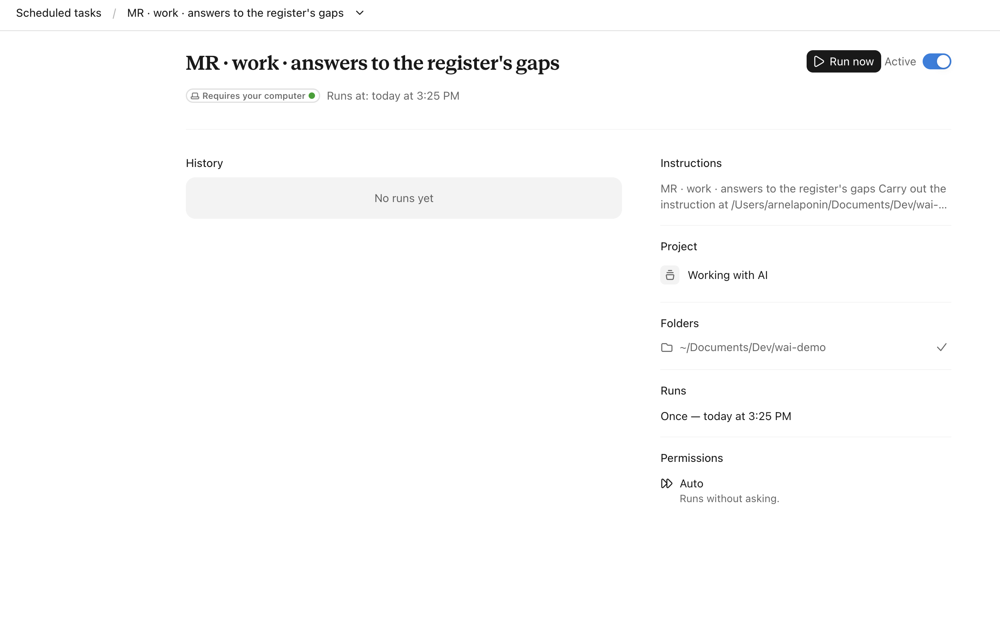
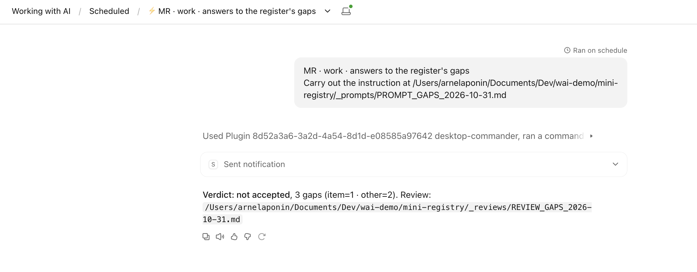
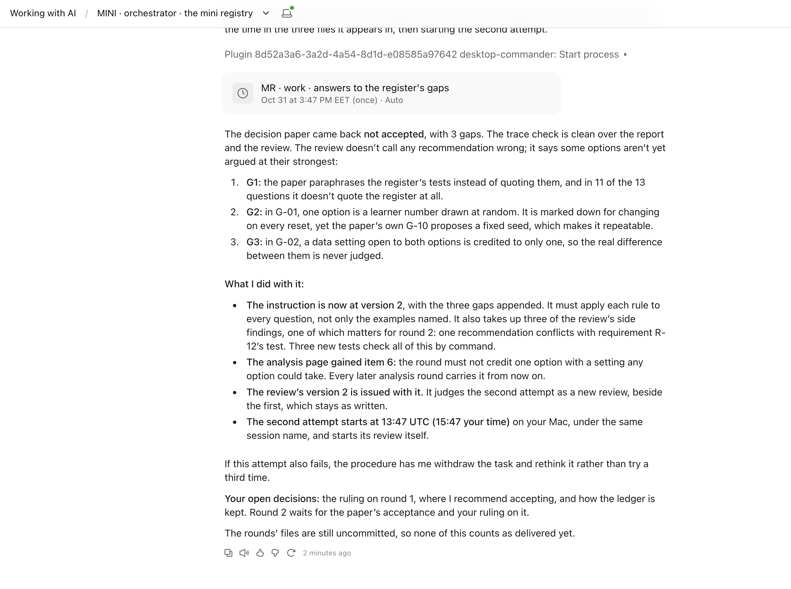

# 5.2 Decide before you build

> **Single message.** Write down what the prototype must do, the tables it reads and the goal in full, and count each requirement against the goal both ways, before any code is written.

## Try it first: The count both ways

*From the record of the registry prototype, which [5.1](5-1.md) introduces.*

Before the full-size registry prototype was built, a checking round counted every requirement in the register against the goals of the design, both ways: each requirement looked up in the goals, and each requirement the goals name looked up in the register.

The register held 36 requirements. 25 were carried by at least one goal, and 11 by none. The goals named no requirement the register did not hold. Before it counted, the round planted two mistakes in a copy of the design, one requirement removed from a goal and one that does not exist added to another, and saw its count name both.

**Your question.** 11 requirements are carried by no goal. What must be true of them before the building starts?

<details>

<summary>Answer key: open it after you have tried</summary>

Each of the 11 must be listed in the design with the reason it is left out of the goals, and each reason must hold when read against its requirement. In the record both were done, and only then could the round say 'the build can be commissioned against the whole register'.

Without that list, the build would quietly leave out 11 things the prototype was meant to do, and nobody would notice until the note. The planted mistakes matter too: a count that has never been seen to fail proves nothing by coming back clean.

</details>

## The concept

The cheapest place to find a mistake is before anything is built. So the toy, like the full-size prototype, spends its first rounds on documents, before any code. Each is written by a work session, checked by a review, and ruled on by you.

The register of requirements says what the prototype must do, one numbered line each, with a test. The groundwork holds the tables the build will read: the three lists, the settings of the made-up data, and the rule the search follows. Writing them as tables means the build reads them instead of copying them, so a change is made in one place. The goal written in full says every step of enrolling a learner, and every way it can go wrong, such as the search finding two children.

Then a checking round counts every requirement against the goal, both ways. A requirement the goal does not carry is either listed with its reason or is a gap. A requirement the goal names that the register does not hold is a gap the other way. Plant one mistake of each kind first, and see the count find them.

You rule on each document before the next one starts. A design accepted in a hurry is the most expensive mistake of a prototype, because every round after it builds on it.

Software teams that build with AI assistants call this way of working spec-driven development: the description of what to build, the spec, is written before any code, and the assistant builds from it. [Birgitta Böckeler compared three of its tools](https://martinfowler.com/articles/exploring-gen-ai/sdd-3-tools.html) and described three levels of it. Spec-first: the spec is written for one task and then set aside. Spec-anchored: it is kept, and every later change is checked against it. Spec-as-source: people change only the spec, never the code. The toy works at the second level: every round is counted against the register, and at the end its documents travel to the real build and its code does not. The tools she compared are made for developers, in a code editor or at a command line, and the person who writes the spec is also the one who judges what is built from it. This course keeps the spec and adds what the tools leave to you: a review by a session that never saw the work, and your ruling on each document.

## In the tool

With the orchestrator plugin. Ask the orchestrator for rounds 2, 3 and 4 of the brief, one at a time: the groundwork, the goal written in full, and the count. Start each round only when the last one's ruling is in the log.

The orchestrator may put a round in between, as it did after round 1 with the answers to the register's open questions. Each new round is a new scheduled task, and asks again for its folder.



A round can come back not accepted. Here the review of the answers found three gaps. The work session's last line says so, with the number of gaps of each kind.



The orchestrator does what Module 3 taught. It writes version 2 of the instruction with the gaps added, and adds a line to the page of faults so that every later round carries it. It issues a new review beside the first, and schedules the second attempt. If that fails too, it withdraws the task and writes it again. Read its account, and note what is still waiting on you: here, the ruling on round 1, which it recommends but does not give.



Version 2 came back not accepted too, with three new gaps. So the orchestrator did not send a third version. It withdrew the piece of work and changed what was asked: all thirteen recommendations had stood unchanged through both versions, and neither review had called one wrong; the faults were in how the rival answers were argued. It put the thirteen to you directly, as one decision, with the reviews' open faults named beside them. That is what Module 3 teaches for a task that fails twice: write the task again, rather than its wording a third time.

Read such a decision as carefully as a review. Its recommendations fix numbers that every later round inherits. Here they gave two answers in advance: the duplicates count of round 7 must find 4 of the 8, and a reset of the made-up data must give 64 learners, the 60 children and a second record for each of the 4 the search does not catch.

Read the groundwork as tables: the settings must be the brief's numbers exactly, 60 children, 3 schools, 8 on more than one list, 4 spelt differently. Every row names where it comes from: a line of the brief, a requirement, or your ruling. A row with no source is a guess. In this run the settings began:


| Setting | Value | Source |
| --- | --- | --- |
| Children | 60 different children | brief, line 23; requirements 9 and 14; the owner's ruling on what is counted |
| Schools | 3 | brief, line 24; R-10, R-14 |
| Children on more than one list | 8 | brief, line 25; R-11, R-14 |
| Of those, family name spelt differently on one list | 4 | brief, line 26; R-12, R-14 |
| Ages | 6 to 12 | brief, line 27; R-13, R-14 |
| List entries | 68 | the owner's ruling on what is counted |
| Of the 8, caught by the search | 4 | the owner's ruling on when two entries are one child |

The groundwork, too, came back not accepted at version 1, with one gap: the round's own check of what it had read failed when the review ran it again. Version 2 fixed that alone and was accepted. Its review also noted, outside its tests, that the log named the project's folder wrongly, and raised one question nobody had asked, whether two different children may differ only in capitals. Read what a review found and did not fix as closely as its verdict: that is where the next question comes from.

For the count, read its two totals first, then each list of what nothing carries. In this run:


| Way | Reached | Not reached | Of |
| --- | --- | --- | --- |
| Requirements to the goal | 13 | 10 | 23 |
| The goal to the requirements | 12 | 7 | 19 |

Neither list is a fault in itself. Of the ten requirements no step of the goal carries, seven are about the made-up data, one about the other bodies being simulated, one about the checks running without a window, and one is the note. The seven parts of the goal no requirement's test reaches are all seven ways the goal can go wrong: each is there by the brief's rule or a ruling, and its check in the build is the only test it will have. A mistake planted on purpose, two requirements taken out, was caught. The review counted a second way, from the goal's own references, and got other totals, 8 and 15; it went through every pair that differed and found the count right each time. Two totals that disagree are not yet a fault: ask why they differ.

## On your work: Read a design document before you rule


**💡 AI usage tip** · Read a design document before you rule

**Bring:** the register and the goal.
**Get:** the goal's steps with their failure cases, the requirements both ways, the rules with no source, and two questions for the orchestrator.
**Time:** ~15 min · **Assistant:** any; the tips are tool-neutral.
**Watch for:** A step that says what should happen, not what happens when it fails.


**The problem it solves.** A design document is long and reads as complete. The faults that cost most later are a step with no failure case, and a requirement that slipped between the register and the goal.

Copy the prompt, replace the bracketed parts with your own material, and run it in the assistant your organisation has approved. Never paste personal data or unpublished documents: see [1.4](../module-1/1-4.md).

Two routes: **practise** on the Progressa material in the second tab and check your result against the answer key, or **bring your own** material.



```text
Below are the register of requirements of my prototype [paste it] and the goal written in full [paste it]. Do not change either. As the person who will rule on the goal: (1) list each step of the goal, and for each, whether it says what happens when it fails; (2) list each requirement the goal names and each it does not, and for those it does not, whether the goal or the design says why; (3) list any rule the goal applies that the register does not hold, such as a search rule or a limit. Output: three tables, then the two questions you would put to the orchestrator before ruling.
```



*Invented for this course: every name, number and date below is fictional. Paste it where the prompt asks for your material.*

A goal 'Enrol a learner' with four steps: 1, the clerk enters the child's names, date of birth and school; 2, the registry searches; 3, if found, it shows the learner; 4, if not found, it issues a number and saves the record. The register holds 12 requirements, among them R7: 'If the search finds more than one learner, the clerk is shown all of them and nothing is saved.'




*Read this after your own run. Your result will be worded differently; check that it finds the same things.*

Step 2 has no failure case: the goal does not say what happens when the search finds more than one learner, which R7 requires. Step 1 says nothing about a missing date of birth. A good reading lists R7 as named by the register and not carried by the goal, and asks the orchestrator for version 2 of the goal with a step for two or more found.





**Safeguard.** This reading is yours, before the review comes back; it does not replace the review. If it finds a gap the review did not, say so in your ruling, and add the gap to the page of faults for drafting.


**With the plugin:** the orchestrator plugin (in preparation) issues each design round in turn and writes its log rows; the count both ways is one of its checking rounds. Until it is released, the same steps run by hand, as Modules 3 and 4 teach; [With the plugin](../starter-folder/with-the-plugin.md) says what it needs.

## Sources

- [Effective harnesses for long-running agents](https://www.anthropic.com/engineering/effective-harnesses-for-long-running-agents), Anthropic Engineering · November 2025. Used for: a list of end-to-end features written from the specification before any is built, so the work is not declared finished early (vendor source).
- [Understanding Spec-Driven-Development: Kiro, spec-kit, and Tessl](https://martinfowler.com/articles/exploring-gen-ai/sdd-3-tools.html), Birgitta Böckeler, on martinfowler.com · 15 October 2025. Used for: spec-driven development and its three levels, spec-first, spec-anchored and spec-as-source; the tools are built for developers.
