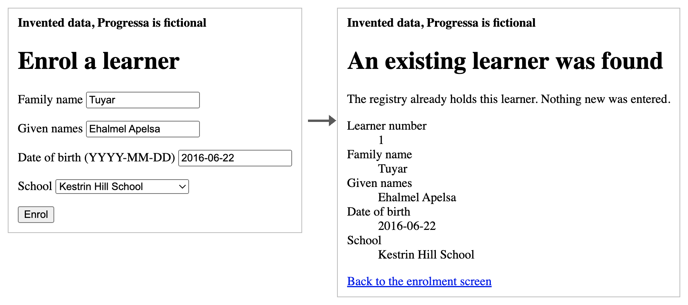
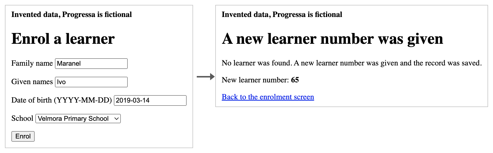
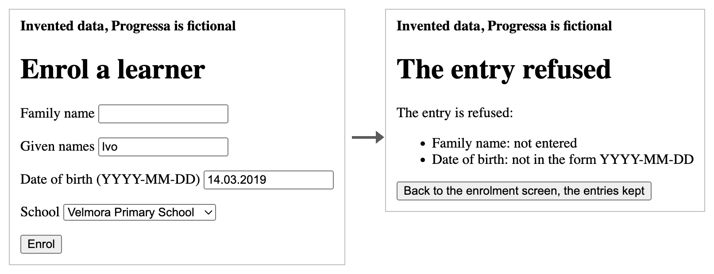

# 5.3 Build one goal per round

> **Single message.** Build in small rounds, one at a time, on made-up data in known numbers, and accept nothing that was not seen running.

## Try it first — The data in known numbers

*From the record of the registry prototype, which [5.1](5-1.md) introduces.*

Before any screen of the full-size prototype was built, one building round wrote the program that makes its made-up data. The groundwork set the numbers: 300 learners in 10 schools, 40 of them on more than one list, 20 of those with the family name spelt differently on one list, and 87 with no birth record. The program read those numbers from the groundwork, made the data the same way every time, and the round counted the result against each setting. All matched.

Two days later, a checking round asked how many of the 40 the prototype's search catches.

**Your question.** Why set the made-up data in known numbers, instead of letting the program invent whatever it likes?

<details>

<summary>Answer key: open it after you have tried</summary>

So that every later check has a known answer. When the duplicates count found 40 children on more than one list and 20 with a spelling variant, those figures could be set against the settings: a count that disagreed with them would have shown a fault in the count, the data or the search. Random data would have given a figure with nothing to check it against.

And because the data is made the same way every time, a review can make it again and count it by its own route. The note to the Permanent Secretary could say plainly that both numbers are set in the made-up data.

</details>

## The concept

Build in small rounds. First the scaffold and the made-up data, then each goal in a round of its own. A round that builds one thing can be reviewed by running that one thing; a round that builds everything can only be read. [The engineers who build agents found the same](https://www.anthropic.com/engineering/effective-harnesses-for-long-running-agents): an agent asked to build a whole application at once tries to do too much and declares it finished too early, while one asked to build one feature at a time, and leave the project in a clean state, makes steady progress.

One round at a time, never two at once. The full-size prototype lost a whole round when four goals were built in parallel in one folder, as Module 4 told.

Made-up data in known numbers. The brief fixes them: 60 children, 3 schools, 8 on more than one list, 4 spelt differently. The data is made the same way every time it is reset, and it never holds a real person.

Accept nothing that was not seen running. The page of faults for building refuses a report of a screen nobody opened, and a build that compiles but was never run. The review runs the project's checks itself, and goes through the goal as the school clerk would.

## In the tool

With the orchestrator plugin. Ask the orchestrator for round 5 of the brief, the scaffold and the made-up data. Check before it is issued that its first step is to check the tools answer, and that its tests include counting the data against the brief's numbers.

Read the report's first paragraph against the settings. In this run every count matched:


| Setting | In the brief | Counted in the made-up data |
| --- | --- | --- |
| Children | 60 | 60 |
| Schools | 3 | 3, of 20 children each |
| List entries | 68 | 68: 24, 22 and 22 on the three lists |
| Children on two lists | 8 | 8 |
| Of those, family name spelt differently | 4 | 4 |
| Ages | 6 to 12 | 6 to 12 |
| Learners after a reset | 64 | 64, numbered 1 to 64 |

All 29 of the round's checks passed, each counting the files the reset wrote. One child dropped on purpose, in a copy, failed 7 checks by name; the reset made twice gave the same data. The review counted again in a program of its own and planted two faults of its own. Note why there are 64 learners and not 60: the search fails to join the 4 children spelt differently, so each is held twice. The number shows the search's limit before anyone has opened a screen.

Then round 6, the goal built. Its review must run the checks and go through enrolling a learner as a clerk would, once for a child the registry finds and once for a new child.

Round 6 came back not accepted at version 1. The prototype did what the goal says on every screen the review tried, but one test was not what it claimed. The checks are meant to run out of sight, without opening the prototype on your screen, and the test of that never looked at what was open on the screen. Version 2 looked before, during and after the checks, and was accepted with all 57 checks passing.







Nothing opens on your screen while the checks run, and the review's screenshots are taken the same way.

## On your work — Read a building report before you rule


**💡 AI usage tip** · Read a building report before you rule

**Bring:** a building round's instruction, report and review.
**Get:** each claim matched to its evidence, the review's own runs, and a recommendation for your ruling.
**Time:** ~10 min · **Assistant:** any; the tips are tool-neutral.
**Watch for:** 'Works' with no run behind it.


**The problem it solves.** A building report can say a screen works when nobody saw it running. Reading the report against what was actually run is the owner's quickest check.

Copy the prompt, replace the bracketed parts with your own material, and run it in the assistant your organisation has approved. Never paste personal data or unpublished documents: see [1.4](../module-1/1-4.md).

Two routes: **practise** on the Progressa material in the second tab and check your result against the answer key, or **bring your own** material.



```text
Below are the instruction for a building round [paste it], its report [paste it] and its review [paste it]. Do not run anything. As the person who will rule: for each claim in the report that something works, find the command or the run that showed it, and its result; mark any claim with none. Check that the review ran the project's checks itself, and went through the goal as its user would, and quote where it says so. List any file the report says was changed that the instruction did not name. Output: a table of claims and their evidence, then the review's own runs, then the files, then one line: rule accepted, or ask for what is missing.
```



*Invented for this course: every name, number and date below is fictional. Paste it where the prompt asks for your material.*

A report: 'The enrolment screen works: a found child is shown and a new child gets a number. The checks pass.' Its evidence lists the build command's output, ending 'compiled successfully'. The review: 'Read the code; it does what the goal says. Accepted.'




*Read this after your own run. Your result will be worded differently; check that it finds the same things.*

Not accepted. 'Compiled successfully' shows the code builds, not that the screen works; no run of the checks or of the screen is shown. The review read the code and ran nothing, which the page of faults for building refuses: a review of building that ran nothing does not accept. Ask for the checks' results and the review's own run through the goal.





**Safeguard.** The chat sees only what you paste; it cannot tell whether a run really happened. Where the evidence is a file, open it yourself before you rule.


**With the kit:** the orchestrator plugin (in preparation) starts each building round, its review in a separate session, and writes the log; it cannot see whether a screen ran, so your ruling still rests on the review's own run. Until it is released, the same steps run by hand, as Modules 3 and 4 teach; [With the plugin](../starter-folder/with-the-plugin.md) says what it needs.

## Sources

- [Effective harnesses for long-running agents](https://www.anthropic.com/engineering/effective-harnesses-for-long-running-agents) — Anthropic Engineering · November 2025. Used for: one feature at a time; an agent's tendency to do too much at once and to declare the work finished too early (vendor source).
